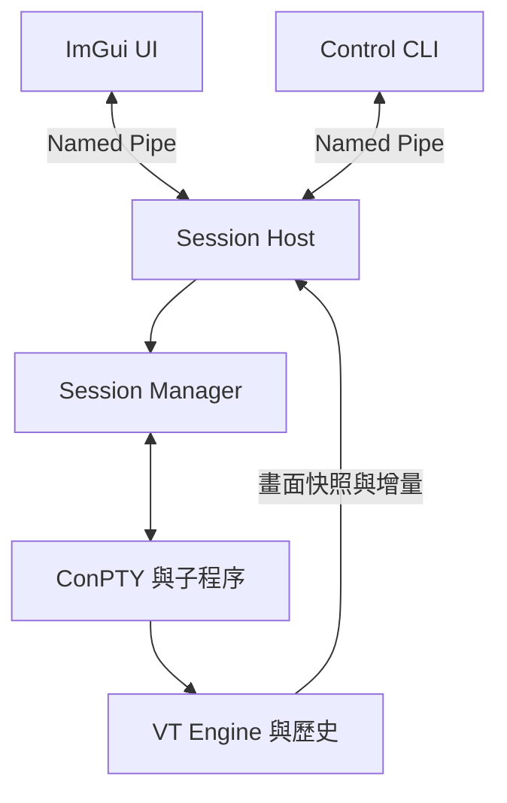

# AgentDesk：Windows AI Agent 工作台

產品需求與系統設計文件 v1.0  
日期：2026-11-16｜狀態：可供技術 POC 與估工的設計草案  
技術基線：C++20、Windows 11 x64、Dear ImGui、Win32、DirectX 11、ConPTY

> AgentDesk 是暫定專案名稱。本文件定義類似 Herdr 使用體驗的獨立實作，不宣稱與 Herdr 協定、程式碼或所有功能相容。內容為建議設計；尚未完成 Windows 實機驗證，不將候選套件或時程視為已驗證成果。

## 0. 文件導讀與決策摘要

| 章節 | 主要讀者 | 用途 |
|---|---|---|
| 1. 產品需求 | PM、RD | 釐清使用情境、範圍與交付條件 |
| 2. 系統架構 | SA、RD | 程序邊界、資料流與生命週期 |
| 3. 技術詳細設計 | RD | 終端機、IPC、狀態與錯誤處理 |
| 4. 介面與操作 | PM、UI、RD | 使用流程與互動規則 |
| 5. 開發計畫 | PM、Tech Lead | POC 關卡、WBS 與估工 |
| 6. 測試與驗收 | QA、RD | 功能、相容性與故障情境 |
| 7. 風險與決策紀錄 | 全體 | 已決策項目與待驗證事項 |

設計原則：UI 與執行核心分離；由背景程序擁有 ConPTY 與終端機狀態；重用 VT 解析核心，自製 ImGui renderer；使用本機 Named Pipe；保留 Agent 原有的權限確認行為。

第一版不建立 HTTP backend、Docker、資料庫、遠端控制或自動多 Agent 排程平台。先完成「兩個 Agent 能正常互動、UI 關閉後持續執行、重新連線還原目前畫面」。

## 1. 產品需求（PRD）

### 1.1 問題與目標

使用者同時在多個終端機執行 coding agent 時，難以掌握哪個工作需要輸入、哪個程序已結束，以及各自操作哪個專案。一般桌面 UI 若同時持有執行程序，意外關閉視窗也可能使工作中斷。

AgentDesk 提供集中工作清單、可分割終端機面板與獨立背景執行。它管理的是實際 CLI 工作階段，不代理模型 API，也不取代 Agent 的登入或訂閱。

### 1.2 使用者故事

| ID | 故事 | 成功條件 |
|---|---|---|
| US-01 | 開發者在指定專案啟動 Agent | 顯示工作目錄、命令與可互動終端機 |
| US-02 | 開發者同時執行兩個 Agent | 各自有獨立輸入、畫面、尺寸與程序狀態 |
| US-03 | 使用者暫時關閉視窗 | 背景工作持續，重新開啟後能接回原工作 |
| US-04 | 使用者需要知道哪個 Agent 等待輸入 | 有可信狀態來源時提示；無來源時顯示未知 |
| US-05 | 使用者停止卡住的工作 | 可先中斷，再明確強制終止整個受管理工作樹 |
| US-06 | 使用者查看先前內容 | 可捲動、選取、複製保留範圍內的終端機文字 |
| US-07 | Agent 或腳本管理另一項工作 | CLI 提供穩定 JSON 輸出與明確退出碼 |

### 1.3 交付範圍

| 等級 | 功能 |
|---|---|
| P0：POC | 單工作 ConPTY、VT 解析、ImGui 繪製、鍵盤輸入、縮放、中文輸入驗證 |
| P1：MVP | 多工作、背景 host、重新連線、捲動複製、工作設定、停止與清理、基本 CLI |
| P2：後續 | 每個 Agent 的可信狀態 adapter、多 Agent 任務派工、匯出、完整搜尋、多視窗 |
| P3：另案 | WSL 專用 adapter、SSH 遠端、插件執行環境、自動更新、多人協作 |

MVP 狀態整合至少實作一個可控測試 adapter，並依實際 Agent 支援情況整合一種目標 Agent。未能取得可信狀態時，允許以「Agent 狀態未知」交付，但不可宣稱具備完成偵測。

### 1.4 平台與限制

- 正式首發目標為 Windows 11 x64，一般使用者權限；確切 OS build 與 CLI 版本在 POC 報告凍結。
- Windows 10 僅列相容性評估，不在 v1.0 保證範圍。
- 使用者預先安裝及登入目標 CLI；建立 profile 時檢查 executable 與必要啟動器。
- 原生 exe 與透過 Node/npm 的 cmd 啟動器需分別驗證，不能假設所有 CLI 都能直接 CreateProcessW。
- 關閉 UI 可續跑；登出、重新開機、host 崩潰不保證續跑。休眠期間工作暫停，恢復後另做連線與程序健康檢查。
- 相同目錄中的多 Agent 可修改同一批檔案。MVP 顯示共用目錄提示；需要隔離時由使用者選擇不同 git worktree。

### 1.5 非功能目標

以下為驗收目標而非已測得數據。基準機：Windows 11 x64、8 邏輯核心以上、16 GB RAM、1080p、150% DPI；報告另附 CPU/GPU 型號。

| 項目 | 目標與量測方式 |
|---|---|
| 並行 | 4 個 shell 穩定；其中 2 個實際 Agent 同時互動 |
| 互動延遲 | 本機測試 echo，自按鍵送出至畫面更新 p95 < 100 ms，不含模型回應 |
| UI 續接 | 4 個 session、每個 120×40 字元畫面，p95 < 2 秒至可操作 |
| 記憶體 | host + UI 額外私有記憶體 < 500 MB，不含子程序；字型及歷史上限固定 |
| 輸出壓力 | 合成 1 MiB/s、持續 60 秒，host 持續消費；UI 可合併畫面更新 |
| 穩定性 | 8 小時 soak、100 次建立／停止，無持續 handle 或 thread 增長 |

## 2. 系統架構（SA）

### 2.1 元件與責任

| 元件 | 程序 | 責任 |
|---|---|---|
| Desktop UI | agent-ui.exe | ImGui 版面、終端機繪製、選取、快捷鍵、IME |
| Session Host | agent-host.exe | 單一使用者背景程序，管理所有工作與資源 |
| Control CLI | agentctl.exe | 以 IPC 呼叫 host，不直接控制 UI |
| Session Manager | host 內部 | 建立、停止、查詢、單一輸入控制權 |
| ConPTY Backend | host 內部 | 管線、HPCON、CreateProcessW、程序監控 |
| Terminal Engine | host 內部 | VT 解析、字元格、游標、模式、歷史 |
| Agent Adapter | host 內部 | 啟動 profile、可信狀態事件與來源記錄 |
| Persistence | host/UI 各自 | 工作 metadata、profile、設定、版面 |



### 2.2 程序生命週期

1. UI 或 CLI 先連接 host；不存在時以一般使用者身分啟動 host。
2. 每位登入使用者的一個登入工作階段只允許一個 host，使用含 SID 與登入工作階段識別的 mutex；競爭者退出並重新連線。
3. host 建立 ConPTY、管線與受管理的程序樹。UI 不持有 HPCON 或子程序控制 handle。
4. UI 關閉僅 detach；host 保持存活，直到使用者明確執行退出背景程序。
5. host 正常退出時先停止工作並清理；host 非正常消失時，利用 Job Object 的政策盡力清理受管理子程序。
6. 新 host 啟動時，將上次遺留的 Running metadata 標記 Lost。絕不只憑舊 PID 採納程序，避免 PID 重用。

Host 不是 Windows Service，也不以系統帳號執行。背景運作只保證同一次登入工作階段內的 UI 分離。

### 2.3 資料流

輸出：Agent → ConPTY → 持續讀取 → 串流 VT 解析 → TerminalState → 帶版本的畫面增量 → UI。

輸入：UI 按鍵／文字 → IPC → 檢查輸入控制權 → 依終端機模式編碼 → 寫入管線 → ConPTY → Agent。

VT Engine 需要回覆的終端機查詢由 host 處理，UI 不連線時仍可回覆。OSC 狀態解析與一般 VT 解析使用一致的串流框架，不能各自用不完整 buffer 搜尋字串。

## 3. 技術詳細設計（SD）

### 3.1 技術選型與建置

| 項目 | 建議 | 狀態 |
|---|---|---|
| 語言 | C++20，RAII 封裝 HANDLE、HPCON、COM 資源 | 決定 |
| 建置 | CMake + MSVC，固定工具鏈版本及 CMakePresets | 決定 |
| GUI | Dear ImGui docking 固定 commit；Win32 + DX11 backends | 決定 |
| 終端機核心 | Paul Evans 的 libvterm，以 C/C++ 邊界封裝 | 候選，需 POC |
| JSON | nlohmann/json 或同級成熟套件 | 候選，凍結前選定 |
| IPC | 本機 Named Pipe，binary length prefix + UTF-8 JSON | 決定 |
| 設定 | JSON 檔，原子替換與 schema_version | 決定 |
| 測試 | CTest + 一種 C++ test framework + Windows integration runner | 框架待選 |

所有第三方套件固定 commit/version，保留 license 與 notices。libvterm 的 Windows 編譯、VT 行為、授權及維護方式通過關卡前，不列為已完成整合。若 POC 不合格，調整引擎選型及工期，不直接擴成從零開發終端機。

### 3.2 ConPTY 建立與關閉

建立順序：驗證 profile／cwd → 建立輸入輸出管線 → CreatePseudoConsole → STARTUPINFOEXW 設定 pseudoconsole attribute → CreateProcessW(CREATE_SUSPENDED) → 指派 Job Object → ResumeThread → 啟動監控。

- 精確限制可繼承 handles，關閉未使用的 pipe ends，避免 EOF 永遠不發生。
- Job Object 預設採 JOB_OBJECT_LIMIT_KILL_ON_JOB_CLOSE，不允許刻意 breakaway。若指派失敗，清理剛建立的程序並回報，不留下半受管理工作。
- 相容性測試需涵蓋既有 Job、ConPTY 相關程序與 CLI 子程序；Job 是生命週期管理工具，不是安全沙箱。
- executable 與 argv 分開儲存，使用經測試的 Windows quoting；不將任意 prompt 拼接成 PowerShell 或 cmd 命令。
- .cmd profile 需明確 shell launcher adapter，其 quoting 與注入測試獨立處理。
- 調整尺寸先 clamp 至合理範圍，再由 session 序列化處理 ResizePseudoConsole 與 engine resize；成功後產生新 generation 的完整快照。
- 輸入與輸出使用獨立工作路徑；MVP 可用每 session 同步讀取 thread、獨立寫入 thread 及序列化處理佇列，不假設匿名同步 pipe 能直接套用 IOCP。

停止流程：先送中斷請求（例如終端機輸入 Ctrl+C；實際效果依 CLI 驗證）→ 最多等待 5 秒 → 顯示仍在執行 → 使用者可明確要求 force → TerminateJobObject → 等候退出 → 在持續 drain 輸出的條件下關閉 pseudoconsole 與管線。

關閉不得阻塞 UI thread。舊 Windows 行為可能在 ClosePseudoConsole 等候輸出消費，必須依選定 OS 的官方流程實作並測試，不能先停 reader 再無條件等待關閉。所有 handle 使用 RAII，但仍需明確設計關閉順序與可取消 I/O。

### 3.3 執行緒、壓力與同步

- UI thread 獨占 ImGui 與 DX11 呼叫；IPC receiver 只把資料送入 UI queue。
- 每個 TerminalState 僅由對應 session actor 寫入；renderer 只讀不可變快照。
- ConPTY reader 不因慢速 UI 停止讀取。host 必須完整依序解析收到的輸出；只允許合併或省略 UI 更新，不可任意丟棄 VT bytes。
- session 原始輸出處理佇列預算 8 MiB；持續超額時明確標記 overload，繼續消費路徑採磁碟暫存或背壓政策，POC 決定其中一種並量測。不得宣稱無限輸出可永遠無阻塞。
- 每個 UI client 發送佇列預算 4 MiB。超額時丟棄未發出的畫面增量、設 needs_snapshot；恢復時傳最新完整快照。持續無法恢復的 client 斷線，不阻塞其他 client。
- CLI 一般控制 RPC 預設 5 秒逾時。逾時不代表操作未執行，需依 request_id 查詢結果，避免重複建立。

### 3.4 終端機資料模型

| 結構 | 主要欄位 |
|---|---|
| Session | id(UUID)、name、cwd、profile_id、process_state、agent_state、created_at、exit_code |
| Cell | grapheme、width(0/1/2)、fg、bg、bold、italic、underline、inverse |
| Screen | cols、rows、cells、cursor、modes、generation、seq |
| HistoryLine | line_id、cells、soft_wrap、timestamp（可選） |
| StateEvent | session_id、source、source_seq、state、observed_at、detail |

字元不是一個 wchar_t 就能完整表示。需處理 UTF-8 跨讀取分段、combining marks、雙欄中文字與寬字元續格。渲染字寬政策與 engine 保持一致；彩色 emoji、複雜 ZWJ shaping 可列限制，但不得破壞後續欄位與游標位置。

必備功能：SGR 顏色與樣式、游標定位、erase、捲動區域、alternate screen、游標可見性、application cursor keys、bracketed paste、必要 DSR/DA 查詢回覆。宣告的終端機能力只涵蓋已驗證項目。

歷史預設每工作 10,000 行並限制 16 MiB，先達上限者截斷最舊資料，UI 顯示保留範圍。alternate screen 與主畫面分開。MVP resize 保留引擎行為，暫不承諾完美歷史 reflow。

### 3.5 ImGui 終端機 renderer 與輸入

使用 ImDrawList 畫背景區段、字形、選取範圍及游標，只繪可見行；不以 InputTextMultiline 充當終端機。TerminalView 負責座標與字元格映射，輸入編碼由 host 的終端機模式決定。

- 使用等寬字型，補入中文字型 glyph。POC 檢查記憶體、DPI、字型授權與缺字。
- 面板寬高換算 cols/rows，拖曳縮放以約 50 ms debounce 合併；字型與 DPI 改變也觸發 resize。
- 正式文字輸入接收 Unicode text events；方向鍵與控制鍵另行編碼，避免 IME 組字與 keydown 重複送字。
- 只有 focused terminal 接收輸入；ImGui 全域快捷鍵不得吞掉終端機必要按鍵。
- Ctrl+C 在有選取時複製、無選取時送中斷；Ctrl+Shift+C 固定複製、Ctrl+Shift+V 貼上。選單提供明確「送出 Ctrl+C」。
- 貼上檢查 NUL、限制單次 1 MiB；依終端機模式加 bracketed paste。多行文字預設先預覽，使用者確認後才送出。
- MVP 選取採可見畫面與有限歷史的 line_id；若歷史淘汰，取消受影響的選取，避免錯誤複製。
- 先支援 docking，multi-viewports 延後，降低 IME、DPI、焦點與多 HWND 的複雜度。

### 3.6 狀態模型

程序狀態與 Agent 狀態分開保存。

| process_state | 意義 |
|---|---|
| Starting | 正在建立資源 |
| Running | 受管理的根程序尚未退出 |
| Stopping | 已提出停止 |
| Exited | 已取得退出資訊，並記錄剩餘子程序處理結果 |
| Failed | 建立或 host 管理步驟失敗 |
| Lost | host 已失去原工作，無法續接 |

agent_state 為 Unknown、Idle、Working、Blocked、Done、Error。每次變更都記錄 source；程序 Running 不代表 Agent Working，Agent Done 不代表程序退出或子任務全完成，輸出沉默也不代表 Done。

優先使用已驗證的 Agent hook／結構化事件；OSC 7501 僅在確認實際 CLI、ConPTY 路徑可傳遞及握手格式後啟用。不能假設任意 OSC 都會穿透 ConPTY。若協定被消費或 CLI 不支援，以專用本機 adapter 回報或維持 Unknown。

內部統一介面為 ReportState(session_id, source, source_seq, state)。OSC 的正式 wire grammar、能力探測與對應 CLI 版本需另附 POC fixture；本文件不自行發明 OSC 7501 格式。自製 CLI state-report 僅是本產品協定。

狀態事件帶 monotonic source_seq，同一來源舊事件不覆蓋新事件。程序結束後畫面優先顯示 Exited／exit_code，保留最後 Agent 狀態供診斷。介面同時顯示狀態來源與最後更新時間。

### 3.7 IPC 協定 v1

Named Pipe 名稱包含目前 SID 與登入工作階段識別。啟用拒絕遠端連線及限制目前使用者的 DACL；服務端驗證連線者登入身分。這是本機同使用者控制通道，不是抵抗同帳號惡意程序的隔離邊界。

frame = 4-byte little-endian payload_length + UTF-8 JSON。每 frame 上限 4 MiB，拒絕 0 長度、超長、無效 UTF-8／JSON、未知版本。所有連線先 hello 協商 version=1；不相容立即回報。

```json
{"v":1,"id":"r-001","method":"session.create","params":{"name":"review","profile_id":"codex-native","cwd":"C:\\work\\demo","args":[]}}
```

```json
{"v":1,"id":"r-001","result":{"session_id":"returned-uuid","process_state":"Starting"}}
```

```json
{"v":1,"event":"screen.delta","session_id":"returned-uuid","generation":1,"base_seq":41,"seq":42,"changes":[{"row":0,"col":0,"cells":[{"text":"A","width":1,"fg":"#ffffff","bg":"#000000"}]}]}
```

| 方法 | 內容與規則 |
|---|---|
| hello | 版本、host_instance_id、client 能力 |
| session.create | name、profile、cwd、args；request_id 在目前 host 內保留結果 10 分鐘以去重 |
| session.list / get | metadata、狀態、尺寸、輸入控制者 |
| session.attach | 訂閱畫面與狀態，取得快照及輸入控制權選項 |
| session.detach | 取消訂閱及釋放控制權，不停止程序 |
| session.input | 控制權 token、文字或按鍵類型；不允許未授權 client 輸入 |
| session.resize | 只有控制者可決定 canonical cols/rows |
| session.stop | mode=interrupt 或 force；需要有效 session_id |
| screen.snapshot | generation、seq、尺寸、cells、cursor、modes |
| history.read | line_id 游標、最多 200 行，回報已淘汰範圍 |
| state.report | 已配置 adapter 的事件，驗證來源與 session 綁定 |
| host.shutdown | 若存在工作且未明確 stop_sessions，回傳 ACTIVE_SESSIONS |

錯誤結構為 error.code、error.message、error.retryable；代碼包含 BAD_REQUEST、NOT_FOUND、PROFILE_INVALID、SPAWN_FAILED、NOT_CONTROLLER、VERSION_MISMATCH、OVERLOADED、ACTIVE_SESSIONS。

首次 attach：host 在 session actor 內建立 seq=S 的快照並註冊後續事件，再發快照，之後才發 seq>S 的增量；避免快照與訂閱之間漏事件。收到不同 generation 或 base_seq 不連續時，UI 捨棄增量並要求新快照。大型快照按 row range 分段，含 snapshot_id、chunk_index、chunk_count；完整收到才切換，單段仍受 frame 上限限制。

MVP 一個 session 同時只允許一個輸入控制者，其餘唯讀。控制權轉移需明確操作；持有者斷線即釋放。無 UI 時沿用最後尺寸。縮小的唯讀面板採裁切／捲動，不可競爭改變 ConPTY 尺寸。

### 3.8 CLI 與自動化邊界

以下為本產品預定指令，並非 Herdr 現有指令：

```powershell
agentctl run --profile codex-native --name review --cwd C:\work\demo
agentctl list --json
agentctl read review --lines 100 --json
agentctl send review --file C:\work\prompt.txt
agentctl stop review --interrupt
agentctl stop review --force
```

CLI 支援 name 查找但拒絕歧義，穩定自動化應使用 session UUID。send 預設只輸入文字，不自動 Enter；需要 --enter 明示。它可能在 Agent 正等待確認時觸發操作，因此自動任務系統應使用結構化 adapter，不把任意畫面文字當可靠 API。

退出碼：0 成功、2 參數錯誤、3 host 無法連線、4 session 不存在或歧義、5 操作遭拒、6 啟動失敗、7 逾時。--json 時 stdout 只含結果，診斷寫 stderr。

真正的多 Agent 任務協作延後至 P2：Task 記錄 task_id、owner_session_id、parent_task_id、status、result_ref。MVP 的 send/read 僅提供通道，不宣稱具備可靠任務完成或自動派工能力。

### 3.9 設定與資料保存

建議資料根目錄為 %LOCALAPPDATA%\AgentDesk。host 持有 profiles.json、sessions.json；UI 持有 ui.json 與 imgui.ini。各檔 schema_version=1，以寫暫存檔再替換的方式保存，保留一份上一版備份。

sessions.json 保存識別、名稱、cwd、profile、時間及退出結果，不保存可重用的原工作程序 handle。預設歷史及原始 VT 留在記憶體，host 重啟後不恢復執行中畫面。磁碟 transcript 為後續選配，啟用前需告知可能含憑證與原始碼。

Agent 登入由原 CLI 處理；不複製 token、不繞過確認、不在診斷 log 記錄輸入文字或完整環境變數。診斷僅記錄 request/session ID、事件類型、錯誤碼、耗時與資源數。

禁止輸出內容自動執行命令或寫剪貼簿。OSC 52 預設不執行，超連結需要點擊且只允許明確允許的 scheme，未知控制序列受長度上限約束並安全忽略。

### 3.10 建議原始碼結構

| 路徑 | 內容 |
|---|---|
| apps/desktop | Win32、DX11、ImGui 入口 |
| apps/host | 背景程序入口與單例 |
| apps/cli | 指令解析與 JSON 輸出 |
| libs/protocol | frame、DTO、錯誤碼、版本 |
| libs/host | session actor、管理與持久化 |
| libs/platform/windows | ConPTY、Job、Pipe、RAII |
| libs/terminal | 引擎封裝、快照、歷史、輸入編碼 |
| libs/ui | TerminalView、面板、字型與輸入 |
| libs/adapters | profile、狀態整合 |
| tests/unit、integration、fixtures | 協定、VT、Windows 實機測試 |
| docs、third_party | 文件、依賴與 notices |

## 4. 介面與操作設計

### 4.1 主畫面

| 區域 | 內容 |
|---|---|
| 頂部工具列 | 新增工作、啟動 profile、連線狀態、設定 |
| 左側工作清單 | 名稱、專案目錄、程序狀態、Agent 狀態、未讀提示 |
| 中央 DockSpace | 可分頁／左右或上下分割的終端機 |
| 右側詳情（可收合） | profile、cwd、退出碼、狀態來源與更新時間 |
| 底部狀態列 | host 連線、輸入控制權、字元尺寸、截斷或過載提示 |

狀態用文字與圖示搭配顏色，不能只靠顏色。Unknown 使用中性標示，Blocked 才提示需要處理。根程序已退出但子程序仍存在時，明確顯示「正在清理子程序」。

### 4.2 新增工作

選擇 profile → 指定 cwd 與名稱 → 顯示 executable／啟動器 → 啟動 → 顯示 Starting → Running 或可操作錯誤。預設複用上次 cwd，禁止默默回退到其他目錄。profile 無效時留在表單，保留輸入並顯示修正方式。

### 4.3 關閉與重新連線

- 視窗 X：關閉 UI 並 detach。首次顯示可關閉的說明，之後不反覆詢問。
- 面板 X：關閉視圖，不停止 session；可從工作清單重新開啟。
- 「停止工作」：interrupt，未結束則提供 force。
- 「退出並停止所有工作」：列出活躍工作，使用者明確選擇後執行 shutdown。
- host 斷線：面板覆蓋 Disconnected，禁止輸入，不顯示為 Done。可嘗試重連；若 host_instance_id 改變，原工作標記 Lost，不自動重跑 prompt。

## 5. 開發計畫與 WBS

### 5.1 里程碑

| 階段 | 工作 | 交付／退出條件 | 粗估人日 |
|---|---|---|---|
| M0 技術 POC | ImGui shell、ConPTY、候選引擎、輸入與中文、單 Agent | 真正 Agent 可輸入、縮放、顯示；輸出及停止不死鎖 | 8–12 |
| M1 Host 基礎 | RAII、Job、session actor、pipe 協定、基本 CLI | 2 工作互不干擾；UI 不在也可讀寫與停止 | 8–12 |
| M2 桌面整合 | docking、renderer、歷史、選取、IME、控制權 | 兩個 Agent 可操作，150% DPI 可用 | 10–15 |
| M3 可靠性 | attach 快照、慢 client、設定、重連、故障處理 | 關閉 UI 後續跑與精確續接；故障有明確狀態 | 8–12 |
| M4 驗收發佈 | adapter、測試、效能、portable zip 與文件 | 完成第 6 章矩陣，限制清單與 notices 齊備 | 8–12 |

合計約 42–63 人日，約 9–13 週全職單人開發，另預留 20–30% 相容性緩衝。此估算假設具備 Windows C++ 經驗、重用成熟 VT 核心且只交付 MVP，不包含遠端、完整插件與自動協作平台；M0 後應重新估算。

### 5.2 技術 POC 的必要決策

1. 固定兩種目標 CLI 的精確版本、原生／cmd 啟動方式與登入方式。
2. 確認 libvterm 在 MSVC 可建置，通過關鍵 VT fixture。
3. 確認繁中 IME 可完成組字、候選視窗定位、Enter 不重複送出。
4. 驗證 ConPTY 對狀態 OSC 的處理；若不通，選 hook adapter 或 Unknown。
5. 量測無 UI 的輸出消費、停止與重新 attach。
6. 凍結 queue 過載政策、終端機字寬與 emoji 限制。

任一關鍵項失敗，先提交替代方案與修正估工，再擴大 UI 功能。不可先做完整漂亮介面而延後終端機驗證。

### 5.3 Definition of Done

功能對應需求 ID、有 Windows 實機證據、錯誤可見、資源可回收；第三方版本與 license 已記錄；沒有將未知 Agent 狀態誤標完成；已更新安裝說明、限制及相容性矩陣。

## 6. 測試計畫與驗收（QA）

### 6.1 測試分層

| 層級 | 必測項 |
|---|---|
| Unit | frame 分段／黏包、JSON 邊界、UTF-8 分段、序號、狀態合併、quoting |
| Terminal fixtures | 游標、erase、色彩、alternate screen、中文、查詢回覆、未知 OSC |
| Windows integration | CreateProcess、ConPTY、resize、Job 清理、pipe ACL、host 重連 |
| 真實 CLI | 目標 Agent 啟動、授權提示、持續輸出、輸入、多行貼上、正常退出 |
| 手動 UI | 繁中 IME、DPI、選取、焦點、快捷鍵、docking |
| Stress／故障 | 高輸出、慢 client、程序崩潰、host crash、損壞設定、磁碟不足 |

### 6.2 功能驗收矩陣

| ID | 對應 | 操作與預期 |
|---|---|---|
| QA-01 | US-01 | 有空白與中文字的 cwd 啟動，Agent 實際目錄正確 |
| QA-02 | US-01 | executable 不存在、cwd 不存在、無權限，回報原因且無殘留程序 |
| QA-03 | US-02 | 兩工作持續輸出，在其中輸入不影響另一個 |
| QA-04 | US-02 | 快速 resize 100 次，最終 host、engine、UI 尺寸一致 |
| QA-05 | US-03 | 工作每秒輸出 counter，關 UI 30 秒再開，PID 與 session 不變、counter 連續 |
| QA-06 | US-03 | attach 與輸出同時發生，無缺漏畫面；增量缺號可重新同步 |
| QA-07 | US-04 | 靜默 60 秒仍為 Unknown／原可信狀態，不自行變 Done |
| QA-08 | US-04 | Blocked、Done、亂序事件依 source_seq 正確處理 |
| QA-09 | US-05 | 忽略 Ctrl+C 的子程序，force 後受管理 Job 無殘留 |
| QA-10 | US-05 | host crash 後 UI 顯示斷線，新 host 不採納舊 PID、不重送 prompt |
| QA-11 | US-06 | 中文、combining、雙欄字元選取複製，不含控制碼且欄位正確 |
| QA-12 | US-06 | 歷史達上限顯示截斷，記憶體維持在預算內 |
| QA-13 | US-07 | CLI --json 無混入 log；send 預設不送 Enter |
| QA-14 | US-02 | 第二 UI 唯讀，不能搶尺寸或輸入；明確移交後才可操作 |
| QA-15 | 平台 | 100%、150%、200% DPI，繁中 IME 不重複送字、候選視窗位置可用 |
| QA-16 | 安全 | 輸出 OSC 52 不修改剪貼簿；輸出文字不觸發命令 |
| QA-17 | IPC | 不同使用者及遠端連線遭拒；超長 frame 安全斷線 |
| QA-18 | 穩定性 | 高輸出與 UI 凍結不阻止 host 消費；恢復取得新快照 |

### 6.3 相容性矩陣與交付證據

每次 release 記錄 OS build、GPU/driver、DPI、IME、字型、host commit、Agent CLI 版本、啟動器、profile 及全部測試結果。先測 PowerShell 與合成互動程式，再測實際 Agent；不以 shell 通過取代 Agent 驗收。

POC 基準矩陣：PowerShell 7、Windows PowerShell 5.1、目標 Codex CLI、目標 Claude Code。後兩者的原生 Windows 支援與安裝條件在 M0 查官方文件並固定版本；若某版本只能經 WSL 運作，列出阻擋並調整首發目標，不暗中納入 WSL 支援承諾。

測試報告附啟動／停止時間、p95 延遲、峰值私有記憶體、handle／thread 趨勢，以及未通過項目的限制或阻擋結論。至少保留一份高輸出、中文輸入、UI detach/attach 的重現步驟。

## 7. 風險、決策與術語

### 7.1 決策紀錄

| ID | 決策 | 理由與代價 |
|---|---|---|
| ADR-01 | host 與 UI 分離 | UI 可關閉；代價是 IPC 與同步設計 |
| ADR-02 | host 擁有終端機引擎 | 無 UI 仍處理查詢與畫面；需傳畫面資料 |
| ADR-03 | ImGui + Win32 + DX11 | C++ 原生工作台；終端機 renderer 需自行整合 |
| ADR-04 | 本機 Named Pipe | 不需網路服務；僅支援單機 |
| ADR-05 | VT 核心重用 | 降低解析器工作量；仍需 Windows 與字寬驗證 |
| ADR-06 | 程序與 Agent 狀態分離 | 避免把存活、沉默或退出等同任務成功 |
| ADR-07 | 首版不做跨重開機續跑 | 無法恢復原程序；metadata 僅供歷史顯示 |

### 7.2 主要風險

| 風險 | 處理方式 |
|---|---|
| CLI 控制序列超出引擎能力 | 用真實 CLI fixtures 提早驗證，固定支援版本 |
| OSC 被 ConPTY 消費 | POC 驗證，使用可信 hook 或顯示 Unknown |
| ImGui 字型、IME、字寬落差 | 最早階段加入繁中與 DPI 測試，列明 emoji 限制 |
| 管線與 ClosePseudoConsole 死鎖 | 分離讀寫、持續 drain、關閉順序測試 |
| 高輸出與無限歷史 | 有界歷史、畫面合併、可見過載狀態 |
| 多 Agent 同時改檔 | 顯示相同 cwd，建議獨立 worktree；不宣稱檔案隔離 |
| 把 send 當可靠任務 API | 明確區分鍵盤輸入與結構化任務協定 |

### 7.3 術語

| 名詞 | 說明 |
|---|---|
| ConPTY | Windows 偽終端機，提供受控終端機輸入輸出 |
| VT／ANSI | 描述游標、顏色、清除與終端機模式的控制序列 |
| Terminal Engine | 解析串流並維護終端機畫面狀態的核心 |
| Renderer | 將畫面字元格繪製為 GUI 的元件 |
| Session | 本產品管理的一個 CLI 執行工作階段 |
| Job Object | Windows 程序群組與生命週期管理機制 |
| OSC | 一類終端機控制序列；特定編號另有協定意義 |
| Snapshot／Delta | 完整畫面狀態／相對某個序號的變更 |
| IME | 中文等文字輸入的組字與候選字系統 |
| Adapter | 將特定 Agent 的啟動與狀態轉為本產品模型的整合層 |

## 8. 官方參考資料

查閱日期：2026-11-16。以下支持底層機制與選型背景；本文件的協定、預算、範圍、時程及驗收值為自行提出的設計。

1. Microsoft：Creating a Pseudoconsole Session（建立、管線與執行緒注意事項）  
   https://learn.microsoft.com/en-us/windows/console/creating-a-pseudoconsole-session
2. Microsoft：CreatePseudoConsole  
   https://learn.microsoft.com/en-us/windows/console/createpseudoconsole
3. Microsoft Console Docs：ClosePseudoConsole（輸出 drain 與關閉注意事項）  
   https://github.com/MicrosoftDocs/Console-Docs/blob/main/docs/closepseudoconsole.md
4. Dear ImGui 官方專案（backends、架構與範例）  
   https://github.com/ocornut/imgui
5. Dear ImGui：Getting Started（Win32／DX11）  
   https://github.com/ocornut/imgui/wiki/Getting-Started
6. Dear ImGui：Docking 與 Multi Viewports  
   https://github.com/ocornut/imgui/wiki/Docking  
   https://github.com/ocornut/imgui/wiki/Multi-Viewports
7. Paul Evans：libvterm（VT220／xterm／ECMA-48 終端機核心）  
   https://www.leonerd.org.uk/code/libvterm/

下一步交付：執行 M0 技術 POC，提交 CLI／引擎版本、繁中輸入結果、ConPTY 狀態通道結果、停止／續接測試，以及更新後估工。本文件不包含已完成實作或實機通過的宣稱。
