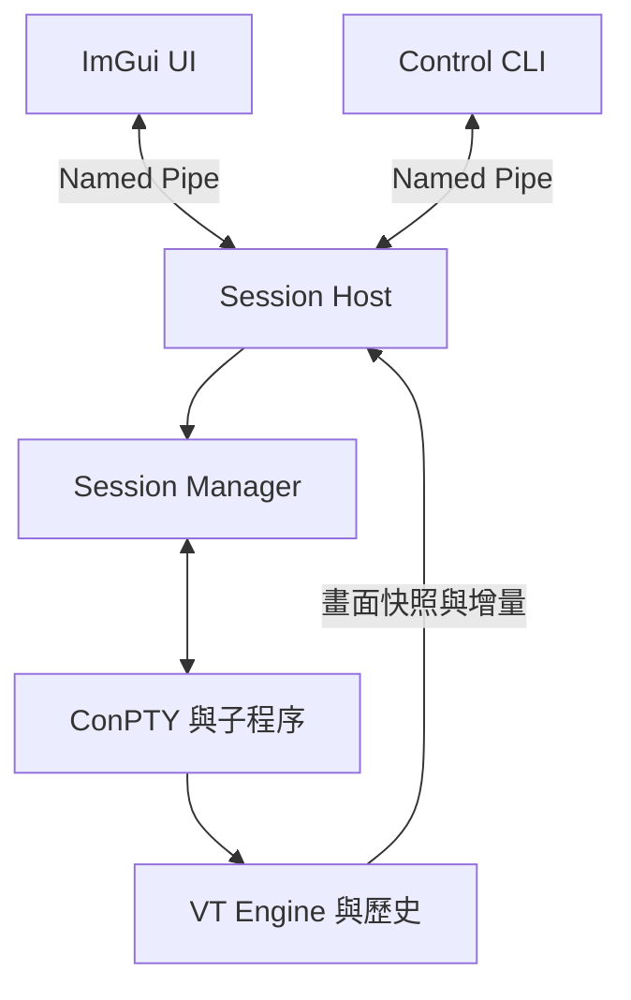

# AgentDesk：Windows AI Agent 工作台

產品需求與系統設計文件 v1.7  
日期：2026-11-16｜狀態：可供技術 POC 與估工的設計草案  
技術基線：C++20、Windows 11 x64、Dear ImGui、Win32、DirectX 11、ConPTY

> 產品名稱定為 AgentDesk，本身以 MIT License 釋出。本文件定義類似 Herdr 使用體驗的獨立實作，不宣稱與 Herdr 協定、程式碼或所有功能相容。內容為建議設計；尚未完成 Windows 實機驗證，不將候選套件或時程視為已驗證成果。

### 版本紀錄

| 版本 | 日期 | 變更 |
|---|---|---|
| 1.0 | 2026-11-16 | 初版（原檔保存在 `docs/archive/AgentDesk_Design_v1.0.md`） |
| 1.1 | 2026-11-16 | 依 herdr／herdr-core 公開原始碼補入：隨附 ConPTY 的必要性、VT 引擎第二候選 libghostty-vt、OSC 7501 觀察到的格式、環境變數＋CLI 狀態回報 adapter、host 脫離啟動者 Job 的規則、待決事項清單。研究筆記見 `docs/research/herdr-reference.md` |
| 1.1.1 | 2026-11-16 | 文字校正：中國用語改為台灣用語、補齊缺動詞的句子、刪除空洞強調，不改任何規格 |
| 1.2 | 2026-11-16 | 使用者決定 OQ-01（名稱 AgentDesk）與 OQ-08（MIT License），新增 ADR-10 |
| 1.3 | 2026-11-16 | 使用者限制：只用已安裝的 Visual Studio C++ 工具鏈，不另外安裝工具。新增 3.1 開發環境基線與 ADR-11；libghostty-vt 降為備案，OQ-07 傾向 vcpkg |
| 1.4 | 2026-11-16 | 更正：OSC 7501 有公開規格（Revision 0.4），Claude Code v2.1.295 起原生支援。3.6 改以 OSC 7501 為主要狀態來源、report-state 為第二來源；補功能偵測與回覆順序、生命週期、上限；新增 QA-21、QA-22 |
| 1.5 | 2026-11-16 | 建立 5 個對應 skill 後補入查證結果：vcpkg 沒有 libvterm port，改以 third_party 原始碼建置；Dear ImGui 1.93.0（docking）與 GoogleTest 1.18.0 在 vcpkg 可取得；OQ-05 傾向 GoogleTest |
| 1.6 | 2026-11-16 | 使用者決定 OQ-02：首發支援 Claude Code 與 Codex CLI。新增 1.2.1 Given／When／Then 驗收條件（PRD 品質門檻）；ADR-09 理由依 OSC 7501 更新 |
| 1.7 | 2026-11-16 | 一致性審查修正：狀態欄位統一為 `seq`，OSC 7501 的 seq 由 host 指派；report-state 新增 `--kind`、`--message`；明定紀錄被丟棄或清除後的 agent_state 與 `last_agent_state`；QA-13 加退出碼；5.2 第 8 項去除過時的 vcpkg port 選項；P2 範圍與 MVP 一致；ADR-10 的 Ghostty 改為僅供參考 |

## 0. 文件導讀與決策摘要

| 章節 | 主要讀者 | 用途 |
|---|---|---|
| 1. 產品需求 | PM、RD | 釐清使用情境、範圍與交付條件 |
| 2. 系統架構 | SA、RD | 程序邊界、資料流與生命週期 |
| 3. 技術詳細設計 | RD | 終端機、IPC、狀態與錯誤處理 |
| 4. 介面與操作 | PM、UI、RD | 使用流程與互動規則 |
| 5. 開發計畫 | PM、Tech Lead | POC 關卡、WBS 與估工 |
| 6. 測試與驗收 | QA、RD | 功能、相容性與故障情境 |
| 7. 風險與決策紀錄 | 全體 | 已決策項目與待驗證事項 |

設計原則：UI 與執行核心分離；由背景程序擁有 ConPTY 與終端機狀態；重用 VT 解析核心，自製 ImGui renderer；使用本機 Named Pipe；保留 Agent 原有的權限確認行為。

第一版不建立 HTTP backend、Docker、資料庫、遠端控制或自動多 Agent 排程平台。先完成「兩個 Agent 能正常互動、UI 關閉後持續執行、重新連線還原目前畫面」。

## 1. 產品需求（PRD）

### 1.1 問題與目標

使用者同時在多個終端機執行 coding agent 時，難以掌握哪個工作需要輸入、哪個程序已結束，以及各自操作哪個專案。一般桌面 UI 若同時持有執行程序，一不小心關掉視窗，工作也會跟著中斷。

AgentDesk 提供集中工作清單、可分割終端機面板與獨立背景執行。它管理的是實際 CLI 工作階段，不代理模型 API，也不取代 Agent 的登入或訂閱。

### 1.2 使用者故事

| ID | 故事 | 成功條件 |
|---|---|---|
| US-01 | 開發者在指定專案啟動 Agent | 顯示工作目錄、命令與可互動終端機 |
| US-02 | 開發者同時執行兩個 Agent | 各自有獨立輸入、畫面、尺寸與程序狀態 |
| US-03 | 使用者暫時關閉視窗 | 背景工作持續，重新開啟後能接回原工作 |
| US-04 | 使用者需要知道哪個 Agent 等待輸入 | 有可信狀態來源時提示；無來源時顯示未知 |
| US-05 | 使用者停止卡住的工作 | 可先中斷，再明確強制終止整個受管理工作樹 |
| US-06 | 使用者查看先前內容 | 可捲動、選取、複製保留範圍內的終端機文字 |
| US-07 | Agent 或腳本管理另一項工作 | CLI 提供穩定 JSON 輸出與明確退出碼 |

### 1.2.1 驗收條件（Given／When／Then）

每個使用者故事至少一組，對應的完整測試見 6.2。

| ID | Given | When | Then | 測試 |
|---|---|---|---|---|
| US-01a | 已設定有效 profile，cwd 含空白與中文字 | 使用者從「新增工作」啟動 | 面板顯示 Starting 再到 Running，Agent 實際工作目錄等於指定 cwd，可輸入 | QA-01 |
| US-01b | profile 的 executable 或 cwd 不存在 | 使用者啟動 | 停在表單、保留輸入並顯示原因；沒有殘留程序 | QA-02 |
| US-02a | 兩個工作都在持續輸出 | 使用者在其中一個面板輸入 | 只有該工作收到輸入，另一個畫面與尺寸不變 | QA-03 |
| US-02b | 第二個 UI attach 到同一工作 | 第二個 UI 嘗試輸入或改尺寸 | 被拒（唯讀），明確移交控制權後才可操作 | QA-14 |
| US-03a | 工作每秒輸出一行計數 | 使用者關閉視窗 30 秒後重開 | PID 與 session 不變，計數連續，2 秒內可操作 | QA-05 |
| US-03b | 從終端機啟動 UI | 使用者關閉那個終端機 | host 與工作仍存活；無法脫離 Job 時 UI 事先提示 | QA-20 |
| US-04a | Claude Code（v2.1.295 以上）在工作中執行 | 它進入等待權限確認 | 清單顯示 Blocked、來源 osc7501 與更新時間 | QA-21 |
| US-04b | 工作沒有任何可信狀態來源 | 輸出靜默 60 秒 | 仍顯示 Unknown，不會變成 Done | QA-07 |
| US-05a | 子程序忽略 Ctrl+C | 使用者停止工作，5 秒後選擇強制終止 | 整個受管理程序樹結束，Job 內無殘留 | QA-09 |
| US-06a | 畫面含中文、組合字元與雙欄字元 | 使用者選取並複製 | 剪貼簿內容欄位正確、不含控制碼 | QA-11 |
| US-06b | 歷史已達上限 | 使用者往上捲 | 顯示已截斷的範圍，記憶體維持在預算內 | QA-12 |
| US-07a | 腳本以 `--json` 呼叫 `agentctl list` | 指令完成 | stdout 只有 JSON，診斷在 stderr，退出碼符合 3.8 | QA-13 |
| US-07b | 腳本呼叫 `agentctl send` 未加 `--enter` | 指令完成 | 只送出文字，不送 Enter | QA-13 |

### 1.3 交付範圍

| 等級 | 功能 |
|---|---|
| P0：POC | 單工作 ConPTY、VT 解析、ImGui 繪製、鍵盤輸入、縮放、中文輸入驗證 |
| P1：MVP | 多工作、背景 host、重新連線、捲動複製、工作設定、停止與清理、基本 CLI |
| P2：後續 | 首發兩個 CLI 以外其他 Agent 的可信狀態 adapter、多 Agent 任務派工、匯出、完整搜尋、多視窗、host 升級不中斷工作（程序持有者與 host 分離，參考 herdr-core 的 holder）、Agent 原生 session 續接命令（resume argv） |
| P3：另案 | WSL 專用 adapter、SSH 遠端、插件執行環境、自動更新、多人協作 |

MVP 狀態整合至少實作一個可控測試 adapter，並整合兩個目標 Agent：Claude Code（OSC 7501）與 Codex CLI（hook＋report-state）。未能取得可信狀態時，允許以「Agent 狀態未知」交付，但不可宣稱能偵測 Agent 已完成工作。

### 1.4 平台與限制

- 正式首發目標為 Windows 11 x64，一般使用者權限；確切 OS build 與 CLI 版本在 POC 報告凍結。
- Windows 10 僅列相容性評估，不在 v1.0 保證範圍。
- 使用者預先安裝及登入目標 CLI；建立 profile 時檢查 executable 與必要啟動器。
- 原生 exe 與透過 Node/npm 的 cmd 啟動器需分別驗證，不能假設所有 CLI 都能直接 CreateProcessW。
- 關閉 UI 可續跑；登出、重新開機、host 崩潰不保證續跑。休眠期間工作暫停，恢復後另做連線與程序健康檢查。
- 相同目錄中的多 Agent 可修改同一批檔案。MVP 顯示共用目錄提示；需要隔離時由使用者選擇不同 git worktree。

### 1.5 非功能目標

以下為驗收目標而非已測得數據。基準機：Windows 11 x64、8 邏輯核心以上、16 GB RAM、1080p、150% DPI；報告另附 CPU/GPU 型號。

| 項目 | 目標與量測方式 |
|---|---|
| 並行 | 4 個 shell 穩定；其中 2 個實際 Agent 同時互動 |
| 互動延遲 | 本機測試 echo，自按鍵送出至畫面更新 p95 < 100 ms，不含模型回應 |
| UI 續接 | 4 個 session、每個 120×40 字元畫面，p95 < 2 秒至可操作 |
| 記憶體 | host + UI 額外私有記憶體 < 500 MB，不含子程序；字型及歷史上限固定 |
| 輸出壓力 | 合成 1 MiB/s、持續 60 秒，host 持續消費；UI 可合併畫面更新 |
| 穩定性 | 8 小時 soak、100 次建立／停止，無持續 handle 或 thread 增長 |

## 2. 系統架構（SA）

### 2.1 元件與責任

| 元件 | 程序 | 責任 |
|---|---|---|
| Desktop UI | agent-ui.exe | ImGui 版面、終端機繪製、選取、快捷鍵、IME |
| Session Host | agent-host.exe | 單一使用者背景程序，管理所有工作與資源 |
| Control CLI | agentctl.exe | 以 IPC 呼叫 host，不直接控制 UI |
| Session Manager | host 內部 | 建立、停止、查詢、單一輸入控制權 |
| ConPTY Backend | host 內部 | 管線、HPCON、CreateProcessW、程序監控 |
| Terminal Engine | host 內部 | VT 解析、字元格、游標、模式、歷史 |
| Agent Adapter | host 內部 | 啟動 profile、可信狀態事件與來源記錄 |
| Persistence | host/UI 各自 | 工作 metadata、profile、設定、版面 |



### 2.2 程序生命週期

1. UI 或 CLI 先連接 host；不存在時以一般使用者身分啟動 host。啟動參數：`DETACHED_PROCESS`，並以 `CREATE_BREAKAWAY_FROM_JOB` 脫離啟動者所在的 Job（例如從終端機或 IDE 啟動 UI 時，該 Job 可能設有 KILL_ON_JOB_CLOSE，關閉終端機會連帶殺掉 host）。不可使用 `CREATE_NEW_PROCESS_GROUP`，這會讓 host 之後啟動的程序收不到 Ctrl+C。只透過 `PROC_THREAD_ATTRIBUTE_HANDLE_LIST` 繼承 NUL 與 log handle。若 breakaway 遭拒，留在原 Job 並在 UI 提示「host 會隨啟動者結束」。
2. 每位登入使用者的一個登入工作階段只允許一個 host，使用含 SID 與登入工作階段識別的 mutex；競爭者退出並重新連線。
3. host 建立 ConPTY、管線與受管理的程序樹。UI 不持有 HPCON 或子程序控制 handle。
4. UI 關閉僅 detach；host 保持存活，直到使用者明確執行退出背景程序。
5. host 正常退出時先停止工作並清理；host 非正常消失時，利用 Job Object 的政策盡力清理受管理子程序。
6. 新 host 啟動時，將上次遺留的 Running metadata 標記 Lost。絕不只憑舊 PID 採納程序，避免 PID 重用。

Host 不是 Windows Service，也不以系統帳號執行。背景運作只保證同一次登入工作階段內的 UI 分離。

### 2.3 資料流

輸出：Agent → ConPTY → 持續讀取 → 串流 VT 解析 → TerminalState → 帶版本的畫面增量 → UI。

輸入：UI 按鍵／文字 → IPC → 檢查輸入控制權 → 依終端機模式編碼 → 寫入管線 → ConPTY → Agent。

VT Engine 需要回覆的終端機查詢由 host 處理，UI 不連線時仍可回覆。OSC 狀態解析與一般 VT 解析使用一致的串流框架，不能各自用不完整 buffer 搜尋字串。

## 3. 技術詳細設計（SD）

### 3.1 技術選型與建置

| 項目 | 建議 | 狀態 |
|---|---|---|
| 語言 | C++20，RAII 封裝 HANDLE、HPCON、COM 資源 | 決定 |
| 建置 | CMake + Ninja + MSVC，固定工具鏈版本及 CMakePresets；只用下方「開發環境基線」列出的已安裝工具 | 決定 |
| GUI | Dear ImGui 1.93.0 docking（vcpkg `imgui` 的 `docking-experimental`、`win32-binding`、`dx11-binding` features，以 builtin-baseline＋overrides 固定）；Win32 + DX11 backends | 決定 |
| 終端機核心 | 首選 Paul Evans 的 libvterm 0.3.3（C，以 CMake＋MSVC 建置；vcpkg 沒有此 port，原始碼放 third_party，`src/encoding/*.inc` 用 Git for Windows 附帶的 perl 產生一次後提交，建置時不呼叫 perl；呼叫端需加 `/utf-8`）。libghostty-vt（herdr-core 採用）需要 Zig 0.16 建置，違反 ADR-11，只有在取得現成建好的庫時才列為備案 | 候選，需 POC |
| ConPTY 實作 | 隨附 Microsoft.Windows.Console.ConPTY NuGet 套件（`conpty.dll` + `OpenConsole.exe`），以 LoadLibraryW 動態載入；找不到時退回系統內建 | 候選，需 POC（見 3.2） |
| JSON | nlohmann/json 或同級成熟套件 | 候選，凍結前選定 |
| IPC | 本機 Named Pipe，binary length prefix + UTF-8 JSON | 決定 |
| 設定 | JSON 檔，原子替換與 schema_version | 決定 |
| 測試 | CTest + 一種 C++ test framework + Windows integration runner | 框架待選 |

開發環境基線（2026-11-16 於開發機確認，ADR-11）：Visual Studio 2022 Build Tools 17.14（MSVC 14.44.35207、Windows SDK 10.0.26100.0、內附 clang-format／clang-tidy）、CMake 4.3.1、Ninja 1.13.2、vcpkg（`C:\vcpkg`）。不另外安裝其他編譯器或建置工具；第三方函式庫透過 vcpkg manifest 或放進 third_party 的原始碼取得。

所有第三方套件固定 commit/version，保留 license 與 notices。libvterm 的 Windows 編譯、VT 行為、授權及維護方式通過關卡前，不列為已完成整合。若 POC 不合格，調整引擎選型及工期，不直接改成從零自寫終端機引擎。

### 3.2 ConPTY 建立與關閉

ConPTY 來源：herdr-core 的實作註解指出，Windows 內建 ConPTY 會吞掉程式回給終端機的部分輸入跳脫序列（DA 查詢回覆、OSC 7501），因此 herdr-core 隨附固定版本並驗 SHA-256 的 Microsoft.Windows.Console.ConPTY（觀察到的版本為 1.24.260710001）。AgentDesk 在 M0 以同一組 fixture 分別測內建與隨附版本；只要內建版本漏掉必要回覆，就改用隨附版本，並把 MIT license 與 NOTICE 放進 third_party。隨附版本無法載入時，該次建立 session 失敗並回報原因，host 本身不退出。

建立順序：驗證 profile／cwd → 建立輸入輸出管線 → CreatePseudoConsole → STARTUPINFOEXW 設定 pseudoconsole attribute → CreateProcessW(CREATE_SUSPENDED) → 指派 Job Object → ResumeThread → 啟動監控。

- 精確限制可繼承 handles，關閉未使用的 pipe ends，避免 EOF 永遠不發生。
- Job Object 預設採 JOB_OBJECT_LIMIT_KILL_ON_JOB_CLOSE，不允許刻意 breakaway。若指派失敗，清理剛建立的程序並回報，不留下半受管理工作。
- 相容性測試需涵蓋既有 Job、ConPTY 相關程序與 CLI 子程序；Job 是生命週期管理工具，不是安全沙箱。
- executable 與 argv 分開儲存，使用經測試的 Windows quoting；不將任意 prompt 拼接成 PowerShell 或 cmd 命令。
- .cmd profile 必須透過明確的 shell launcher adapter 啟動，quoting 與注入測試另外獨立處理。
- 調整尺寸先 clamp 至合理範圍，再由 session 序列化處理 ResizePseudoConsole 與 engine resize；成功後產生新 generation 的完整快照。
- 輸入與輸出使用獨立工作路徑；MVP 可用每 session 同步讀取 thread、獨立寫入 thread 及序列化處理佇列，不假設匿名同步 pipe 能直接套用 IOCP。

停止流程：先送中斷請求（例如終端機輸入 Ctrl+C；實際效果依 CLI 驗證）→ 最多等待 5 秒 → 顯示仍在執行 → 使用者可明確要求 force → TerminateJobObject → 等候退出 → 在持續 drain 輸出的條件下關閉 pseudoconsole 與管線。

關閉不得阻塞 UI thread。舊 Windows 行為可能在 ClosePseudoConsole 等候輸出消費，必須依選定 OS 的官方流程實作並測試，不能先停 reader 再無條件等待關閉。所有 handle 使用 RAII，但仍需明確設計關閉順序與可取消 I/O。

### 3.3 執行緒、壓力與同步

- UI thread 獨占 ImGui 與 DX11 呼叫；IPC receiver 只把資料送入 UI queue。
- 每個 TerminalState 僅由對應 session actor 寫入；renderer 只讀不可變快照。
- ConPTY reader 不因慢速 UI 停止讀取。host 必須完整依序解析收到的輸出；只允許合併或省略 UI 更新，不可任意丟棄 VT bytes。
- session 原始輸出處理佇列預算 8 MiB；持續超額時明確標記 overload，繼續消費路徑採磁碟暫存或背壓政策，POC 決定其中一種並量測。不得宣稱無限輸出可永遠無阻塞。
- 每個 UI client 發送佇列預算 4 MiB。超額時丟棄未發出的畫面增量、設 needs_snapshot；恢復時傳最新完整快照。持續無法恢復的 client 斷線，不阻塞其他 client。
- CLI 一般控制 RPC 預設 5 秒逾時。逾時不代表操作未執行，需依 request_id 查詢結果，避免重複建立。

### 3.4 終端機資料模型

| 結構 | 主要欄位 |
|---|---|
| Session | id(UUID)、name、cwd、profile_id、process_state、agent_state、last_agent_state、agent_state_source、agent_state_at、created_at、exit_code |
| Cell | grapheme、width(0/1/2)、fg、bg、bold、italic、underline、inverse |
| Screen | cols、rows、cells、cursor、modes、generation、seq |
| HistoryLine | line_id、cells、soft_wrap、timestamp（可選） |
| StateEvent | session_id、source、seq、state、kind、message、observed_at |

字元不是一個 wchar_t 就能完整表示。需處理 UTF-8 跨讀取分段、combining marks、雙欄中文字與寬字元續格。渲染字寬政策與 engine 保持一致；彩色 emoji、複雜 ZWJ shaping 可列限制，但不得破壞後續欄位與游標位置。

必備功能：SGR 顏色與樣式、游標定位、erase、捲動區域、alternate screen、游標可見性、application cursor keys、bracketed paste、必要 DSR/DA 查詢回覆。宣告的終端機能力只涵蓋已驗證項目。

歷史預設每工作 10,000 行並限制 16 MiB，先達上限者截斷最舊資料，UI 顯示保留範圍。alternate screen 與主畫面分開。MVP resize 保留引擎行為，暫不承諾完美歷史 reflow。

### 3.5 ImGui 終端機 renderer 與輸入

使用 ImDrawList 畫背景區段、字形、選取範圍及游標，只繪可見行；不以 InputTextMultiline 充當終端機。TerminalView 負責座標與字元格映射，輸入編碼由 host 的終端機模式決定。

- 使用等寬字型，補入中文字型 glyph。POC 檢查記憶體、DPI、字型授權與缺字。
- 面板寬高換算 cols/rows，拖曳縮放以約 50 ms debounce 合併；字型與 DPI 改變也觸發 resize。
- 正式文字輸入接收 Unicode text events；方向鍵與控制鍵另行編碼，避免 IME 組字與 keydown 重複送字。
- 只有 focused terminal 接收輸入；ImGui 全域快捷鍵不得吞掉終端機必要按鍵。
- Ctrl+C 在有選取時複製、無選取時送中斷；Ctrl+Shift+C 固定複製、Ctrl+Shift+V 貼上。選單提供明確「送出 Ctrl+C」。
- 貼上檢查 NUL、限制單次 1 MiB；依終端機模式加 bracketed paste。多行文字預設先預覽，使用者確認後才送出。
- MVP 選取採可見畫面與有限歷史的 line_id；若歷史淘汰，取消受影響的選取，避免錯誤複製。
- 先支援 docking，multi-viewports 延後，降低 IME、DPI、焦點與多 HWND 的複雜度。

### 3.6 狀態模型

程序狀態與 Agent 狀態分開保存。

| process_state | 意義 |
|---|---|
| Starting | 正在建立資源 |
| Running | 受管理的根程序尚未退出 |
| Stopping | 已提出停止 |
| Exited | 已取得退出資訊，並記錄剩餘子程序處理結果 |
| Failed | 建立或 host 管理步驟失敗 |
| Lost | host 已失去原工作，無法續接 |

agent_state 為 Unknown、Idle、Working、Blocked、Done、Error。每次變更都記錄 source；程序 Running 不代表 Agent Working，Agent Done 不代表程序退出或子任務全完成，輸出沉默也不代表 Done。

內部統一介面為 ReportState(session_id, source, seq, state, kind, message)。`seq` 在同一 (session, source) 內單調遞增：report-state 由呼叫端提供；OSC 7501 沒有序號，由 host 依收到順序為每個 session 指派遞增計數。狀態來源依可信度排列，都是程式自己送出的結構化回報；MVP 不從畫面推斷（ADR-09）：

1. **OSC 7501 Program Status Protocol**（`source=osc7501`）：主要來源。
2. **`agentctl report-state` adapter**（`source` 由整合方指定）：給不支援 OSC 7501 的 Agent，或補 OSC 7501 沒涵蓋的事件。
3. 都沒有時維持 Unknown。

**OSC 7501**：公開規格為 Revision 0.4（2026-10-10，https://www.superlogical.com/rex/docs/build/program-status），Ghostty 與 herdr-core 都有實作。Claude Code v2.1.295 起會先查詢終端機是否支援，支援就自動回報狀態，Claude Code 端不用設定（`CLAUDE_CODE_DISABLE_TERMINAL_TITLE=1` 會關閉此功能）。

```text
回報：OSC 7501 ; state=<s>[:id=<path>][:kind=<k>][:progress=<0-100>][:app=<a>][:title=<b64>][:msg=<b64>] ST
查詢：OSC 7501 ; ? ST
回覆：OSC 7501 ; ? ST          （可附 :states=... :kinds=...；省略代表預設集合）
ST = ESC \ 或 BEL
```

- state：`idle`、`working`、`done`、`blocked`、`error`；`clear` 移除該 id 與其下所有紀錄，沒有 id 時清除全部。kind（只用於 blocked）：`permission`、`question`、`auth`。
- 每次回報整筆取代該 id 的紀錄。沒有 id 的是根紀錄，AgentDesk 的 agent_state 取根紀錄；子紀錄保留在詳情面板。
- 生命週期：程序結束或出現新的 shell 提示（OSC 133 A）時，host 必須丟掉 working 與 blocked；done 與 error 保留。紀錄屬於終端機本身，切換 alternate screen 不影響；RIS 清除全部紀錄。
- 上限：整段 ≤4096 bytes、msg 解碼後 ≤2048 bytes、title 解碼後 ≤192 bytes、每個 session ≤256 筆紀錄（滿了淘汰最久未更新者）。msg／title 解碼後含控制字元時整筆丟棄；顯示前要中和 bidi 與不可見字元。
- **功能偵測與回覆順序**：程式送出查詢後會緊接著送 `CSI c`（DA1），若 DA1 回覆先到就判定不支援。host 收到查詢時必須把回覆寫回 PTY 輸入，而且要排在 DA1 回覆之前。這兩種回覆都會經過 ConPTY 的輸入方向，內建 ConPTY 可能吞掉它們（見 3.2），因此 OSC 7501 能否使用要看 ADR-08 的結論。
- 由 OSC 7501 狀態觸發的外部效果（通知、聲音）要限流。

**環境變數＋CLI 回報 adapter（第二來源）**：herdr 讓整合方透過環境變數與 CLI 回報狀態，不靠畫面。AgentDesk 採同樣模式，但名稱與指令是本產品自己的協定：

| 環境變數 | 意義 |
|---|---|
| `AGENTDESK_SESSION_ID` | 此程序所在的 session UUID |
| `AGENTDESK_CTL` | 本次 host 對應的 agentctl.exe 完整路徑 |
| `AGENTDESK_PIPE` | host 的 Named Pipe 名稱 |

```powershell
& $env:AGENTDESK_CTL report-state $env:AGENTDESK_SESSION_ID --source codex-hook --state working --seq 1731744000123
```

參數：`--state`（idle、working、done、blocked、error、clear）必填；`--kind`（permission、question、auth，只用於 blocked）與 `--message`（單行，≤2048 bytes UTF-8，不得含控制字元）選填，語意與 OSC 7501 相同。

規則：source 需穩定且唯一，`agentdesk:` 前綴保留給內建 adapter；seq 必須跨程序重啟仍遞增，建議用毫秒時間戳；host 忽略 seq 不大於已接受值的報告；回報端應背景送出、短逾時、失敗不影響 Agent。只在三個變數都存在時回報。

各 Agent 的預定來源：

- **Claude Code**：用 OSC 7501（v2.1.295 以上）。hook 只在 OSC 7501 無法使用時當備援；官方文件寫明 `Stop` hook 在使用者中斷時不會觸發，所以只靠 hook 會讓中斷後的狀態卡在 Working。
- **Codex CLI**：目前沒查到 Codex 支援 OSC 7501，改用 hook 呼叫 `report-state`。Codex 有 `PermissionRequest` 與 `Interrupt` 等 hook 事件，M0 要實測涵蓋程度。

herdr 對這兩個 Agent 都改用畫面規則推斷狀態。AgentDesk MVP 不做畫面推斷：結構化來源沒涵蓋的轉換，就保留最後狀態，並顯示來源與經過時間。M0 要列出實測缺口。畫面推斷若日後加入，屬 P2，來源必須標示為 `heuristic`，且不可作為自動送出輸入的依據。細節見 skill `shared/domain-coding-agents`。

UI 的 Done 視為「已完成且使用者尚未查看」；查看後在該 UI 顯示為 Idle。這個已讀狀態屬於 UI，不回寫 host。

狀態事件帶單調遞增的 seq，同一來源舊事件不覆蓋新事件。

**紀錄消失後的顯示**：OSC 7501 根紀錄因 `clear`、RIS、程序結束或 OSC 133 A 被丟棄時，agent_state 改為 Unknown（不推測成 Idle 或 Done）；被丟棄前的值存入 `last_agent_state`，連同來源與時間供詳情面板與診斷使用。程序結束後畫面優先顯示 Exited／exit_code。done 與 error 依規格在程序結束後保留，所以 agent_state 維持 Done／Error。介面同時顯示狀態來源與最後更新時間。

### 3.7 IPC 協定 v1

Named Pipe 名稱包含目前 SID 與登入工作階段識別。啟用拒絕遠端連線及限制目前使用者的 DACL；伺服器端驗證連線者的登入身分。這是本機同使用者控制通道，不是抵抗同帳號惡意程序的隔離邊界。

frame = 4-byte little-endian payload_length + UTF-8 JSON。每 frame 上限 4 MiB，拒絕 0 長度、超長、無效 UTF-8／JSON、未知版本。所有連線先 hello 協商 version=1；不相容立即回報。

```json
{"v":1,"id":"r-001","method":"session.create","params":{"name":"review","profile_id":"codex-native","cwd":"C:\\work\\demo","args":[]}}
```

```json
{"v":1,"id":"r-001","result":{"session_id":"returned-uuid","process_state":"Starting"}}
```

```json
{"v":1,"event":"screen.delta","session_id":"returned-uuid","generation":1,"base_seq":41,"seq":42,"changes":[{"row":0,"col":0,"cells":[{"text":"A","width":1,"fg":"#ffffff","bg":"#000000"}]}]}
```

| 方法 | 內容與規則 |
|---|---|
| hello | 版本、host_instance_id、client 能力 |
| session.create | name、profile、cwd、args；request_id 在目前 host 內保留結果 10 分鐘以去重 |
| session.list / get | metadata、狀態、尺寸、輸入控制者 |
| session.attach | 訂閱畫面與狀態，取得快照及輸入控制權選項 |
| session.detach | 取消訂閱及釋放控制權，不停止程序 |
| session.input | 控制權 token、文字或按鍵類型；不允許未授權 client 輸入 |
| session.resize | 只有控制者可決定 canonical cols/rows |
| session.stop | mode=interrupt 或 force；需要有效 session_id |
| screen.snapshot | generation、seq、尺寸、cells、cursor、modes |
| history.read | line_id 游標、最多 200 行，回報已淘汰範圍 |
| state.report | 已配置 adapter 的事件，驗證來源與 session 綁定；欄位 session_id、source、seq、state、kind、message（對應 3.6） |
| host.shutdown | 若存在工作且未明確 stop_sessions，回傳 ACTIVE_SESSIONS |

錯誤結構為 error.code、error.message、error.retryable；代碼包含 BAD_REQUEST、NOT_FOUND、PROFILE_INVALID、SPAWN_FAILED、NOT_CONTROLLER、VERSION_MISMATCH、OVERLOADED、ACTIVE_SESSIONS。

首次 attach：host 在 session actor 內建立 seq=S 的快照並註冊後續事件，再發快照，之後才發 seq>S 的增量；避免快照與訂閱之間漏事件。收到不同 generation 或 base_seq 不連續時，UI 捨棄增量並要求新快照。大型快照按 row range 分段，含 snapshot_id、chunk_index、chunk_count；完整收到才切換，單段仍受 frame 上限限制。

MVP 一個 session 同時只允許一個輸入控制者，其餘唯讀。控制權轉移需明確操作；持有者斷線即釋放。無 UI 時沿用最後尺寸。縮小的唯讀面板採裁切／捲動，不可競爭改變 ConPTY 尺寸。

### 3.8 CLI 與自動化邊界

以下為本產品預定指令，並非 Herdr 現有指令：

```powershell
agentctl run --profile codex-native --name review --cwd C:\work\demo
agentctl list --json
agentctl read review --lines 100 --json
agentctl send review --file C:\work\prompt.txt
agentctl stop review --interrupt
agentctl stop review --force
agentctl report-state <session-uuid> --source my-hook --state blocked --kind permission --message "需要核准指令" --seq 1731744000123
```

CLI 支援 name 查找但拒絕歧義，穩定自動化應使用 session UUID。send 預設只輸入文字，不自動 Enter；需要 --enter 明示。它可能在 Agent 正等待確認時觸發操作，因此自動任務系統應使用結構化 adapter，不把任意畫面文字當可靠 API。

退出碼：0 成功、2 參數錯誤、3 host 無法連線、4 session 不存在或歧義、5 操作遭拒、6 啟動失敗、7 逾時。--json 時 stdout 只含結果，診斷寫 stderr。

多 Agent 任務協作延後至 P2：Task 記錄 task_id、owner_session_id、parent_task_id、status、result_ref。MVP 的 send/read 僅提供通道，不宣稱具備可靠任務完成或自動派工能力。

### 3.9 設定與資料保存

建議資料根目錄為 %LOCALAPPDATA%\AgentDesk。host 持有 profiles.json、sessions.json；UI 持有 ui.json 與 imgui.ini。各檔 schema_version=1，以寫暫存檔再替換的方式保存，保留一份上一版備份。

sessions.json 保存識別、名稱、cwd、profile、時間及退出結果，不保存可重用的原工作程序 handle。預設歷史及原始 VT 留在記憶體，host 重啟後不恢復執行中畫面。磁碟 transcript 為後續選配，啟用前需告知可能含憑證與原始碼。

Agent 登入由原 CLI 處理；不複製 token、不繞過確認、不在診斷 log 記錄輸入文字或完整環境變數。診斷僅記錄 request/session ID、事件類型、錯誤碼、耗時與資源數。

禁止輸出內容自動執行命令或寫剪貼簿。OSC 52 預設不執行，超連結必須由使用者點擊才開啟，且只開白名單內的 scheme，未知控制序列受長度上限約束並安全忽略。

### 3.10 建議原始碼結構

| 路徑 | 內容 |
|---|---|
| apps/desktop | Win32、DX11、ImGui 入口 |
| apps/host | 背景程序入口與單例 |
| apps/cli | 指令解析與 JSON 輸出 |
| libs/protocol | frame、DTO、錯誤碼、版本 |
| libs/host | session actor、管理與持久化 |
| libs/platform/windows | ConPTY、Job、Pipe、RAII |
| libs/terminal | 引擎封裝、快照、歷史、輸入編碼 |
| libs/ui | TerminalView、面板、字型與輸入 |
| libs/adapters | profile、狀態整合 |
| tests/unit、integration、fixtures | 協定、VT、Windows 實機測試 |
| docs、third_party | 文件、依賴與 notices |

## 4. 介面與操作設計

### 4.1 主畫面

| 區域 | 內容 |
|---|---|
| 頂部工具列 | 新增工作、啟動 profile、連線狀態、設定 |
| 左側工作清單 | 名稱、專案目錄、程序狀態、Agent 狀態、未讀提示 |
| 中央 DockSpace | 可分頁／左右或上下分割的終端機 |
| 右側詳情（可收合） | profile、cwd、退出碼、狀態來源與更新時間 |
| 底部狀態列 | host 連線、輸入控制權、字元尺寸、截斷或過載提示 |

狀態用文字與圖示搭配顏色，不能只靠顏色。Unknown 使用中性標示，Blocked 才提示需要處理。根程序已退出但子程序仍存在時，明確顯示「正在清理子程序」。

### 4.2 新增工作

選擇 profile → 指定 cwd 與名稱 → 顯示 executable／啟動器 → 啟動 → 顯示 Starting → Running 或可操作錯誤。預設沿用上次的 cwd，不得默默改用其他目錄。profile 無效時留在表單，保留輸入並顯示修正方式。

### 4.3 關閉與重新連線

- 視窗 X：關閉 UI 並 detach。首次顯示可關閉的說明，之後不反覆詢問。
- 面板 X：關閉視圖，不停止 session；可從工作清單重新開啟。
- 「停止工作」：interrupt，未結束則提供 force。
- 「退出並停止所有工作」：列出執行中的工作，使用者明確選擇後執行 shutdown。
- host 斷線：面板覆蓋 Disconnected，禁止輸入，不顯示為 Done。可嘗試重連；若 host_instance_id 改變，原工作標記 Lost，不自動重跑 prompt。

## 5. 開發計畫與 WBS

### 5.1 里程碑

| 階段 | 工作 | 交付／退出條件 | 粗估人日 |
|---|---|---|---|
| M0 技術 POC | ImGui shell、ConPTY、候選引擎、輸入與中文、單 Agent | 實際 Agent 可輸入、縮放、顯示；輸出及停止不死鎖 | 8–12 |
| M1 Host 基礎 | RAII、Job、session actor、pipe 協定、基本 CLI | 2 工作互不干擾；UI 不在也可讀寫與停止 | 8–12 |
| M2 桌面整合 | docking、renderer、歷史、選取、IME、控制權 | 兩個 Agent 可操作，150% DPI 可用 | 10–15 |
| M3 可靠性 | attach 快照、慢 client、設定、重連、故障處理 | 關閉 UI 後續跑與精確續接；故障有明確狀態 | 8–12 |
| M4 驗收發布 | adapter、測試、效能、portable zip 與文件 | 完成第 6 章矩陣，限制清單與 notices 齊備 | 8–12 |

合計約 42–63 人日，約 9–13 週全職單人開發，另預留 20–30% 相容性緩衝。此估算假設具備 Windows C++ 經驗、重用成熟 VT 核心且只交付 MVP，不包含遠端、完整插件與自動協作平台；M0 後應重新估算。

### 5.2 技術 POC 的必要決策

1. 固定兩種目標 CLI 的精確版本、原生／cmd 啟動方式與登入方式。
2. 確認 libvterm 在 MSVC 可建置，通過關鍵 VT fixture。
3. 確認繁中 IME 可完成組字、候選視窗定位、Enter 不重複送出。
4. 驗證 OSC 7501 端到端：Claude Code 的查詢能到達 host、host 的回覆能在 DA1 回覆之前回到 Claude Code、之後的狀態回報能到達 host；若不通，改用 hook adapter 或 Unknown。
5. 量測無 UI 的輸出消費、停止與重新 attach。
6. 凍結 queue 過載政策、終端機字寬與 emoji 限制。
7. 比較內建與隨附 ConPTY：DA／DSR 回覆、OSC 7501 是否到達 host、Ctrl+C、ClosePseudoConsole 行為，決定 ADR-08。
8. 確認 libvterm 的按鍵編碼（方向鍵、功能鍵、修飾鍵、application cursor keys、bracketed paste）符合目標 CLI 需求；建置與 fixture 見第 2 項。libvterm 不合格時才評估 libghostty-vt 的現成庫（需使用者同意，ADR-11）。
9. 實測 Claude Code 的 OSC 7501 與 Codex 的 hook 能回報哪些狀態轉換（含使用者中斷、拒絕權限），列出缺口。

任一關鍵項失敗，先提交替代方案與修正估工，再擴大 UI 功能。不可先做完整漂亮介面而延後終端機驗證。

### 5.3 Definition of Done

功能對應需求 ID、有 Windows 實機證據、錯誤可見、資源可回收；第三方版本與 license 已記錄；沒有將未知 Agent 狀態誤標完成；已更新安裝說明、限制及相容性矩陣。

## 6. 測試計畫與驗收（QA）

### 6.1 測試分層

| 層級 | 必測項 |
|---|---|
| Unit | frame 分段／多個 frame 黏在同一次讀取、JSON 邊界、UTF-8 分段、序號、狀態合併、quoting |
| Terminal fixtures | 游標、erase、色彩、alternate screen、中文、查詢回覆、未知 OSC |
| Windows integration | CreateProcess、ConPTY、resize、Job 清理、pipe ACL、host 重連 |
| 真實 CLI | 目標 Agent 啟動、授權提示、持續輸出、輸入、多行貼上、正常退出 |
| 手動 UI | 繁中 IME、DPI、選取、焦點、快捷鍵、docking |
| Stress／故障 | 高輸出、慢 client、程序崩潰、host crash、損壞設定、磁碟不足 |

### 6.2 功能驗收矩陣

| ID | 對應 | 操作與預期 |
|---|---|---|
| QA-01 | US-01 | 有空白與中文字的 cwd 啟動，Agent 實際目錄正確 |
| QA-02 | US-01 | executable 不存在、cwd 不存在、無權限，回報原因且無殘留程序 |
| QA-03 | US-02 | 兩工作持續輸出，在其中輸入不影響另一個 |
| QA-04 | US-02 | 快速 resize 100 次，最終 host、engine、UI 尺寸一致 |
| QA-05 | US-03 | 工作每秒輸出 counter，關 UI 30 秒再開，PID 與 session 不變、counter 連續 |
| QA-06 | US-03 | attach 與輸出同時發生，無缺漏畫面；增量缺號可重新同步 |
| QA-07 | US-04 | 靜默 60 秒仍為 Unknown／原可信狀態，不自行變 Done |
| QA-08 | US-04 | Blocked、Done、亂序事件依 seq 正確處理；OSC 7501 紀錄被丟棄後顯示 Unknown，`last_agent_state` 保留原值 |
| QA-09 | US-05 | 忽略 Ctrl+C 的子程序，force 後受管理 Job 無殘留 |
| QA-10 | US-05 | host crash 後 UI 顯示斷線，新 host 不採納舊 PID、不重送 prompt |
| QA-11 | US-06 | 中文、combining、雙欄字元選取複製，不含控制碼且欄位正確 |
| QA-12 | US-06 | 歷史達上限顯示截斷，記憶體維持在預算內 |
| QA-13 | US-07 | CLI --json 無混入 log；send 預設不送 Enter；退出碼 0、2～7 各以一個情境觸發並核對 |
| QA-14 | US-02 | 第二 UI 唯讀，不能搶尺寸或輸入；明確移交後才可操作 |
| QA-15 | 平台 | 100%、150%、200% DPI，繁中 IME 不重複送字、候選視窗位置可用 |
| QA-16 | 安全 | 輸出 OSC 52 不修改剪貼簿；輸出文字不觸發命令 |
| QA-17 | IPC | 不同使用者及遠端連線遭拒；超長 frame 安全斷線 |
| QA-18 | 穩定性 | 高輸出與 UI 凍結不阻止 host 消費；恢復取得新快照 |
| QA-19 | US-04 | report-state 以舊 seq、錯誤 session、未設定環境變數呼叫，皆不改變狀態；失敗不阻塞呼叫端超過逾時 |
| QA-20 | US-03 | 從 Windows Terminal 啟動 UI 後關閉該終端機，host 與工作仍存活；breakaway 被拒時 UI 有提示 |
| QA-21 | US-04 | 合成程式送 `OSC 7501 ; ?` 再送 `CSI c`，收到的 7501 回覆在 DA1 回覆之前；實際 Claude Code 在 AgentDesk 中能回報 working、blocked、done |
| QA-22 | US-04 | OSC 7501 的 working／blocked 在程序結束或 OSC 133 A 後被清除，done／error 保留；超過上限或 msg 含控制字元的回報整筆丟棄 |

### 6.3 相容性矩陣與交付證據

每次 release 記錄 OS build、GPU/driver、DPI、IME、字型、host commit、Agent CLI 版本、啟動器、profile 及全部測試結果。先測 PowerShell 與合成互動程式，再測實際 Agent；不以 shell 通過取代 Agent 驗收。

POC 基準矩陣：PowerShell 7、Windows PowerShell 5.1、目標 Codex CLI、目標 Claude Code。後兩者的原生 Windows 支援與安裝條件在 M0 查官方文件並固定版本；若某版本只能經 WSL 運作，列出阻擋並調整首發目標，不暗中納入 WSL 支援承諾。

測試報告附啟動／停止時間、p95 延遲、峰值私有記憶體、handle／thread 趨勢，以及未通過項目的限制或阻擋結論。至少保留一份高輸出、中文輸入、UI detach/attach 的重現步驟。

## 7. 風險、決策與術語

### 7.1 決策紀錄

| ID | 決策 | 理由與代價 |
|---|---|---|
| ADR-01 | host 與 UI 分離 | UI 可關閉；代價是 IPC 與同步設計 |
| ADR-02 | host 擁有終端機引擎 | 無 UI 仍處理查詢與畫面；需傳畫面資料 |
| ADR-03 | ImGui + Win32 + DX11 | C++ 原生工作台；終端機 renderer 需自行整合 |
| ADR-04 | 本機 Named Pipe | 不需網路服務；僅支援單機 |
| ADR-05 | VT 核心重用 | 降低解析器工作量；仍需 Windows 與字寬驗證 |
| ADR-06 | 程序與 Agent 狀態分離 | 避免把存活、沉默或退出等同任務成功 |
| ADR-07 | 首版不做跨重開機續跑 | 無法恢復原程序；metadata 僅供歷史顯示 |
| ADR-08 | 隨附 ConPTY（待 M0 確認） | 內建版本可能吞掉 DA 與 OSC 7501 查詢回覆，Claude Code 會因此判定不支援、不送狀態；代價是多兩個二進位檔、需追版本與 license |
| ADR-09 | MVP 狀態只收結構化回報，不做畫面推斷 | 不會誤判 Done 或在權限畫面誤送輸入；代價是結構化來源沒涵蓋的轉換（主要是 Codex hook 的缺口，以及 OSC 7501 無法使用時的 Claude Code）只能顯示舊狀態加經過時間 |
| ADR-10 | AgentDesk 以 MIT License 釋出 | 與 Dear ImGui、libvterm、Microsoft ConPTY 套件同為 MIT，可直接隨附（Ghostty 也是 MIT，但依 ADR-11 僅供參考）；herdr 為 Apache-2.0，只參考設計、不複製程式碼，避免帶入其 NOTICE 義務 |
| ADR-11 | 只用已安裝的 VS 2022 C++ 工具鏈，不另外安裝工具 | 使用者要求；開發環境可重現、無額外依賴。代價是排除需要 Zig 的 libghostty-vt |

### 7.2 主要風險

| 風險 | 處理方式 |
|---|---|
| CLI 控制序列超出引擎能力 | 用真實 CLI fixtures 提早驗證，固定支援版本 |
| OSC 7501 查詢或回覆被 ConPTY 消費 | POC 驗證（5.2 第 4、7 項）；不通時改用 hook adapter 或顯示 Unknown |
| ImGui 字型、IME、字寬落差 | 最早階段加入繁中與 DPI 測試，列明 emoji 限制 |
| 管線與 ClosePseudoConsole 死鎖 | 分離讀寫、持續 drain、關閉順序測試 |
| 高輸出與無限歷史 | 有界歷史、畫面合併、可見過載狀態 |
| 多 Agent 同時改檔 | 顯示相同 cwd，建議獨立 worktree；不宣稱檔案隔離 |
| 把 send 當可靠任務 API | 明確區分鍵盤輸入與結構化任務協定 |
| 內建 ConPTY 吞掉終端機回覆 | M0 比較內建與隨附版本，見 ADR-08 |
| 啟動者 Job 連帶殺掉 host | host 以 breakaway 啟動；被拒時在 UI 明示 |
| libvterm 不符需求，而備案需要 Zig | 依 ADR-11 不安裝 Zig；先提交替代方案與修正估工，由使用者決定 |
| hook 漏報狀態轉換 | 顯示來源與經過時間；不把舊狀態當成現況 |

### 7.3 術語

| 名詞 | 說明 |
|---|---|
| ConPTY | Windows 偽終端機，提供受控終端機輸入輸出 |
| VT／ANSI | 描述游標、顏色、清除與終端機模式的控制序列 |
| Terminal Engine | 解析串流並維護終端機畫面狀態的核心 |
| Renderer | 將畫面字元格繪製為 GUI 的元件 |
| Session | 本產品管理的一個 CLI 執行工作階段 |
| Job Object | Windows 程序群組與生命週期管理機制 |
| OSC | 一類終端機控制序列；特定編號另有協定意義 |
| Snapshot／Delta | 完整畫面狀態／相對某個序號的變更 |
| IME | 中文等文字輸入的組字與候選字系統 |
| Adapter | 將特定 Agent 的啟動與狀態轉為本產品模型的整合層 |

### 7.4 待決事項

以下項目需要使用者決定或 M0 實測後才能凍結，凍結前相關工作 BLOCKED：

| ID | 問題 | 決定者／時點 |
|---|---|---|
| OQ-01 | 產品名稱：**已決定** AgentDesk（2026-11-16） | 使用者 |
| OQ-02 | 首發 Agent CLI：**已決定** Claude Code 與 Codex CLI（2026-11-16）；精確版本與原生或 cmd 啟動器由 M0 凍結 | 使用者＋M0 |
| OQ-03 | VT 引擎：傾向 libvterm（ADR-11），M0 確認 | M0 結果 |
| OQ-04 | 是否隨附 ConPTY（ADR-08） | M0 結果 |
| OQ-05 | C++ 測試框架與 JSON 套件：測試傾向 GoogleTest 1.18.0（vcpkg）＋CTest；JSON 待選 | Sprint 1 的 S1-1 凍結 |
| OQ-06 | 輸出過載政策：磁碟暫存或背壓 | M0 結果 |
| OQ-07 | 第三方套件取得方式：傾向 vcpkg manifest（開發機已有 `C:\vcpkg`）；vcpkg 沒有的 libvterm 放 third_party | Sprint 1 的 S1-1 凍結 |
| OQ-08 | 授權：**已決定** MIT License（2026-11-16，ADR-10） | 使用者 |

## 8. 官方參考資料

查閱日期：2026-11-16。以下資料佐證底層機制與選型背景；本文件的協定、預算、範圍、時程及驗收值為自行提出的設計。

1. Microsoft：Creating a Pseudoconsole Session（建立、管線與執行緒注意事項）  
   https://learn.microsoft.com/en-us/windows/console/creating-a-pseudoconsole-session
2. Microsoft：CreatePseudoConsole  
   https://learn.microsoft.com/en-us/windows/console/createpseudoconsole
3. Microsoft Console Docs：ClosePseudoConsole（輸出 drain 與關閉注意事項）  
   https://github.com/MicrosoftDocs/Console-Docs/blob/main/docs/closepseudoconsole.md
4. Dear ImGui 官方專案（backends、架構與範例）  
   https://github.com/ocornut/imgui
5. Dear ImGui：Getting Started（Win32／DX11）  
   https://github.com/ocornut/imgui/wiki/Getting-Started
6. Dear ImGui：Docking 與 Multi Viewports  
   https://github.com/ocornut/imgui/wiki/Docking  
   https://github.com/ocornut/imgui/wiki/Multi-Viewports
7. Paul Evans：libvterm（VT220／xterm／ECMA-48 終端機核心）  
   https://www.leonerd.org.uk/code/libvterm/
8. herdr（設計參考，非相容對象）  
   https://github.com/herdrdev/herdr  
   https://github.com/herdrdev/herdr-core  
   https://github.com/herdrdev/herdr-app
9. Microsoft Terminal releases（Microsoft.Windows.Console.ConPTY NuGet 套件來源）  
   https://github.com/microsoft/terminal/releases
10. Ghostty（libghostty-vt 來源）  
   https://github.com/ghostty-org/ghostty

下一步交付：執行 M0 技術 POC，提交 CLI／引擎版本、繁中輸入結果、ConPTY 狀態通道結果、停止／續接測試，以及更新後估工。本文件不包含已完成實作或實機通過的宣稱。
