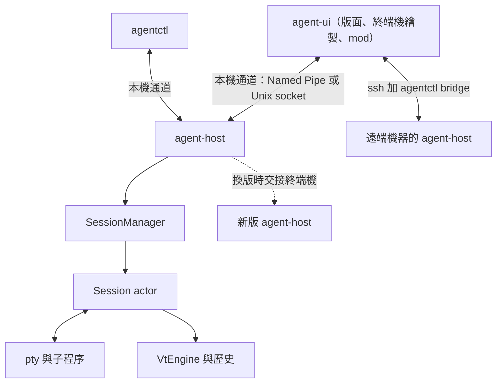
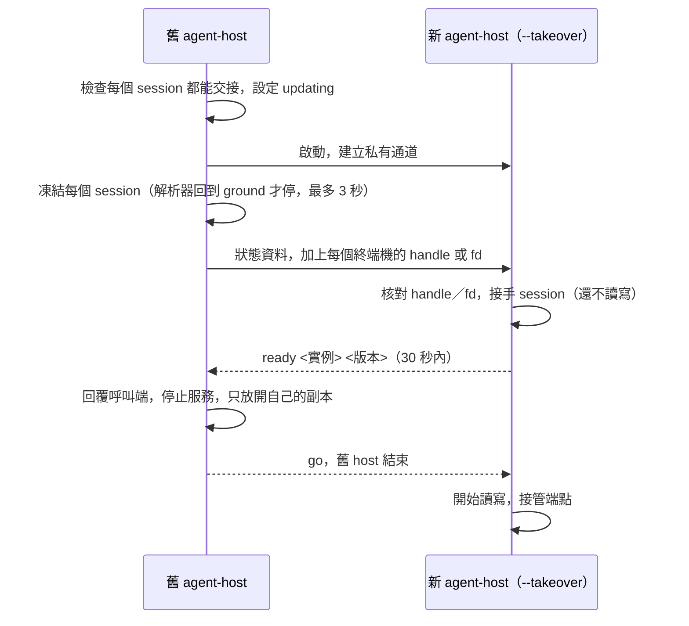

# AgentDesk 詳細設計文件

版本 v3.2｜日期：2026-11-24｜產品版本 0.2.0｜需求契約：`contracts/approved/PRD.md` 5.0.0
技術基線：C++20、Dear ImGui（FreeType 繪字）、libvterm 0.3.3。Windows 11 x64：Win32、DirectX 11、隨附 ConPTY。macOS 13 以上（Apple Silicon）：AppKit、Metal、POSIX pty

> 這份文件依 0.2.0 的程式重寫，描述系統「現在怎麼運作」。需求與驗收在 PRD；這裡寫設計、資料格式、數字與理由。程式與文件不一致時，先查程式，再修文件或列進 12.4。
>
> AgentDesk 以 MIT License 釋出。介面與行為依 herdr-app 的原始碼複刻（ADR-15），程式全部用 C++ 重寫，不宣稱與 herdr 相容；程式裡不出現 herdr 的名稱（ADR-21），本文件提到 herdr 是因為它是參考產品。

### 版本紀錄

| 版本 | 日期 | 變更 |
|---|---|---|
| 3.2 | 2026-11-24 | 平台抽象層第 1～8 步完成：Windows 也實作中立介面，過渡用的 `compat/` 拿掉，交接邏輯合為一份（2.1、2.3、5.2、ADR-45）。路徑改由 `ui::path_text` 依路徑本身判斷系統。對外行為不變 |
| 3.1 | 2026-11-24 | 合併 Windows 端的 v2.27（版面與主題第一、二輪）與 macOS 端的 v3.0。v2.27 的 2.8～2.16 原文搬到 7.16～7.24，內建版面與 style 對照表在 7.25，決策紀錄加入 ADR-32～ADR-41。兩邊編號相撞：macOS 端的 ADR-30、ADR-31 不變，Windows 端的「Mac 風格的視窗按鈕」改為 ADR-42、「AgentDesk Mac 版面」改為 ADR-43。新增 ADR-44（新版面在兩個平台的做法）。合併前的兩份保存在 `docs/archive/AgentDesk_Design_v2.27.md`、`AgentDesk_Design_v3.0.md` |
| 3.0 | 2026-11-24 | 使用者要求依照現有程式重寫。改為純設計文件：需求與驗收移到 PRD 4.0.0；依程式碼重寫架構、協定、host、UI 與平台差異各章；決策紀錄（第 11 章）照舊保留。舊版 v2.21 與完整的版本紀錄保存在 `docs/archive/AgentDesk_Design_v2.21.md`，v1.0 在 `docs/archive/AgentDesk_Design_v1.0.md` |

## 0. 文件導讀

| 章 | 內容 | 主要讀者 |
|---|---|---|
| 1 | 系統概觀：三個程式、元件與資料流 | 全體 |
| 2 | 原始碼結構、依賴、平台分離方式、建置 | RD |
| 3 | agent-host：生命週期、資料、session、狀態模型 | RD |
| 4 | IPC 協定 v1 | RD、整合方 |
| 5 | 線上更新、agent-host 交接、使用統計 | RD |
| 6 | agentctl | RD、整合方 |
| 7 | agent-ui：版面、工作區、快捷鍵、設定、終端機繪製、mod；7.16～7.25 是 AgentDesk 自己的版面與主題功能 | RD、UI |
| 8 | 安全與隱私 | 全體 |
| 9 | Windows 與 macOS 的差異 | RD |
| 10 | 測試與驗收矩陣 | QA |
| 11 | 決策紀錄（ADR） | 全體 |
| 12 | 風險、待人工驗收、待決事項、已知落差 | PM、RD |

設計原則：

1. UI 與執行核心分離：終端機、子程序、VT 引擎與歷史都在 agent-host；agent-ui 與 agentctl 只是 client。關掉視窗不影響工作。
2. host 完整解析所有輸出：只有送給 UI 的畫面更新可以合併或丟棄。
3. Agent 狀態只信結構化回報：沒有來源就是 Unknown，不從畫面推斷。
4. 一份原始碼，兩個平台在建置時分開：共用程式不寫平台判斷，差異放在內部介面後面（2.3）。

## 1. 系統概觀

### 1.1 程式與元件

| 程式 | 角色 |
|---|---|
| `agent-host`（Windows：`agent-host.exe`） | 每位使用者只有一個的背景程序。擁有 pty、子程序、VT 引擎、歷史、session 紀錄與 UI 文件；提供本機 IPC 服務 |
| `agent-ui`（Windows：`agent-ui.exe`；macOS：`AgentDesk.app`） | 桌面視窗。連上 host 取得畫面並送出輸入；版面、側欄、分頁、終端機繪製、設定、mod、更新、使用統計都在這裡 |
| `agentctl`（Windows：`agentctl.exe`） | 命令列 client；也是 Agent 的狀態 hook（`hook`）、ssh 轉接（`bridge`）與 agent-host 更新工具（`update`） |

| 元件 | 所在 | 職責 |
|---|---|---|
| SessionManager | host | 協定方法、session 表、控制權、訂閱、子 Agent 任務與回報、git 與檔案方法 |
| Session | host | 一個終端機的 actor：pty、VT 引擎、狀態、寫入佇列、快照發布 |
| 平台層 | host、UI、CLI | pty、子程序、本機通道、系統資訊（2.3） |
| VtEngine | host | libvterm 封裝：畫面、歷史、按鍵編碼、OSC 7501／7／133／8 |
| Handover | host | agent-host 換版時把終端機交給新 host（5.2） |
| HostClient | UI | 連線、重連、session 清單、attach、畫面快照與增量、ui.state |
| 版面引擎 | UI | 依版面樹排出側欄、分頁列、窗格、面板、狀態列（7.2） |
| Workspace | UI | space、分頁、分割樹、焦點、注意力（7.4、7.5） |
| TerminalView | UI | 終端機繪製、輸入、選取、搜尋、連結（7.9） |
| ModHost | UI | 載入並呼叫 mod（7.14） |
| Updates、Telemetry | UI | 線上更新與使用統計（5.1、5.3） |



### 1.2 資料流

- **輸出**：程式 → pty → reader 執行緒 → session 佇列 → actor 執行緒依序餵給 VtEngine → 最多每 8 ms 發布一次不可變快照 → SessionManager 對每個訂閱者送增量或快照 → UI。
- **輸入**：UI 按鍵或文字 → `session.input`（檢查控制權）→ actor 依終端機模式編碼 → writer 執行緒寫入 pty → 程式。
- **終端機查詢**（DA、DSR、OSC 7501 查詢）由 host 的 VtEngine 回覆，UI 不在也照常回覆。OSC 7501 的回覆排在 DA1 回覆之前。

### 1.3 程序生命週期摘要

1. UI 或 agentctl 先試著連 host（300 ms）；連不上而且允許啟動時，以背景程序啟動 host，再以 10 秒逾時連線（3.1）。
2. 每位使用者同時只有一個 host（Windows：named mutex；macOS：`flock`）。
3. UI 關閉只中斷連線；host 持續執行，直到收到 `host.shutdown` 或換版交接完成。
4. host 啟動時把上次留下的 Running、Starting、Stopping 紀錄標成 Lost，絕不憑舊 PID 接管程序。唯一例外是換版交接：新 host 只接受舊 host 交給它的 handle 或 fd，核對後接手。
5. UI 每次取得 session 清單時，移除已結束或 Lost 的終端機面板；分頁空了關分頁，space 空了關 space。沒連上的遠端機器保留面板。

## 2. 原始碼、依賴與建置

### 2.1 原始碼結構

| 路徑 | 內容 |
|---|---|
| `apps/desktop` | agent-ui。共用的視窗內容依功能分檔：`app`、`frame`（每幀流程與版面繪製）、`sidebar`、`tab_bar`、`terminals_layout`、`panes`、`files_changes`、`side_panels`、`code_preview`、`overlays`（命令面板、picker、說明、啟動器、改名）、`notices`（通知、peek、更新提示）、`notes`（What's new、意見回饋、確認、結束）、`welcome`、`machine_add`、`worktrees`、`settings_dialog`、`settings_pages`、`settings_store`（ui.json）、`layouts`、`themes`、`programs`、`commands`、`sessions`、`git_cache`、`chrome`。共用宣告在 `app_internal.hpp`、`overlay_kit.hpp`。系統相關：`desktop_os.hpp`、`window_ops.hpp`；Windows 外殼 `win/`（入口 `win/main_win.cpp`）；macOS 外殼 `macos/` |
| `apps/host` | agent-host 入口：Windows `main_win.cpp`、macOS `main_posix.cpp` |
| `apps/cli` | agentctl：共用的指令在 `main.cpp`，入口與系統相關部分在 `cli_win.cpp`、`cli_posix.cpp` |
| `libs/platform` | 平台層。`include/agentdesk/platform/` 是兩個平台共用的介面（`pty.hpp`、`process.hpp`、`ipc_transport.hpp`、`system.hpp`、`dynamic_library.hpp`、`text.hpp`）；`windows/`、`posix/` 各是一份實作，CMake 只建其中一份，目標名稱都是 `agentdesk::platform` |
| `libs/terminal` | VtEngine、OSC 7501 解析與紀錄（`program_status`）、OSC 7 路徑轉換（`cwd_uri`） |
| `libs/protocol` | 分幀、訊息封包、錯誤碼、畫面編碼 |
| `libs/ipc` | 本機通道的伺服器與 client、啟動或連上 host、ssh 轉接。走平台層的位元組串流，兩個平台同一份程式 |
| `libs/host` | Session、SessionManager、狀態、持久化（store）、git 工具、交接（`handover.cpp`）。系統相關在 `host_os.hpp`（`host_os_win.cpp`、`host_os_posix.cpp`）與 `handover_os.hpp`（`handover_win.cpp`、`handover_posix.cpp`） |
| `libs/ui` | TerminalView、Workspace、版面引擎（`layout`）、Keymap、keyboard、ModHost（`mods`）、程式表、sprites、字型、連結、剪貼簿、git_info、HostClient、遠端畫面、更新、使用統計、視窗位置。唯一碰 `imgui_internal.h` 的是 `imgui_adapter.cpp` |
| `libs/modapi`、`mods/` | mod 介面（純 C 的 `mod_api.h`、header-only 的 `mod_sdk.hpp`、SDK 建置檔）與三個範例 mod |
| `tools/` | 開發與量測工具，不出貨：`vt_probe`（兩平台）、`pty_run`、`session_bench`、`soak`、`qa`、`fetch_conpty`、`make_fixtures`、`package`、`devkit`（後面這些只在 Windows） |
| `tests/` | `unit`（共用）、`unit/win`、`unit/posix`、`integration/windows`、`integration/posix`、`fixtures` |
| `third_party/` | libvterm 0.3.3（加了交接用的狀態存取）、隨附 ConPTY 的授權、字型、herdr-app 的授權與素材（版面、主題、程式表與圖示、提示音）、修改過的 ImGui macOS backend（`imgui_osx`） |
| `scripts/` | `build.cmd`（Windows）、`build.sh`、`package_macos.sh` |

### 2.2 依賴

| 項目 | 版本與來源 | 用途 |
|---|---|---|
| Dear ImGui | 1.93.0 docking（vcpkg，features `wchar32`、`freetype`；Windows 另有 `win32-binding`、`dx11-binding`） | 介面。macOS backend 收錄於 `third_party/imgui_osx` 並加上組字文字的回呼 |
| FreeType | vcpkg（經 imgui[freetype]） | 繪字；macOS 另用它找出字型集合（.ttc）裡的字面編號 |
| libvterm | 0.3.3，原始碼收錄於 `third_party/libvterm` | VT 解析；加了 `agentdesk_handover.c` 讀寫完整狀態 |
| nlohmann/json | 3.12.0（vcpkg） | 協定與設定檔 |
| lunasvg、plutovg | 3.5.0、1.3.3（vcpkg） | 程式圖示 SVG 點陣化 |
| GoogleTest | 1.18.0（vcpkg） | 測試，不出貨 |
| 隨附 ConPTY | Microsoft.Windows.Console.ConPTY 1.24.260710001（`fetch_conpty` 下載並驗 SHA-256） | Windows 的 pty（ADR-08） |
| 字型 | Geist、JetBrains Mono（OFL）、Symbols Nerd Font（MIT） | 介面、終端機、圖示 |

vcpkg 以 manifest 模式固定 baseline。Windows triplet `x64-windows-static-md`，macOS 用 overlay triplet `cmake/triplets/arm64-osx-agentdesk.cmake`（最低 macOS 13）。

### 2.3 平台分離方式

兩個平台共用一份原始碼，差異在建置時分開：

1. **共用的 `.cpp` 不寫 `#ifdef _WIN32`。** 各模組不同的部分放在小的內部介面後面，實作分成 `*_win.cpp`（或 `win/`）與 `*_posix.cpp`（或 `macos/`），由各資料夾的 CMakeLists 依 `WIN32` 挑選：

   | 內部介面 | 內容 |
   |---|---|
   | `libs/host/src/host_os.hpp` | 系統錯誤文字、shell 提示鉤子、工具的尋找與啟動設定、OSC 7 對照的電腦名稱 |
   | `libs/host/src/handover_os.hpp` | 交接的通道與終端機的傳遞：Windows 用匿名 pipe 加 `DuplicateHandle`，macOS 用 socketpair 加 `SCM_RIGHTS` |
   | `libs/ui/src/*_os.hpp` | `fonts_os`、`keymap_os`、`keyboard_os`、`links_os`、`mods_os`、`updates_os`；`system_process.hpp`（`system_process_win.cpp`、`system_process_posix.cpp`） |
   | `apps/desktop/desktop_os.hpp`、`window_ops.hpp` | 開檔、提示音、外觀、日期、程式檔位置、啟動程式、首次縮放；視窗操作 |
   | `apps/cli/cli_os.hpp` | 入口、stdin、ssh 轉接 |

2. **系統能力走平台層的中立介面**（`libs/platform/include`）：pty、子程序、本機串流、資料夾與雜湊、動態函式庫、文字轉換。介面上沒有 HANDLE、HWND、fd，字串一律 UTF-8，路徑用 `std::filesystem::path`；差異寫成能力（`pty_capabilities()`），不散在呼叫端。
3. **宣告本身不同的標頭檔**只剩兩個，同名放在 `windows/include`、`posix/include`，靠 include 路徑挑選：`crt.hpp`（在 POSIX 上提供 MSVC 的 `_stricmp`、`gmtime_s` 等名稱）與 `pty_handles.hpp`（交接時一個終端機要傳什麼）。
4. **屬於別台機器的路徑不經過 `std::filesystem`。** 遠端機器可能是另一個系統，`ui::path_text` 由路徑本身判斷是 Windows 或 POSIX，再接路徑、換分隔符。git 在兩個系統都印 `/`，不能一律換成 `\`。
5. 剩下的 `#ifdef` 只有給第三方用的 `mod_sdk.hpp` 匯出巨集。

ctest 的 `PlatformBoundaries`（`cmake/CheckPlatformBoundaries.cmake`）檢查共用檔案沒有引用 `<windows.h>`、`platform/win/`、POSIX 系統標頭，也沒有用 `#if` 問平台。檔名或資料夾標明平台的（`*_win.cpp`、`win/`、`*_posix.cpp`、`macos/`）不在此限。

### 2.4 建置與測試

| | Windows | macOS |
|---|---|---|
| 工具 | VS 2022 Build Tools 17.14（MSVC 14.44、Windows SDK 10.0.26100.0）、CMake、Ninja、`C:\vcpkg`（ADR-11） | Xcode Command Line Tools、CMake、Ninja、`~/vcpkg`（ADR-30） |
| 指令 | `scripts\build.cmd <preset> all|build|configure` | `scripts/build.sh <preset> all|build|configure` |
| preset | `msvc-x64-debug`、`msvc-x64-release` | `clang-macos-arm64-debug`、`clang-macos-arm64-release` |
| 警告 | `/W4 /permissive- /WX` | `-Wall -Wextra -Wpedantic -Werror` |
| 測試 label | `unit`、`windows_integration` | `unit`、`posix_integration` |
| 打包 | `agentdesk_package.exe`（`docs/release.md`）：`AgentDesk-<版本>-win-x64.zip` | `scripts/package_macos.sh`：`AgentDesk.app`（ad-hoc 簽章）與 `AgentDesk-<版本>-macos-arm64.zip` |

- 新 clone 的 Windows 建置要先跑一次 `tools/fetch_conpty.exe` 取得隨附 ConPTY，再重新 configure。
- `build.cmd` 建置前會結束從 `build\<preset>\` 啟動的 agent-ui 與 agent-host（它們鎖住執行檔與 `conpty.dll`）；`AGENTDESK_KEEP_HOST=1` 可略過。
- 建置後 agent-host 與 agentctl 每次都複製到 agent-ui 旁邊（`agent-ui-siblings` target）。
- 截圖：Windows 用 `tools/qa/screenshot_ui`；macOS 用 `agent-ui --screenshot <png> --exit-after-ms N`（不需要螢幕錄製權限）。

## 3. agent-host

### 3.1 生命週期

**啟動**（`libs/ipc/src/host_launcher*.cpp`）：`connect_or_start_host` 先以 300 ms 試連；連不上且允許啟動時，從自己旁邊的執行檔啟動 host，再以 10 秒逾時連線並送 `hello`。

| | Windows | macOS |
|---|---|---|
| 背景啟動 | `DETACHED_PROCESS`＋`CREATE_BREAKAWAY_FROM_JOB`，只繼承 NUL 與 log handle；不可用 `CREATE_NEW_PROCESS_GROUP`（否則子程序收不到 Ctrl+C）。breakaway 被拒時留在原 Job；那個 Job 會在啟動者關閉時結束所有程序的話，UI 狀態列與 agentctl 會先提示 | `posix_spawn` 加 `POSIX_SPAWN_SETSID`，stdio 接 `/dev/null`，`POSIX_SPAWN_CLOEXEC_DEFAULT` |
| 工作目錄 | 使用者家目錄（不能是安裝資料夾，否則線上更新無法改名資料夾） | 家目錄 |
| 單一實例 | named mutex `Local\AgentDesk-host-<SID>-s<登入工作階段>` | `flock` `<runtime>/host.lock` |
| 端點 | `\\.\pipe\AgentDesk-<SID>-s<登入工作階段>` | Unix socket `<使用者暫存資料夾>/AgentDesk/host.sock` |

- 第二個 host 發現已有實例時直接以 0 結束，啟動它的一方再去連既有的 host。端點已被別人占用時以 3 結束，其他致命錯誤以 1 結束。
- `--pipe NAME` 換成另一個端點與實例鎖（測試、第二個本機 host）；macOS 上不含 `/` 的名稱對應到 runtime 資料夾的 `<名稱>.sock`。
- **結束**：`host.shutdown` 設定結束事件；host 等 200 ms 讓回覆送達，停止服務，強制停止所有 session。macOS 的 host 忽略 SIGPIPE 與 SIGHUP。
- **host.log**：資料資料夾裡的 `host.log`，每行有時間與 pid，記錄啟動、接手、交接、停止、致命錯誤與被略過的損毀紀錄（只記檔名與位置）。

### 3.2 資料資料夾、檔案與 profile

資料資料夾：`--data-dir`，否則 `AGENTDESK_DATA_DIR`，否則 Windows `%LOCALAPPDATA%\AgentDesk`、macOS `~/Library/Application Support/AgentDesk`。

| 檔案 | 持有者 | 內容 |
|---|---|---|
| `profiles.json` | host | `{schema_version:1, wsl_detected, profiles:[{id,name,executable,args}]}` |
| `sessions.json` | host | `{schema_version:1, sessions:[{id,name,cwd,profile_id,created_at,process_state,exit_code,parent,labels}]}`，最多 200 筆 |
| `ui-state.json` | host | `{schema_version:1, rev, doc}`：UI 文件（space、分頁、分割樹、隱藏的面板），所有視窗共用 |
| `host.log` | host | 診斷紀錄 |
| `ui.json` | UI | 設定（7.8） |
| `keys.json`、`keys.error` | UI | 快捷鍵（7.7） |
| `layouts/`、`layouts/.state/` | UI | 自訂版面與使用者的拖曳、開關（7.2） |
| `themes/` | UI | 使用者主題檔 |
| `mods/` | UI | mod（7.14） |
| `programs.json`、`programs.error` | UI | 程式表的覆蓋（7.11） |
| `window.json` | UI | 視窗位置與大小（7.1） |
| `feedback/` | UI | 存檔的意見回饋 |
| `telemetry/` | UI | 使用統計的報告（5.3） |
| `ui-crash.txt` | UI | 崩潰紀錄（訊號或例外與呼叫堆疊） |

**寫入**：先寫 `<檔>.tmp`，再原子替換；舊檔留作 `.bak`（Windows `ReplaceFileW`；macOS 先複製 `.bak` 再 `rename`）。**讀取**：主檔損毀或 schema_version 不符時讀 `.bak`；兩份都壞時把主檔改名為 `.corrupt-<UTC 時間>`，以預設值啟動。單筆紀錄損毀時跳過，在 host.log 只記檔名與位置。

**profile 偵測**（`profiles.json` 不存在時）：

- Windows：以 `SearchPath` 找 `claude-native`（claude.exe）、`codex-native`（codex.exe）、`pwsh`（PowerShell 7，`-NoLogo`）、`powershell`（Windows PowerShell，`-NoLogo`）、`cmd`；再從 `HKCU\Software\Microsoft\Windows\CurrentVersion\Lxss` 為每個 WSL 發行版建 `wsl-<名稱>`（略過 `docker-desktop*`）。沒有 `wsl_detected` 旗標的舊檔只補一次 WSL。
- macOS：在登入 shell 的 PATH 上找 `claude`、`codex`；再列出登入 shell 與 `/etc/shells` 的每個 shell（依檔名去重），以 `-l` 啟動。
- 驗證：id 不能空白；拒絕 `.cmd`、`.bat`；executable 必須可執行。

### 3.3 Session 與歷史

每個 session 是一個 actor（`libs/host/src/session.cpp`），有三個執行緒：

| 執行緒 | 工作 |
|---|---|
| reader（在平台層的 pty 裡） | 讀 pty 輸出，只放進 actor 佇列 |
| actor | 唯一碰 VtEngine 的地方：依序解析、產生查詢回覆、更新狀態、最多每 8 ms 發布一次不可變快照（`shared_ptr<const ScreenSnapshot>`） |
| writer | 把輸入寫進 pty |

- **背壓**：佇列裡的輸出超過 8 MiB 時 reader 暫停讀取，子程序的寫入隨之阻塞，不丟任何位元組；次數記在 `backpressure_waits`。關閉前先解除背壓，否則 join reader 會死結。
- **歷史**：每個 session 10,000 行、16 MiB，先達到者截斷最舊的資料；`history.read` 一次最多 200 行，回報第一個還在的 line id。OSC 字串上限 64 KiB。
- **libvterm 的處理**：UTF-8 序列被切在兩次讀取之間時，VtEngine 暫存尾端不完整的序列（只延後、不丟），程式結束時 flush。預設色的格子 RGB 一律存成 0，這樣比較快照或經協定傳送時，兩個預設色的格子才會相等。模糊寬度字元一律 1 欄、ZWJ emoji 不合併；libvterm 不通知 RIS，OSC 7501「RIS 清除全部紀錄」沒有實作。
- **前景程式與資料夾**：`session.list` 的 `program`、`program_argv`、`live_cwd` 來自平台層（Windows：Job 裡最新最深的子程序與 PEB；macOS：`tcgetpgrp` 加 `libproc`）。shell 送來的 OSC 7 優先於程序的工作目錄；OSC 7 的主機名稱必須是這台電腦才採用。
- **已結束的 session**：只有最新 8 個保留完整的 Session 物件（畫面與歷史），更舊的只留紀錄。
- **環境變數**：每個 session 都有 `AGENTDESK_SESSION_ID`、`AGENTDESK_CTL`（agentctl 的完整路徑）、`AGENTDESK_PIPE`（host 端點）。

### 3.4 停止

- **中斷**（`session.stop` mode=interrupt）：寫入 0x03，狀態改為 Stopping，開始 5 秒寬限；5 秒後仍在執行時 `still_running_after_interrupt` 為 true，UI 提供「Force stop」。
- **強制**（mode=force）：Windows `TerminateJobObject`；macOS 對根程序的程序群組與「以這個終端機為控制終端機」的所有程序送 SIGKILL（shell 會把每個 job 放進不同的程序群組，只殺根群組會留下背景 job）。
- **根程序結束**：取得 exit code 與剩餘的子程序數，關閉 pty（reader 先 drain 最後的輸出），結束剩下的子程序。
- **關閉 pty 的順序**：Windows `ClosePseudoConsole` → join reader → 釋放 handle（寫入 mutex 保護）→ `TerminateJobObject`。macOS 先對終端機的所有程序送 SIGHUP，最多等 2 秒讓 reader 讀完，再送 SIGKILL，最多再等 2 秒直到沒有程序。
- **寫入不卡住其他操作**：macOS 的 pty master 是非阻塞的；程式不讀輸入、輸入佇列滿了時，寫入以 50 ms 為單位等待空間，只持有寫入鎖，所以調整尺寸、查前景程式與關閉不會被卡住；關閉開始後寫入放棄。

### 3.5 狀態模型

| process_state | 意義 |
|---|---|
| Starting | 正在建立資源 |
| Running | 根程序還沒結束 |
| Stopping | 已提出停止 |
| Exited | 根程序已結束，記錄 exit code 與剩餘子程序數 |
| Failed | 建立失敗 |
| Lost | 上一個 host 留下的紀錄，無法續接 |

agent_state 為 Unknown、Idle、Working、Blocked、Done、Error，和 process_state 各自獨立：程序 Running 不代表 Agent Working，輸出沉默不代表 Done。每次變更記錄來源與時間；狀態改變時舊值存進 `last_agent_state`。

**來源**（依可信度）：

1. **OSC 7501**（Program Status Protocol Revision 0.4，source `osc7501`）。Claude Code 2.1.295 起先送查詢，終端機回覆支援才自動回報。
   ```text
   回報：OSC 7501 ; state=<s>[:id=<path>][:kind=<k>][:progress=<0-100>][:app=<a>][:title=<b64>][:msg=<b64>] ST
   查詢：OSC 7501 ; ? ST     回覆：OSC 7501 ; ? ST
   ```
   - state：`idle`、`working`、`done`、`blocked`、`error`；`clear` 移除該 id 與其下的紀錄（沒有 id 時清除全部）。kind（只用於 blocked）：`permission`、`question`、`auth`。
   - 每次回報整筆取代該 id 的紀錄；agent_state 取根紀錄（沒有 id 的那筆）。`app` 寫進 `agent_app`，UI 用它查程式表。
   - 上限：整段 4096 bytes、msg 解碼後 2048 bytes、title 192 bytes、每個 session 256 筆（滿了淘汰最久沒更新的）；msg 或 title 解碼後含控制字元時整筆丟棄。
   - OSC 7501 沒有序號，host 依收到順序指派遞增的 seq。
   - **回覆順序**：程式送查詢後緊接著送 DA1（`CSI c`），DA1 的回覆先到就判定不支援，所以 host 的 7501 回覆一定排在 DA1 回覆之前。Windows 的系統內建 ConPTY 會吞掉這個回覆，因此一律用隨附 ConPTY（ADR-08）。
2. **`state.report`**（`agentctl report-state` 或 `agentctl hook`，source 為 `report:<呼叫端給的名稱>`）。source 1～64 個可列印字元，`agentdesk:` 前綴保留；seq 由呼叫端給，建議用毫秒時間戳；message 最多 2048 bytes、不含控制字元；kind 只在 Blocked 時保留。
3. 都沒有時是 Unknown。

**去重**：每個 (session, source) 記住最後接受的 seq，不大於它的回報忽略；交接時 seq 一起搬過去。

**生命週期**：程式結束時丟掉 working 與 blocked，done、error、idle 保留；shell 顯示新提示（OSC 133 A）時丟掉全部紀錄（Agent 已經結束）。根紀錄被丟掉時 agent_state 改為 Unknown，不推測成 Idle 或 Done。

**UI 的 Done**：「沒在看的時候完成」；看過之後在該 UI 顯示 Idle，不回寫 host（7.5）。

### 3.6 shell 提示鉤子與資料夾追蹤

host 啟動 shell 時加上鉤子，讓 shell 在每次顯示提示時送出 OSC 133 A（前一個程式已結束）；WSL、zsh、bash 另外送 OSC 7（目前資料夾），PowerShell 改成同步程序的工作目錄，Command Prompt 只送 OSC 133 A。實作在 `host_os_win.cpp`、`host_os_posix.cpp`。

| shell | 做法 |
|---|---|
| PowerShell 7、Windows PowerShell | 加上 `-NoExit -Command`，包住使用者原本的 `prompt` 函式：先送 OSC 133 A，再把位置同步到 `[Environment]::CurrentDirectory`（host 從 PEB 讀資料夾）。profile 自己帶 `-Command`、`-File` 等參數時不加 |
| Command Prompt | `PROMPT=$E]133;A$E\<使用者原本的 PROMPT 或 $P$G>` |
| WSL（bash） | 經 `WSLENV` 傳入 `PROMPT_COMMAND`，送 OSC 133 A 與 `OSC 7 file://$WSL_DISTRO_NAME$PWD`；`/mnt/<碟>/…` 對應 `<碟>:\…`，其他對應 `\\wsl.localhost\<發行版>\…`。帶 `-e`、`--exec`、`--` 的 profile 不加 |
| zsh（macOS） | `ZDOTDIR` 指到 runtime 資料夾裡 AgentDesk 寫的 `.zshenv`：還原使用者的 `ZDOTDIR`、載入使用者的 `.zshenv`，互動 shell 加一個 precmd 鉤子送 OSC 133 A 與 OSC 7；使用者其他的設定檔照常載入 |
| bash（macOS） | `PROMPT_COMMAND` 送 OSC 133 A 與 OSC 7；使用者的設定檔若自己設定 `PROMPT_COMMAND` 會取代它 |

macOS 上每個 shell 另外取得 `TERM=xterm-256color`、`COLORTERM=truecolor`、`TERM_PROGRAM=AgentDesk`、登入 shell 的 `PATH`（從 Finder 啟動的程式 PATH 很短，找不到使用者裝的 `claude`、`node`、`git`），以及繼承的 `LANG` 不是 UTF-8 時的 `LANG=en_US.UTF-8`。

### 3.7 子 Agent 的任務與回報

- `session.create` 可帶 `parent`（必須存在）、`labels`、`task`（最多 64 KiB）。agentctl 在 session 裡執行 `run` 時，預設以 `AGENTDESK_SESSION_ID` 當 parent（`--no-parent` 可取消）。
- 維護執行緒每 200 ms 處理一次：
  - **任務**：子 Agent 回報 Idle（有狀態來源時）、沒有狀態來源滿 8 秒、或最晚 24 秒時，以貼上加 Enter 送出。
  - **回報**（`session.report`）：送到 `to`，沒給就送父 Agent；文字前面加 `[from <名稱> <id 前 8 碼>]`。目標不在 Working 或 Blocked、也沒有待送任務時才送，否則排隊。
  - 交接期間都不送。
- `session.wait`：每 100 ms 檢查一次，條件 `idle`（看過 Working 之後回到 Idle 或 Done，或第一次的狀態就不是 Unknown）、`blocked`、`exited`、`change`；Exited 或 Failed 一律算達成；逾時預設 10 分鐘，上限 1 小時。

## 4. IPC 協定 v1

### 4.1 分幀與訊息

- frame = 4 bytes little-endian 長度 + UTF-8 JSON；上限 4 MiB。長度為 0、超過上限或不是 UTF-8 視為違反協定，直接斷線，不嘗試重新對齊（QA-17）。
- 請求 `{"v":1,"id","method","params"}`；回應 `{"v":1,"id","result"}` 或 `{"v":1,"id","error":{code,message,retryable}}`；事件 `{"v":1,"event",...}`。
- `id` 是 1～128 bytes 的字串，`params` 必須是物件。`v` 不是 1 時回 `VERSION_MISMATCH` 並斷線；其他解析錯誤回 `BAD_REQUEST`，連線保留。client 送來的回應或事件忽略。
- 序列化時無效的 UTF-8 換成 U+FFFD。回覆放不進一個 frame 時回 `INTERNAL`；client 端的請求放不進 frame 時在本地回 `BAD_REQUEST`，不送出。
- request id 必須跨 client 唯一（`session.create` 依它去重），client 以 `c-<pid>-<高精度計時器>-<序號>` 產生。

### 4.2 hello

參數 `{version, client}`。回覆：`version`、`host_instance_id`（每次啟動新的 UUID）、`host_version`、`host_pid`、`succeeds`（這個 host 接手過的實例 id）、`host_exe`、`capabilities{osc7501, bundled_conpty}`。UI 看到原本的實例 id 在新 host 的 `succeeds` 裡，就不把 session 標成 Lost（5.2）。

### 4.3 session 方法

`session` 參數接受 UUID 或名稱；名稱對到多個時回 `AMBIGUOUS`，找不到回 `NOT_FOUND`。Lost 的 session 對 attach、input、resize、stop、snapshot、history 回 `NOT_FOUND`。

| 方法 | 參數 | 回覆與規則 |
|---|---|---|
| `profile.list` | — | `{profiles:[{id,name,executable,args}]}` |
| `session.create` | `profile_id`、`cwd`（必填）、`name`、`args`（接在 profile 參數後）、`cols`（預設 120，2～1000）、`rows`（預設 40，1～500）、`parent`、`labels`、`task` | `{session_id, process_state}`；依 request id 去重 10 分鐘（失敗也記住） |
| `session.list` | — | `{sessions:[...], host_instance_id}`，由舊到新 |
| `session.get` | `session` | 描述：紀錄欄位、`controller`、`subscribers`；執行中的另有 `process_state`、`pid`、`exit_code`、`agent_state`、`agent_source`、`agent_kind`、`agent_message`、`last_agent_state`、`still_running_after_interrupt`、`remaining_processes`、`cols`、`rows`、`history_truncated`、`backpressure_waits`、`program`、`program_argv`、`agent_app`、`live_cwd`；只剩紀錄的為 `agent_state:"Unknown"`、`history_only:true` |
| `session.attach` | `session`、`want_control`、`take_control` | 描述加 `is_controller`、`snapshot_id`、`snapshot_meta`；之後送分段的 `screen.snapshot` 事件 |
| `session.detach` | `session` | 取消訂閱，釋放控制權，不停止程序 |
| `session.input` | `session`、`kind`：`text`（`text`、`mods`）、`key`（enter、tab、backspace、escape、方向鍵、insert、delete、home、end、pageup、pagedown、f1～f12，加 `mods`）、`paste`（拒絕 NUL 與超過 1 MiB）、`raw`（`bytes`）、`mouse`（press／release／move、按鈕 0～5、row、col、mods） | 有控制者時只接受控制者；沒有控制者時任何 client 都可輸入（`agentctl send` 依賴這條） |
| `session.resize` | `session`、`rows`、`cols` | 只有控制者可以 |
| `session.stop` | `session`、`mode`：interrupt（預設）或 force | 3.4 |
| `session.wait` | `session`、`until`、`timeout_ms` | `{reached, process_state, agent_state, agent_message}`（3.7） |
| `session.label` | `session`、`labels{k:v}` | 值為空字串時刪除；鍵最多 64 bytes 可列印字元 |
| `session.report` | `session`（送出者）、`text`（1～64 KiB，不含 NUL）、`to` | `{queued:true, to}`（3.7） |
| `screen.snapshot` | `session` | meta 加 `snapshot_id`，內容以事件送出；送出佇列滿時回 `OVERLOADED`（可重試） |
| `history.read` | `session`、`from_line_id`、`max_lines`（≤200）、`tail` | `{lines:[{line_id,text,wrapped}], first_available_line_id, truncated}` |
| `state.report` | `session`、`source`、`state`、`seq`、`kind`、`message` | 3.5 |

### 4.4 其他方法

| 方法 | 參數 | 規則 |
|---|---|---|
| `host.shutdown` | `stop_sessions` | 有執行中的 session 而沒有 `stop_sessions` 時回 `ACTIVE_SESSIONS` |
| `host.update` | `exe`（絕對路徑） | 把終端機交給新的 agent-host（5.2）；`{now, host_instance_id}` |
| `ui.state.get` | `watch` | `{rev, doc}`；`watch` 的連線在別人寫入時收到 `ui.state` 事件 |
| `ui.state.set` | `doc`（≤1 MiB） | `{rev}`；最新的寫入為準 |
| `worktree.add` | `repo`、`branch`、`path` | 不經 shell 執行 `git worktree add`；分支已存在就 checkout，否則 `-b <分支> <路徑> HEAD`；分支不能以 `-` 開頭；預設位置家目錄的 `.agentdesk/worktrees`；逾時 600 秒 |
| `fs.list` | `path`（絕對）、`max`（預設 500，1～5000） | `{entries:[{name,dir}], more}`，略過 `.git` |
| `fs.read` | `path`（絕對） | `{text}`；不存在 `{missing}`；超過 1 MiB `{too_large,size}`；含 NUL `{binary}` |
| `git.run` | `cwd`（絕對）、`args`（1～32 個） | 只允許 status、diff、rev-parse、rev-list、add、for-each-ref、commit、log、`worktree list|remove`、`submodule status`；拒絕 `--ext-diff`、`--textconv`、`--output`、`--exec`、`-c`、`--config`。一律加上 `--no-optional-locks -c core.fsmonitor=false -c diff.autoRefreshIndex=false -C <cwd>`；輸出上限 3 MiB、錯誤 64 KiB；逾時 60 秒（worktree 600 秒） |

`fs.*` 與 `git.run` 是給遠端機器的 Files／Changes 用的（7.12、7.13），只能讀到同一個作業系統使用者讀得到的東西。

### 4.5 事件與畫面編碼

| 事件 | 欄位 |
|---|---|
| `screen.snapshot` | `session_id`、`snapshot_id`、`chunk_index`、`chunk_count`、`meta`、`rows`。每段最多 900 KiB（每段列數 = 900 KiB ÷（cols × 32）） |
| `screen.delta` | `session_id`、`generation`、`base_seq`、`seq`、`meta`、`rows`（只含變動的列） |
| `session.state` | `session_id`、`process_state`、`exit_code`、`agent_state`、`agent_source`、`agent_kind`、`agent_message`、`last_agent_state`、`still_running_after_interrupt`、`remaining_processes`。一定送達，不會被丟 |
| `ui.state` | `rev`、`doc`、`from` |

- meta：`generation`、`seq`、`rows`、`cols`、`cursor{row,col,visible}`、`alt_screen`、`mouse`、`title`。
- 列：`{row, cells, wrap?, links?}`；格子 `[text, width, fg, bg, attrs]`，fg 或 bg 是 16 個 ANSI 色之一時多帶 `fg_ansi`、`bg_ansi`（0～15），UI 用主題的色表畫。顏色是 0xRRGGBB，`-1` 是主題預設色。`links` 是 OSC 8 超連結 `[起欄, 迄欄, uri]`。

### 4.6 attach、訂閱與控制權

- **attach**：host 在 session actor 內取得 seq=S 的快照並註冊訂閱（同一把鎖），送出快照，之後只送 seq>S 的增量，快照與訂閱之間不會漏事件。
- **送給訂閱者**：client 需要重新同步，或 generation、尺寸改變時送完整快照；否則只送變動的列。
- **控制權**：一個 session 同時只有一個控制者。`take_control` 一定取得；`want_control` 只在沒人控制時取得。client 斷線時釋放它的控制權與訂閱。UI attach 時帶 `want_control`，別的視窗持有時顯示唯讀橫幅，按「Take control」改帶 `take_control`。
- **增量對不上**：generation 不同或 base_seq 不連續時，UI 丟掉增量並要求 `screen.snapshot`。

### 4.7 錯誤碼、逾時與上限

錯誤碼：`BAD_REQUEST`、`NOT_FOUND`、`PROFILE_INVALID`、`SPAWN_FAILED`、`NOT_CONTROLLER`、`VERSION_MISMATCH`、`OVERLOADED`、`ACTIVE_SESSIONS`、`AMBIGUOUS`、`INTERNAL`。處理方法時拋出的例外變成 `INTERNAL`；Windows 的系統錯誤以 `FormatMessageW` 重新描述為 UTF-8。

| 項目 | 值 |
|---|---|
| RPC 預設逾時 | 5 秒；逾時不代表沒有執行，遲到的回覆丟棄 |
| UI 的 `session.create` | 15 秒 |
| 遠端的 fs／git 呼叫 | 60 秒（`git worktree` 600 秒） |
| 每個 client 的送出佇列 | 4 MiB 之後拒收可丟棄的訊息（快照、增量）並設 `needs_snapshot`；16 MiB 之後斷開這個 client |
| I/O 緩衝 | 64 KiB |
| 交接期間 | 只服務 hello、profile.list、session.list、session.get、history.read、ui.state.get、fs.list、fs.read；其他回 `OVERLOADED`（可重試，「agent-host is updating」） |

### 4.8 本機通道的安全

這是同一使用者的控制通道，不是對抗同帳號惡意程式的隔離邊界。

- **Windows**：Named Pipe 的 DACL 只含 SYSTEM 與目前使用者，`PIPE_REJECT_REMOTE_CLIENTS`，以 `FILE_FLAG_FIRST_PIPE_INSTANCE` 防搶名；host 比對 client 的 SID，client 也比對 server 程序的使用者，不符即拒絕；client 以 `SECURITY_IDENTIFICATION` 開啟。
- **macOS**：runtime 資料夾 0700、socket 0600（建立時 umask 0177），雙方以 `getpeereid` 核對 uid，不符的連線計入 `rejected_clients` 並關閉；socket 設 `SO_NOSIGPIPE`。殘留的 socket 連不上時視為過期並取代；連得上時回 `EADDRINUSE`。

## 5. 更新、交接與使用統計

### 5.1 AgentDesk 本身的更新

實作在 `libs/ui/src/updates.cpp`，系統相關部分在 `updates_win.cpp`、`updates_posix.cpp`。

- **啟用條件**：設了 `AGENTDESK_RELEASES_URL`，而且執行中的是發布包安裝的版本：Windows 以執行檔旁有 `THIRD_PARTY_NOTICES.md` 判斷（只有 zip 裡有），macOS 是 `AgentDesk.app` 且 `Contents/Resources` 有它。建置資料夾永遠不更新。
- **時程**：啟動 10 秒後檢查，之後每小時一次，失敗 30 分鐘後重試。
- **manifest**：`<url>/app/latest.json` = `{version, targets:{"windows-x86_64"|"darwin-aarch64":{url, sha256}}}`；`core/latest.json` 同格式，給 agent-host，只接受協定世代相同的版本。
- **流程**：
  1. 用系統的 curl 下載到 `<安裝>.download`，比對 sha256，用系統的 tar 解壓（zip 裡是 `AgentDesk-<版本>-win-x64/` 或 `AgentDesk-<版本>-macos-arm64/AgentDesk.app`）。
  2. 確認解出的 agent-ui `--version` 相符，改名為 `<安裝>.new` 並寫入 `<安裝>.new.json`。
  3. 右下角提示「Restart」。按下、下次結束程式，或上次沒正常結束時的下次啟動前換版：`<安裝>` → `<安裝>.old`，`.new` → `<安裝>`，失敗就換回。
  4. 寫下 `.updated` 標記並重開：Windows 由系統的 Windows PowerShell 等舊程序結束後 `Start-Process`；macOS 由 `/bin/sh` 等舊程序結束後 `open`（腳本固定，pid 與路徑以參數傳入）。新程序帶 `AGENTDESK_UPDATE_EXPECTED`，不會再重試更新，啟動後從環境移除。
  5. 更新後第一次啟動顯示 What's new，並以 `agentctl update --exe <zip 帶來的 agent-host>` 把終端機交給新版 host。

### 5.2 agent-host 交接

觸發：`agentctl update`、設定 › Updates 的 agent-host 列、app 更新後第一次啟動。client 端（`agentctl update`）：

1. 以 300 ms 試連 host，不啟動 host；沒有 host 在跑時只把新執行檔放到位置上，下次啟動生效。
2. 準備新執行檔：有 `--exe` 時檢查它的 `--version`；否則下載 `core/latest.json` 指的檔案到 `.new`，比對 sha256 與 `--version`，把執行中的檔案改名為 `.old`、`.new` 改成正式名稱。
3. 以 120 秒逾時呼叫 `host.update`；失敗時把 `.old` 換回。
4. 等最多 15 秒，直到新的實例 id 在端點上回應 hello。

host 端（流程與狀態格式在 `handover.cpp`，通道與終端機的傳遞在 `handover_win.cpp`、`handover_posix.cpp`）：



- **凍結**：暫停 reader；解析器不在 ground 時逐位元組多讀；寫完所有待送的輸入；不再監看程序是否結束。沒讀的位元組留在 pty 給新 host。
- **狀態資料**（格式兩平台相同）：magic `ADHO`、格式 1、實例 id、`succeeds`（最多 16 筆）；每個 session 的紀錄、待送任務與時間、待送回報、引擎狀態（兩個畫面緩衝區、筆、模式、捲動區、tab、字元集、DECSC 游標、歷史與 line id、OSC 7501 紀錄與 seq）；最後是 ui.state、rev 與去重表。
- **Windows**：以兩條私有管線溝通；把 ConPTY 的 signal、reference、conhost、輸入、輸出、子程序與 Job 共 7 個 handle `DuplicateHandle` 給新程序。新 host 核對 PID、程序在 Job 裡、Job 仍是 KILL_ON_JOB_CLOSE 且不允許 breakaway、console 程序是 OpenConsole，再用隨附 ConPTY 的 `ConptyPackPseudoConsole` 重建。系統內建 ConPTY 沒有這個函式，所以不能交接，回報錯誤。
- **macOS**：`socketpair` 當通道（新 host 的 fd 3），以 `agent-host --takeover <舊 pid>` 啟動；狀態資料之後以 `SCM_RIGHTS` 依序送出每個 pty master。新 host 核對：fd 是 pty master、根程序還在、是同一使用者、自成 session 且擁有這個終端機。新 host 不是根程序的父程序，之後程式結束時 exit code 記為未知。
- **失敗**：ready 之前任何錯誤或逾時，舊 host 結束新程序（Windows `TerminateProcess`，macOS SIGKILL）、恢復所有 session、清除 updating，回 `INTERNAL`。新 host 驗證失敗只關自己的副本，絕不結束程式。
- **收尾**：舊 host 回覆後等 200 ms、停止服務（macOS 關閉監聽 socket 但不刪除檔案，新 host 會用同一個路徑）、放開所有 session、送出 go 後結束。新 host 等不到 go 時：舊 host 10 秒內結束就照樣接手，否則放棄（舊 host 還擁有 session）。新 host 接管端點時名稱還被占用就每 100 ms 重試，最多 100 次；之後刪除 `agent-host.old`。

### 5.3 使用統計

實作在 `libs/ui/src/telemetry.cpp`（ADR-18）。

- **預設開啟，但沒有預設伺服器**：設了 `AGENTDESK_TELEMETRY_URL` 才送出（curl POST，20 秒上限）。`DO_NOT_TRACK`、`AGENTDESK_TELEMETRY=0`（或 false、off、no）、CI 環境變數（CI、GITHUB_ACTIONS、GITLAB_CI、CIRCLECI、BUILDKITE、JENKINS_URL、TEAMCITY_VERSION）只關閉這一次執行。設定 › Privacy 關閉時清空待送的報告並換一個新的安裝 id（128 位元亂數）。
- **報告**：每個 UTC 日一份，跨日後放進待送佇列，7 天後丟棄；送出失敗以 2／4／8／16／24 小時加隨機抖動重試。存在資料資料夾的 `telemetry/`。
- **內容**：版本、安裝 id、日期；app 版本、作業系統與處理器（windows／x86_64 或 macos／aarch64）、通道、agent-host 版本；使用時間、啟動次數與中位數時間、異常結束次數；Agent 程式名稱（只用程式表裡的名稱，其他記為 other）；分組後的 Agent、space、分頁、終端機數量（0、1、2–5、6–20、21+）；版面、mod 類別（內建、改過的內建、自訂）、內建命令名稱、是否自訂按鍵與主題、歡迎頁結果、更新失敗與 host 遺失事件。不含自由文字。
- 「What we send」逐字顯示待送的報告、今天的草稿與上次送出的內容。

## 6. agentctl

| 指令 | 說明 |
|---|---|
| `run --profile ID [--name N] [--cwd DIR] [--task T] [--parent ID \| --no-parent] [--label k=v]... [-- args]` | `session.create`；cwd 預設目前資料夾；印出 session id |
| `list` | 表格：ID、NAME、PROCESS、AGENT、CWD |
| `read <s> [--lines N]` | 歷史尾端加目前畫面的最後 N 行（預設 100，1～200） |
| `send <s> (--text T \| --file F \| --key K) [--enter]` | `--file` 以貼上送出；只有 `--enter` 才送 Enter |
| `stop <s> (--interrupt \| --force)` | |
| `wait <s> [--until idle\|blocked\|exited\|change] [--timeout-ms N]` | 預設 10 分鐘；沒達成退出碼 7 |
| `report-state <s> --source S --state ST --seq N [--kind K] [--message M]` | `state.report` |
| `report <文字> \| --text T \| --file F [--to S] [--from S]` | `session.report`；from 預設 `AGENTDESK_SESSION_ID` |
| `label <s> k=v...` | `session.label`，一律輸出 JSON |
| `shutdown [--stop-sessions]` | `host.shutdown` |
| `hook` | Agent CLI 的狀態 hook：從 stdin 讀事件 JSON（最多 1 MiB），`UserPromptSubmit`、`PostToolUse` → working，`PermissionRequest` → blocked（permission），`Stop`、`Interrupt` → idle；source `agentdesk-hook`、seq 為毫秒時間戳。不輸出任何東西、一律以 0 結束、不啟動 host、以 1.5 秒逾時，也不代替使用者回答權限確認 |
| `bridge` | 連上（必要時啟動）本機 host，把 stdin／stdout 逐位元組轉接到端點；stdout 只有協定位元組。給 ssh 用 |
| `update [--version V] [--exe PATH]` | 5.2 |
| `skill`、`--skill` | 印出一份說明，教在 AgentDesk 裡執行的 Agent 怎麼開子 Agent、等待它、讀它的輸出、接收它的回報 |

- **全域選項**：`--json`、`--pipe NAME`、`--no-start`、`--timeout-ms N`（預設 5000）。端點依序取 `--pipe`、`AGENTDESK_PIPE`、預設值；`bridge` 不看 `AGENTDESK_PIPE`。
- **不啟動 host 的指令**：`report-state`、`report`、`shutdown`、`hook`、`update`，以及有 `--no-start` 時。
- **退出碼**：0 成功、2 參數錯誤（`BAD_REQUEST`）、3 host 無法連線、4 不存在或歧義（`NOT_FOUND`、`AMBIGUOUS`）、5 遭拒（其他錯誤碼）、6 啟動失敗（`PROFILE_INVALID`、`SPAWN_FAILED`）、7 逾時（訊息說明操作可能已經執行）。macOS 上參數不是有效 UTF-8 時退出碼 2。
- **`--json`**：成功時 stdout 只有 host 的結果；失敗時 stdout 是 `{"error":{code,message}}`，診斷寫 stderr。`update --json` 成功輸出 `{"now":"agent-host X"}`，失敗在 stderr 輸出 `{"error":{message,hint}}`。
- **入口**：Windows 是 `wmain`（主控台輸出設為 UTF-8）；macOS 把 UTF-8 參數轉成寬字串後交給共用的 `agentctl_main`，並忽略 SIGPIPE（ssh 的另一端可能已經離開）。

## 7. agent-ui

### 7.1 視窗外殼

| | Windows（`apps/desktop/main.cpp`） | macOS（`apps/desktop/macos/main_macos.mm`） |
|---|---|---|
| 視窗與繪圖 | Win32 視窗＋DirectX 11 | NSWindow＋MTKView（Metal）；每幀由 MTKViewDelegate 畫進新的 drawable |
| 標題列 | 自繪（`WM_NCCALCSIZE`、`WM_NCHITTEST`）。最小化、最大化、關閉畫在分頁列右端；拖曳分頁列或品牌列移動視窗，雙擊切換最大化，支援貼齊 | 透明標題列，保留系統紅綠燈；側欄品牌列與 terminals 上方列讓出紅綠燈的位置；拖曳上方列移動視窗 |
| 輸入法 | IMM；系統的組字視窗放在游標處 | 收錄並修改 ImGui 的 macOS backend：組字中的文字畫在終端機游標處（7.9），組字期間的按鍵留給輸入法；Metal view 不接受 first responder，避免點擊後打不了字 |
| 快捷鍵攔截 | Ctrl+Esc、Ctrl+Shift+Esc 有綁定時以低階鍵盤 hook 攔下 | Cmd 只用於 AgentDesk 的命令 |
| 崩潰紀錄 | `ui-crash.txt`（例外與堆疊） | `ui-crash.txt`：致命訊號時只用 async-signal-safe 的呼叫寫入訊號與堆疊 |

- **重繪**：事件驅動，有輸入、畫面更新、動畫或計時器時才畫下一幀。
- **視窗位置**（ADR-23）：`window.json` 以邏輯像素記住螢幕、位置、大小與是否最大化；螢幕不在或位置不在任何螢幕上時，以上次的大小置中於滑鼠所在的螢幕。沒有紀錄時是 1280×820 邏輯像素乘上 zoom，限制在可用範圍的 50%～90%。自動化執行（`--exit-after-ms`）固定 1400×900，不讀寫 `window.json`。
- **縮放**：`zoom` 0.5～3，以 0.1 為一級。第一次啟動：Windows 取系統的文字大小（100%～225%）並在主螢幕寬度 ≥ 2400 邏輯像素時再乘 1.15；macOS 只看寬度。
- **自動化參數**：`--pipe NAME`、`--start "<profile>"`、`--exit-after-ms N`、`--report file.json`；macOS 另有 `--screenshot <png>`。

### 7.2 版面引擎

版面是一棵 JSON 節點樹（`libs/ui/include/agentdesk/ui/layout.hpp`）：row、column、stack、block、floating。大小、分隔線拖曳、浮動區塊的吸附與位置照 herdr。每個 block 的 `content.mod` 指定由誰畫：

| 名稱 | 繪製 |
|---|---|
| `workspace-chrome` | 品牌列與側欄底部 |
| `spaces`、`agents` | 側欄的兩個清單 |
| `tabs` | 分頁列 |
| `terminals-bar` | terminals 版面的上方列 |
| `workspace-status` | 狀態列 |
| `files`、`changes` | 右側面板 |
| `pane` | 面板標題列 |
| 其他名稱 | 同名 mod 的面板 |

- **內建版面**共九個，完整清單與各版面的 mod、style 在 7.25，各版面的設計在 7.16～7.24。以下兩個來自 herdr（`third_party/herdr/layouts/`，建置時編進程式），其餘在 `libs/ui/layouts/`：
  - `workspace`（herdr 的 main，預設）：側欄 268 px（44～480）裡有品牌列 46 px、Spaces 與 Agents（各占一份，最小 90）、底部 69 px；工作區有分頁列 42 px、窗格與右側面板（預設隱藏，368 px，280～900）、狀態列 28 px。面板外框圓角 10、1 px 邊框、目前面板用強調色、標題列 30 px。
  - `terminals`：上方列 38 px 加窗格，沒有側欄與狀態列，面板標題列 38 px，自帶 graphite 主題與 15 px 字級。
- **自訂版面**：`layouts/<名稱>.json` 新增版面，或取代同名的內建版面；檔案壞了就顯示內建版面並列出錯誤。版面的 `theme`、`font_size` 優先於使用者設定。
- **使用者的改動**（大小、隱藏、stack 選哪個子節點、浮動位置）存到 `layouts/.state/<名稱>.json`，不改版面檔。第一次啟動時，`ui.json` 舊的 `sidebar_width`、`panel_width`、`spaces_share`、`sidebar` 轉成 workspace 的 `.state`。
- **舊格式**（有 `sidebar`、`tab_bar` 等鍵、沒有樹）讀成同 style 的內建版面再隱藏關掉的部分。`ui.json` 存的版面找不到時顯示第一個版面。
- **命令**：`layout.toggle|show|hide:<id>`、`layout.resize:<id>=<px>`、`layout.select:<stack>=<子節點>`、`layout.switch`、`layout.clone`（複製成 `<名稱>-copy`，已存在就失敗）、`layout.reset`（只接受內建版面，使用者的同名檔改名為 `.old-<時間>`）。
- **還沒做**：版面裡的 terminal 與 agent 區塊不畫（終端機只在分頁裡）；`layout.set`；背景圖片；`shadow`、`window_drag`、`titlebar`、`traffic_lights`、`peek` 只讀不用；版面指定 AgentDesk 沒有的主題時不套用。

### 7.3 畫面區域

- **品牌列**：標記與名稱、搜尋（picker）、側欄收合鈕；macOS 先讓出紅綠燈。
- **Spaces**：標題旁的「+」開 shell 選單（FR-32）。有遠端機器時每台機器一個標頭（圖示、名稱、狀態、「+」、連線點、摺疊）。每列 30 px（worktree 28 px）：彩色字母頭像、名稱、`repo · branch ↑N ↓N`；linked worktree 掛在同 repo 的主 checkout 下面；可拖曳排序（只在同一台機器內）；右鍵選單有改名、worktree、關閉。窄欄模式每格只顯示編號與狀態點。沒有 space 的機器顯示「New space there」或「Loading…」。
- **Agents**：只列各 space 面板裡正在執行、現在有狀態的終端機。排序依優先度（釘選、Needs you、Done、Working、Idle）或依 space 分組；子 Agent 以樹狀列在父 Agent 下面；每列有程式圖示、名稱、上次變動多久前、機器；狀態變動時間存在 `ui.json` 的 `agents_changed`，30 天後丟棄。點沒有面板的子 Agent 開 peek。
- **側欄底部**：Settings、Add machine。
- **分頁列**：側欄隱藏時最左邊的「顯示側欄」按鈕（ADR-26），分頁，「+」新增選單，Changes 與 Files 按鈕，Windows 的視窗按鈕。分頁標籤：分頁名稱；沒命名時用主要 Agent 的即時標題、面板標題或編號；放大時加「 Z」，mod 可加裝飾。拖曳排序、雙擊改名、右鍵 Rename／New tab／Close、滾輪切換。
- **新增選單**：Terminal 與這台機器的其他 shell；「Start an agent」（已安裝的 Agent，按 1～9 直接啟動，加最多兩個沒安裝的已知 Agent，灰色）；New space、New worktree…、Open worktree…。
- **面板**：標題列（程式圖示、名稱、狀態：spinner、Needs you 標籤或完成點、資料夾）；滑鼠移上時出現往右分割、往下分割、放大、關閉。兩個以上面板時出現拖曳把手：放在目標外側 25% 移到那一側，放在中間互換，Esc 取消。斷線、Lost、已結束、或由別的視窗控制時，終端機上方顯示橫幅。右鍵選單：分割、放大、改名、右鍵交給程式或開選單、「Send back to <父 Agent>」、關閉。沒有分頁時顯示 New terminal 與 Start a program 卡片。
- **Files／Changes**：見 7.13。
- **Details 欄**（AgentDesk 自己的，只在 workspace 版面，`details.toggle`）：Agent 狀態與來源、程序、程式、資料夾、標籤、子終端機；按鈕 Ctrl+C、Stop、Force stop、Restart here、Take control。
- **狀態列**：機器（「This computer」）、目前面板的分支、「N agents · M need you」；host 斷線時顯示原因與「Start host」，host 會隨啟動終端機結束時提示；右側是命令面板的按鍵提示，點了開命令面板。
- **terminals 版面的上方列**：「顯示側欄」按鈕（切到有側欄的版面，ADR-27）、目前的 space（點了開 picker）、分頁、設定（ADR-25）、命令面板、新分頁。

### 7.4 工作區模型

`libs/ui/src/workspace.cpp`；UI 文件以 `ui.state.set` 存在 host，最後一次改動後 400 ms 寫入，所有視窗共用。

- **space**：`{id, name, machine, color, panel, folder, active_tab, tabs}`。顏色從 ansi6、ansi3、ansi4、ansi5、ansi2、ansi1 中挑用得最少的。標題：space 名稱；沒有就用第一個終端機所在 checkout 的頂層資料夾名稱，在 shell 裡 cd 後跟著變；家目錄顯示「~」。space 只能在同一台機器的範圍內移動。
- **分頁**：`{id, name, root, focused, zoomed, settled, pane_names}`。
- **分割樹**：節點可有多個子節點並帶權重。沿同一方向分割時插入兄弟節點並平分目標的權重；不同方向時把目標換成新的容器。移除時把份額依比例還給兄弟節點，只剩一個子節點的容器收合。
- **焦點**：`focus_history` 最多 32 筆，關閉面板時退回上一個。方向鍵切換與交換找邊緣最近、重疊最多的鄰居；`pane.resize` 每次 40 px；放大時不能交換或調整大小。
- **收起**（`tab.settle`）：收起的分頁不出現在 tab.next／prev 與清單裡，程式繼續跑；最後一個顯示的分頁不能收起；有提醒或被選取時自動回來。
- **隱藏的面板**：子 Agent 的面板被收起（`pane.park`）後，程式繼續跑，記在文件的 `hidden`。
- **清理**：取得 session 清單時，移除已結束或 Lost 的面板（沒連上的遠端機器除外）。

### 7.5 注意力與提醒

| 等級 | 來源 | 優先 |
|---|---|---|
| Needs you | Blocked 或 Error | 4 |
| Done | 沒在看時從忙碌變成其他狀態 | 3 |
| Working | Working | 2 |
| Idle | Idle、看過的 Done | 1 |
| 無 | Unknown | 0 |

- **「在看」**：視窗有焦點，而且該面板在目前顯示的分頁裡可見。
- **提醒**：進入 Blocked／Error 每次都提醒（在看時只播聲音）；從忙碌變成其他狀態時，只在沒在看時提醒並標 Done，看過才變 Idle；UI 第一次取得清單時不提醒。子 Agent 的 Done 顯示為 Idle。
- **提醒的內容**：`sounds` 開啟時播放提示音（Needs you 用 `request.mp3`、完成用 `done.mp3`，或 `sound_blocked`、`sound_done` 指定的 MP3；檔案不在時播系統聲音）；收起的分頁回到分頁列；沒在看而且 `toasts` 開啟時，右下角跳出通知「<標題> needs you／finished」加「<space> / <分頁>」，點了跳到該面板。
- **通知**：340×72，右下角堆疊，顯示 5 秒（Needs you 與 Working 8 秒）。另外，程式啟動 2 秒內以非 0 結束（127 不限時間）時顯示「Terminal failed to start」10 秒，附 exit code 與最後 5 行。
- 分頁與 space 顯示其中最緊急的等級；Agents 清單依等級、最後變動時間、建立時間排序。
- 不使用作業系統的通知中心。

### 7.6 命令

命令的格式是 `名稱:參數`（`apps/desktop/commands.cpp`），快捷鍵、命令面板、選單、mod 都經同一個入口；失敗時跳出「<命令> failed」通知 8 秒。舊名稱的別名：`terminal.park` → `pane.park`、`terminal.peek` → `agent.peek`、`terminal.open` → `tab.new`、`app.quit` → `window.close`、`mod.open:picker` → `app.picker`。`<mod>.<命令>` 在該 mod 資料夾存在時交給 mod。

| 群組 | 命令 |
|---|---|
| 啟動 | `tab.new`、`space.new`、`pane.split:right\|down`（在目前資料夾開預設 shell；沒有 host 或 shell 時開啟動器）、`launch:<space\|right\|down\|tab>:<profile>`、`agent.new[:space]`、`space.new_on:<機器>`、`session.restart` |
| 面板 | `pane.close`、`terminal.kill[:id]`（含子 Agent）、`pane.park`、`pane.zoom`、`pane.go:<方向>`、`pane.swap:<方向>`、`pane.resize:<方向>`、`pane.rename`、`terminal.search`、`terminal.copy\|paste\|paste_image\|select_all\|scroll`、`terminal.right_click:program\|menu`、`terminal.pin`、`session.interrupt`、`session.stop`、`session.force_stop` |
| 分頁與 space | `tab.rename`、`space.rename`、`tab.close`（最後一個分頁先問「Close space?」）、`space.close`（先確認）、`space.move:<n>`、`tab.goto`、`tab.move:left\|right`、`tab.settle`、`tab.unsettle`、`tab.next\|prev`、`tab.select:<n>`、`space.next\|prev`、`space.select:<n>`、`panel[:files\|changes]` |
| Agent | `agent.next\|prev`、`agent.focus:<id>`、`agent.peek:<id>`、`agent.keep:<id>`（子 Agent 開成面板） |
| worktree | `worktree.new`、`worktree.open`、`worktree.open_at`、`worktree.remove`（主 checkout 拒絕；有未提交的變更或子模組有未推送的 commit 時警告）、`worktree.remove_now\|remove_force` |
| 程式與視窗 | `app.picker`、`app.palette`、`app.help`、`app.settings[:頁]`、`app.zoom_in\|out\|reset`、`app.keys`、`app.reset`（`keys.json` 改名為 `keys.json.aside`，回到 workspace 版面）、`app.exit_all`、`app.welcome`、`app.whats_new`、`app.feedback`、`app.check_updates`、`app.update`、`app.update_core`、`app.hide`、`app.hide_others`（macOS）、`window.minimize\|maximize\|close`、`machine.add`、`sidebar.toggle`、`sidebar.rail`、`details.toggle`、`theme:<id>`、`overlay.close` |
| 版面與 mod | `layout:<名稱>`、`layout.switch`、`layout.clone`、`layout.reset`、`layout.toggle\|show\|hide\|resize\|select`、`mod.clone`、`mods.reload`、`mods.folder`、`mod:<mod>:<命令>` |

**命令面板**：寬 620、距頂端 60 px。內容依序是具名項目、每個主題、每個版面、其餘命令、mod 的命令。模糊比對：每個字母 +1、在字首 +6、連續字母 +3×長度、每個間隔 −0.3、標題每個字 −0.02；群組與命令名稱的備用比對少 4 分。沒有輸入時先列最近用過的 5 個（記 20 個），再依群組列出。

**picker**（`app.picker`）：忙碌的 space 在前、需要你的最前，列出分頁與其中 Agent 的程式名稱；接著是安靜的 space（可展開）與新增列。以子字串比對「space 分頁 程式」。

### 7.7 快捷鍵

`keys.json`（資料資料夾）不存在時寫入預設值，改了就重新載入。任何一項有錯時整份不套用，錯誤寫在 `keys.error` 並列在設定 › Look。

- **區段**：`global`、`terminal`、`layout:<版面>`（顯示該版面時優先於 global）、`mod:<名稱>`。終端機有焦點時 `terminal` 區段優先。
- **和弦**：`ctrl|alt|shift[|cmd]-<鍵>`；鍵為 a–z、0–9、f1–f12、tab、enter、esc、space、backspace、insert、delete、home、end、pageup、pagedown、方向鍵與 `/ ? , . = + - [ ] ; \``。
- **值**：空字串或 null 取消綁定；命令字串；`{"command", "args"}` 變成 `命令:參數`；`send:<文字>` 送出文字；`terminal` 把按鍵交給程式。
- **舊名稱轉換**：`project.*` → `space.*`、`context.*` → `tab.*`、`mod.open:start` → `tab.new`、`layout.toggle:sidebar` → `sidebar.toggle`、`mod.open:picker` → `app.picker`。
- 綁定的按鍵不送進程式；其他按鍵（含 Shift+Enter、Ctrl+Enter、Esc）照原樣送出。

**預設鍵表**（`keymap_win.cpp`、`macos/keymap_macos.cpp`）：

| 功能 | Windows | macOS |
|---|---|---|
| 新分頁、關閉分頁 | Ctrl+Shift+T、Ctrl+Shift+W | ⌘T、⌘W |
| 上／下一個分頁 | Alt+[、Alt+]、Ctrl+Tab、Ctrl+Shift+Tab、Ctrl+PgDn／PgUp | ⇧⌘]、⇧⌘[、⌃Tab、⌃⇧Tab |
| 選第 N 個分頁 | Ctrl+1～9 | ⌘1～9 |
| 新 space、改名 | Ctrl+Shift+N、Shift+F2 | ⌘N、⇧F2 |
| 上／下一個 space | Ctrl+Shift+PgDn／PgUp | ⌥⌘]、⌥⌘[ |
| 選第 N 個 space | Alt+1～9 | ⌃1～9 |
| 分頁改名 | F2 | F2 |
| 往右、往下分割 | Ctrl+Shift+O、Ctrl+Shift+E | ⌘D、⇧⌘D |
| 關閉面板、放大 | Ctrl+Shift+X、Ctrl+Shift+Z | ⇧⌘W、⇧⌘Enter |
| 切換、交換面板 | Alt+H/J/K/L 或 Alt+方向鍵、Alt+Shift+H/J/K/L | ⌥⌘方向鍵、⌥⇧⌘方向鍵 |
| 上／下一個 Agent | Alt+↑、Alt+↓ | ⌘[、⌘] |
| picker、命令面板 | Ctrl+Shift+K、Ctrl+Shift+P | ⌘P、⇧⌘P |
| 快捷鍵說明、設定 | Ctrl+Shift+/、Ctrl+, | ⌘/、⌘, |
| 側欄、切換版面 | Ctrl+Shift+B、Ctrl+Shift+L | ⌘B、⇧⌘L |
| 縮放 | Ctrl+=、Ctrl+-、Ctrl+0 | ⌘=、⌘-、⌘0 |
| 結束、隱藏、最小化 | —（視窗的 X） | ⌘Q、⌘H、⌥⌘H、⌘M |
| Focus 模式、Stage、Inbox | Ctrl+Shift+.、Ctrl+Shift+M、Ctrl+Shift+I | ⇧⌘.、⇧⌘M、⇧⌘I |
| Pair、Review、Timeline | Ctrl+Shift+2、Ctrl+Shift+R、Ctrl+Shift+H | ⇧⌘2、⇧⌘R、⇧⌘H |
| Review 版面：下一個、上一個檔案 | F8、Shift+F8 | F8、⇧F8 |
| Stage 版面：上一個、下一個 Agent | Alt+←、Alt+→ | ⌥⌘←、⌥⌘→ |
| Terminals 版面：調整大小、分割、間距、關閉面板 | Alt+R、Alt+Shift+Enter、Alt+Shift+G、Alt+Shift+Q | ⌥⌘R、⌥⌘Enter、⌥⌘G、—（⇧⌘W） |
| Pair 版面：共用輸入列、左右交換 | Alt+P、Alt+Shift+S | ⌥⌘P、⌥⌘S |
| Classic 版面：選單列 | F10 | F10 |
| 重設快捷鍵與版面 | Ctrl+Alt+Shift+Esc | 同左 |
| 終端機：複製、貼上 | Ctrl+Shift+C、Ctrl+Insert；Ctrl+Shift+V、Shift+Insert；有選取時 Ctrl+C 複製 | ⌘C、⌘V |
| 終端機：搜尋、全選 | Ctrl+Shift+F | ⌘F、⌘A |
| 終端機：貼圖片 | Ctrl+V | ⌃V |
| 終端機：刪前一個字、逐字移動 | Ctrl+Backspace、Ctrl+←／→ | ⌥Backspace、⌥←／→ |
| 終端機：行首、行尾、刪到行首 | — | ⌘←、⌘→、⌘Backspace |

macOS 上 ImGui 互換 Cmd 與 Ctrl：`keys.json` 的 `cmd` 是 ImGui 的 Ctrl，`ctrl` 是 Control 鍵（ImGui 的 Super）；提示以 ⌃⌥⇧⌘ 顯示。Control+C 一定送給程式。

### 7.8 設定

**`ui.json`**（資料資料夾，`schema_version: 1`）：寫入時合併 AgentDesk 不認得的鍵、原子替換、最多重試 3 次；檔案解析失敗或型別不符時不覆寫，在設定頁提示。`telemetry` 即使檔案其他部分讀不到也照樣遵守。

| 鍵 | 預設 | 說明 |
|---|---|---|
| `layout` | `workspace` | 顯示的版面 |
| `appearance` | `system` | system、light、dark |
| `theme_dark`、`theme_light`、`layout_themes` | midnight、paper、{} | 每個版面各自的深淺主題 |
| `zoom` | 1.0 | 0.5～3；第一次啟動依系統決定 |
| `ui_text` | 15 | 介面文字 11～24 px |
| `font_size`、`terminal_font`、`terminal_weight` | 14、JetBrains Mono、500 | 終端機字級 8～32、字型、字重 100～900 |
| `line_height`、`cell_width`、`scroll_speed` | 1.0、1.0、1.0 | 0.8～2、0.8～2、0.1～5 |
| `ui_font` | Geist | 介面字型 |
| `shell_profile` | 空 | 預設 shell；空的時候見 FR-32 |
| `copy_on_select` | true | 放開即複製 |
| `worktree_dir` | 空 | 空的時候是家目錄的 `.agentdesk/worktrees` |
| `sounds`、`sound_done`、`sound_blocked` | true、空、空 | 提示音 |
| `toasts` | true | Agent 提醒的角落通知 |
| `option_as_alt` | auto | macOS：auto、on、off、left、right |
| `machines` | [] | `{name, target, ctl}` |
| `mods_enabled` | [] | 啟用的 mod |
| `panels` | files、changes | 分頁列上的面板按鈕 |
| `agents_sort` | priority | priority 或 space |
| `details` | false | Details 欄 |
| `sidebar_restore` | 268 | 從窄欄還原的寬度 |
| `palette_recent`、`agents_changed`、`folded_machines`、`last_cwd` | | 介面狀態 |
| `welcomed`、`seen_version`、`close_notice_shown` | | 歡迎頁、What's new、第一次關閉的說明 |
| `telemetry` | true | 只有關閉時才寫入 false |

另外還讀寫舊版的 `sidebar`、`sidebar_width`、`spaces_share`、`panel_width`、`theme`（只用來轉換）。

**設定頁**：

| 頁 | 內容 |
|---|---|
| Look | 版面卡片；外觀（系統、淺色、深色）與每個版面的深淺主題卡片；縮放、介面文字、終端機字型、字級、字重、行高、格寬、捲動速度、介面字型；預設 shell、放開即複製、編輯 keys.json 與錯誤列表、worktree 資料夾 |
| Keyboard | 只在 macOS：Option 鍵的五種設定 |
| Machines | 這台電腦與 agent-host 版本；每台機器的狀態、版本、改名、移除（移除後那台的終端機照常執行）；Add a machine |
| Alerts | 提示音開關、通知開關（Show notes），兩種提示音的試聽 |
| Mods | 每個 mod 一個開關與說明；打開前先說明權限，按「Turn on」才啟用；錯誤顯示在該 mod 下面；重新載入、開啟 mods 資料夾 |
| Updates | AgentDesk 的版本、狀態、What's new、檢查與重新啟動；agent-host 的版本與「Update agent-host」 |
| Privacy | 使用統計開關；「What we send」逐字顯示會送出的內容 |

### 7.9 終端機繪製與輸入

`libs/ui/src/terminal_view.cpp`。

- **繪製**：用 ImDrawList 畫背景、字形、選取與游標，只畫可見的列。格寬取字型真實的 advance（終端機字型開 PixelSnapH），不用 `CalcTextSize`（它無條件進位，游標會越往右越偏）。每格各自定位；寬字元放大填滿兩格並置中，右半格用左格的背景色。框線、方塊、點字、Powerline 與 ⏺ 由 sprites 依格子的像素邊界畫成圖形（`sprites.cpp`）。格子記住它是 16 個 ANSI 色中的哪一個時，用主題的色表畫。
- **按鍵處理順序**：（1）綁定的和弦（terminal 區段優先），交給 AgentDesk，不送進程式；（2）Windows 上有選取時 Ctrl+C 複製；（3）具名按鍵依修飾鍵編碼；（4）Ctrl 或 Alt 加字元；（5）可列印文字（含輸入法確定的文字）只從 ImGui 的字元佇列取得，避免同一個字送兩次，控制字元過濾掉。AltGr（Windows 的 Ctrl+Alt 加字元）當成文字。macOS 上 Cmd 和弦不送進程式，Option 依 `option_as_alt` 決定是 Alt 還是輸入字元（auto：美式與 ABC 鍵盤配置時是 Alt，每次按鍵時查目前的輸入來源）。
- **輸入法**：游標位置經 ImGui 交給系統，候選視窗出現在游標旁。macOS 組字中的文字以底線畫在游標處，確定後才送出。
- **選取**：拖曳、雙擊選字、三擊選行，含歷史；拖出邊緣時每 50 ms 自動捲動 1～5 行；放開即複製。按住 Shift 時不把滑鼠交給程式而是選取。程式沒讀滑鼠時中鍵貼上。
- **滑鼠**：程式開啟滑鼠回報（DECSET 1000／1002／1003）時，點擊、拖曳、移動與滾輪以 SGR 編碼送給程式。滾輪：在 alternate screen 且程式沒讀滑鼠時送方向鍵；否則捲動歷史，每格 3 行 × `scroll_speed`。右鍵預設開選單，可改成交給程式（`terminal.right_click`），Shift＋右鍵一定開選單。
- **搜尋**：畫面與歷史（最多 5000 行，向 host 分頁讀取），ASCII 不分大小寫；從最新的符合處開始，Enter 往舊、Shift+Enter 往新，Esc 關閉。
- **貼上**：超過 1 MiB 或含 NUL 拒絕；多行先確認（預覽 4 KB）；依終端機模式加 bracketed paste。複製或拖進來的檔案貼成加引號的路徑。`terminal.paste_image`：剪貼簿有文字就貼文字；只有圖片時送 Ctrl+V，讓程式自己讀剪貼簿。
- **剪貼簿**：程式不能寫入（OSC 52 不註冊回呼）。
- **連結**：按住 Ctrl（macOS 是 Cmd）移上去出現手形游標，點擊才開啟；OSC 8 超連結優先於文字比對。比對規則照 Ghostty；允許的 scheme：https、http、mailto、ftp、file、ssh、git、tel、magnet、ipfs、ipns、gemini、gopher、news。路徑（絕對、相對目前資料夾、`~/`、`$HOME`、`$PWD`、其他環境變數）必須存在；去掉結尾的句點與 `:行[:欄]`。`file:` URL 必須指向這台電腦上存在的檔案（Windows 的 UNC 不探測）。程式與指令檔不執行：Windows 對 .exe、.com、.bat、.cmd、.ps1、.psm1、.vbs、.vbe、.js、.jse、.wsf、.wsh、.msi、.msp、.scr、.lnk、.pif、.hta、.cpl、.reg、.url 改用 `explorer /select` 標出，並去掉結尾的句點與空白、拒絕檔案串流的冒號；macOS 對 .app、.command、.sh、.tool、.pkg、.dmg、.workflow、.scpt、.jar、.terminal、.py、.rb、.pl 與任何可執行檔改用 `open -R` 標出。
- **尺寸**：面板寬高換算成欄列，拖曳時合併約 50 ms；字型與 DPI 改變也觸發 resize。只有控制者會送 resize；唯讀的面板裁切顯示。

### 7.10 主題

`apps/desktop/themes.cpp`。內建八個：AgentDesk 的 Midnight、Ember、Moss（深色）、Paper（淺色），以及 preset-graphite、preset-ink、preset-moss（深色）、preset-paper（淺色）。主題檔格式 `{background, foreground, selection, cursor, ansi[16], colors{}}`，從程式資料夾與資料資料夾的 `themes/` 讀取，資料資料夾優先；隨附 atom-one-dark。介面顏色從主題推算。外觀為 system 時跟著系統的 app 外觀（最多每 2 秒檢查一次）。版面指定的主題優先於使用者選的主題與外觀設定。舊的主題 id `<x>-<preset>` 讀成 `preset-<preset>`。

### 7.11 字型與程式表

- **字型**（FreeType 繪字）：介面用隨附的 Geist（Regular、Medium、SemiBold），終端機用 JetBrains Mono（Medium、Bold），圖示用 Symbols Nerd Font。每個字型檔只讀一次、共用一份記憶體。缺字依序由中文字型、Nerd Font、符號字型補上：
  - Windows：微軟正黑體（或細明體）、Segoe UI Symbol、Segoe UI Emoji；找不到隨附字型時退回 Segoe UI、Cascadia Mono、Consolas。
  - macOS：以 CoreText 依 PostScript 名稱找蘋方（PingFang TC）、Apple Symbols，找不到再依序找黑體、冬青黑體、Arial Unicode；字型集合以 FreeType 找出正確的字面編號；不加 hinting，和系統文字一致。Apple Color Emoji（彩色點陣，約 180 MB）不合併。
  - 已安裝的字型家族：Windows 從登錄檔列出，macOS 從 CoreText 列出，供設定選擇。
- **程式表**：隨附的 `programs/programs.json`（15 個 shell、19 個直譯器、125 個程式，129 個 SVG 圖示，來自 herdr-app），資料資料夾的 `programs.json` 疊加在上面，錯誤寫進 `programs.error`。面板與 Agents 清單的名稱與圖示依 OSC 7501 的 `app`，否則依前景程式的命令列（拆開 shell、pwsh、直譯器的包裝）；未知的程式以名稱雜湊出顏色。選單裡的 Agent 依序是 claude、codex、pi、opencode、cursor、copilot、amp、gemini、grok。

### 7.12 HostClient、重新連線與遠端機器

- **本機**：UI 第一次連線時可以啟動 host；之後每秒重連一次但不自己啟動（狀態列的「Start host」才啟動）。每 2 秒更新一次 session 清單。
- **重新連線**：新 host 的實例 id 不同，而且原本的 id 不在它的 `succeeds` 裡（不是換版交接），原本的 session 一律標成 Lost，不會重跑任何東西。是交接時重新 attach 取得新快照，控制者重新取得控制權。
- **遠端機器**：`ui.json` 的 `machines` 每台 `{name, target, ctl}`。「Add a machine」列出 `~/.ssh/config` 的主機（跟隨 Include，最多 16 層，略過萬用字元的主機），也可直接輸入 `user@host`。每台機器一個 HostClient，以 20 秒逾時執行：

  ```text
  ssh -T -o BatchMode=yes -o ServerAliveInterval=15 -o ConnectTimeout=10 <target> <ctl 或 agentctl> bridge
  ```

  - Windows 的 ssh 在不顯示視窗、關閉即結束的 Job 裡執行，經兩條私有的 overlapped named pipe 連到 UI；macOS 用 stdin／stdout 管線。stderr 收最多 4 KiB，hello 失敗時把 ssh 的訊息顯示給使用者，或「no answer from the remote host」。
  - `BatchMode=yes`：AgentDesk 不在背景要求輸入密碼。
  - 斷線後每 10 秒重連。遠端的 session 走同一套協定（attach、input、快照、ui.state）；遠端 space 的 Files／Changes 與 worktree 經那台的 `fs.list`、`fs.read`、`git.run`、`worktree.add`，在背景執行緒呼叫。
  - 測試與第二個本機 host：target 寫 `pipe:<名稱>` 時改執行本機的 `agentctl --pipe <名稱> --no-start bridge`。
  - 遠端 host 自己做同一使用者的檢查；bridge 只轉接位元組。

### 7.13 Files／Changes 與 git

- 兩個面板跟著目前面板 shell 所在的資料夾與機器（`live_cwd`）。每 10 秒更新，本機另有資料夾監看（Windows 用變更通知，macOS 每 500 ms 比對資料夾與其項目的修改時間），變更以 150 ms 合併。開關狀態依 space 記住。
- **Files**：28 px 的樹狀列，顯示隱藏檔，只略過 `.git`；每個資料夾最多 500 個項目、總共 5000 個；檔名旁 A／U／D／M 的 git 狀態。預覽唯讀、1 MiB 以下、不是二進位檔，以終端機字型顯示並語法上色（關鍵字、字串、註解、函式、型別、數字、常數），可選取文字。
- **Changes**：標頭是檔案數與 +／− 總行數；最多列 1000 個檔案；差異以 9% 的綠／紅底色標示；底部輸入訊息後 `git add -A` 再 `git commit -m`。
- **GitCache**（`apps/desktop/git_cache.cpp`）：在背景執行緒查每個資料夾的頂層、worktree、分支與領先落後數；本機的 git 加上 `--no-optional-locks -c core.fsmonitor=false` 等參數，遠端經 `git.run`。監看 repo 的 git 資料夾（Windows 用變更通知，同時最多 62 個；macOS 每秒比對 HEAD、index、refs、logs/HEAD、packed-refs、FETCH_HEAD 的時間），10 分鐘沒被問到的資料夾停止監看；視窗在前景時另有 60 秒的保底更新。

### 7.14 mod

介面在 `libs/modapi`：純 C 的 `agentdesk/mod_api.h`（版本 1）與 header-only 的 `mod_sdk.hpp`；開發指南 `docs/mods.md`。

- **位置**：資料資料夾的 `mods/<名稱>/mod.dll`（macOS `mod.dylib`），旁邊可有 `mod.json`（`{"description"}`）與 `settings.json`。只載入 `mods_enabled` 裡的 mod，入口是 `agentdesk_mod_init`，所有呼叫都在 UI 執行緒。
- **host 提供**：run（執行命令）、send（送文字到 session，可加 Enter）、notify（通知）、exec（啟動程式，不經 shell，最多 64 個參數）、add_command、sessions（JSON）、setting。
- **mod 提供**：on_event（agent_state、session_added、session_exited、約每秒一次的 tick）、panels（sidebar、details）、click、decorate（分頁、Agent）、command、destroy。
- **載入**：Windows `LoadLibraryExW` 只搜尋 mod 自己的資料夾與 System32；macOS 以絕對路徑 `dlopen`（`RTLD_NOW | RTLD_LOCAL`）。
- **相容性**（ADR-29）：介面結構只在尾端加成員；載入前把結構清為零，舊 mod 不認得的成員是 NULL；用比 AgentDesk 新的介面版本編譯的 mod 拒絕並在設定頁說明。
- **當掉保護**：Windows 每次呼叫包在 SEH 裡；macOS 在呼叫期間攔 SIGSEGV、SIGBUS、SIGILL、SIGFPE 並跳回。當掉的 mod 停用，程式碼留著不卸載。無窮迴圈無法中斷，介面會停住；處理方式是結束 agent-ui、從 `mods_enabled` 拿掉該 mod 再開（終端機在 agent-host 照常執行）。
- **範例**（`mods/`）：agent-summary（側欄的狀態數量面板）、ntfy-notify（用 curl 經 ntfy.sh 推送到手機，`settings.json` 填 topic）、tab-timer（分頁標題後顯示經過時間）。第一次啟動時從程式資料夾複製到資料資料夾，預設不啟用；發布包附 SDK 標頭與範例原始碼。

### 7.15 對話框與其他畫面

| 畫面 | 內容 |
|---|---|
| 快捷鍵說明（`app.help`） | 640×520，依 spaces、tabs、panes、agents、terminal、window 分組列出所有按鍵，可篩選 |
| 啟動器（`agent.new`） | 資料夾、名稱（選填）、機器（有遠端機器時）；每個 profile 一列，按 1～9 直接啟動；New git worktree…；說明「在 agent-host 裡執行，關掉視窗也會繼續」 |
| 改名 | 寬 380，用於分頁、space、面板與 mod.clone；清空就回到自動名稱 |
| What's new | 更新後第一次啟動顯示一次（`seen_version`），內容是固定的條列（不分平台） |
| Send feedback | 680×650；只有 Copy 與 Save to file（`feedback/feedback-<時間>.md`），草稿附上版本、作業系統與版面 |
| 確認 | 關閉 space、移除 worktree |
| 結束並停止全部（`app.exit_all`） | 列出執行中的 session，確認後請 host 停止全部並結束 |
| 第一次關閉的說明 | 說明終端機會在背景繼續執行，只顯示一次（`close_notice_shown`） |
| peek | 視窗的 80%，顯示子 Agent 的即時終端機，可「go to」或「keep」；Esc 回到終端機 |
| 歡迎頁 | 四頁：AgentDesk 是什麼與外觀、大小；遠端機器；Files 與 Changes 面板開關；命令面板、keys.json、mod、`agentctl --skill`、意見回饋。結果記在 `welcomed` |
| 新增機器 | `~/.ssh/config` 的主機與 `user@host` 欄位，每列顯示 Add、Connecting、已加入或錯誤（可複製 ssh 指令） |
| worktree | New worktree（分支名稱）、Open worktree（篩選，上下鍵循環） |
| 更新提示 | 右下角 34 px 的提示列：Restart 與前往 Updates；agent-host 更新失敗的通知 |

7.16～7.24 是 v2.27 的 2.8～2.16 原文，只改了章節、ADR 與 FR 編號。文中提到的其他章節（2.1～2.7、3.x、4.x、5.x、7.1、7.5）是 v2.27 的編號，請對照 `docs/archive/AgentDesk_Design_v2.27.md`；那份文件也有協定（3.7.3）、`agentctl timeline`（3.8）、`ui.json` 新欄位（3.9）與畫面細節（4.x）的說明。文中的 Alt／Ctrl 按鍵是 Windows 的，macOS 的見 7.7；系統呼叫名稱（例如 `GetLocalTime`、`MoveFileExW`）也是 Windows 的，兩個平台都走 `apps/desktop/desktop_os.hpp`（ADR-44）。

### 7.16 AgentDesk Mac（mac 版面，ADR-43）

使用者要把原本 AgentDesk 98 的想法（整個畫面換成另一種作業系統的樣子）改成 Mac 風格。herdr-app 沒有這種版面，所以這是 AgentDesk 自己的設計：感覺像 macOS，但不用 Apple 的標誌、字型、圖示、桌布或色碼。字用隨附的 Geist，圖示用 Nerd Font 的字形與 `programs\icons` 的程式圖示，桌布由程式畫，顏色全部從目前主題推算。AgentDesk 98 已依 ADR-28 移除，這個版面沒有沿用它的程式或素材。

- 版面檔 `libs/ui/layouts/mac.json`：最上面 28 px 的 `mac-menubar` 區塊；下面是 desktop 欄（上下 16、左右 28 px 邊距，不能拖曳調整），裡面是 window 欄（圓角 12、1 px 框線，34 px 的 `mac-window-title` 加上顯示目前分頁的 tab 區塊）與 62 px 的 `mac-dock` 區塊。版面裡出現這三個 mod 名稱之一，style 就是 `mac`（2.4 的對照表），由 `apps/desktop/mac_layout.cpp` 畫。`traffic_lights` 是 [10, 8]，圓形視窗按鈕放在選單列裡。
- 選單列：主題的 chrome 色往底色混一點，底部 1 px 線。左起是圓形視窗按鈕（設定為 Round 時）、AgentDesk 標誌與粗體名稱（AgentDesk 選單），再來是 File、Edit、View、Window、Help。點標題開選單，選單開著時滑鼠移到另一個標題就換過去，左右鍵也可以換；再點一次同一個標題關閉。下拉選單圓角 8、1 px 框線、內距 5 px，每列 24 px，滑鼠所在列用強調色填滿、字變白，快捷鍵靠右（取自 keys.json），停用的列變淡，目前的版面與分頁打勾。每一列都對應現有的命令（`MacLayout.EveryMenuRowNamesAKnownCommand` 檢查）。右邊依序是 Windows 式按鈕（設定為 Windows 時）、時鐘（本機時間、24 小時制，例如「Thu 16:25」，每分鐘換）、Agent 狀態（需要你的數量與紅點、執行中的數量與轉圈，都沒有時是機器人圖示；點一下用 `agent.focus` 跳到第一個需要你的 Agent，沒有就開 Go to）。其餘部分可拖曳移動視窗，雙擊最大化。
- 桌面：從強調色到 info 色、都混進底色的斜向漸層，加上兩團用多層半透明圓疊出來的柔光；深色與淺色主題都用同樣的算法。
- 視窗：目前分頁的面板放在浮動視窗裡，視窗有柔和陰影。標題列左邊三顆 11 px 圓鈕：紅色與黃色把分頁收進 Dock（`tab.settle`，程式繼續跑），綠色切換「填滿桌面」（新命令 `window.fill`，視窗去掉邊距與圓角，Dock 留在下方 10 px 的帶狀區）；標題列置中寫「space 名稱 — 分頁名稱」，雙擊標題列也是填滿桌面。沒有任何分頁時不畫視窗，桌面中央顯示標誌與「No tabs — press + in the Dock」。
- Dock：底部置中、圓角 18 的半透明膠囊，44 px 圖塊、間距 10 px。每個 space 一個彩色字母頭像（目前的 space 下面有點，有需要你或完成的分頁時右上角有標記），分隔線，目前 space 的分頁（焦點面板的程式圖示，用程式表的底色與前景色；有程式在跑下面有點；右上角標記需要你、完成或執行中；收起的分頁變淡），分隔線，最後是「+」（開新增選單）與齒輪（設定）。滑鼠指到的圖塊放大到 1.25 倍、左右鄰居 1.1 倍，逐幀平滑過渡，上方顯示名稱泡泡；點 space 切換、點分頁顯示它（收起的會回來），右鍵分頁圖塊是分頁列同樣的選單。圖塊太多放不下時整個 Dock 等比縮小。
- 通知在這個版面改到右上角、選單列下方；Ctrl+Shift+B 照 ADR-27 切到有側欄的版面。主題跟其他版面一樣各自記住深淺兩套（預設沿用 Midnight 與 Paper）；為這個版面配的 Dusk／Dawn（`mac-dusk`、`mac-dawn`）只在設定頁建議，按 Use 才換（7.20）。設定 › Look 的版面卡片畫出選單列、桌布、視窗與 Dock 的縮圖。

### 7.17 Stage 與 Focus 模式（ADR-38、ADR-32）

Stage 的構想是 `docs/design/ideas.md` 第二輪的 C2，實作與差異在 `docs/design/ideas/IMPL-round2-stage.md`；Focus 的規格在 `docs/design/ideas/A-usage-layouts.md`，實作在 `IMPL-A12.md`。第一輪的 Mission Control（版面 `mission`，ADR-32）已由 Stage 取代（ADR-38）。

**Stage（版面 `stage`）**：一個 Agent 在大的主舞台上，可以直接操作；其他 Agent 在下方的底片條排成即時縮圖，像視訊會議的排版。

- 版面檔 `libs/ui/layouts/stage.json`：`bar`（42 px 的 `stage-bar`）、stack `stage-body`（`stage` 分頁區塊、`empty`）、`strip`（`stage-strip`）。繪製在 `apps/desktop/stage_layout.cpp`，純邏輯在 `libs/ui` 的 `stage`（`strip_order`、`lineup`、篩選、大小與 `fit_size`、`step`、換台紀錄 `History`、`auto_switch_target`、水平捲動、柔光 `glow_level`）。
- **主舞台**：一般的分頁面板（`lone` 的 tab 區塊），完全可以打字。台上的 Agent 就是目前聚焦的終端機，所以任何換焦點的方式（點縮圖、Alt+方向鍵、點通知、命令面板）都會換台。
- **頂端列**：「Stage」、台上 Agent 的程式圖示、名稱、space 與細節、狀態標記，需要你時再加它回報的訊息（紅字）；右邊是「←」（`stage.back`，換回剛才那一個）與共用的新增、設定、回到原本版面三顆按鈕（`layout_bar_buttons`）。
- **底片條**：上面一列是「Agents N」、篩選 All／Needs you N／Working N（`stage_filter`）與大小 S／M／L（`stage_size`，160×96、224×136、304×184 設計 px）；下面是每個 Agent 一張縮圖，台上的那個不在條裡。條的高度超過視窗 40% 時自動改用小一號，條上標的是實際的大小。超出寬度時滾輪水平捲動，兩端有淡出邊緣與箭頭按鈕。`stage_shells` 為 true 時一般終端機也有縮圖。
- **縮圖**：`tok::card` 卡片。標頭是狀態圈（工作中是慢慢轉的四分之三圈）、程式圖示、名稱與多久前變化或「Needs you」；中間是畫面最後幾行（共用的 `screen_tail_of()` 快取，`App::State::screen_tails`，用縮小的等寬字畫，每張最多每秒重讀 4 次）；M、L 多一行頁尾（訊息，或 space 與子 Agent 數）。不建 `TerminalView`、不改尺寸、不搶控制權，也不多送 IPC。機器連不上時變暗並寫「Machine offline」。子 Agent 沒有自己的縮圖，只顯示數量。
- **需要你**：縮圖外圍發出 `needs_you` 色的柔光並排到最前面（等最久的在前）；柔光呼吸 3 次（每次 1.6 秒）後停在固定亮度，減少動畫時直接固定，高對比時只留邊框。其他縮圖維持第一次看到的先後順序，不跟側欄依狀態排，以免一直換位置。
- **換台**：點縮圖、`stage.show:<id>`，或在 Stage 裡按 Alt+Left／Alt+Right（`stage.prev`／`stage.next`，只綁在 keys.json 的 `layout:stage`，其他版面仍是 `pane.go`）。新面板從底色淡入（260 ms），縮圖換位置時滑過去，原本台上的 Agent 回到條裡。終端機是即時的 `TerminalView`，沒有舊畫面可以疊，所以是淡入，不是交叉淡化。
- **自動換台**（`stage_auto_switch`，預設關）：有 Agent 開始需要你時自己上台；最近 4 秒內有按鍵或點擊、有選單或對話框開著，或台上的 Agent 也在等你時不換。
- Ctrl+Shift+M（`stage.toggle`）：從別的版面切到 Stage，再按一次回到原本的版面（`layout_return`）。Esc 照常送給終端機（ADR-32 的決定不變）。舊命令仍然有效：`mission.toggle` 切換 Stage、`mission.expand:<id>` 把那個 Agent 放上台、`mission.filter:<f>` 設定篩選（`blocked` 讀成 `needs_you`）；`mission.wall` 已拿掉。
- 空白狀態：完全沒有東西可上台時，整個舞台用 `draw_empty_state`（「Nothing on stage yet」與開始程式的按鈕），底片條隱藏；條裡沒有縮圖時用單行版 `draw_empty_row`（還沒有 Agent、所有 Agent 都在台上、篩選後沒有東西並附「Show all」）。沒有 agent-host 時沿用載入中與錯誤卡。通知從頂端列下面出現（`toast_area("stage")`），因為下方是底片條；Stage 沒有狀態列。
- 設定 › Look 選到 Stage 時多三列：縮圖大小、Plain terminals、Switch to an agent that needs you。
- 從 Mission Control 留下的共用邏輯：`ui::mission` 的 `screen_tail`、`wall_order`、`filter_matches`、`clean_message` 等（Garden 也用 `clean_message`）。`mission.json` 與 `mission_layout.cpp` 已刪除。

**Focus 模式**：任何版面都能切換的模式，畫面只剩一個終端機。

- `focus.toggle`（Ctrl+Shift+.）、`focus.on`、`focus.off`。開啟時以不列出的內建樹 `focus.json` 取代目前版面，保留目前版面的主題、字級與 keys.json 區段；顯示目前分頁的焦點面板（沒有就是放大中的，再沒有就第一個），`Tab::zoomed` 與分割樹不動，關掉就回到原本的分割。狀態存在 `ui.json` 的 `focus_on`，重開後仍在 Focus。
- 底部 22 px 的列：左邊程式與「名稱 · space」，中間其他 Agent 的狀態點（需要你、完成為實心，工作中是空心圈，閒置是小灰點，Unknown 不畫；子 Agent 不另外畫點，父 Agent 的點顯示整棵樹最緊急的狀態），放不下時「+N」；點一個點跳到那個 Agent 並留在 Focus。右邊是「Exit focus」與快捷鍵。滑鼠在終端機上緣停 300 ms，面板標題列浮在終端機上方出現（不推擠終端機，尺寸不變）。
- 提醒（`focus_alerts`，視窗在前景時才適用）：`edge_sound`（預設）視窗內緣亮一下並播放提示音、不跳通知；`edge` 只亮邊緣；`normal` 照平常。預設 `edge_sound` 是使用者的決定，讓 4.1「需要你時一定播放提示音」仍然成立。視窗在背景時照平常提醒。設定 › Alerts 有「In focus mode」一列。
- Focus 開著時風格版面（例如 Classic）的外框、背景與鍵盤攔截都不作用，也不能開調整大小模式；`stage.toggle`、`inbox.toggle`、`review.toggle`、`pair.toggle`、`garden.toggle` 都走共用的 `toggle_layout`，會先離開 Focus 再切版面。

**限制**：Stage 的 L 縮圖只在單元測試確認過（截圖環境的視窗太矮，都退成 M）；很多 Agent 同時工作時縮圖的 CPU 用量沒有量；自動換台的「正在打字」不分按鍵是否打在終端機裡。Focus：Release 下的每幀時間還沒量；實際 Claude Code 在 Focus 裡的顯示與 Esc、Ctrl+C 要人工確認。

### 7.18 Review 與 Timeline（ADR-33）

設計規格在 `docs/design/ideas/A-usage-layouts.md`，實作與差異在 `docs/design/ideas/IMPL-A34.md`。

**Review（版面 `review`）**：左邊是目前分頁，右邊是這個 Agent 資料夾的改動清單、diff 與 commit。

- 版面檔 `libs/ui/layouts/review.json`，繪製在 `apps/desktop/review_layout.cpp`，純邏輯在 `libs/ui` 的 `review`。三個區塊：`review-head`（42 px：‹ › 換 Agent、名稱與狀態、分支、重新整理；同一個 checkout 有兩個以上執行中的 Agent 時顯示「N agents in this repo」）、`review-changes`（右欄 ≥ 760 設計 px 時左右排，否則上下排；diff 用 JetBrains Mono 12、行高 17，超過 1,500 列截斷）、`review-commit`（88 px 的訊息框與 Commit 鈕；Agent 還在工作時提示檔案可能再變）。
- 資料沿用 `SidePanels` 的 Changes（兩邊選中的檔案一致），畫法是 Review 自己的。跟隨規則：焦點是 Agent 時跟著它；焦點移到一般 shell 時，`review_follow` 為 `agent`（預設）保留上一個 Agent，`focused` 跟著 shell。Agent 從 Working 變成其他狀態時立刻重讀，不等 10 秒。
- `review.toggle`（Ctrl+Shift+R）切進來、再按一次回原本的版面（和 Stage、Inbox、Pair、Garden 共用 `toggle_layout` 與 `layout_return`）；`review.next_file`／`review.prev_file` 是 F8／Shift+F8，只綁在 keys.json 的 `layout:review` 區段，頭尾會繞回；`review.refresh` 沒有預設鍵。
- 左右欄最小寬度是 300／320（規格的 420 在 700 設計 px 寬的視窗會切掉右欄）。

**Timeline**：每個 Agent 一列的橫向時間軸，看離開期間誰在工作、誰在等你、誰做完了。

- UI：`timeline.toggle`（Ctrl+Shift+H）開關的浮層（視窗的 90%×80%，最小 640×400），另有版面區塊 `{"content": {"mod": "timeline"}}`（沒有標題列、不接鍵盤）。範圍 15m／1h／4h／24h（浮層內按 1～4，存在 `timeline_range`），←→ 平移、End 回到現在、Ctrl+滾輪以滑鼠位置為中心換範圍、↑↓ 選列、Enter 前往。工作中是實心條，需要你是 `needs_you` 實心條，Error 加斜線紋，完成是細線加「✓」，程序結束畫「×」。點段落或標籤執行 `agent.focus:<id>` 並關閉浮層。「Since you left」（`timeline_since_left`）把視窗失去焦點之後的時間加底色；離開的時間只放在記憶體。只列出曾經有 Agent 狀態的 session，一般 shell 不成列。純邏輯在 `libs/ui` 的 `timeline`（`segments`、`pack`、`ticks`、`rows`、`parse_session`），繪製在 `apps/desktop/timeline.cpp`。
- **host 的狀態歷史**（`libs/host` 的 `StateTimeline`，`state_timeline.cpp`）：每個 session 記 `{at_ms, agent_state, process_state}`，**只記時間與狀態，不記訊息與畫面內容**。相同狀態不重複記；每個 session 最多 1,000 筆，超過 24 小時的丟掉，但保留範圍開始前的最後一筆當起點；有丟過就設 `truncated`。系統時間被調回去時，新的一筆用前一筆的時間，順序不亂。記錄點在 `Session` 改變狀態的地方（啟動、`report-state`、OSC 7501 與紀錄被丟棄、中斷、強制停止、程序結束），持有 `state_mutex_` 時追加，鎖的順序和 `info()` 相同，VtEngine 仍只在 actor 執行緒使用。已結束的 session 被釋放前，把 timeline 複製到 `ended_timeline`，沿用已結束紀錄的 200 筆上限。
- **協定**（仍是 v1，3.7.3）：新的唯讀方法 `session.timeline {session?, since_ms?}`，回傳 `now_ms` 與每個 session 的 `id`、`name`、`program`、`profile`、`parent`、`created_at`、`ended`、`truncated`、`adopted`、`marks`（`[at_ms, agent_state, process_state]`）；`since_ms` 最多往回 24 小時。它列在 `kReadOnly`，換版交接時也能讀。`session.state` 事件多一個選填欄位 `at`（狀態改變的時間，毫秒）。舊 host 對 `session.timeline` 回 `BAD_REQUEST: unknown method`，UI 把那台機器的群組標成「Timeline needs a newer agent-host on this machine」，其他機器照常；舊 host 沒有 `at` 時，UI 用收到事件的時間。舊 UI 忽略 `at`，也不呼叫新方法。
- **換版交接（host.update）不搬歷史**（使用者決定）：新 host 在接手時記下當下狀態當第一筆，回傳 `adopted: true`，UI 在軸上標「History starts HH:MM (agent-host updated)」。交接的資料格式沒有改。重新啟動 host 後舊 session 是 Lost、沒有紀錄，不出現在 Timeline。
- UI 只在浮層或區塊顯示時才向 host 要資料，每 15 秒一次，範圍變長或往回平移時立刻再要；兩次之間用 `session.state` 的 `at` 接上新的一筆。
- **CLI**：`agentctl timeline [<session>] [--since 15m|1h|4h|24h] [--json]`（3.8）。
- **限制**：tooltip 不顯示狀態來源（host 沒記來源）；Ctrl+滾輪只在四個範圍之間切換；「Since you left」底色與新 UI 對舊 agent-host 執行檔的實測要人工確認。

### 7.19 Terminals 的選項與好玩的版面（ADR-37、ADR-34）

第一輪的三個風格版面（設計規格 `docs/design/ideas/B-style-layouts.md`，實作 `IMPL-B.md`）在第二輪依使用者同意收斂（ADR-37，實作 `IMPL-round2-base.md`）：AgentDesk Tiling 併進 Terminals 成為選項，AgentDesk Cockpit 拿掉，AgentDesk Classic 改為好玩的版面。Garden（7.24）也是好玩的版面。顏色都從主題推算，沒有寫死色碼。

**Terminals 的選項**（原本的 Tiling）：純邏輯在 `libs/ui` 的 `ui::terminals`（`terminals_options`，由原本的 `tiling_layout` 改寫），繪製在 `apps/desktop/terminals_options.cpp`。

- 設定 › Look 選到 Terminals 時多兩列：Square corners（`terminals_square`，直角面板；左上角三顆視窗按鈕也改成小方塊）與 Gaps（`terminals_gaps_on` 加 `terminals_gaps` 0～24 px，預設 8）。預設值（圓角、間距 8）時樹完全不改，畫面和原本逐像素相同。間距 g 套在面板之間，視窗邊緣與上方列的間距是 round(0.75 × g)。關掉間距時面板彼此相貼、貼齊視窗邊，相鄰面板共用一條 1 px 邊線，聚焦的面板最後再補畫邊框。
- 按鍵（keys.json 的 `layout:terminals` 區段，原本在 `layout:tiling`）：Alt+R 調整大小模式（`terminals.resize_mode`：H/J/K/L 或方向鍵每次 40 px，加 Shift 10 px，Esc／Enter 結束；模式中按鍵不送進終端機）、Alt+Shift+Enter 往較長的一邊分割（`pane.split:auto`，所有版面都可用）、Alt+Shift+Q 關閉面板、Alt+Shift+G 開關間距（`terminals.gaps`）。另有 `terminals.corners`。shell 的 Alt+R 在這個版面會被攔下，可在 keys.json 改掉。
- 調整大小模式在任何版面都能用命令開啟（Focus 除外），只有 Terminals 預設綁了 Alt+R。提示改成浮在面板區下方的小卡，面板到底時卡片邊框閃一下 `needs_you` 色。
- 舊名稱 `tiling.resize_mode`、`tiling.gaps` 仍是已知命令。存檔的 `"layout": "tiling"` 開成 Terminals 並打開直角；沒有新鍵時沿用舊的 `tiling_gaps`、`tiling_gaps_on`。Tiling 的頂端狀態列、Pane titles 與 Focus follows mouse 沒有搬過來（Terminals 有自己的 38 px 面板標題列；使用者同意併入的只有直角、間距與按鍵）。

**拿掉 Cockpit**：刪除 `cockpit_layout.cpp`、`ui::cockpit`、`cockpit.json`、`cockpit-night`／`cockpit-day` 主題、測試、設定列、建議主題、提示卡、`cockpit.reset_today` 與視窗按鈕的圓環畫法。存檔的 `"layout": "cockpit"` 改開 AgentDesk。每個 Agent 最後一次狀態改變的時間改成中性的 `StyleUi::changes` 留下（Classic、Inbox、Stage 在用）；狀態變化紀錄與「今天完成」沒有留。

**Fun layouts**：設定 › Look 的「Fun layouts」開關（`fun_layouts`，預設 false）。關著時 Classic 與 Garden 不出現在版面卡片、Mac 與 Classic 的 View 選單，也不在 Ctrl+Shift+L 的輪替裡；正在使用的版面保留自己的卡片。命令面板的「Layout: AgentDesk Classic」「Layout: Garden」與 `layout:classic`、`layout:garden` 一律可用。

**AgentDesk Classic（`classic`，好玩的版面）**：整個視窗用字元畫成單色終端機的樣子。外觀沒有改（加陰影或圓角會破壞字元畫的風格），只改了列在哪裡；提示卡多一條說明它是好玩的版面。純邏輯在 `libs/ui` 的 `classic_layout`，繪製在 `apps/desktop/classic_layout.cpp`。

- 字元格用 `s.fonts.mono`（預設隨附的 JetBrains Mono），14 設計 px，格高 20；框線等字元畫成填滿格子的形狀。選單列（AGENTDESK、File、Edit、View、Window、Help，每列都是現有命令）、分頁列、狀態列（`─[ NEED YOU n ]─[ WORKING n ]─…`）、文字側欄（預設隱藏，Ctrl+Shift+B 開關）、字元框面板（聚焦雙線）。
- 狀態一律有字元，不只靠顏色：`[!]` 需要你、`[~]` 工作中、`[+]` 完成、`[.]` 閒置、`[?]` 未知。
- F10 打開選單列（`classic.menu`，keys.json 的 `layout:classic` 區段）；其他版面沒有綁 F10，照常送給程式。`TerminalView` 的通則是：沒有修飾鍵的 F1～F12 在 keys.json（含版面區段）有綁定時交給視窗，沒綁定的照舊送給程式。
- 單色終端機（`classic_mono_terminal`，預設開）：非預設的顏色（含 ANSI 16 色）映到主題的單色色階，前景與背景亮度差太小時把前景推開；預設前景與背景保持原值。特效（`classic_effects`：light 預設、off、full；`classic.effects` 循環切換）是靜態掃描線與暗角，full 再加文字微光；淺色主題與 Windows 高對比時不畫。

**共用規則**：`ui::styles::effects_allowed` 在設定為 off、淺色主題或 Windows 高對比時回 false；系統的高對比與動畫設定改由共用的 `tok::reduce_motion()`、`system_high_contrast()` 讀（7.21）。為 Classic 配的主題（`phosphor-green`／`phosphor-paper`，另附 `phosphor-amber`）只在設定頁建議，不自動套用（7.20）。

**限制**：Release 下 Classic 的每幀時間與輸入延遲還沒量；Windows 高對比、關閉動畫、`window_buttons` 為 windows 時的 Terminals 直角、非整數縮放下的框線與掃描線只有單元測試，沒有截圖。

### 7.20 主題：依時間切換、跟著狀態變色、建議主題、主題編輯器（ADR-35）

設計規格在 `docs/design/ideas/T-themes.md`，實作與差異在 `docs/design/ideas/IMPL-T.md`。T1（高對比與色盲友善主題、狀態形狀、Reduce motion 設定）使用者決定延後，沒有做。

**共用的色彩計算**（`libs/ui` 的 `color_math`，不依賴 ImGui）：sRGB 與線性光、WCAG 對比、OKLab／OKLCh、CIEDE2000、Machado 2009 色覺模擬；`check_palette()`／`palette_problems()` 檢查文字 4.5:1、圖形 3:1，以及需要你／工作中／完成三色在一般與三種色覺下是否分得開。T1 之後可以直接用。

**依時間切換（T2）**：設定 › Look › Theme 的 Appearance 多一個 **Schedule**（`ui.json` 的 `appearance` 為 `"schedule"`）。

- `appearance_schedule`：`{mode, light_at "HH:MM", dark_at, latitude|null, longitude|null, sun_offset}`。Fixed times 依兩個時間切換（淺色時間可以晚於深色，用於夜班）；Sunrise, sunset 用 NOAA 公式從緯度、經度算日出日落，Shift（`sun_offset`）可整體提前或延後最多 120 分鐘。下方一行顯示今天幾點換、現在是哪一種，或排程沒作用的原因。
- **隱私**：不連網，不呼叫 Windows 的定位 API；緯度與經度由使用者手動輸入，只存到小數一位。沒填經度時用時區的標準經線推算。規格裡選做的「Use my location once」需要 WinRT 定位（新的建置依賴），沒有做。
- 時間由 `GetLocalTime` 與 `GetTimeZoneInformation` 取得，結果快取 1 秒，切換在一秒內生效。`appearance.toggle` 在排程模式下暫時換成另一種外觀，到下一個切換時間為止（只在記憶體）。兩個時間相同或格式錯誤時退回 07:00／19:00。測試用環境變數 `AGENTDESK_NOW` 取代目前時間。

**跟著 Agent 狀態變色（T3）**：Tint by agent state（`ambient`：`"off"` 預設、`"subtle"`），另有 Also when done（`ambient_done`）。

- 目標取所有 session（含其他機器）最緊急的注意力：需要你 → `needs_you` 色相、強度 1；開了 Also when done 時，完成 → `done` 色相、強度 0.5。淡入 1200 ms、淡出 2500 ms，至少維持 2 秒。
- 只動 canvas、chrome、surface（不透明時含 hover／selected），OKLab 色度最多偏 0.010、亮度不變；accent 最多轉 12°。文字、狀態色、框線、終端機與 ANSI 顏色都不變。`tint_protected()` 會降低強度，直到沒有任何檢查的配對掉到 min(原值, AA) 以下，所以淺色主題幾乎看不出來。
- 主題編輯器開著或 Windows 對比主題開著時不作用；Windows 關閉動畫效果時直接跳到目標強度。

**建議主題（T4）**：版面的 `suggested_themes` 或內建表（2.4）提供一組深淺主題。

- 設定 › Look › Theme 出現一列「Made for …」與 **Use** 按鈕（`theme.suggested`，寫進 `layout_themes[<版面>]`），建議的主題卡右上角有星號。版面目前的主題已經是建議值、版面檔寫死 `theme`，或建議的主題不存在時，這列不出現。
- **絕不自動套用**（使用者決定）：不論既有或新的版面，外觀只在使用者按 Use 時改變。B 組原本「第一次顯示時寫入建議主題」的做法已拿掉。第二輪的 Stage、Inbox、Pair、Garden 沒有建議主題。
- 新增 `mac-dusk`（Dusk）與 `mac-dawn`（Dawn），顏色是我們自己的，通過完整的對比與色覺檢查。設定頁的版面卡片用該版面實際的主題畫。

**主題編輯器（T5）**：`apps/desktop/theme_editor.cpp` 的對話框（880×620 設計 px）。

- 開啟方式：主題卡右鍵的 **Edit a copy…**（任何主題）、**Edit…** 與 **Delete…**（使用者自己的主題檔）、深淺兩排卡片最後的 **New theme**，以及命令 `theme.new[:<id>]`、`theme.edit[:<id>]`、`theme.folder`、`theme.delete:<id>`。
- 左邊列出 Base、Interface、Status 與 16 個終端機顏色，每列有色塊、hex 欄位、對它常用背景的對比與 `auto`（推算值，不寫進檔案）或復原鈕。右邊是範例（可模擬三種色覺，只影響範例）與 Checks（`palette_problems()`）。整個視窗即時預覽；Cancel 回到原本的主題。
- 存檔到資料夾 `themes\<名稱>.json`（寫暫存檔再 `MoveFileExW` 替換），`colors` 只寫有改的值，未知的鍵保留；存完立刻套用。名稱規則擋掉空白、超過 64 字、Windows 不允許的字元與保留名稱、內建主題 id 與 preset 的結尾。對比低可以存，只有終端機文字低於 3:1 時多問一次。刪除是改名成 `<名稱>.json.old-<時間>`，用到它的設定改回預設。
- 沒有獨立的「Save as…」：改 Name 再存就寫成新檔。同時開著的其他 AgentDesk 視窗要重開才會讀到新存的主題。

### 7.21 共用設計規則與整體美化（ADR-37）

第一輪後加的版面由不同的 agent 分頭實作，風格不一致。第二輪先定一套共用規則，再套到所有畫面；實作與截圖在 `docs/design/ideas/IMPL-round2-base.md`。純數值與運算在 `libs/ui` 的 `design_tokens`（`ui::tokens::`，有單元測試），換成螢幕像素、字型與繪圖的部分在 `apps/desktop/ui_tokens.hpp`／`.cpp`（`tok::`，由 `app_internal.hpp` 引入）。新畫面直接用這些，不再自己寫像素數字。

| 類別 | 值 |
|---|---|
| 間距 | 4 px 一格：4、8、12、16、24、32（`kSpaceXs`～`kSpaceXxl`，`tok::sp(n)`、`gap_xs()`～`gap_xl()`） |
| 圓角 | 6（晶片、按鈕、清單列、輸入框）、10（卡片、選單、通知）、12（對話框、大面板） |
| 線 | 1 個裝置像素的分隔線，落在整數像素上（`hline()`、`vline()`） |
| 字級 | Title 15 px Semibold、行高 20；Body 13 px Regular、行高 18；Caption 11.5 px Medium、行高 16（Geist） |
| 顏色 | `hover_fill`、`selected_fill`（accent 12%／16%）、`selected_edge`、`focus_ring`（對底色至少 3:1）、`divider`，全部從目前的色票算，換主題、淺色、環境色調都跟著走 |
| 陰影 | `elevation(surface, 1)`：卡片、通知、選單；`elevation(surface, 2)`：對話框。深色主題另有頂邊高光；Windows 高對比時不畫陰影與高光 |
| 動畫 | 120 ms（hover、小的顏色變化）、180 ms（淡入淡出、滑入、狀態點換色）、260 ms（較大的面板），滑入距離 8 px，三次曲線 `ease_out`／`ease_in_out` |

- **減少動畫**：`tok::reduce_motion()` 在 Windows「動畫效果」關掉時為 true（最多每 2 秒讀一次 `SPI_GETCLIENTAREAANIMATION`），`tok::fade`、`appear`、`cross_fade` 這時直接跳到結果。第一次呼叫直接給目前的值，所以一開畫面不會全部在動。動畫進行中才呼叫 `tok::keep_animating()`，主迴圈的 `next_wakeup_ms()` 在動畫期間每 16 ms 醒一次，結束就回到原本的節奏。
- **陰影**：`tok::card()` 一次畫陰影、底色、1 px 邊框與高光；`tok::window_shadow()` 給已經有底色的 ImGui 視窗。最上層的 modal 對話框由 `frame.cpp` 透過 `ui::adapter::topmost_modal()` 統一加 level 2 陰影。陰影是多圈半透明線條模擬的，淺色主題在 modal 的暗化底下幾乎看不到，這是刻意的低調。
- **空白狀態**：`StateCard::art`（`kTerminal`、`kChanges`、`kSearch`、`kAgents`、`kAllDone`、`kFiles`）在標題上方畫 64 px 的小插圖；`draw_empty_state()` 是插圖、一句話與一個可選的按鈕；窄的側邊面板用 48 px 插圖加一行字（`panel_empty()`）；放不下直式排法的地方用單行版 `draw_empty_row()`（Stage 的底片條）。插圖是 AgentDesk 自己畫的簡單圖形，顏色取自色票。
- **美化範圍**：通知（圓角 10、level 1 陰影、左側 3 px 狀態色條、從右側滑入 16 px 並淡入）、所有 modal 與右鍵選單的陰影、Mac 下拉選單淡入、側欄／命令面板／Changes／Review 的選取列改用 `tok::selected`、狀態標記換色時淡入、沒有分頁與 Files／Changes／Review／Focus／Timeline 的空白狀態。設定對話框、提示卡、Classic、Focus 底列、Mac 的選單列與 Dock、分頁列的版面沒有改。
- 每個 Agent 最後一次狀態改變的時間（`StyleUi::changes`，steady ms）每個 tick 更新，和顯示哪個版面無關，Inbox 的完成區與 Stage 的縮圖都讀它。

**限制**：Windows 關閉動畫效果、高對比、125%／150% 縮放下的陰影與 1 px 線只有程式與單元測試，沒有截圖。右鍵選單只加了陰影、沒有淡入（ImGui 的右鍵選單由呼叫端自己結束，要淡入得改所有呼叫端）。

### 7.22 Inbox（ADR-39）

構想是 `docs/design/ideas.md` 第二輪的 C1，實作與差異在 `docs/design/ideas/IMPL-round2-inbox.md`。同時跑好幾個 Agent 時，最花時間的是搞清楚「誰在等我、要我做什麼」；Inbox 把需要你的 Agent 排成一列卡片，不用切過去就能回答。

- 版面檔 `libs/ui/layouts/inbox.json`：42 px 的 `inbox-bar`、左邊的佇列 `inbox-queue`（寬度可拖拉，360～720 px）、右邊照常顯示目前分頁的面板區。繪製在 `apps/desktop/inbox_layout.cpp`，純邏輯在 `libs/ui` 的 `inbox`。
- Ctrl+Shift+I（`inbox.toggle`）：從其他版面切過來，再按一次回到原本的版面（共用 `toggle_layout`）。
- **上方列**：「Inbox」、「N need you」與「N done」兩顆小藥丸，有卡片被延後時再加「N snoozed」文字按鈕（按下去全部重新顯示）；右邊是「Newest | Oldest」排序（`inbox_order`）與共用的三顆按鈕。
- **需要你的卡片**：每個 Blocked 的 Agent 一張，預設最新開始等的在前。內容：程式圖示與名稱、問題種類（Permission／Question／Sign-in）、等了多久（超過 10 分鐘改用 `needs_you` 色）；一行 space · 分頁或 Agent 標題 · 分支 · 「N files changed」；Agent 結構化回報的訊息（OSC 7501 的 `msg` 或 `agentctl report-state --message`，最多三行，沒有時顯示淡色提示）；畫面最後四行的預覽（共用的 `screen_tail_of()`，只用來看，狀態一律不從畫面文字判斷，ADR-09）；按鈕列是快速回答（1～9 小鍵帽）、Snooze 與 Open，沒有快速回答時改放「Reply (R)」。選取中的卡片多一列回覆欄位：Enter 送出文字（貼上後補一個 Enter），無法輸入（別的視窗控制、機器連不上）時停用並說明原因。送出後到 Agent 換狀態前顯示「✓ Sent」（6 秒內淡出）。
- **等了多久**優先用側欄記在 `ui.json` 的 `agents_changed`（重開 agent-ui 後仍正確），沒有時才退回 `StyleUi::changes`。**變更檔案數**用 `GitCache::with_changes()` 與 `GitInfo::changed_files`（和 Pair 同一套；`git status --porcelain=v1 -z --untracked-files=all`），只有需要你的卡片會要求計數。
- **完成區**（DONE）：上次看過之後完成的 Agent（AttentionTracker 的 Done），一列 56 px，Dismiss（等於 `attention.seen`）與 Open（切過去，也算看過）。只有完成時，最上面放一張「Nothing needs you」小橫幅。
- **Inbox zero**：佇列空了時畫 AgentDesk 自己的插圖（空收件盤、打勾的圓與散開的火花，約 1.1 秒、只播一次），加上「Inbox zero」與摘要（例如「3 agents working, 2 idle」）。減少動畫時直接顯示最後一格。
- **動畫**：卡片從右邊滑入 16 px 並淡入（180 ms）；離開時往左滑 24 px 並淡出（260 ms），其他卡片緩動補位。聲音規則沒有改：需要你一律響。
- **鍵盤**：只有佇列握有鍵盤時才生效（點一下佇列，或剛切進 Inbox）；點終端機就回到一般打字。↑／↓（K／J）、Home／End 移動選取（需要你的卡片與完成列是同一串），Enter 開啟，R 回覆，1～9 快速回答，S Snooze（完成列是 Dismiss），D／Delete Dismiss。這些鍵不在 keys.json；有元件在用鍵盤、有彈出視窗或按著 Ctrl／Alt／Win 時佇列不處理。
- **Snooze**：卡片先收起來，直到 Agent 離開等待後又回來，或換了一個問題（訊息或種類變了，`ui::inbox::still_snoozed`）。只存在記憶體，重開 agent-ui 就清掉，以免「等一下再處理」的事留到下次被忘記。
- **快速回答**（`inbox_answers`，只讀不寫，保留使用者寫的內容）：依程式（programs.json 的 key）列出按鈕，每項 `label`（最多 40 bytes）、`send`（原封不動寫進終端機的位元組，和 keys.json 的 `send:` 走同一條路）、`enter`（再補一個 `\r`）、`kinds`（`permission`、`question`、`auth`；沒寫就都出現）。每個程式最多 9 個。查找順序：使用者寫的同名程式 → 隨附的預設 → 使用者寫的 `"*"`；空陣列等於關掉按鈕。格式不對的項目跳過，原因記在 `Settings::inbox_answer_errors`。Inbox 開著時最多 2 秒內重讀。
- **隨附的預設**只給 permission 回報：Claude Code 是 Yes `1`／No Esc，Codex 是 Yes `y`／No Esc（`libs/ui/src/inbox.cpp` 的 `default_answers()`）。這是依官方文件與提示畫面的描述推得的，**還沒用真的 CLI 驗證**；其他程式沒有預設。
- 命令：`inbox.toggle`、`inbox.open[:<id>]`、`inbox.snooze[:<id>]`、`inbox.unsnooze`、`inbox.dismiss[:<id>]`、`inbox.reply[:<id>]`、`inbox.answer:<n>[:<id>]`、`inbox.order:newest|oldest`；沒有 id 時作用在選取的卡片。切進 Inbox 時用 `ui::adapter::clear_keyboard()` 讓佇列先拿到鍵盤。

**限制**：預設快速回答待真的 Claude Code 與 Codex 驗證（數字鍵或 `y` 是否不需要 Enter、Esc 是否等於拒絕、提示改版後是否還對）；`inbox_answers` 的錯誤還沒顯示在畫面上；變更檔案數跟著 git cache 的更新時機，可能慢一點；Agent 第一次出現時就是 done，或從 idle 直接跳到 done，不會算成沒看過的完成（AttentionTracker 原本的規則）；關閉動畫、高對比、125%／150% 縮放與遠端斷線時的卡片沒有截圖。

### 7.23 Pair（ADR-40）

構想是 `docs/design/ideas.md` 第二輪的 C3，實作與差異在 `docs/design/ideas/IMPL-round2-pair.md`。兩個 Agent 左右並排，下方一個共用輸入列，可以把同一個任務同時交給兩邊，比誰先做完、做得比較好。

- 版面檔 `libs/ui/layouts/pair.json`：42 px 的 `pair-bar`、中間的 `pair-stage`、60 px 的共用輸入列 `pair-prompt`、最底下一般的狀態列。繪製在 `apps/desktop/pair_layout.cpp`，純邏輯在 `libs/ui` 的 `pair`。一般版面，Ctrl+Shift+L 會輪到它；Ctrl+Shift+2（`pair.toggle`）切過來，再按一次回到原本的版面。
- **設定卡**（還沒有 pair 時）：左右兩個程式選擇框（agent-host 的 profile 清單，預設左 Claude Code、右 Codex；沒有 Codex 時兩邊都是 Claude Code），「Separate worktrees」開關預設打開。目前資料夾是 git 儲存庫時，每一邊在 `pair/` 開頭的新分支上有自己的 checkout（`worktree.add`，和「New git worktree」同一個 RPC 與存放位置），未提交的變更留在原地；關掉或不是 git 儲存庫時顯示黃色警告：兩邊會在同一個資料夾裡改檔案。「Start pair」用 `session.create` 開兩個 session（「<profile> (A)」「(B)」），放進目前 space 一個名為「Pair」的新分頁，左右分割。已有兩個以上 Agent 時多一個「Pair two open agents」。
- **並排**：兩個一般的終端機面板，各有 40 px 的標題列（A／B 圓標、程式圖示、名稱、狀態，空間夠時再加「Finished first」或「Won」、「Kept」、這一輪的時間、變更檔案數與 +／- 行數、「Change」）。名稱至少保留 150 px，其餘依重要性省略。
- **共用輸入列**：平常不搶鍵盤，點它或按 Alt+P（`pair.prompt`）才拿到游標，點終端機或按 Esc 還回去；有鍵盤時面板的焦點框會暗下來。Enter 或「Send to both」把文字送給兩邊（貼上後補一個 Enter，和 mod 的 `send` 同一條路）並開始新的一輪；「Left only」「Right only」只送一邊。
- **上方列**：「Pair」、A vs B、交換左右（Alt+Shift+S，`pair.swap`）、「Close pair」（只解除配對，兩個終端機照常在分頁裡跑）與共用的三顆按鈕。「Change」列出其他執行中的終端機，選到另一邊正在用的就是交換。一邊的終端機結束時，那一半改成空白狀態卡。
- **比賽**：只看結構化的 agent 狀態（ADR-09）。一輪從送出提示時開始算；沒經過輸入列時，從第一次回報 Working 開始（host 的 `state_at_ms`）。回報過 Working 之後回報 Done 才算完成，Blocked 仍算在跑，完成後又回報 Working 就重新計時。比的是各自的用時，不是完成的時刻。一邊先完成時，它的面板頂端由左往右畫出棋盤格終點線（約 600 ms，減少動畫時直接顯示）。兩邊都完成後出現結果條：「<名稱> finished first, 12s ahead」（相差不到 1 秒是「A dead heat」）、兩邊的時間與變更數、「Review」（切到 Review 看那一邊的 diff，Ctrl+Shift+R 回 Pair）與「Keep」（只在畫面上標記，不做任何 git 操作）。
- **變更數**：`GitCache::with_changes(dir, machine)` 讓被問到的資料夾在背景一併數未提交的變更（`git status --porcelain=v1 -z --untracked-files=all` 數檔案、`git diff HEAD --numstat -z` 加總行數；未追蹤的文字檔在這台電腦上數行數，最多 200 個、每個 1 MiB 以內）。任一邊狀態改變時，以及有一邊在 Working 的期間每 3 秒，重新查一次。
- `ui.json` 的 `pair`：`{"left_profile", "right_profile", "worktrees", "left", "right"}`，`left`／`right` 是目前這一對的 session id，重開視窗時接回來，終端機已不在就清掉。
- 命令：`pair.toggle`、`pair.start[:<左>,<右>|:existing]`、`pair.send:both|left|right[:<文字>]`、`pair.prompt`、`pair.swap`、`pair.repair:<side>[:<session id>]`、`pair.close`、`pair.keep:<side>`、`pair.review:<side>`、`pair.dismiss`。Alt+P、Alt+Shift+S 只綁在 keys.json 的 `layout:pair`，其他版面照常送給程式。Ctrl+Shift+2 在每個區段的預設裡都沒有人用，代價是終端機收不到 Ctrl+Shift+2（有些程式當成 Ctrl+@），可在 keys.json 改掉。
- 在遠端機器上配對時，用目前 space 所在的機器開 session 與 worktree；未追蹤檔案的行數只在這台電腦數。

**限制**：貼上後補 Enter 的送法還沒用真的 Claude Code 與 Codex 實測（bracketed paste 之後接 Enter 的行為），要人工驗收；Pair 開的 worktree 不會自動移除，要自己用「Remove worktree」清掉；直接在終端機裡打字時，計時從第一次回報 Working 開始，會比按下 Enter 晚一點；關閉動畫時的終點線、遠端的 pair、一邊結束時的空白卡、Change 選單沒有截圖。

### 7.24 Garden（ADR-41）

構想是 `docs/design/ideas.md` 第二輪的 C4，實作與差異在 `docs/design/ideas/IMPL-round2-garden.md`。每個 Agent 是一隻 AgentDesk 自己畫的小動物，適合開在第二台螢幕，用餘光就看得出誰在忙、誰在等你。好玩的版面（7.19），沒有預設按鍵。

- 版面檔 `libs/ui/layouts/garden.json`：42 px 的 `garden-bar` 與 `garden-scene`。繪製在 `apps/desktop/garden_layout.cpp`，純邏輯在 `libs/ui` 的 `garden`（外觀、狀態對姿勢、姿勢內插、排列、畫格頻率）。
- **場景**：全部用 ImDrawList 的圓、橢圓、貝茲曲線與圓角矩形畫，沒有圖片，也沒有借用現成角色。深色主題是夜晚（漸層天空、閃爍的星星、月亮），淺色主題是白天（太陽、慢慢飄的雲）；山丘接到草地，草地顏色取自色票的 done 混進背景色，小花與草叢位置固定。上方列的底色接著天空，有「需要你／工作中／完成」三個計數（只算 Agent 本身，和側欄一致），右邊是新增、設定、回到原本版面三顆按鈕。
- **小動物**：同一種身體造型，差異由 session id 的 FNV-1a 雜湊決定（同一個 id 永遠長一樣）：顏色是所在 space 的頭像色稍作調整，耳朵四選一、尾巴三選一，身體寬度與動作相位也不同。
- **姿勢只看結構化狀態**（ADR-09）：Working 沿虛線小路小跳步；Blocked 面向你揮手、頭上一個 `needs_you` 色的「!」；Done 在看到它變成 Done 的 1.8 秒內開心彈跳並冒出閃光，之後坐下（剛打開 Garden 時已經是 Done 的直接坐著）；Idle 睡覺、飄著「z z」；Unknown 半透明安靜坐著。換姿勢時用 420 ms 的 ease-in-out 逐項內插。
- **實用的部分**：每隻下方有名字與 space；滑鼠停留浮出卡片（程式、space、狀態與持續多久、最後一則訊息，用 `ui::mission::clean_message` 清理）；點一下回到原本的版面並聚焦那個 Agent，跳一則通知說明怎麼回來（沒有面板的子 Agent 改開 peek，花園留著）；右鍵有 Open、Peek、Rename、Close pane。Agent 依建立時間排成交錯的幾列（不依急迫程度，以免狀態一變整群換位置），欄數 1～6，20 隻也放得下；子 Agent 以小一號的身形站在父 Agent 旁，超過兩隻顯示「+n」。沒有 Agent 時草地中間立一塊木牌與「Start a program…」按鈕；agent-host 沒在跑時用共用的狀態卡。
- **效能**：視窗在前景、有東西在動時約每秒 30 格；只有睡覺的 Agent 時每秒 10 格；視窗不在前景時每秒 4 格，動作時鐘放慢成 0.4 倍；全部靜止時不要求畫格。`tok::reduce_motion()` 時完全靜止，每個姿勢畫成定格。Garden 顯示時不因為有 Working 的 Agent 而每 50 ms 喚醒（`garden_wakeup_ms()`）。熱路徑不配置記憶體：名單、名字、位置每 200 ms 或場地大小改變時才重建。
- 命令：`garden.toggle`（命令面板的「Garden: your agents as little creatures」）、`garden.open:<id>`。沒有預設按鍵，想要的話在 keys.json 綁 `garden.toggle`；`ui.json` 沒有新鍵。

**限制**：主迴圈每次醒來畫兩格（既有行為），Garden 把時間對齊到時間格讓兩格相同，但 GPU 仍畫兩次；關閉動畫、高對比、125%／150% 縮放沒有截圖。

### 7.25 內建版面與 style 對照表（v2.27 的 2.4）

內建九個版面，依 `builtin_names()` 的順序。前七個是一般版面，後兩個是好玩的版面（Fun layouts，7.19）：

| 名稱 | 顯示名稱 | 說明 |
|---|---|---|
| `workspace` | AgentDesk | herdr 的 main，預設 |
| `terminals` | Terminals | herdr 的 terminals；可選直角、間距與鍵盤調整大小（7.19、ADR-37） |
| `stage` | Stage | 主舞台加底片條，7.17、ADR-38 |
| `inbox` | Inbox | 需要你的 Agent 收件匣，7.22、ADR-39 |
| `review` | Review | 審查台，7.18、ADR-33 |
| `pair` | Pair | 兩個 Agent 並排比較，7.23、ADR-40 |
| `mac` | AgentDesk Mac | 7.16、ADR-43 |
| `classic` | AgentDesk Classic | 好玩的版面：字元畫的單色終端機，7.19、ADR-34 |
| `garden` | Garden | 好玩的版面：每個 Agent 是一隻小動物，7.24、ADR-41 |

Ctrl+Shift+L 依這個順序輪替。`ui.json` 的 `fun_layouts` 關著（預設）時，Classic 與 Garden 不出現在設定 › Look 的版面卡片、Mac 與 Classic 的 View 選單，Ctrl+Shift+L 也跳過它們；正在用的版面一律保留自己的卡片，`layout:classic`、`layout:garden` 隨時可用（`ui::styles::is_fun_layout`、`is_listed`、`next_listed`）。

第二輪拿掉的內建版面由 `ui::styles::replacement_for()` 換成新的版面，`settings_store.cpp` 讀 `layout` 與 `layout_return` 時都會查：`tiling` → `terminals`（同時打開直角）、`cockpit` → `workspace`、`mission` → `stage`（ADR-37、ADR-38）。轉換發生在讀設定時，所以使用者自己放的同名版面檔（`layouts\tiling.json`、`layouts\mission.json`）照樣載入、可以手動切回，但它們用到的 `tiling-*`、`mission-*` mod 已沒有畫面，會顯示空白區塊。

herdr-app 的 `main.json`、`terminals.json` 原檔放在 `third_party/herdr/layouts`；其餘是我們的檔案，放在 `libs/ui/layouts`，全部在建置時編進程式。另外有一棵不列出的內建樹 `focus`（`libs/ui/layouts/focus.json`）：它不在 `builtin_names()` 裡，`layout.switch` 不會切到它，只由 Focus 模式使用（7.17）。原本的 AgentDesk 98 已移除（ADR-28）；`ui.json` 存的版面名稱找不到、也沒有替代版面時，顯示第一個版面。

- **mod → style 對照表**（`libs/ui` 的 `layout_styles.hpp`，`ui::styles::style_of_mod`／`style_of_tree`）：版面樹裡出現的 mod 名稱決定這個版面的 style，由對應的 C++ 檔案畫外框、背景與最上層。規則寫在一處：Mac 優先，其餘取樹中第一個出現的 style；分頁區塊的 pane header mod 也算。

  | style | mod 名稱 |
  |---|---|
  | `mac` | `mac-menubar`、`mac-window-title`、`mac-dock` |
  | `terminals` | `terminals-bar`、`terminals-pane` |
  | `focus` | `focus-strip` |
  | `stage` | `stage-bar`、`stage-strip`、`stage-empty` |
  | `inbox` | `inbox-bar`、`inbox-queue` |
  | `review` | `review-head`、`review-changes`、`review-commit` |
  | `pair` | `pair-bar`、`pair-stage`、`pair-prompt` |
  | `classic` | `classic-menubar`、`classic-tabs`、`classic-status`、`classic-sidebar`、`classic-pane` |
  | `garden` | `garden-bar`、`garden-scene` |

  Terminals 的選項、Stage、Pair、Classic、Garden 的繪製由 `apps/desktop/style_layouts.cpp` 集中分派（區塊、調整過的樹、背景、最上層、每幀維護、設定列與版面卡片的預覽）。

  面板讀版面 pane 的 `radius`、`border`、`focus`、`header.height`、`gap`（`ui::styles::pane_look`，各 style 有預設）；通知位置由 `ui::styles::toast_area` 決定。既有三個版面改走這張表後，截圖逐像素相同（只差時鐘）。
- 每個版面各自記住一組深色與淺色主題（`ui.json` 的 `layout_themes`）。主題有我們的四套，加上 herdr 的 graphite、ink、moss、paper、atom-one-dark，AgentDesk 隨附的主題檔（`libs/ui/themes`，建置時複製到執行檔旁的 `themes\`：`mac-dusk`、`mac-dawn`、`phosphor-green`、`phosphor-amber`、`phosphor-paper`；`cockpit-night`、`cockpit-day` 隨 Cockpit 拿掉，選了它們的人載入時退回預設主題），以及使用者放進資料夾 `themes\` 或用主題編輯器存的主題檔；介面顏色照 herdr 的 resolve() 從主題推算（推算移到 `libs/ui` 的 `theme_file`，數值不變）。主題檔可選填 `name`（卡片顯示的名稱）與 `colors.info`（預設等於 accent）。
- 版面檔可選填 `suggested_themes: {"dark": id, "light": id}`，是為這個版面配好的一組主題；沒寫時查內建表（workspace → midnight／paper、terminals → preset-graphite／preset-paper、mac → mac-dusk／mac-dawn、classic → phosphor-green／phosphor-paper；stage、inbox、review、pair、garden 沒有）。建議只出現在設定頁，**不會自動套用**（7.20、ADR-35）。

## 8. 安全與隱私

| 項目 | 設計 |
|---|---|
| 本機通道 | 只允許目前使用者（4.8）。這是同一使用者的控制通道，不是對抗同帳號惡意程式的隔離邊界 |
| 程式輸出 | 不能觸發命令、不能寫剪貼簿（不支援 OSC 52）；未知的控制序列受長度上限約束並忽略；OSC 7501 的 msg 與 title 含控制字元時整筆丟棄，顯示前中和 bidi 與不可見字元 |
| 連結 | 使用者按住修飾鍵點擊才開啟；只開白名單內的 scheme 與存在的檔案；程式與指令檔只標出不執行（7.9） |
| 啟動程式 | executable 與參數分開保存與傳遞，不經 shell；Windows 使用經測試的 argv quoting，拒絕直接啟動 `.cmd`、`.bat`；mod 的 exec 也不經 shell |
| 子程序的範圍 | Windows：每個 session 一個 KILL_ON_JOB_CLOSE 的 Job，不允許 breakaway；子程序以 CREATE_SUSPENDED 建立、指派 Job 後才恢復。macOS：每個 session 自成 session（`setsid`），停止時結束這個終端機的所有程序。這是生命週期管理，不是沙盒 |
| 遠端檔案與 git | `fs.*`、`git.run` 只接受絕對路徑，git 只允許白名單內的子命令並拒絕會執行外部程式的選項（4.4） |
| mod | 沒有沙盒，以使用者權限執行；只載入已啟用的 mod，啟用前說明權限；範例預設不啟用 |
| 診斷紀錄 | host.log 與 ui-crash.txt 只記 ID、事件類型、錯誤碼、耗時與資源數，不記輸入文字或完整環境變數；損毀的設定紀錄只記檔名與位置 |
| Agent 的登入 | 由 CLI 自己處理；AgentDesk 不複製 token、不繞過權限確認，`agentctl hook` 也不代替使用者回答 |
| 網路 | 只有設了 `AGENTDESK_RELEASES_URL`、`AGENTDESK_TELEMETRY_URL` 才連線；下載檔比對 sha256 與 `--version`；意見回饋不自動送出 |
| 歷史 | 只在記憶體；host 重啟後不恢復畫面，不寫磁碟 transcript |

## 9. Windows 與 macOS 的差異

| 項目 | Windows | macOS |
|---|---|---|
| 終端機 | 隨附 ConPTY＋Job；reader、writer 執行緒 | `posix_openpt`＋`fork`（`setsid`、`TIOCSCTTY`）；master 非阻塞；根程序結束以 kqueue 監看 |
| OSC 7501 查詢回覆 | 需要隨附 ConPTY（ADR-08） | pty 不攔截，直接通過 |
| 前景程式與資料夾 | Job 成員＋PEB | `tcgetpgrp`＋`libproc` |
| 停止 | `TerminateJobObject` | 對根程序群組與終端機的所有程序送訊號 |
| 提示鉤子 | PowerShell、Command Prompt、WSL | zsh、bash；另補 `TERM`、`LANG`、登入 shell 的 `PATH` |
| shell 偵測 | PowerShell 7、Windows PowerShell、Command Prompt、WSL 發行版 | 登入 shell 與 `/etc/shells` |
| 本機通道 | Named Pipe（DACL、拒絕遠端） | Unix socket（0700／0600、`getpeereid`） |
| 單一實例 | named mutex | `flock` |
| host 交接 | `DuplicateHandle`＋`ConptyPackPseudoConsole`；只支援隨附 ConPTY | `socketpair`＋`SCM_RIGHTS`；接手後 exit code 未知 |
| 視窗 | Win32＋DX11，自繪標題列與視窗按鈕 | NSWindow＋Metal，系統紅綠燈 |
| 輸入法 | IMM，系統組字視窗 | 修改過的 ImGui backend，組字文字畫在游標處 |
| 快捷鍵 | Ctrl 為主 | Cmd 為主（herdr-app 的 `keys.macos.json`）；`option_as_alt` |
| 字型後備 | 微軟正黑體、Segoe UI Symbol／Emoji | 蘋方、Apple Symbols（不合併 Apple Color Emoji） |
| mod | `mod.dll`、SEH | `mod.dylib`、訊號保護 |
| 資料資料夾 | `%LOCALAPPDATA%\AgentDesk` | `~/Library/Application Support/AgentDesk` |
| 程式資源 | 執行檔旁的 `fonts\`、`sounds\`、`programs\`、`themes\`、`mods\` | `AgentDesk.app/Contents/Resources/` |
| 更新 | `windows-x86_64`；PowerShell 重開 | `darwin-aarch64`；`/bin/sh` 加 `open` 重開 |
| 打包 | zip（含 `conpty\`） | `.app`（ad-hoc 簽章）加 zip |
| 只有一邊有的 | WSL 發行版、隨附 ConPTY、Ctrl+Esc 攔截 | 設定 › Keyboard、⌘H／⌥⌘H |

## 10. 測試與驗收

### 10.1 測試分層

| 層級 | 執行檔與 label | 內容 |
|---|---|---|
| 單元 | `unit_tests`（`unit`） | 協定分幀與訊息、VtEngine 與 fixture、OSC 7501、交接的狀態格式、input mapping、連結、工作區與注意力、版面、快捷鍵、sprites、更新、使用統計、程式表、mod（實際載入測試用 mod）、safe_read、視窗位置。平台專屬的預期值在 `tests/unit/win/`、`tests/unit/posix/` |
| Windows 整合 | `win_integration_tests`（`windows_integration`） | ConPTY、內建與隨附 ConPTY 的比較、Session、Named Pipe、host（含 ssh bridge 的協定、子 Agent、worktree、滑鼠）、host 交接、更新 |
| macOS 整合 | `posix_integration_tests`（`posix_integration`） | pty（輸出不漏位元組、背壓、resize、中斷、關閉時結束所有 job、寫入卡住時關閉不被擋）、子程序、Unix socket（權限、過期 socket、peer 檢查）、系統資訊、OSC 7501 回覆順序，以及和 Windows 共用的 Session 測試 |
| 工具 | `vt_probe`、`session_bench`、`soak`、`qa/*`、`screenshot_ui` | 假 Agent、吞吐與延遲、長時間穩定性、QA-05／07／10、截圖 |
| 實機 | — | 實際的 Claude Code、Codex、IME、DPI、ssh |

macOS（0.2.0，Debug）：240 個測試通過。Windows 的最近一次完整結果在 `contracts/inbox/TestReport_sprint*.md`。

### 10.2 驗收矩陣

| ID | 對應 | 操作與預期 |
|---|---|---|
| QA-01 | US-01 | 有空白與中文字的 cwd 啟動，程式的實際目錄正確 |
| QA-02 | US-01 | executable 不存在、cwd 不存在、無權限，回報原因且沒有殘留程序 |
| QA-03 | US-02 | 兩個工作持續輸出，在其中一個輸入不影響另一個 |
| QA-04 | US-02 | 快速 resize 100 次，最後 host、引擎、UI 的尺寸一致 |
| QA-05 | US-03 | 工作每秒輸出計數，關 UI 30 秒再開，PID 與 session 不變、計數連續 |
| QA-06 | US-03 | attach 與輸出同時發生，畫面沒有缺漏；增量缺號可重新同步 |
| QA-07 | US-04 | 靜默 60 秒仍為 Unknown 或原本的可信狀態，不會自己變成 Done |
| QA-08 | US-04 | Blocked、Done、亂序事件依 seq 處理；OSC 7501 紀錄被丟棄後顯示 Unknown，`last_agent_state` 保留原值 |
| QA-09 | US-05 | 忽略 Ctrl+C 的子程序，強制停止後沒有殘留 |
| QA-10 | US-03 | host 崩潰後 UI 顯示斷線，新 host 不接管舊 PID、不重送 prompt |
| QA-11 | US-06 | 中文、組合字元、雙欄字元選取複製，不含控制碼且欄位正確 |
| QA-12 | US-06 | 歷史達上限時顯示截斷，記憶體維持在預算內 |
| QA-13 | US-07 | `--json` 沒有混入診斷；send 預設不送 Enter；退出碼 0、2～7 各以一個情境觸發 |
| QA-14 | US-02 | 第二個 UI 唯讀，不能搶尺寸或輸入；明確接手後才能操作 |
| QA-15 | 平台 | 100%、150%、200% DPI 與 Retina；繁中輸入法不重複送字、候選視窗位置可用 |
| QA-16 | 安全 | 輸出 OSC 52 不修改剪貼簿；輸出文字不觸發命令 |
| QA-17 | IPC | 其他使用者與遠端連線被拒；超長 frame 安全斷線 |
| QA-18 | 穩定性 | 高輸出與 UI 凍結不阻止 host 消費；恢復後取得新快照 |
| QA-19 | US-04 | report-state 以舊 seq、錯誤 session、沒有環境變數呼叫，都不改變狀態；失敗不卡住呼叫端超過逾時 |
| QA-20 | US-03 | 從終端機啟動 UI 後關閉該終端機，host 與工作仍在；Windows 上 breakaway 被拒時有提示 |
| QA-21 | US-04 | 合成程式送 `OSC 7501 ; ?` 再送 `CSI c`，7501 的回覆在 DA1 之前；實際 Claude Code 能回報 working、blocked、done |
| QA-22 | US-04 | 程序結束後 working／blocked 被清除，done／error 保留；OSC 133 A 後全部清除；超過上限或 msg 含控制字元的回報整筆丟棄 |

### 10.3 交付證據

每次 release 記錄作業系統版本、GPU 與驅動、DPI、輸入法、字型、host commit、Agent CLI 版本與全部測試結果（`docs/compatibility.md`）。先測 shell 與合成程式，再測實際的 Agent；不以 shell 通過取代 Agent 驗收。測試報告附啟動與停止時間、p95 延遲、峰值私有記憶體、handle 與執行緒趨勢。

## 11. 決策紀錄

| ID | 決策 | 理由與代價 |
|---|---|---|
| ADR-01 | host 與 UI 分離 | UI 可關閉；代價是 IPC 與同步設計 |
| ADR-02 | host 擁有終端機引擎 | 無 UI 仍處理查詢與畫面；需傳畫面資料 |
| ADR-03 | ImGui + Win32 + DX11 | C++ 原生工作台；終端機 renderer 需自行整合 |
| ADR-04 | 本機 Named Pipe | 不需網路服務；僅支援單機 |
| ADR-05 | VT 核心重用 | 降低解析器工作量；仍需 Windows 與字寬驗證 |
| ADR-06 | 程序與 Agent 狀態分離 | 避免把存活、沉默或退出等同任務成功 |
| ADR-07 | 首版不做跨重開機續跑 | 無法恢復原程序；metadata 僅供歷史顯示 |
| ADR-08 | 隨附 ConPTY（M0 定案，2026-11-17） | 內建版本可能吞掉 DA 與 OSC 7501 查詢回覆，Claude Code 會因此判定不支援、不送狀態；代價是多兩個二進位檔、需追版本與 license |
| ADR-09 | MVP 狀態只收結構化回報，不做畫面推斷 | 不會誤判 Done 或在權限畫面誤送輸入；代價是結構化來源沒涵蓋的轉換（主要是 Codex hook 的缺口，以及 OSC 7501 無法使用時的 Claude Code）只能顯示舊狀態加經過時間 |
| ADR-10 | AgentDesk 以 MIT License 釋出 | 與 Dear ImGui、libvterm、Microsoft ConPTY 套件同為 MIT，可直接隨附（Ghostty 也是 MIT，但依 ADR-11 僅供參考）；herdr 為 Apache-2.0，只參考設計、不複製程式碼，避免帶入其 NOTICE 義務。（「只參考設計、不複製程式碼」這句已由 ADR-15 取代：使用者同意轉寫 herdr 的程式碼，發布包的 THIRD_PARTY_NOTICES 列出 herdr-app 與其授權） |
| ADR-11 | 只用已安裝的 VS 2022 C++ 工具鏈，不另外安裝工具 | 使用者要求；開發環境可重現、無額外依賴。代價是排除需要 Zig 的 libghostty-vt |
| ADR-12 | 主畫面改用固定版面（側欄＋分頁＋分割面板），不用 ImGui DockSpace | 使用者要求介面接近 herdr（https://herdr.dev/gallery/ 觀察到的預設視窗：Spaces 與 Agents 側欄、分頁、卡片面板、細狀態列）。固定版面每次由 host 的 session 清單重建，不需要 imgui.ini。代價是不能任意拖曳停靠，分割只有左右、每分頁最多 3 個。（版面細節已由 ADR-15 取代：分割樹可往右或往下、不限數量；Sprint 10 起由版面引擎排版，見 2.4） |
| ADR-13 | 功能對齊 herdr，外觀自訂 | 使用者要求「一樣好用，但不能讓人覺得一樣，配色可以不同，功能要一樣」。功能依 herdr-app 公開指南（defaults/AGENTS.md、keys.json）整理：space／分頁／分割、注意力與通知、命令面板、worktree、子 Agent 協作、遠端機器、版面與 mod。手機 app 不做（使用者決定）。配色、圖示、字體與命名都是我們自己的；herdr 為 Apache-2.0，只參考行為，不複製程式碼。（「外觀自訂、不複製程式碼」已由 ADR-15 取代；mod 的做法見 ADR-14、ADR-17） |
| ADR-14 | mod 用 Lua 5.5（vcpkg lua[cpp]，MIT）（已由 ADR-17 取代） | 每個 mod 一個沙盒 Lua state：沒有 io、os.execute、require、程式載入，有指令數上限，連續出錯就停用。要啟動程式只能用 `agentdesk.exec`（不經 shell）。UI 以資料（widget 清單）回傳，mod 主機不碰 ImGui，可以單元測試。代價是新增一個依賴，mod 能力受限於我們提供的 API |
| ADR-15 | 依 herdr-app 原始碼完整複刻介面與行為（2026-11-18） | 使用者要求「一定要完整複刻，有問題就去查 herdr 的 source code」，並同意直接轉寫其程式碼。依據是 herdr-app commit 321c9a8 的版面檔與 mod（審閱與逐項規格見 docs/research/herdr-app-review.md 與 docs/research/herdr-app/）。版面尺寸、互動、狀態與提醒規則、Files／Changes、picker、命令面板、設定、歡迎頁、worktree 對話框都照 herdr；介面用 C++／ImGui 重寫，不搬 JS 執行環境。herdr 是 Apache-2.0：發布包的 THIRD_PARTY_NOTICES 列出 herdr-app 並附授權，隨附它的兩段提示音；隨附 Geist、JetBrains Mono（OFL）與 Symbols Nerd Font（MIT）。配色保留我們自己的四個主題（使用者同意配色可以不同；2026-11-19 使用者決定另外加入 herdr 的主題，兩者並存，見 2.4）。介面文字預設 15 px（herdr 為 13），可在設定調整。代價是 NOTICE 義務；遠端機器的 Files／Changes 經該機器的 agent-host（fs.list、fs.read、git.run）取得，沒有資料夾監看，每 10 秒更新 |
| ADR-16 | WSL 發行版作為本機 shell，不做 Linux 版 host（2026-11-18） | 使用者詢問能否接入 WSL，並選了兩項：列進新增選單、資料夾追蹤跟著 Linux 的 cd。host 從 HKCU\Software\Microsoft\Windows\CurrentVersion\Lxss 列出發行版（略過 docker-desktop*），每個建一個 `wsl.exe -d <名稱>` profile；已有的 profiles.json 只補一次（`wsl_detected`）。資料夾追蹤用 OSC 7：host 透過 `WSLENV` 傳入 bash 的 `PROMPT_COMMAND`，在每次提示字元前送 `file://$WSL_DISTRO_NAME$PWD`，`/mnt/<碟>/…` 對應 `<碟>:\…`，其他對應 `\\wsl.localhost\<發行版>\…`；任何 shell 送的 OSC 7 都優先於讀 PEB。Windows 的 git 對 WSL 路徑加 `-c safe.directory=*`（否則因擁有者不同拒絕）。不改使用者 WSL 裡的檔案。不做 Linux 版 agent-host（讓 WSL 當遠端機器）：它要重寫 ConPTY、Job、Named Pipe、背景啟動、程序樹等平台層，還需要 Linux 工具鏈，多換到的只有「Windows 端 host 結束後，WSL 裡的工作仍在」。代價：只支援 bash，`~/.bashrc` 自設 PROMPT_COMMAND 或用 zsh／fish 時資料夾停在啟動位置；WSL 檔案走網路檔案系統，大 repo 的 Changes 較慢 |
| ADR-17 | mod 改為 C++ DLL，移除 Lua（2026-11-18，取代 ADR-14） | 使用者要求「所有的程式都想用 C++ 完成」，並在三個選項（移除 mod、C++ DLL、保留 Lua）中選了 C++ DLL。mod 是 `mods\<名稱>\mod.dll`，介面是純 C 的 `agentdesk/mod_api.h`（版本 1：host 提供 run、send、notify、exec、add_command、sessions、setting；mod 提供 on_event、panels、click、decorate、command、destroy；結構化資料用 JSON 字串），另有 header-only 的 `mod_sdk.hpp`。只載入已啟用的 mod，`LoadLibraryExW` 只搜尋 DLL 所在資料夾與 System32。每次呼叫 mod 都包在 SEH 裡：當掉就停用並保留 DLL 不卸載；C++ 例外由 SDK 攔下並以通知回報。範例 mod 改寫成 C++，隨 zip 附上 SDK 標頭與範例原始碼，Codex 狀態 hook 也改成 `agentctl hook`（不再附 PowerShell 腳本）。代價：mod 不再有沙盒，以使用者權限執行（Lua 版禁止檔案與 shell）；無窮迴圈無法中斷；寫 mod 要能編譯 C++ |
| ADR-18 | 版面只保留 herdr 有的 | 使用者決定（2026-11-19）：移除自己加的 Board、Grid、Focus，只留 workspace（herdr 的 main）與 terminals，另外補上 Herdr 98。原本刻意不做的 Herdr 98、線上更新檢查、使用統計都要做；更新與統計沒有預設伺服器，比照 herdr 從原始碼建置的版本，設定 AGENTDESK_RELEASES_URL、AGENTDESK_TELEMETRY_URL 才會連線。（Herdr 98 依 ADR-21 改名 AgentDesk 98） |
| ADR-19 | agent-host 換版時接手終端機 | 使用者決定照 herdr 移植（2026-11-19，OQ-09）：herdr-core 更新時終端機繼續跑。舊 host 啟動 `agent-host --takeover`，凍結每個 session（解析器回到 ground 才停、沒讀的位元組留在原管線），把 ConPTY、子程序與 Job 的 handle 複製給新 host，並送出完整的終端機狀態；新 host 逐一核對 handle（PID、Job 成員、KILL_ON_JOB_CLOSE、OpenConsole），用隨附 ConPTY 的 `ConptyPackPseudoConsole` 重建後回報 ready，舊 host 才放手。ready 之前任何失敗都由舊 host 接回。代價：只支援隨附 ConPTY（內建版拒絕更新）；換版時連線會斷，client 重新連上；升級 ConPTY 時要重新確認 HPCON 結構 |
| ADR-20 | 新增 space 或分頁時選擇 shell（AgentDesk 的亮點，herdr 沒有） | 使用者要求（2026-11-19）：按側欄的「+」時，列出程式啟動時在這台電腦偵測到的 shell（PowerShell 7、Windows PowerShell、Command Prompt、各個 WSL 發行版），選哪個就用哪個開新 space；分頁列的「+」選單也把預設以外的 shell 都列出來，直接開成新分頁。herdr 只開一種 shell，在 Windows 上就沒辦法同時用 cmd 與 PowerShell。快捷鍵 Ctrl+Shift+N、Ctrl+Shift+T 維持直接開預設 shell |
| ADR-22 | 全面重構與程式註解（2026-11-20） | 使用者要求重構所有程式、註解改用自己的話、移除所有 herdr 的註解與對應行數。做法：行為不變的重構（拆長函式、合併重複、刪死碼），12,700 行的 `app.cpp` 依功能拆成約 30 個檔案；驗收依據是 292 個測試全過，以及重構前後 15 張介面截圖逐像素相同（只剩游標閃爍與 Changes 清單內容這類每次執行就會變的差異）。程式裡 herdr 的出處與行號全部移除，原本的對照整理在 `docs/research/herdr-app/code-map.md`（herdr-app commit 321c9a8；`sol.js` 原本多算 200 行，表中已更正）；名稱含 herdr 的識別字改名，存檔裡的資料字串（主題 id、舊值轉換）不變。例外：有轉寫 herdr 程式的檔案保留一行 `Portions adapted from herdr-app (Apache-2.0) and modified; see THIRD_PARTY_NOTICES.md.`，這是 Apache-2.0 §4(b) 對修改檔案的要求。之後新寫的程式也不加 herdr 出處；要查 herdr 行為時查對照表或 herdr 原始碼，再用自己的話寫註解 |
| ADR-23 | 視窗開啟的位置與大小（2026-11-20） | 使用者回報：4K 32 吋（150%）上視窗太小，Full HD 上又偏大，希望依螢幕自動調整，並考慮 Windows 的縮放比例。原因：視窗固定開成 1400×900 實體像素，沒有乘上縮放比例，在 4K 150% 上只等於 933×600 邏輯像素。做法：(1) 照 herdr-app 的 `place.rs`，記住上次的位置、大小、螢幕與是否最大化（`window.json`），重開時回到原處；螢幕不在或位置不在任何螢幕上時，以上次的大小置中於滑鼠所在的螢幕。(2) 沒有紀錄時，大小是 herdr 的首次尺寸 1280×820 邏輯像素乘上目前的 zoom，再限制在可用範圍（扣掉工作列）的 50%～90%：Full HD 100% 得 1280×820（約 67%×79%）；4K 150%、zoom 1.2 得 1536×984 邏輯像素（2304×1476 實體像素，約 60%×71%）；4K 100% 至少佔半個螢幕；125% 的筆電高度不超過 90%。下限 50% 是 herdr 沒有的，避免 100% 的大螢幕開出很小的視窗。(3) 首次啟動縮放（zoom）的「寬螢幕 ×1.15」改用邏輯像素判斷（≥ 2400），和 herdr 一致：縮放比例已經放大畫面，4K 200%（1920 邏輯像素）不再額外放大。Windows 的「文字大小」（TextScaleFactor）照舊算進首次 zoom。自動化執行（`--exit-after-ms`）固定 1400×900 且不讀寫 `window.json`，截圖比對不受影響 |
| ADR-24 | AgentDesk 98 暫時隱藏（2026-11-20；已由 ADR-28 取代） | 使用者要求：先讓 AgentDesk 98 不要出現，但程式碼保留（使用者偏好 Mac 風格，是否移除 98 風格還沒決定）。做法：只在 agent-ui 列出版面的地方（`load_layouts`）略過 win98，內建的和 `layouts\win98.json` 都不列；`ui.json` 存的版面是 win98 時顯示第一個版面，存檔的值不改，重新開放時會回到 98。歡迎頁「More examples」不再提 AgentDesk 98。程式、素材、keys.json 的 `layout:win98` 區段與 `win98.*` 命令名稱都保留，`libs/ui` 的版面與 win98 單元測試照跑；`AGENTDESK_WIN98=1` 重新列出，截圖工具在 `--run` 含 win98 時自動設定，所以 98 的截圖比對仍可做。執行檔大小不變（程式照樣連結進去）；真正移除時再處理 |
| ADR-25 | terminals 版面加設定按鈕（2026-11-20） | 使用者回報：切到 terminals 版面後左側欄不見，畫面上沒有按鈕能回到設定或換版面，第一次使用的人不會知道快捷鍵。herdr-app 的 terminals-bar 只有命令面板與新分頁兩個按鈕，設定與換版面只能靠快捷鍵或命令面板。做法：上方列在命令面板按鈕左邊加一個齒輪按鈕，開啟設定的 Look 頁（最上面就是版面選擇）；三個按鈕滑鼠停留時顯示名稱與目前綁定的快捷鍵（New tab、Commands、Settings and layouts）。和 herdr 不同的地方只有這兩點，尺寸與樣式沿用原本的按鈕 |
| ADR-26 | 側欄隱藏後的「顯示側欄」按鈕（2026-11-20） | 使用者回報：按 Ctrl+Shift+B 後側欄整個不見，不用快捷鍵就叫不回來。herdr-app 也一樣：側欄自己的按鈕只把它縮成 44 px 的窄欄，整個隱藏後畫面上沒有按鈕，只能用快捷鍵或命令面板。做法：側欄節點隱藏時，分頁列最左邊（分頁前面）畫一個側欄圖示按鈕，樣式同分頁列其他 26 px 圖示按鈕，滑鼠停留顯示「Show sidebar」與目前綁定的快捷鍵，點一下執行 `sidebar.toggle`。側欄顯示時不畫，畫面與原本相同 |
| ADR-27 | 在 terminals 版面叫出側欄（2026-11-20） | 使用者回報：按 Ctrl+Shift+L 切到 terminals 後，看不到能叫出左側欄的按鈕。terminals 版面本身沒有側欄，ADR-26 的按鈕只在有側欄的版面出現，ADR-25 的齒輪要進設定才能換版面，不夠直接。做法：(1) terminals 上方列最左邊（space 前面）加一個側欄圖示按鈕，樣式同該列其他 31 px 圖示按鈕，提示「Show sidebar」與快捷鍵；(2) `sidebar.toggle`（Ctrl+Shift+B）在沒有側欄節點的版面，改為切到第一個有側欄的版面（內建是 workspace）並確保側欄顯示。所以「顯示側欄」在每個版面都是同一個圖示、同一個快捷鍵；切換時照常顯示「Layout: workspace」提示 |
| ADR-28 | AgentDesk 98 移除（2026-11-20） | 使用者要求：準備公開到 GitHub，不要在版本庫裡留下模仿 Windows 98 的素材與程式。做法：刪除 `apps/desktop/win98_*.cpp`、`libs/ui` 的 win98 邏輯、`third_party/herdr/win98`（像素字型、圖示、圖片、音效）、`third_party/herdr/layouts/win98.json`、win98 單元測試，以及建置時複製 `win98\`、打包與 THIRD_PARTY_NOTICES 裡的對應項目；內建版面剩 workspace 與 terminals，keys.json 的 `layout:win98` 預設區段與 `win98.*` 命令一併拿掉。`ui.json` 存的版面是 win98 時顯示 workspace，舊格式版面檔的 style win98 讀成 workspace。取代 ADR-24 的隱藏做法 |
| ADR-29 | 開放 mod 給其他人寫（2026-11-20） | 準備公開到 GitHub，讓別人也能寫 mod。四項準備：(1) 設定 › Mods 打開開關時不直接啟用，先在該列下方說明 mod 以使用者的 Windows 權限執行（能讀寫檔案、啟動程式、在終端機輸入）以及卡住時視窗會停住，按「Turn on」才啟用，每次啟用都會說明；關閉不需確認。(2) 相容性：介面新版本只在結構尾端加成員、不改不刪，AgentDesk 載入 api_version 介於 1 與自己版本之間的 mod（載入前結構清為零，舊 mod 不認得的成員是 NULL），比自己新的 mod 拒絕並在設定頁說明；`mod_sdk.hpp` 也改為只拒絕比標頭舊的 AgentDesk。目前只有版本 1，行為不變。(3) 卡住無法從程式中斷，`mod_api.h`、使用說明與開發指南寫明處理方式：終端機在 agent-host 繼續跑，結束 agent-ui、從 `mods_enabled` 拿掉 mod 再開。(4) 開發指南 `docs/mods.md`（英文）：檔案配置、建置、範例、host 與 mod 的每個呼叫、UI 執行緒規則、相容性、純 C 寫法、發布建議 |
| ADR-30 | 做 macOS 版（2026-11-24） | 使用者決定（OQ-10）：做 macOS 版，第一版一次做到完整（介面、輸入法、mod、打包）；host 熱更新第一版就要支援（Unix socket `SCM_RIGHTS` 傳 PTY master fd，新 host 逐一核對後接手）；快捷鍵照 herdr-app 的 macOS 行為（`keys.macos.json`、`cmd` 修飾鍵、`option_as_alt`）；只支援 Apple Silicon、最低 macOS 13。ADR-11 放寬：macOS 上可使用 Xcode Command Line Tools 與 vcpkg，Windows 開發環境的限制不變。做法：先在 Windows 上把作業系統相依搬到平台抽象層後面（行為不變，每步測試全綠），再補 macOS 實作，介面與步驟見 `docs/design/platform-abstraction.md`。PRD 契約升為 3.2.0（FR-39、FR-40） |
| ADR-21 | 程式裡不出現 herdr 的名稱 | 使用者要求（2026-11-19）：執行檔、畫面與跟著發布的檔案只寫 AgentDesk。win98 版面改名 AgentDesk 98；開機、關於與開始選單側邊的「Herdr 98」圖片改由程式用像素字型畫出；Start 與 Update 圖示的 herdr 標誌換成 AgentDesk 的標誌（依 herdr art/generate.ts 的畫法重新產生）；預設主題 id 改為 `preset-<名稱>`，舊設定照樣讀得到。保留的部分：THIRD_PARTY_NOTICES 裡 herdr-app 的授權聲明（Apache-2.0 第 4 條要求）、原始碼註解裡的出處、版本庫的 `third_party/herdr/` |
| ADR-31 | 平台差異在建置時分開（2026-11-24） | 使用者要求完整的程式審查與重構，讓 Windows 與 macOS 的程式共存，做法是建置時分開。共用的 `.cpp` 拿掉 `#ifdef _WIN32`／`__APPLE__`（約 140 處），各模組不同的部分放在內部介面後面，實作分成 `*_win.cpp`／`win/` 與 `*_posix.cpp`／`macos/`，由 CMake 挑選；宣告不同的標頭檔放在 `include_win/`、`include_posix/`，靠 include 路徑挑選（2.3）。原本整份都是 Win32 的檔案留在原位，方便和 Windows 端的修改合併。代價：搬到 `*_win.cpp` 的程式還沒在 Windows 上編譯；`handover.cpp` 與 `handover_posix.cpp` 的共同邏輯仍是兩份（要在 Windows 上能編譯時才能安全合併） |
| ADR-32 | Mission Control 版面與 Focus 模式（2026-11-20） | 使用者從構想（7.5）選定 A1、A2。決定：(1) Mission Control 做成內建版面 `mission`，格子用快照的最後幾行畫，不開 `TerminalView`、不搶控制權、不多送 IPC；考慮過每格一個縮小的 `TerminalView`，但會改尺寸並拖慢畫面，放棄。(2) Focus 做成任何版面都能切的模式（不列出的內建樹 `focus.json`），不做成獨立版面，這樣保留原版面的主題、字級與按鍵。(3) 使用者決定：Mission Control 不用 Esc 回牆面，Ctrl+Shift+M 負責進出，Esc 照常送給終端機（Claude Code 用 Esc 中斷）。(4) 使用者決定：`focus_alerts` 預設 `edge_sound`（亮邊緣加提示音，不跳通知），規格提議的 `edge` 留作選項，所以 4.1「需要你時一定播放提示音」不變。(5) 「看過」改為以畫面上實際畫出的終端機判斷（4.1），否則牆面會誤清 Done；既有三個版面的行為不變。(6) 全域快捷鍵延後一幀執行。代價：`layout_return` 只記一層；牆面的選擇不存檔，每次進入都先看牆面；Release 效能與實際 Claude Code 的顯示待人工驗收。7.17。（Mission Control 已由 ADR-38 的 Stage 取代；Focus、Esc 照常送給終端機與「看過」的規則不變） |
| ADR-33 | Review 版面與 Timeline（2026-11-20） | 使用者選定 A3、A4。Review：內建版面 `review`，資料沿用 Changes 面板的 `SidePanels`，畫法自己做（規格的列高、字級、標記與 Changes 面板不同，硬共用會改到現有面板）；F8／Shift+F8 只綁在 `layout:review`，為此 `TerminalView` 改成有綁定的 F1～F12 交給視窗，沒綁定的照舊送給程式。Timeline：狀態歷史放在 host（UI 關著也要記），只記時間、agent_state、process_state，不記訊息或畫面，每個 session 最多 1,000 筆、24 小時；新的唯讀方法 `session.timeline` 與 `session.state` 的選填欄位 `at`，協定版本不變。考慮過由 UI 記錄歷史，但 UI 關著時就記不到，而「離開一陣子回來」正是 Timeline 的情境，所以放在擁有執行狀態的 host。使用者決定：換版交接（host.update）不搬歷史，新 host 從接手時重新記錄並標 `adopted`；另一個選項是交接時一起搬 marks，但交接的資料格式一改就要重測整個交接流程（ADR-19），所以不採用。舊 host 回「unknown method」時 UI 只標那台機器需要更新。另加 `agentctl timeline`。代價：重新啟動 host 或換版後之前的歷史就沒了；tooltip 沒有狀態來源；多個 Agent 共用 checkout 時 Review 只能提示，分不出誰改的。7.18 |
| ADR-34 | 風格版面 AgentDesk Tiling、Cockpit、Classic（2026-11-20） | 使用者選定 B1～B3。原則同 ADR-43：可以有那個風格，但圖形、字、配色都是自己的，顏色從主題推算。做法：mod 名稱 → style 改成 `libs/ui` 的一張對照表（Mac 優先，其餘取樹中第一個），取代 `derive_layout` 的 if 串；面板讀版面的框線、圓角、標題列高度與間距。既有 workspace、terminals、mac 改動前後的截圖逐像素相同。使用者決定：Classic 的選單鍵用 F10（只綁在 `layout:classic`），因為 Ctrl+Shift+M 給了 Mission Control。Tiling 的 Alt+R 等鍵只在 `layout:tiling` 區段，shell 的 Alt+R 在那個版面會被攔下，可在 keys.json 改掉。Classic 的單色對映連 ANSI 16 色一起轉，換成彩色主題時終端機也是單色；要看彩色 diff 得關掉 Monochrome terminal。B 組原本在版面第一次顯示時自動寫入建議主題，依 ADR-35 拿掉。代價：選單程式仍在 `ui::mac`，以別名共用；Cockpit 的「今天完成」是 UI 自己數的近似值（UI 關著時完成的，重開時才算）；Release 效能與高對比、非整數縮放下的外觀待人工驗收。7.19。（ADR-37 取代了 Tiling 與 Cockpit 的部分：Tiling 併進 Terminals，Alt+R 等鍵移到 `layout:terminals`；Cockpit 拿掉；Classic 改為好玩的版面） |
| ADR-35 | 主題：依時間切換、跟著狀態變色、建議主題、主題編輯器（2026-11-20） | 使用者選定 T2～T5，T1（高對比與色盲友善）延後。先做 `libs/ui` 共用的色彩計算（WCAG 對比、OKLab、CIEDE2000、色覺模擬），T3、T5 與之後的 T1 都用它。T2：不連網、不用 Windows 定位 API，緯度與經度手動輸入、只存一位小數；規格的「Use my location once」需要 WinRT 定位這個新依賴，沒做。T3：預設關閉，只微調底色與 accent，文字、狀態色與終端機顏色不動，並以對比保護限制強度；代價是淺色主題幾乎看不出來。T4：使用者決定建議主題**絕不自動改外觀**，只在設定頁顯示「Made for …」列與 Use 按鈕；考慮過「第一次顯示版面時直接套用」，但已升級的使用者切到 mac 會突然換配色，所以不採用，新版面（Cockpit、Classic）也一樣。T5：存成和手寫格式相同的主題檔，只寫有改的顏色、保留未知的鍵，刪除只改名不刪檔。AgentDesk 隨附的主題檔集中到 `libs/ui/themes`。代價：其他同時開著的 AgentDesk 視窗要重開才讀到新存的主題；狀態形狀（屬 T1）還沒有，編輯器的色覺提示不會建議開啟它。7.20 |
| ADR-36 | 視窗按鈕跟著主題、第一次使用提示（2026-11-20） | 使用者試用後回報：(1) 換主題時左上角的關閉、縮小、放大鈕顏色不變，認為是 bug；(2) 不同版面看不出要怎麼用，希望第一次使用時有說明。做法：(1) 按鈕顏色由 `ui::window_buttons::derive()` 從主題推算：關閉取「需要你」色、縮放取「完成」色、最小化取暖色的「工作中」色或兩者之間的琥珀色，色相維持在紅、琥珀、綠附近，在 OKLab 調整亮度使每顆在所在的列上對比至少 3:1，三顆兩兩 CIEDE2000 至少 15，做不到就退回一般的紅、琥珀、綠；依版面風格畫成圓鈕（AgentDesk、Terminals、Mac、Mission Control、Review、Focus）、霓虹圓環（Cockpit）、小方塊（Tiling）或文字鈕（Classic），Windows 式按鈕的關閉鈕懸停色也跟著主題。(2) 每個內建版面與專注模式各有一張提示卡（用途一句、3～5 條操作，快捷鍵從 keymap 讀，沒有綁定的鍵盤操作不列），第一次出現 600 ms 後、歡迎頁結束且沒有其他彈窗時自動顯示一次；「Got it」、Enter、Esc、點外面都算看過，「Don't show tips」關掉全部；卡片開著時鍵盤不會送進終端機（`ui::adapter::release_keyboard()`）。`layout.tips[:<名稱>]` 可隨時重看（命令面板、Mac／Classic 的 Help 選單、設定 › Look 的 Layout tips 列）。新設定 `tips`（預設 true）與 `tips_seen`；舊使用者每個沒看過的版面也會看到一次。自動化執行（`--exit-after-ms`）不自動跳卡，設 `AGENTDESK_TIPS=1` 才會，所以截圖基準不變。代價：淺色主題為了對比，最小化鈕偏赭色而不是亮黃色。（ADR-37 起 Cockpit 的霓虹圓環已拿掉，小方塊改由 Terminals 打開直角時使用；Mission Control、Tiling、Cockpit 的提示卡換成 Stage、Inbox、Pair、Garden 的） |
| ADR-37 | 第二輪第一階段：共用設計規則、版面收斂與整體美化（2026-11-21） | 使用者試用第一輪後認為後加的版面還要美化、很多不實用，要以「實用、好看又有趣」重新評估（`docs/design/ideas.md` 第二輪構想），看過評估後說「全部都做」，依建議執行，包括第一輪依使用者要求做的三個版面要不要動的問題（同意拿掉 Cockpit、合併 Tiling、Classic 改為彩蛋）。做法：(1) 共用設計規則（7.21）：`libs/ui` 的 `design_tokens` 放數值，`apps/desktop/ui_tokens` 放螢幕端；4 px 間距、三種圓角、三層字級、兩級陰影、三種動畫時間，全部遵守 Windows 的「減少動畫」，動畫期間才提高喚醒頻率；空白狀態改用自己畫的小插圖。(2) 整體美化：通知、對話框、選單、選取列、狀態標記、空白狀態依規則統一；原則是收斂，不加新裝飾，行為與尺寸邏輯不變。(3) Tiling 併進 Terminals：直角、間距（`terminals_square`、`terminals_gaps`、`terminals_gaps_on`）與 Alt+R 等鍵（`layout:terminals`）；預設值時畫面和原本逐像素相同；存檔的 `tiling` 開成 Terminals 並打開直角，`tiling.*` 舊命令仍可用。Tiling 的頂端狀態列、Pane titles、Focus follows mouse 沒有搬（Terminals 有自己的面板標題列；要加回時原本的做法在 git 歷史）。(4) 拿掉 Cockpit（程式、版面檔、兩套主題、測試、設定、提示卡、`cockpit.reset_today`）：儀表多半顯示 0 又佔掉三分之一畫面，它的用途由 Stage 與 Inbox 接手；存檔的 `cockpit` 開成 AgentDesk，選了 Cockpit 主題的人退回預設主題；「今天完成」與狀態變化紀錄沒有留，只留每個 Agent 的狀態變化時間（`StyleUi::changes`）。(5) 好玩的版面：Classic（之後加上 Garden）只有在設定 › Look 打開「Fun layouts」（`fun_layouts`，預設 false）時才列在版面卡片、View 選單與 Ctrl+Shift+L；命令面板與 `layout:<名稱>` 一律可用。(6) 存 `ui.json` 時刪掉 `tiling_*`、`cockpit_*`（合併後也刪 `mission_*`）開頭的鍵（`ui::styles::drop_obsolete_settings`）。代價：拿掉的版面若使用者自己放了同名版面檔，存檔中的名稱仍會被轉換（轉換發生在讀設定時），檔案可手動切回但會有空白區塊；陰影是線條模擬，淺色主題幾乎看不到；右鍵選單沒有淡入；關閉動畫、高對比、125%／150% 縮放下的外觀只有程式與單元測試。2.4、7.19、7.21 |
| ADR-38 | Stage 取代 Mission Control（2026-11-21） | 第二輪評估：Mission Control 方向對，但格子大半空白、只看得到最後幾行，也沒有能好好操作的大畫面。Stage（第二輪 C2，7.17）是一個可以直接打字的主舞台加底片條即時縮圖，需要你的縮圖發光並排到前面。做法：內建版面 `stage` 取代 `mission`，存檔的 `mission`（含 `layout_return`）轉成 `stage`；Ctrl+Shift+M 改為 `stage.toggle`，`mission.toggle`、`mission.expand`、`mission.filter` 保留為別名，`mission.wall` 拿掉；`mission_filter`、`mission_shells` 讀進 `stage_filter`、`stage_shells`，`mission_sub_agents` 拿掉。沿用 Mission Control 的 `screen_tail` 與排序邏輯；畫面末行的快取移到 `App::State::screen_tails`（`screen_tail_of()`），和 Inbox 共用一份。取捨：條的順序固定（第一次看到的先後），只有「需要你」會往前跳，比跟著側欄依狀態排穩定；Ctrl+1～9 已經是 `tab.select`，所以換台用 Alt+Left／Alt+Right，只綁在 `layout:stage`；換台是新面板淡入，不是交叉淡化（終端機沒有離屏的舊畫面）；自動換台預設關，打字中、選單開著或台上的 Agent 也在等你時不換；子 Agent 只顯示數量，沒有自己的縮圖。代價：大螢幕上的 L 縮圖與 260 ms 淡入只在單元測試與放慢的建置確認過；很多 Agent 同時工作時的 CPU 用量沒有量；「正在打字」不分按鍵是否打在終端機裡。7.17 |
| ADR-39 | Inbox：需要你的 Agent 收件匣（2026-11-21） | 第二輪 C1，評估中實用價值最高。決定：(1) 卡片上的「Agent 要什麼」只用結構化回報的訊息（OSC 7501 的 `msg`、`agentctl report-state --message`），畫面最後幾行只當參考顯示，不拿來判斷狀態（ADR-09）。(2) 規格寫卡片上有固定的「同意／拒絕」；改成可設定的快速回答（`inbox_answers`），因為不同 CLI 的按鍵不同，我們也不能親自執行它們確認。隨附預設只給 permission 回報：Claude Code 是 `1`／Esc，Codex 是 `y`／Esc，依官方文件與提示畫面的描述推得，**要用真的 CLI 驗證**（數字鍵或 `y` 是否不需要 Enter、Esc 是否等於拒絕、改版後是否還對）；其他程式沒有預設。`inbox_answers` 只讀不寫，保留使用者自己寫的內容。(3) 回覆用貼上再補 Enter（和 mod 的 `send` 同一條路），程式開了 bracketed paste 時多行文字不會打到一半送出。(4) Snooze 不存檔，重開就清掉，以免「等一下再處理」的事被忘到下次。(5) 等了多久優先用存在 `ui.json` 的 `agents_changed`，重開 agent-ui 後仍正確。(6) 佇列的按鍵只在佇列握有鍵盤時有效，點終端機就回到一般打字；Ctrl+Shift+I 在原本的 keymap 裡沒有人用。(7) 變更檔案數和 Pair 共用 `GitCache::with_changes()`。代價：預設快速回答未驗證；`inbox_answers` 的錯誤只記在設定裡，還沒顯示在畫面上；變更數跟著 git cache 的更新時機，可能慢一點；AttentionTracker 沒算成「沒看過的完成」的 Agent 不會出現在完成區。7.22 |
| ADR-40 | Pair：兩個 Agent 並排比較（2026-11-21） | 第二輪 C3。決定：(1) 「Separate worktrees」預設打開，每一邊在 `pair/` 開頭的新分支上有自己的 checkout，沿用既有的 `worktree.add` 與 `session.create`；不是 git 儲存庫時仍可開始，但明確警告兩邊會改到同一個資料夾。(2) 「誰先完成」只看結構化的 agent 狀態（ADR-09），比的是各自的用時，分開送出時比較公平。(3) Keep 只在畫面上標記，不做任何 git 操作；Pair 開的 worktree 不自動移除，避免誤刪 Agent 的成果。(4) 送出用貼上文字再補 `\r`（和 mod 的 `send` 同一條路）。(5) 全域鍵 Ctrl+Shift+2：合併時檢查過 `global`、`terminal` 與每個 `layout:*` 區段都沒用到；代價是終端機收不到 Ctrl+Shift+2（有些程式當成 Ctrl+@），可在 keys.json 改掉。Alt+P、Alt+Shift+S 只在 `layout:pair`。代價：**貼上後補 Enter 的送法還沒用真的 Claude Code 與 Codex 實測**，要人工驗收；直接在終端機打字時計時從第一次回報 Working 開始，比按下 Enter 晚一點；worktree 要自己清；遠端機器上只有 git diff 的行數。7.23 |
| ADR-41 | Garden：Agent 小花園（2026-11-21） | 第二輪 C4，好玩的版面。決定：(1) 小動物、場景與插圖全部用 ImDrawList 自己畫，不用圖片，也不借用現成角色；外觀由 session id 的雜湊決定，同一個 Agent 每次長一樣。(2) 姿勢只看結構化狀態（ADR-09）。(3) 點小動物是「回到原本的版面並聚焦」，不在花園裡滑出面板：塞進終端機面板會把場景切掉一半，原本的版面已經是使用者習慣的分割與分頁；會跳通知說明怎麼回來。(4) 依建立時間排，不依急迫程度排，以免狀態一變整群換位置；需要你的那隻已有紅色「!」與上方計數。(5) 看到它變成 Done 時才彈跳，剛打開時已完成的直接坐著。(6) 沒有預設按鍵，只登記為好玩的版面（`fun_layouts`），想要的人在 keys.json 綁 `garden.toggle`。(7) 效能：前景且有動作時約每秒 30 格，只有睡覺時 10 格，背景 4 格，靜止時不畫；減少動畫時全部定格；熱路徑不配置記憶體。代價：主迴圈每次醒來畫兩格（既有行為），GPU 實際畫兩次；關閉動畫、高對比、非整數縮放下的畫面沒有截圖。7.24 |
| ADR-42 | Mac 風格的視窗按鈕（2026-11-20） | 使用者要求換成 Mac 風格，並要求查過 UI 設計、風格可以一樣但不能抄。調查：macOS 的設計原則是標題列與工具列合一、側欄從頂端延伸到底且選取用圓角、視窗按鈕是左上三顆圓鈕並有一般、懸停、非作用中三種狀態（Apple HIG 側欄頁、WWDC25「Designing for macOS」）。AgentDesk 依 herdr 複刻，herdr 本身就照 macOS 設計，側欄、圓角與膠囊分頁已具備；差的是視窗按鈕，所以照 herdr-app 在 macOS 上的版面規則做：按鈕位置取版面的 `traffic_lights`（workspace [12, 16]、terminals [16, 18]），品牌列左側讓出 76 px，窄欄寬 76 px 且只放按鈕（展開用窄欄底部的 »），分頁列與 terminals 上方列從按鈕之後開始（分別留 12、10 px），右上角不畫 Windows 式按鈕。按鈕由 AgentDesk 自己畫，不用 Apple 的素材、字型或色碼：直徑 12、間距 8，自訂的紅、琥珀、綠，滑鼠在這組按鈕上時才顯示 ×、−、＋，視窗非作用中時改用框線色，按下時變暗；點擊區延伸到間距的一半。新設定 `window_buttons`（`mac` 預設、`windows`），設定 › Look 的「Window buttons」切換；舊的 `ui.json` 沒有這個鍵，所以一律改為 Mac 式 |
| ADR-43 | AgentDesk Mac 版面（2026-11-20） | 使用者要把原本 AgentDesk 98 的想法改成 Mac 風格的版面。herdr-app 沒有對應的版面，所以是 AgentDesk 自己的設計，不抄 Apple：不用 Apple 的標誌、字型、SF Symbols、桌布、圖示，也不照抄 Apple 規格裡的色碼；用隨附的 Geist、Nerd Font 字形、程式表圖示、程式畫的圖形與從主題推算的顏色。組成：選單列（AgentDesk 選單與 File、Edit、View、Window、Help，每列都是現有命令；右側時鐘與 Agent 狀態）、桌布、放目前分頁的浮動視窗、spaces 與分頁的 Dock（滑鼠指到時放大）。版面檔是我們的 `libs/ui/layouts/mac.json`，由版面引擎排位置，建置時和 herdr 的兩個檔案一起編進程式。視窗標題列的紅、黃、綠圓鈕不關閉程式：紅、黃把分頁收進 Dock（`tab.settle`），綠色填滿桌面（新命令 `window.fill`）。原因：Agent 關掉就停了，一不小心按到紅鈕不該結束正在跑的工作，收起來的分頁在 Dock 上一點就回來；真的要關閉用 File › Close tab 或 Dock 右鍵選單。通知改到右上角，避免蓋住 Dock。`tab.goto` 列入已知命令（Window 選單與 Dock 用它選分頁）。7.16 |
| ADR-44 | 新版面在兩個平台的做法（2026-11-24） | 合併 Windows 端的版面與 macOS 端時的決定：(1) 視窗按鈕：macOS 保留系統的紅綠燈，AgentDesk 不畫自己的按鈕（`mac_window_buttons()`、`windows_window_buttons()` 都看 `window_draws_own_buttons()`），設定裡的「Window buttons」只在 Windows 出現；各版面頂端列靠 `clear_of_traffic_lights()` 讓開系統按鈕。(2) 系統呼叫：本機時間與時區、減少動畫、高對比、環境變數、取代檔案失敗的原因都加到 `desktop_os.hpp`，兩個平台各自實作。(3) 快捷鍵：macOS 的新版面切換鍵用 Cmd 加 Windows 的字母，單一版面的按鍵用 Cmd+Option，因為單獨的 Option 會輸入字元；寫死按鍵的測試分到 `tests/unit/win/` 與 `tests/unit/posix/`。(4) 編號：macOS 端的 ADR-30、ADR-31、FR-39、FR-40 有 62 個檔案引用，所以改 Windows 端的編號 | 使用者 2026-11-24 要求合併且不能改壞 macOS。macOS 端還沒有編譯過合併後的程式（12.2） |
| ADR-45 | Windows 端改用中立的平台介面（2026-11-24） | 完成 `docs/design/platform-abstraction.md` 第 1～8 步。(1) `Session` 不再等原生 handle：根程序結束由 `Pty` 的回呼通知，actor 只等自己的佇列；Windows 用 `RegisterWaitForSingleObject`。(2) 隨附 ConPTY 的選擇收進平台層（`win::pty_conpty()`），`HostConfig`、`SessionConfig` 不再帶 `ConPtyApi`。(3) 一般子程序合為 `platform::Process`；host 的 git 與更新用的工具不放進 kill-on-close Job（`git gc` 之類會留在背景）。(4) Named Pipe 的安全設定與雙向身分檢查照舊，只是搬進 `StreamListener`。(5) 交接流程合為一份。(6) `FolderWatch` 與 `WindowHost` 不做成共用介面，沿用原本的做法，因為 macOS 端無法在這裡驗證。(7) 每一步一個 commit，合成一個 PR | 使用者 2026-11-24 要求完成審查列出的所有項目。對外行為、協定與檔案格式不變；macOS 端還沒有在實機編譯過（12.2） |

ADR-14、ADR-24 已被取代（見表內說明），保留供查閱。表中提到的「設計文件 2.4」等章節編號是 v2.21 的，對照舊版 `docs/archive/AgentDesk_Design_v2.21.md`。

## 12. 風險、待驗收與待決事項

### 12.1 主要風險

| 風險 | 處理方式 |
|---|---|
| CLI 的控制序列超出引擎能力 | 用真實 CLI 的 fixture 驗證，固定支援的版本 |
| Windows 的 ConPTY 吞掉 OSC 7501 回覆 | 一律使用隨附 ConPTY（ADR-08） |
| 管線與 ClosePseudoConsole 死鎖 | 讀寫分離、持續 drain、關閉順序測試 |
| 高輸出與無限歷史 | 有上限的歷史、合併畫面更新、背壓 |
| 多個 Agent 同時改同一批檔案 | 顯示相同的資料夾，建議用 worktree；不宣稱檔案隔離 |
| 把 `send` 當成可靠的任務 API | 區分鍵盤輸入與結構化協定；`--skill` 說明限制 |
| hook 漏報狀態轉換 | 顯示來源與經過時間；不把舊狀態當成現況 |
| mod 沒有沙盒 | 只載入已啟用的 mod，啟用前說明；當掉就停用 |
| 交接依賴隨附 ConPTY 的內部結構 | 讀 HPCON 前檢查型別；升級 ConPTY 時重新確認；ready 之前任何失敗都由舊 host 接回 |
| 更新或統計連到不該連的伺服器 | 沒有預設網址；下載檔比對 sha256 與 `--version` |
| 兩個平台的程式在一邊改了另一邊沒編譯 | 共用程式沒有平台判斷，兩邊都會編譯；`*_win.cpp` 只在 Windows 編譯，合併前要在 Windows 上建置並跑全部測試 |

### 12.2 待人工驗收

| 平台 | 項目 |
|---|---|
| Windows | 繁中注音與候選視窗、100%／150%／200% DPI、Codex hook 實機、另一個 Windows 帳號連線被拒、實際 ssh 連到另一台電腦 |
| macOS | 注音輸入（組字顯示、選字窗位置、組字中的按鍵不送進程式）、Option 鍵的五種設定、實際的 Claude Code／Codex 狀態顯示、Retina 與外接螢幕之間移動、紅綠燈位置與拖曳上方列、通知音效、mod 啟用、實際 ssh 連線 |
| macOS | 合併後的程式在 Mac 上建置並跑全部測試（7.16～7.25 的版面與主題沒有在 macOS 上編譯過）；各版面頂端列與紅綠燈的位置、新版面的快捷鍵、減少動畫與增加對比 |

### 12.3 待決事項

需要使用者決定的項目；決定前相關工作暫停。

| 編號 | 問題 | 影響 |
|---|---|---|
| OQ-11 | （1）macOS 與 Windows 能不能互為遠端機器；（2）macOS 版的程式碼簽章與公證用哪個 Apple Developer 帳號 | （1）擋住跨平台的遠端機器；（2）擋住 macOS 版正式發布（目前是 ad-hoc 簽章） |

OQ-01～OQ-10 已決定：OQ-01 名稱 AgentDesk、OQ-08 MIT License（ADR-10）；OQ-02 首發 Claude Code 與 Codex CLI；OQ-03 libvterm 0.3.3；OQ-04 隨附 ConPTY 1.24.260710001（ADR-08）；OQ-05 GoogleTest 1.18.0、nlohmann-json 3.12.0；OQ-06 背壓；OQ-07 vcpkg manifest；OQ-09 agent-host 單獨更新時終端機不中斷（ADR-19）；OQ-10 做 macOS 版（ADR-30）。

### 12.4 已知落差與後續工作

**程式與需求不一致**（PRD 第 7 節）：目前沒有。

**技術債與後續工作**：

| 項目 | 說明 |
|---|---|
| reader join 沒有逾時 | 子程序結束後若還有孫程序開著它的輸出，`run_tool`（host 的 git）與 UI 的 `run_process` 會一直等 |
| 交接途中 session 剛好結束 | macOS 上凍結後、新 host 接手前，有程式剛好結束時整次交接失敗；應把該 session 降為「已結束、只保留畫面」 |
| OSC 7501 的 RIS 規則 | libvterm 不通知 RIS，沒有實作 |
| 版面引擎未用的欄位 | 7.2 最後一點 |
| 螢幕閱讀器 | 沒有支援 |

## 13. 術語與參考資料

### 13.1 術語

| 名詞 | 說明 |
|---|---|
| ConPTY | Windows 的偽終端機 |
| pty | POSIX 的偽終端機；master 在 host，slave 是程式的終端機 |
| VT／ANSI | 描述游標、顏色、清除與終端機模式的控制序列 |
| VtEngine | 解析輸出串流並維護畫面、歷史的元件（libvterm 封裝） |
| Snapshot／Delta | 完整畫面／相對某個 seq 的變更 |
| generation | 畫面重建（如尺寸改變）時遞增的編號；不同 generation 的增量不能套用 |
| 控制者 | 一個 session 目前唯一能輸入與改尺寸的 client |
| Job Object | Windows 的程序群組與生命週期管理機制 |
| OSC 7501／133／7／8 | 程式狀態／shell 提示／目前資料夾／超連結的控制序列 |
| space、分頁、面板 | 工作地點／一棵分割樹／一個終端機 |
| 版面 | 決定畫面上有哪些區塊與位置的 JSON 樹 |
| mod | 使用者安裝的 C++ 動態函式庫擴充 |
| 交接（handover） | agent-host 換版時把執行中的終端機交給新 host |
| picker | 搜尋 space、分頁與 Agent 並跳過去的清單 |
| 機器 | 透過 ssh＋`agentctl bridge` 連上的另一台電腦 |

### 13.2 參考資料

1. Program Status Protocol（OSC 7501）Revision 0.4：https://www.superlogical.com/rex/docs/build/program-status
2. Microsoft：Creating a Pseudoconsole Session、CreatePseudoConsole、ClosePseudoConsole：https://learn.microsoft.com/en-us/windows/console/creating-a-pseudoconsole-session
3. Microsoft Terminal releases（Microsoft.Windows.Console.ConPTY）：https://github.com/microsoft/terminal/releases
4. Dear ImGui：https://github.com/ocornut/imgui
5. libvterm：https://www.leonerd.org.uk/code/libvterm/
6. herdr（行為參考，不是相容對象）：https://github.com/herdrdev/herdr、https://github.com/herdrdev/herdr-core、https://github.com/herdrdev/herdr-app
7. Ghostty（連結比對與 sprites 幾何的參考）：https://github.com/ghostty-org/ghostty

其他文件：平台抽象層 `docs/design/platform-abstraction.md`；使用說明 `docs/user-guide.md`；mod 開發 `docs/mods.md`；Agent hook 設定 `docs/integrations/agent-hooks.md`；發布 `docs/release.md`；M0 結論 `docs/poc/M0-report.md`；herdr-app 的逐項規格與程式對照 `docs/research/herdr-app/`；Sprint 紀錄 `sprint/current/status.md`。
