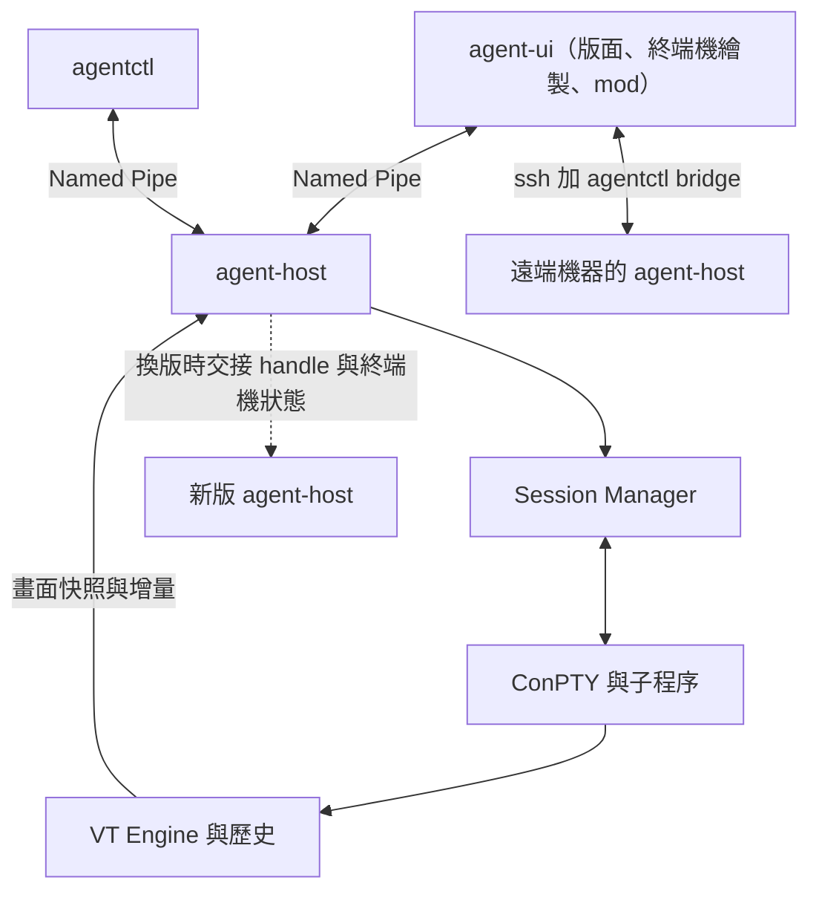
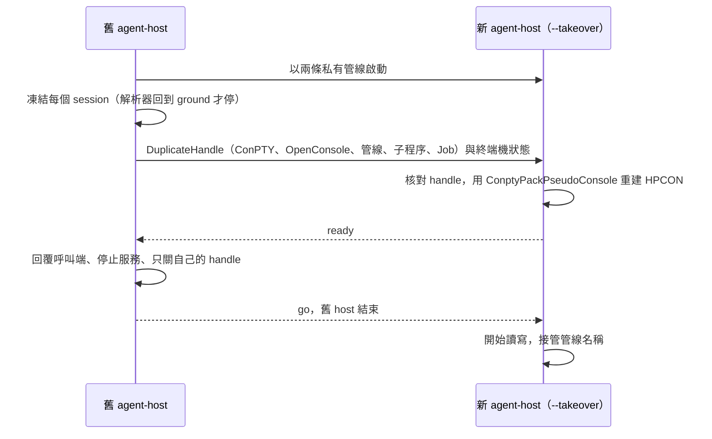

# AgentDesk：Windows AI Agent 工作台

產品需求與系統設計文件 v2.14  
日期：2026-11-20｜狀態：產品版本 0.2.0。MVP（M0～M4）、herdr 主要功能（5.5）、herdr-app 介面與行為移植（5.6、ADR-15）都已完成，使用者在 2026-11-19 驗收（5.7）；WSL 發行版可作為本機 shell（ADR-16）；還沒做的人工驗收見 5.4、5.7  
技術基線：C++20、Windows 11 x64、Dear ImGui（FreeType 繪字）、Win32、DirectX 11、隨附 ConPTY

> 產品名稱定為 AgentDesk，本身以 MIT License 釋出。介面與行為依 herdr-app 原始碼複刻（ADR-15），程式全部用 C++ 重寫，不宣稱與 herdr 的協定或程式相容；程式裡不出現 herdr 的名稱（ADR-21），本文件提到 herdr 是因為它是參考產品。第 1 章保留 MVP 時的需求，MVP 之後加上的功能主要寫在 2.4～2.8、3.7.2～3.7.3 與第 4 章；實機驗證結果見各 Sprint 的 TestReport（`contracts/inbox/TestReport_sprint*.md`）。

### 版本紀錄

| 版本 | 日期 | 變更 |
|---|---|---|
| 1.0 | 2026-11-16 | 初版（原檔保存在 `docs/archive/AgentDesk_Design_v1.0.md`） |
| 1.1 | 2026-11-16 | 依 herdr／herdr-core 公開原始碼補入：隨附 ConPTY 的必要性、VT 引擎第二候選 libghostty-vt、OSC 7501 觀察到的格式、環境變數＋CLI 狀態回報 adapter、host 脫離啟動者 Job 的規則、待決事項清單。研究筆記見 `docs/research/herdr-reference.md` |
| 1.1.1 | 2026-11-16 | 文字校正：中國用語改為台灣用語、補齊缺動詞的句子、刪除空洞強調，不改任何規格 |
| 1.2 | 2026-11-16 | 使用者決定 OQ-01（名稱 AgentDesk）與 OQ-08（MIT License），新增 ADR-10 |
| 1.3 | 2026-11-16 | 使用者限制：只用已安裝的 Visual Studio C++ 工具鏈，不另外安裝工具。新增 3.1 開發環境基線與 ADR-11；libghostty-vt 降為備案，OQ-07 傾向 vcpkg |
| 1.4 | 2026-11-16 | 更正：OSC 7501 有公開規格（Revision 0.4），Claude Code v2.1.295 起原生支援。3.6 改以 OSC 7501 為主要狀態來源、report-state 為第二來源；補功能偵測與回覆順序、生命週期、上限；新增 QA-21、QA-22 |
| 1.5 | 2026-11-16 | 建立 5 個對應 skill 後補入查證結果：vcpkg 沒有 libvterm port，改以 third_party 原始碼建置；Dear ImGui 1.93.0（docking）與 GoogleTest 1.18.0 在 vcpkg 可取得；OQ-05 傾向 GoogleTest |
| 1.6 | 2026-11-16 | 使用者決定 OQ-02：首發支援 Claude Code 與 Codex CLI。新增 1.2.1 Given／When／Then 驗收條件（PRD 品質門檻）；ADR-09 理由依 OSC 7501 更新 |
| 1.7 | 2026-11-16 | 一致性審查修正：狀態欄位統一為 `seq`，OSC 7501 的 seq 由 host 指派；report-state 新增 `--kind`、`--message`；明定紀錄被丟棄或清除後的 agent_state 與 `last_agent_state`；QA-13 加退出碼；5.2 第 8 項去除過時的 vcpkg port 選項；P2 範圍與 MVP 一致；ADR-10 的 Ghostty 改為僅供參考 |
| 1.8 | 2026-11-17 | M0 結果：ADR-08 定案（隨附 ConPTY，內建版本實測丟掉 OSC 7501 回覆）；凍結 OQ-03～OQ-07；3.3 過載政策改為背壓；3.4 補 libvterm 已知限制；5.1 補 M0 後修正估工。依據 `docs/poc/M0-report.md` |
| 2.14 | 2026-11-20 | ADR-24：AgentDesk 98 暫時隱藏（程式保留、照常編譯與測試）；2.4、2.8 加註 |
| 2.13 | 2026-11-20 | ADR-23：視窗開啟的位置與大小。記住上次的位置、大小與是否最大化（`window.json`）；第一次啟動依螢幕的可用範圍、縮放比例與 zoom 決定大小；首次啟動縮放的螢幕寬度改用邏輯像素；4.1 加一列 |
| 2.12 | 2026-11-20 | ADR-22：全面重構（行為不變），`apps/desktop` 由單一 `app.cpp` 拆成依功能分的檔案；程式註解改用自己的話，移除 herdr 出處與行號（對照表在 `docs/research/herdr-app/code-map.md`）；2.8、3.10 依新結構更新 |
| 2.11 | 2026-11-19 | 依 0.2.0 的程式全面校正：2.1 元件與圖、2.2 生命週期（host 工作目錄、交接、結束面板的清除），新增 2.4 版面引擎、2.5 mod、2.6 遠端機器、2.7 更新與 agent-host 交接、2.8 AgentDesk 98；3.1 補 FreeType、lunasvg 與字型；3.2 改正隨附 ConPTY 缺少時的行為；3.5、3.6、3.9 依現況更新（版面引擎取代 docking、`agentctl hook`、不再用 imgui.ini）；3.7.2 移到 3.8 前面並新增 3.7.3；3.8 補 `hook`、`update`；3.10 改成實際的原始碼結構；第 4 章改寫為目前的主畫面；新增 5.7 Sprint 10 完成狀態與使用者驗收；5.4～5.6 標註已被取代的內容；7.1 依編號排列並標註被後續 ADR 取代的句子；7.2、7.3 補項目；7.4 的待決事項都已決定，清空；第 8 章結尾更新 |
| 2.10 | 2026-11-19 | ADR-21：程式裡不出現 herdr 的名稱，win98 版面改名 AgentDesk 98；Release 連結參數改為 /OPT:REF /OPT:ICF |
| 2.9 | 2026-11-19 | ADR-20：新增 space 或分頁時選擇 shell（AgentDesk 的亮點）；Agent 回到 shell 提示時刪除狀態（3.4、QA-22）；herdr 的主題、版面引擎、FreeType 繪字、框線與方塊字元填滿格子 |
| 2.8 | 2026-11-19 | ADR-18：版面只保留 herdr 有的（移除 Board、Grid、Focus），補做 Herdr 98、線上更新檢查、使用統計（Settings › Updates、Privacy，沒有內建伺服器）；修正點擊與選單問題（見 sprint/current/status.md）；ADR-19：agent-host 單獨更新時接手終端機（OQ-09 已決定）；程式表與圖示改用 herdr 的 |
| 2.7 | 2026-11-18 | 對照 herdr-app 原始碼（commit 321c9a8）逐行比對約 400 項，補齊約 58 項：分割樹改為多子節點與權重、分頁與焦點規則、側欄與 Agent 清單、選單與對話框、Terminals 版面、win32-input-mode、複製貼上與連結、Files／Changes、worktree、設定與歡迎頁 |
| 2.6 | 2026-11-18 | 依 herdr 規格逐項比對（約 150 項）補齊缺漏與差異，見 5.6 最後一列與「刻意保留的差異」 |
| 2.5 | 2026-11-18 | 使用者要求全部用 C++：新增 ADR-17（mod 改為 C++ DLL，取代 ADR-14）；Codex 狀態 hook 改為 `agentctl hook` |
| 2.4 | 2026-11-18 | 補齊 herdr 移植的剩餘項目（5.6）：滑鼠回報、右鍵設定、分頁收起、複製與重設版面、複製 mod、What's new、Send feedback、遠端機器的 Files／Changes；ADR-15 的代價更新 |
| 2.3 | 2026-11-18 | 使用者要求接入 WSL：新增 ADR-16；1.3 的 P3「WSL 專用 adapter」改為「WSL 作為遠端機器（Linux 版 agent-host）」 |
| 2.2 | 2026-11-18 | 使用者要求完整複刻 herdr、可直接參考並轉寫其程式碼、介面字太小：新增 ADR-15（取代 ADR-13 的「外觀自訂、不複製程式碼」與 ADR-10 的對應句、ADR-12 的版面細節）；新增 5.6；新分頁、新 space、分割一律先開 shell；關閉面板與分頁會結束其中的程式（與 herdr 相同） |
| 2.1 | 2026-11-17 | 使用者要求功能與 herdr 一樣好用、外觀不同：新增 ADR-13（對齊範圍，手機版不做）、ADR-14（Lua mod）；4.1 改為 space／分頁／分割樹；3.7.2 新增協定方法；3.8 新增 CLI 指令；新增 5.5 |
| 2.0 | 2026-11-17 | MVP 完成：4.1 主畫面改為實作的版面（側欄 Spaces／Agents、分頁加分割面板、Details 卡片），新增 ADR-12；新增 5.4 MVP 完成狀態與限制；已結束 session 只保留最新 8 個的完整畫面（3.4 補充） |
| 1.9 | 2026-11-17 | M1 實作補充（3.7.1）：attach 的控制權參數、事件格式、輸入種類、`profile.list`、`history.read` 的 `tail`、錯誤碼 `AMBIGUOUS`、request id 必須跨 client 唯一、`AGENTDESK_DATA_DIR`；3.8 補 `--key`、`shutdown`、`--pipe`、`--no-start`、`--timeout-ms` |

## 0. 文件導讀與決策摘要

| 章節 | 主要讀者 | 用途 |
|---|---|---|
| 1. 產品需求 | PM、RD | 釐清使用情境、範圍與交付條件 |
| 2. 系統架構 | SA、RD | 程序邊界、資料流與生命週期 |
| 3. 技術詳細設計 | RD | 終端機、IPC、狀態與錯誤處理 |
| 4. 介面與操作 | PM、UI、RD | 使用流程與互動規則 |
| 5. 開發計畫 | PM、Tech Lead | POC 關卡、WBS 與估工 |
| 6. 測試與驗收 | QA、RD | 功能、相容性與故障情境 |
| 7. 風險與決策紀錄 | 全體 | 已決策項目與待驗證事項 |

設計原則：UI 與執行核心分離；由背景程序擁有 ConPTY 與終端機狀態；重用 VT 解析核心，自製 ImGui renderer；使用本機 Named Pipe；保留 Agent 原有的權限確認行為。

MVP 不建立 HTTP backend、Docker、資料庫、遠端控制或自動多 Agent 排程平台，先完成「兩個 Agent 能正常互動、UI 關閉後持續執行、重新連線還原目前畫面」。MVP 之後加上的遠端機器（ssh）、mod、線上更新與 agent-host 交接見 2.4～2.8；HTTP backend、Docker、資料庫與自動排程至今都沒有做。

## 1. 產品需求（PRD）

### 1.1 問題與目標

使用者同時在多個終端機執行 coding agent 時，難以掌握哪個工作需要輸入、哪個程序已結束，以及各自操作哪個專案。一般桌面 UI 若同時持有執行程序，一不小心關掉視窗，工作也會跟著中斷。

AgentDesk 提供集中工作清單、可分割終端機面板與獨立背景執行。它管理的是實際 CLI 工作階段，不代理模型 API，也不取代 Agent 的登入或訂閱。

### 1.2 使用者故事

| ID | 故事 | 成功條件 |
|---|---|---|
| US-01 | 開發者在指定專案啟動 Agent | 顯示工作目錄、命令與可互動終端機 |
| US-02 | 開發者同時執行兩個 Agent | 各自有獨立輸入、畫面、尺寸與程序狀態 |
| US-03 | 使用者暫時關閉視窗 | 背景工作持續，重新開啟後能接回原工作 |
| US-04 | 使用者需要知道哪個 Agent 等待輸入 | 有可信狀態來源時提示；無來源時顯示未知 |
| US-05 | 使用者停止卡住的工作 | 可先中斷，再明確強制終止整個受管理工作樹 |
| US-06 | 使用者查看先前內容 | 可捲動、選取、複製保留範圍內的終端機文字 |
| US-07 | Agent 或腳本管理另一項工作 | CLI 提供穩定 JSON 輸出與明確退出碼 |

### 1.2.1 驗收條件（Given／When／Then）

每個使用者故事至少一組，對應的完整測試見 6.2。

| ID | Given | When | Then | 測試 |
|---|---|---|---|---|
| US-01a | 已設定有效 profile，cwd 含空白與中文字 | 使用者從「新增工作」啟動 | 面板顯示 Starting 再到 Running，Agent 實際工作目錄等於指定 cwd，可輸入 | QA-01 |
| US-01b | profile 的 executable 或 cwd 不存在 | 使用者啟動 | 停在表單、保留輸入並顯示原因；沒有殘留程序 | QA-02 |
| US-02a | 兩個工作都在持續輸出 | 使用者在其中一個面板輸入 | 只有該工作收到輸入，另一個畫面與尺寸不變 | QA-03 |
| US-02b | 第二個 UI attach 到同一工作 | 第二個 UI 嘗試輸入或改尺寸 | 被拒（唯讀），明確移交控制權後才可操作 | QA-14 |
| US-03a | 工作每秒輸出一行計數 | 使用者關閉視窗 30 秒後重開 | PID 與 session 不變，計數連續，2 秒內可操作 | QA-05 |
| US-03b | 從終端機啟動 UI | 使用者關閉那個終端機 | host 與工作仍存活；無法脫離 Job 時 UI 事先提示 | QA-20 |
| US-04a | Claude Code（v2.1.295 以上）在工作中執行 | 它進入等待權限確認 | 清單顯示 Blocked、來源 osc7501 與更新時間 | QA-21 |
| US-04b | 工作沒有任何可信狀態來源 | 輸出靜默 60 秒 | 仍顯示 Unknown，不會變成 Done | QA-07 |
| US-05a | 子程序忽略 Ctrl+C | 使用者停止工作，5 秒後選擇強制終止 | 整個受管理程序樹結束，Job 內無殘留 | QA-09 |
| US-06a | 畫面含中文、組合字元與雙欄字元 | 使用者選取並複製 | 剪貼簿內容欄位正確、不含控制碼 | QA-11 |
| US-06b | 歷史已達上限 | 使用者往上捲 | 顯示已截斷的範圍，記憶體維持在預算內 | QA-12 |
| US-07a | 腳本以 `--json` 呼叫 `agentctl list` | 指令完成 | stdout 只有 JSON，診斷在 stderr，退出碼符合 3.8 | QA-13 |
| US-07b | 腳本呼叫 `agentctl send` 未加 `--enter` | 指令完成 | 只送出文字，不送 Enter | QA-13 |

### 1.3 交付範圍

| 等級 | 功能 |
|---|---|
| P0：POC | 單工作 ConPTY、VT 解析、ImGui 繪製、鍵盤輸入、縮放、中文輸入驗證 |
| P1：MVP | 多工作、背景 host、重新連線、捲動複製、工作設定、停止與清理、基本 CLI |
| P2：後續 | 首發兩個 CLI 以外其他 Agent 的可信狀態 adapter、多 Agent 任務派工、匯出、完整搜尋、多視窗、host 升級不中斷工作（程序持有者與 host 分離，參考 herdr-core 的 holder）、Agent 原生 session 續接命令（resume argv） |
| P3：另案 | WSL 作為遠端機器（Linux 版 agent-host）、SSH 遠端、插件執行環境、自動更新、多人協作 |

0.2.0 的進度：P2 的「host 升級不中斷工作」已做，做法是新舊 agent-host 交接 handle（ADR-19，2.7），不是 herdr-core 的 holder 程序；子 Agent 協作的通道已做（3.8），自動派工沒有做；終端機搜尋涵蓋畫面與最多 5000 行歷史。P3 的 SSH 遠端（2.6）、插件執行環境（C++ DLL mod，ADR-17，2.5）、自動更新（2.7）已做。WSL 依 ADR-16 改為本機 shell，不做 Linux 版 agent-host，上表那一項不再採用。多人協作沒有做。

MVP 狀態整合至少實作一個可控測試 adapter，並整合兩個目標 Agent：Claude Code（OSC 7501）與 Codex CLI（hook＋report-state）。未能取得可信狀態時，允許以「Agent 狀態未知」交付，但不可宣稱能偵測 Agent 已完成工作。

### 1.4 平台與限制

- 正式首發目標為 Windows 11 x64，一般使用者權限；確切 OS build 與 CLI 版本在 POC 報告凍結。
- Windows 10 僅列相容性評估，不在 v1.0 保證範圍。
- 使用者預先安裝及登入目標 CLI；建立 profile 時檢查 executable 與必要啟動器。
- 原生 exe 與透過 Node/npm 的 cmd 啟動器需分別驗證，不能假設所有 CLI 都能直接 CreateProcessW。
- 關閉 UI 可續跑；登出、重新開機、host 崩潰不保證續跑。休眠期間工作暫停，恢復後另做連線與程序健康檢查。
- 相同目錄中的多 Agent 可修改同一批檔案。MVP 顯示共用目錄提示；需要隔離時由使用者選擇不同 git worktree。

### 1.5 非功能目標

以下為驗收目標而非已測得數據。基準機：Windows 11 x64、8 邏輯核心以上、16 GB RAM、1080p、150% DPI；報告另附 CPU/GPU 型號。

| 項目 | 目標與量測方式 |
|---|---|
| 並行 | 4 個 shell 穩定；其中 2 個實際 Agent 同時互動 |
| 互動延遲 | 本機測試 echo，自按鍵送出至畫面更新 p95 < 100 ms，不含模型回應 |
| UI 續接 | 4 個 session、每個 120×40 字元畫面，p95 < 2 秒至可操作 |
| 記憶體 | host + UI 額外私有記憶體 < 500 MB，不含子程序；字型及歷史上限固定 |
| 輸出壓力 | 合成 1 MiB/s、持續 60 秒，host 持續消費；UI 可合併畫面更新 |
| 穩定性 | 8 小時 soak、100 次建立／停止，無持續 handle 或 thread 增長 |

## 2. 系統架構（SA）

### 2.1 元件與責任

| 元件 | 程序 | 責任 |
|---|---|---|
| Desktop UI | agent-ui.exe | 自繪標題列、版面、側欄、分頁、面板、終端機繪製、選取、快捷鍵、IME、Files／Changes、命令面板與設定 |
| Session Host | agent-host.exe | 單一使用者背景程序，管理所有工作與資源，保存 UI 文件（ui.state） |
| Control CLI | agentctl.exe | 以 IPC 呼叫 host，不直接控制 UI；另有 `hook`（Agent 的狀態 hook）、`bridge`（給 ssh 轉接）、`update`（更換 agent-host） |
| Session Manager | host 內部 | 建立、停止、查詢、單一輸入控制權、子 Agent 的 parent、task、report |
| ConPTY Backend | host 內部 | 管線、HPCON、CreateProcessW、Job、程序監控、前景程式偵測 |
| Terminal Engine | host 內部 | VT 解析、字元格、游標、模式、歷史；OSC 7501、OSC 7、OSC 133 |
| Agent Adapter | host 內部 | profile（含偵測到的 shell 與 WSL 發行版）、shell 提示鉤子、可信狀態事件與來源記錄 |
| Handover | host 內部 | agent-host 換版時把執行中的終端機交給新 host（2.7、ADR-19） |
| Layout Engine | UI 內部 | 依版面樹排出畫面上的各個區塊（2.4） |
| Mod Host | UI 內部 | 載入 C++ DLL mod（2.5、ADR-17） |
| Remote Machines | UI 內部 | 經 `ssh <目標> agentctl bridge` 連到其他 Windows 電腦的 agent-host（2.6） |
| Updates／Telemetry | UI 內部 | 版本檢查、換版、使用統計；沒有預設伺服器（2.7、ADR-18） |
| Persistence | host／UI 各自 | 工作 metadata、profile、UI 文件、設定、版面（3.9） |



### 2.2 程序生命週期

1. UI 或 CLI 先連接 host；不存在時以一般使用者身分啟動 host。啟動參數：`DETACHED_PROCESS`，並以 `CREATE_BREAKAWAY_FROM_JOB` 脫離啟動者所在的 Job（例如從終端機或 IDE 啟動 UI 時，該 Job 可能設有 KILL_ON_JOB_CLOSE，關閉終端機會連帶殺掉 host）。不可使用 `CREATE_NEW_PROCESS_GROUP`，這會讓 host 之後啟動的程序收不到 Ctrl+C。只透過 `PROC_THREAD_ATTRIBUTE_HANDLE_LIST` 繼承 NUL 與 log handle。若 breakaway 遭拒，留在原 Job 並在 UI 提示「host 會隨啟動者結束」。host 的工作目錄是使用者家目錄（`USERPROFILE`），不是安裝資料夾：Windows 不能改名某個程序的工作目錄，否則線上更新無法把安裝資料夾改名（2.7）。
2. 每位登入使用者的一個登入工作階段只允許一個 host，使用含 SID 與登入工作階段識別的 mutex；競爭者退出並重新連線。
3. host 建立 ConPTY、管線與受管理的程序樹。UI 不持有 HPCON 或子程序控制 handle。
4. UI 關閉僅 detach；host 保持存活，直到使用者明確執行退出背景程序。
5. host 正常退出時先停止工作並清理；host 非正常消失時，利用 Job Object 的政策盡力清理受管理子程序。
6. 新 host 啟動時，將上次遺留的 Running metadata 標記 Lost。絕不只憑舊 PID 採納程序，避免 PID 重用。唯一的例外是換版交接（2.7、ADR-19）：新 host 只接受舊 host 複製給它的 handle，用 handle 本身驗證後接手，不讀 sessions.json，也不憑 PID。
7. UI 每次取得 session 清單時，移除終端機已結束（exited、killed）或 Lost 的面板；分頁空了就關分頁，space 空了就關 space，已結束的 session 也不會被開成 space（照 herdr，Sprint 10）。沒連上的遠端機器保留它的面板，因為那裡的工作還在跑。

Host 不是 Windows Service，也不以系統帳號執行。背景運作只保證同一次登入工作階段內的 UI 分離。

### 2.3 資料流

輸出：Agent → ConPTY → 持續讀取 → 串流 VT 解析 → TerminalState → 帶版本的畫面增量 → UI。

輸入：UI 按鍵／文字 → IPC → 檢查輸入控制權 → 依終端機模式編碼 → 寫入管線 → ConPTY → Agent。

VT Engine 需要回覆的終端機查詢由 host 處理，UI 不連線時仍可回覆。OSC 狀態解析與一般 VT 解析使用一致的串流框架，不能各自用不完整 buffer 搜尋字串。

### 2.4 版面與版面引擎（ADR-15、ADR-18）

內建三個版面：workspace（herdr 的 main，預設；設定與命令面板顯示為 AgentDesk）、terminals、win98（AgentDesk 98，見 2.8；目前隱藏，ADR-24）。herdr-app 的 `main.json`、`terminals.json`、`win98.json` 原檔放在 `third_party/herdr/layouts`，建置時編進程式。

- 版面模型在 `libs/ui`（`layout.hpp`）：節點樹由 block、row、column、stack、floating 組成，JSON 的鍵與預設值都照 herdr。大小計算、分隔線拖曳、浮動區塊的吸附與位置也照 herdr，herdr 的 layout.rs、layout_sync.rs 與拖曳測試已移植成單元測試。
- 側欄、分頁列、窗格、右側面板、狀態列，以及 AgentDesk 98 的桌面、工作列、小幫手，位置都由目前版面的樹決定。每個區塊依它寫的 mod 名稱交給對應的 C++ 繪製函式；寫的是 C++ DLL mod 的名稱時，畫那個 mod 的面板。
- 自訂版面放在 `%LOCALAPPDATA%\AgentDesk\layouts\<名稱>.json`。使用者拖曳、開關造成的改動另存到 `layouts\.state\<名稱>.json`，不改版面檔。`layout.toggle`、`layout.show`、`layout.hide`、`layout.resize`、`layout.select` 照 herdr。`layout.clone` 複製成 `<名稱>-copy`（已存在就失敗）；`layout.reset` 只接受內建版面，同名的使用者檔改名成 `<名稱>.json.old-<時間>`。
- 舊格式的版面檔（有 `sidebar`、`tab_bar` 等鍵、沒有樹）在讀取時轉換：當成同 `style` 的內建版面，再隱藏關掉的部分、套上 theme 與 font_size，檔案本身不改寫。`ui.json` 原本存的側欄寬度、面板寬度、Spaces／Agents 比例與側欄開關，第一次啟動時轉成 workspace 的 `.state`。
- 每個版面各自記住一組深色與淺色主題（`ui.json` 的 `layout_themes`）。主題有我們的四套，加上 herdr 的 graphite、ink、moss、paper、atom-one-dark，以及使用者放進 `themes\` 的主題檔；介面顏色照 herdr 的 resolve() 從主題推算。
- 還沒做的部分：版面裡的 terminal 與 agent 區塊不畫（終端機只在分頁裡）；`layout.set` 與「把 mod 停靠到版面」；背景圖片；`shadow`、`window_drag`、`titlebar`、`traffic_lights`、`peek` 只讀不用；版面指定 AgentDesk 沒有的主題時不套用。AgentDesk 自己的 Details 面板不屬於 herdr，仍貼在窗格右邊。

### 2.5 Mod（ADR-17）

mod 是 C++ DLL，放在 `%LOCALAPPDATA%\AgentDesk\mods\<名稱>\mod.dll`，旁邊可以有 `mod.json`（說明）與 `settings.json`（mod 自己的設定）。UI 的 ModHost（`libs/ui`，不碰 ImGui，可單元測試）只載入已啟用的 mod，`LoadLibraryExW` 只搜尋 DLL 所在資料夾與 System32。

- 介面在 `libs/modapi`：純 C 的 `agentdesk/mod_api.h`（版本 1）與 header-only 的 `mod_sdk.hpp`。host 端提供 run、send、notify、exec、add_command、sessions、setting；mod 端提供 on_event、panels、click、decorate、command、destroy；結構化資料用 JSON 字串。
- 每次呼叫 mod 都包在 SEH 裡：mod 當掉就停用，DLL 留著不卸載；C++ 例外由 SDK 攔下並以通知回報。
- 隨附三個範例（`mods/` 的 tab-timer、ntfy-notify、agent-summary），第一次啟動時放進資料夾，預設不啟用；zip 附上 SDK 標頭與範例原始碼。
- 代價：mod 沒有沙盒，以使用者權限執行；無窮迴圈無法中斷，整個介面會停住。

### 2.6 遠端機器

「Add machine」從 `~/.ssh/config` 列出主機，也可以直接輸入 `user@host`。UI 執行 `ssh <目標> agentctl bridge`，bridge 把 stdin／stdout 轉接到那台電腦的 agent-host 管線（需要時先啟動它），之後走同一套 IPC 協定。遠端的 space 與 Agent 顯示在同一個側欄，程式在那台電腦上執行。

- 需求：對方是 Windows 並安裝 AgentDesk，`agentctl` 在 PATH 上（或填完整路徑），設好金鑰登入。AgentDesk 不在背景要求輸入密碼，需要密碼或確認主機金鑰時，設定頁顯示 ssh 的訊息。
- 遠端 space 的 Files／Changes 經那台的 agent-host 取得（`fs.list`、`fs.read`、`git.run`，3.7.3），沒有資料夾監看，每 10 秒更新（ADR-15）。
- 機器沒連上時，它的面板保留（2.2 第 7 項）。WSL 不當遠端機器（ADR-16）。
- 實際 ssh 連到另一台 Windows 仍待人工驗收（5.5）。

### 2.7 線上更新、使用統計與 agent-host 交接（ADR-18、ADR-19）

更新與使用統計都沒有預設伺服器，比照 herdr 從原始碼建置的版本：設了 `AGENTDESK_RELEASES_URL` 才檢查更新，設了 `AGENTDESK_TELEMETRY_URL` 才送出使用統計。

**AgentDesk 本身的更新**：啟動 10 秒後檢查，之後每小時一次，失敗 30 分鐘後重試。讀 `app/latest.json` 的 `targets["windows-x86_64"]`（url 與 sha256），用 System32 的 curl 下載、比對 sha256，解壓到安裝資料夾旁的 `.download`，確認 `agent-ui --version` 相符後改名為 `.new` 並寫入 `.new.json`。按「Restart to update」、下次結束程式，或上次沒正常結束時的下次啟動前，把安裝資料夾改名為 `.old`、`.new` 改回原名，失敗就還原。安裝資料夾以執行檔旁有沒有 `THIRD_PARTY_NOTICES.md` 判斷（只有 zip 裡有）。

**agent-host 單獨更新**：`agentctl update [--json] [--version X] [--exe PATH]` 或設定 › Updates 的 agent-host 列，讀 `core/latest.json` 下載 `agent-host.exe.new`，檢查 sha256 與 `--version` 後換檔（執行中的檔案改名為 `.old`），再以 `host.update` 請執行中的 host 交接，失敗就換回。app 更新後第一次啟動，UI 以 `agentctl update --exe` 把終端機交給 zip 帶來的 agent-host，成功後刪除 `.old`。

**交接流程**（`libs/host/src/handover.cpp`）：



- 凍結時若解析器不在 ground，舊 host 會逐位元組多讀，最多 3 秒；其餘位元組留在原管線給新 host。一起搬的有兩個畫面緩衝區、筆、模式、捲動區、tab、字元集、DECSC 游標（收錄的 libvterm 加了 `agentdesk_handover.c`，3.4）、歷史（含 line id）、OSC 7501 紀錄與 seq。
- 新 host 核對：GetProcessId 等於紀錄、程序在那個 Job 裡、Job 仍是 KILL_ON_JOB_CLOSE 且不允許 breakaway、console 程序是 OpenConsole。
- ready 之前出錯或逾時（30 秒）：舊 host 結束新程序，恢復所有 session。新 host 驗證失敗只關自己的副本，絕不 TerminateJobObject。
- 交接期間，會改變狀態的請求回 `OVERLOADED`（可重試，「agent-host is updating」）；當時的連線（含 `agentctl wait`）會中斷。hello 的 `succeeds` 列出接手過的 host 實例，UI 看到原本的實例在裡面就不把 session 標成 Lost，重新 attach 取得新快照，控制者也重新取得控制權。
- 只支援隨附 ConPTY：系統內建版沒有 `ConptyPackPseudoConsole`，更新會回報錯誤，終端機不受影響。

**使用統計**（設定 › Privacy）：每個 UTC 日一份報告，跨日後放進待送佇列，7 天後丟棄；報告用隨機 id，送出失敗時以指數退避重試；使用者關閉統計時清空報告並換 id。`DO_NOT_TRACK`、`AGENTDESK_TELEMETRY=0`、CI 環境只關閉這一次執行。「What we send」逐字顯示待送報告、今天的草稿與上次送出的內容。

### 2.8 AgentDesk 98（win98 版面，ADR-18、ADR-21）

> **目前隱藏（ADR-24）**：版面清單、Ctrl+Shift+L、命令面板與設定都不列出 AgentDesk 98，歡迎頁也不再提到它；`ui.json` 存的是 win98 時改顯示第一個版面（workspace），`layouts\win98.json` 也不列出。程式與素材都保留並照常編譯、測試；設環境變數 `AGENTDESK_WIN98=1` 再啟動就會列出（截圖工具在 `--run` 含 win98 時自動設定）。

移植自 herdr 的 Herdr 98，依 ADR-21 改名為 AgentDesk 98。桌面、工作列、開始選單、窗格標題列、對話框、踩地雷、接龍與小幫手都由程式自己畫。

- 程式：繪製在 `apps/desktop/win98_*.cpp`（kit、dialogs、chrome、desktop、games），純邏輯在 `libs/ui/src/win98.cpp`；素材（像素字型、圖示、圖片、音效、版面專用主題）在 `third_party/herdr/win98`。SVG 用 lunasvg 點陣化成 DX11 貼圖，PNG 用 WIC 解碼。
- 開機畫面、關於與開始選單側邊的標題圖由程式用像素字型畫出，Start 與 Update 圖示換成 AgentDesk 的標誌（ADR-21）。
- 狀態存在資料目錄的 `win98.json`（scale、mute、桌面、小幫手位置、遊戲設定等）。
- 版面專用主題 win98 不列在主題清單；終端機用它的 16 色表（格子記住自己用的是哪一個 ANSI 色，3.7.3）。
- 按鍵在 keys.json 的 `layout:win98` 區段。Ctrl+Esc、Ctrl+Shift+Esc 只在 AgentDesk 位於最前面、且 keys.json 有綁定時，由低階鍵盤 hook 先接下，執行 `win98.start`、`win98.taskman`；其他時候仍是 Windows 的開始選單與工作管理員。

## 3. 技術詳細設計（SD）

### 3.1 技術選型與建置

| 項目 | 建議 | 狀態 |
|---|---|---|
| 語言 | C++20，RAII 封裝 HANDLE、HPCON、COM 資源 | 決定 |
| 建置 | CMake + Ninja + MSVC，固定工具鏈版本及 CMakePresets；只用下方「開發環境基線」列出的已安裝工具 | 決定 |
| GUI | Dear ImGui 1.93.0（vcpkg `imgui` 的 `docking-experimental`、`win32-binding`、`dx11-binding`、`wchar32`、`freetype` features，以 builtin-baseline＋overrides 固定）；Win32 + DX11 backends。主畫面不用 DockSpace（ADR-12），由版面引擎排版（2.4） | 決定 |
| 繪字 | FreeType 2.15.0（vcpkg，經 `imgui[freetype]`，FTL 授權，與 MIT 相容）；框線、方塊、點字、Powerline 字元由 `libs/ui` 的 sprites 照格子像素畫成圖形（移植自 herdr 的 sprites.rs） | 決定（Sprint 10） |
| 字型 | 隨附 Geist（介面）、JetBrains Mono Medium（終端機）、Symbols Nerd Font；中文以微軟正黑體補上 | 決定（ADR-15） |
| 圖片 | lunasvg 3.5.0＋plutovg 1.3.3（vcpkg，MIT）點陣化 SVG；PNG 用 WIC 解碼 | 決定（Sprint 10） |
| 終端機核心 | libvterm 0.3.3（官方 tarball 原始碼收錄於 third_party，tarball 已含產生的 `.inc`，建置不需 perl；呼叫端加 `/utf-8`）。libghostty-vt 因需要 Zig 不採用（ADR-11） | 決定（M0） |
| ConPTY 實作 | 隨附 Microsoft.Windows.Console.ConPTY 1.24.260710001（`conpty.dll` + `OpenConsole.exe`），`fetch_conpty.exe`（`tools/fetch_conpty`）釘選版本並驗 SHA-256，以 LoadLibraryExW 從執行檔旁的 `conpty\` 載入；找不到時退回系統內建並在 UI 標示「狀態回報不可用」 | 決定（M0，ADR-08） |
| JSON | nlohmann/json 3.12.0（vcpkg） | 決定（S1-1） |
| IPC | 本機 Named Pipe，binary length prefix + UTF-8 JSON | 決定 |
| 設定 | JSON 檔，原子替換與 schema_version | 決定 |
| 測試 | CTest＋GoogleTest 1.18.0（vcpkg）；label `unit`、`windows_integration` | 決定（S1-1） |

開發環境基線（2026-11-16 於開發機確認，ADR-11）：Visual Studio 2022 Build Tools 17.14（MSVC 14.44.35207、Windows SDK 10.0.26100.0、內附 clang-format／clang-tidy）、CMake 4.3.1、Ninja 1.13.2、vcpkg（`C:\vcpkg`）。不另外安裝其他編譯器或建置工具；第三方函式庫透過 vcpkg manifest 或放進 third_party 的原始碼取得。

所有第三方套件固定 commit/version，保留 license 與 notices。libvterm 的 Windows 編譯、VT 行為、授權及維護方式通過關卡前，不列為已完成整合。若 POC 不合格，調整引擎選型及工期，不直接改成從零自寫終端機引擎。

### 3.2 ConPTY 建立與關閉

ConPTY 來源：herdr-core 的實作註解指出，Windows 內建 ConPTY 會吞掉程式回給終端機的部分輸入跳脫序列（DA 查詢回覆、OSC 7501），因此 herdr-core 隨附固定版本並驗 SHA-256 的 Microsoft.Windows.Console.ConPTY（觀察到的版本為 1.24.260710001）。AgentDesk 在 M0 以同一組 fixture 分別測內建與隨附版本，內建版本漏掉了 OSC 7501 回覆，因此改用隨附版本（ADR-08），MIT license 與 NOTICE 放在 third_party/conpty。host 啟動時載入 ConPTY：執行檔旁沒有 `conpty\conpty.dll` 就退回系統內建版本（狀態回報不可用，也不能換版交接）；檔案存在卻載入失敗時，host 啟動失敗。

建立順序：驗證 profile／cwd → 建立輸入輸出管線 → CreatePseudoConsole → STARTUPINFOEXW 設定 pseudoconsole attribute → CreateProcessW(CREATE_SUSPENDED) → 指派 Job Object → ResumeThread → 啟動監控。

- 精確限制可繼承 handles，關閉未使用的 pipe ends，避免 EOF 永遠不發生。
- Job Object 預設採 JOB_OBJECT_LIMIT_KILL_ON_JOB_CLOSE，不允許刻意 breakaway。若指派失敗，清理剛建立的程序並回報，不留下半受管理工作。
- 相容性測試需涵蓋既有 Job、ConPTY 相關程序與 CLI 子程序；Job 是生命週期管理工具，不是安全沙箱。
- executable 與 argv 分開儲存，使用經測試的 Windows quoting；不將任意 prompt 拼接成 PowerShell 或 cmd 命令。
- .cmd profile 必須透過明確的 shell launcher adapter 啟動，quoting 與注入測試另外獨立處理。
- 調整尺寸先 clamp 至合理範圍，再由 session 序列化處理 ResizePseudoConsole 與 engine resize；成功後產生新 generation 的完整快照。
- 輸入與輸出使用獨立工作路徑；MVP 可用每 session 同步讀取 thread、獨立寫入 thread 及序列化處理佇列，不假設匿名同步 pipe 能直接套用 IOCP。

停止流程：先送中斷請求（例如終端機輸入 Ctrl+C；實際效果依 CLI 驗證）→ 最多等待 5 秒 → 顯示仍在執行 → 使用者可明確要求 force → TerminateJobObject → 等候退出 → 在持續 drain 輸出的條件下關閉 pseudoconsole 與管線。

關閉不得阻塞 UI thread。舊 Windows 行為可能在 ClosePseudoConsole 等候輸出消費，必須依選定 OS 的官方流程實作並測試，不能先停 reader 再無條件等待關閉。所有 handle 使用 RAII，但仍需明確設計關閉順序與可取消 I/O。

### 3.3 執行緒、壓力與同步

- UI thread 獨占 ImGui 與 DX11 呼叫；IPC receiver 只把資料送入 UI queue。
- 每個 TerminalState 僅由對應 session actor 寫入；renderer 只讀不可變快照。
- ConPTY reader 不因慢速 UI 停止讀取。host 必須完整依序解析收到的輸出；只允許合併或省略 UI 更新，不可任意丟棄 VT bytes。
- session 原始輸出處理佇列預算 8 MiB。超過時採**背壓**（OQ-06，M0 定案）：reader 暫停讀取 PTY，子程序的寫入隨之阻塞，不丟任何位元組；host 記錄 `backpressure_waits` 並在狀態列顯示過載。關閉 session 前先解除背壓，避免 join reader 時死結。M0 實測 1 MiB/s 持續 60 秒未觸發背壓。不得宣稱無限輸出可永遠無阻塞。
- 每個 UI client 發送佇列預算 4 MiB。超額時丟棄未發出的畫面增量、設 needs_snapshot；恢復時傳最新完整快照。持續無法恢復的 client 斷線，不阻塞其他 client。
- CLI 一般控制 RPC 預設 5 秒逾時。逾時不代表操作未執行，需依 request_id 查詢結果，避免重複建立。

### 3.4 終端機資料模型

| 結構 | 主要欄位 |
|---|---|
| Session | id(UUID)、name、cwd、profile_id、process_state、agent_state、last_agent_state、agent_state_source、agent_state_at、created_at、exit_code |
| Cell | grapheme、width(0/1/2)、fg、bg、bold、italic、underline、inverse |
| Screen | cols、rows、cells、cursor、modes、generation、seq |
| HistoryLine | line_id、cells、soft_wrap、timestamp（可選） |
| StateEvent | session_id、source、seq、state、kind、message、observed_at |

字元不是一個 wchar_t 就能完整表示。需處理 UTF-8 跨讀取分段、combining marks、雙欄中文字與寬字元續格。渲染字寬政策與 engine 保持一致；彩色 emoji、複雜 ZWJ shaping 可列限制，但不得破壞後續欄位與游標位置。

必備功能：SGR 顏色與樣式、游標定位、erase、捲動區域、alternate screen、游標可見性、application cursor keys、bracketed paste、必要 DSR/DA 查詢回覆。宣告的終端機能力只涵蓋已驗證項目。

libvterm 0.3.3 已知限制（M0 實測）：UTF-8 序列被切在兩次寫入之間且後接控制字元時會產生 U+FFFD，VtEngine 暫存尾端不完整序列繞過（只延後、不丟）；Ambiguous 寬度一律 1 欄；ZWJ emoji 序列不合併；不支援 kitty keyboard protocol；不對外通知 RIS，因此 OSC 7501「RIS 清除全部紀錄」目前無法實作。為了換版時保存完整畫面（ADR-19），收錄的 libvterm 加了一段 AgentDesk 自己的存取程式（`agentdesk_handover.c`、`vterm_agentdesk.h`），其餘未改，見 third_party/libvterm/README.agentdesk.md。

歷史預設每工作 10,000 行並限制 16 MiB，先達上限者截斷最舊資料，UI 顯示保留範圍。alternate screen 與主畫面分開。MVP resize 保留引擎行為，暫不承諾完美歷史 reflow。

### 3.5 ImGui 終端機 renderer 與輸入

使用 ImDrawList 畫背景區段、字形、選取範圍及游標，只繪可見行；不以 InputTextMultiline 充當終端機。TerminalView 負責座標與字元格映射，輸入編碼由 host 的終端機模式決定。

- 使用等寬字型，補入中文字型 glyph。POC 檢查記憶體、DPI、字型授權與缺字。目前的做法：終端機用 JetBrains Mono Medium、介面用 Geist，由 FreeType 繪字；格寬取字型的真實 advance，不用 `CalcTextSize`；寬字元放大填滿兩格並置中；框線、方塊、點字與 Powerline 字元畫成圖形，上下列之間沒有縫（3.1）。
- 格子記住它用的是 16 個 ANSI 色中的哪一個，主題有自己的色表時用主題的顏色畫。
- 面板寬高換算 cols/rows，拖曳縮放以約 50 ms debounce 合併；字型與 DPI 改變也觸發 resize。
- 正式文字輸入接收 Unicode text events；方向鍵與控制鍵另行編碼，避免 IME 組字與 keydown 重複送字。
- 只有 focused terminal 接收輸入；ImGui 全域快捷鍵不得吞掉終端機必要按鍵。
- Ctrl+C 在有選取時複製、無選取時送中斷；Ctrl+Shift+C 固定複製、Ctrl+V 或 Ctrl+Shift+V 貼上。選單提供明確「送出 Ctrl+C」。
- 貼上檢查 NUL、限制單次 1 MiB；依終端機模式加 bracketed paste。多行文字預設先預覽，使用者確認後才送出。
- MVP 選取採可見畫面與有限歷史的 line_id；若歷史淘汰，取消受影響的選取，避免錯誤複製。
- 先支援 docking，multi-viewports 延後，降低 IME、DPI、焦點與多 HWND 的複雜度。（v2.0 起主畫面改用固定版面，不用 DockSpace，ADR-12；Sprint 10 再改由版面引擎排版，2.4。multi-viewports 至今沒有做。）
- 會讀滑鼠的程式（DECSET 1000／1002／1003，SGR 編碼）直接收到點擊、拖曳與滾輪，按住 Shift 照常選取；右鍵預設開選單，可改成交給程式（`terminal.right_click`），Shift＋右鍵一定開選單。

### 3.6 狀態模型

程序狀態與 Agent 狀態分開保存。

| process_state | 意義 |
|---|---|
| Starting | 正在建立資源 |
| Running | 受管理的根程序尚未退出 |
| Stopping | 已提出停止 |
| Exited | 已取得退出資訊，並記錄剩餘子程序處理結果 |
| Failed | 建立或 host 管理步驟失敗 |
| Lost | host 已失去原工作，無法續接 |

agent_state 為 Unknown、Idle、Working、Blocked、Done、Error。每次變更都記錄 source；程序 Running 不代表 Agent Working，Agent Done 不代表程序退出或子任務全完成，輸出沉默也不代表 Done。

內部統一介面為 ReportState(session_id, source, seq, state, kind, message)。`seq` 在同一 (session, source) 內單調遞增：report-state 由呼叫端提供；OSC 7501 沒有序號，由 host 依收到順序為每個 session 指派遞增計數。狀態來源依可信度排列，都是程式自己送出的結構化回報；MVP 不從畫面推斷（ADR-09）：

1. **OSC 7501 Program Status Protocol**（`source=osc7501`）：主要來源。
2. **`agentctl report-state` adapter**（`source` 由整合方指定）：給不支援 OSC 7501 的 Agent，或補 OSC 7501 沒涵蓋的事件。
3. 都沒有時維持 Unknown。

**OSC 7501**：公開規格為 Revision 0.4（2026-10-10，https://www.superlogical.com/rex/docs/build/program-status），Ghostty 與 herdr-core 都有實作。Claude Code v2.1.295 起會先查詢終端機是否支援，支援就自動回報狀態，Claude Code 端不用設定（`CLAUDE_CODE_DISABLE_TERMINAL_TITLE=1` 會關閉此功能）。

```text
回報：OSC 7501 ; state=<s>[:id=<path>][:kind=<k>][:progress=<0-100>][:app=<a>][:title=<b64>][:msg=<b64>] ST
查詢：OSC 7501 ; ? ST
回覆：OSC 7501 ; ? ST          （可附 :states=... :kinds=...；省略代表預設集合）
ST = ESC \ 或 BEL
```

- state：`idle`、`working`、`done`、`blocked`、`error`；`clear` 移除該 id 與其下所有紀錄，沒有 id 時清除全部。kind（只用於 blocked）：`permission`、`question`、`auth`。
- 每次回報整筆取代該 id 的紀錄。沒有 id 的是根紀錄，AgentDesk 的 agent_state 取根紀錄；子紀錄保留在詳情面板。
- 生命週期：程序結束時，host 丟掉 working 與 blocked，done 與 error 保留；出現新的 shell 提示（OSC 133 A）時，表示 Agent 已經結束，丟掉全部紀錄（使用者決定，2026-11-19：Agent 結束就刪除狀態，space 關閉才全部關掉）。PowerShell、CMD、WSL 每次顯示提示都會送出 OSC 133 A（host 啟動 shell 時加上的提示鉤子）。紀錄屬於終端機本身，切換 alternate screen 不影響；規格要求 RIS 清除全部紀錄，但 libvterm 不通知 RIS，這條尚未實作（3.4）。
- 上限：整段 ≤4096 bytes、msg 解碼後 ≤2048 bytes、title 解碼後 ≤192 bytes、每個 session ≤256 筆紀錄（滿了淘汰最久未更新者）。msg／title 解碼後含控制字元時整筆丟棄；顯示前要中和 bidi 與不可見字元。
- **功能偵測與回覆順序**：程式送出查詢後會緊接著送 `CSI c`（DA1），若 DA1 回覆先到就判定不支援。host 收到查詢時必須把回覆寫回 PTY 輸入，而且要排在 DA1 回覆之前。這兩種回覆都會經過 ConPTY 的輸入方向，內建 ConPTY 可能吞掉它們（見 3.2），因此 OSC 7501 能否使用要看 ADR-08 的結論。
- 由 OSC 7501 狀態觸發的外部效果（通知、聲音）要限流。

**環境變數＋CLI 回報 adapter（第二來源）**：herdr 讓整合方透過環境變數與 CLI 回報狀態，不靠畫面。AgentDesk 採同樣模式，但名稱與指令是本產品自己的協定：

| 環境變數 | 意義 |
|---|---|
| `AGENTDESK_SESSION_ID` | 此程序所在的 session UUID |
| `AGENTDESK_CTL` | 本次 host 對應的 agentctl.exe 完整路徑 |
| `AGENTDESK_PIPE` | host 的 Named Pipe 名稱 |

```powershell
& $env:AGENTDESK_CTL report-state $env:AGENTDESK_SESSION_ID --source codex-hook --state working --seq 1731744000123
```

參數：`--state`（idle、working、done、blocked、error、clear）必填；`--kind`（permission、question、auth，只用於 blocked）與 `--message`（單行，≤2048 bytes UTF-8，不得含控制字元）選填，語意與 OSC 7501 相同。

規則：source 需穩定且唯一，`agentdesk:` 前綴保留給內建 adapter；seq 必須跨程序重啟仍遞增，建議用毫秒時間戳；host 忽略 seq 不大於已接受值的報告；回報端應背景送出、短逾時、失敗不影響 Agent。只在三個變數都存在時回報。

各 Agent 的預定來源：

- **Claude Code**：用 OSC 7501（v2.1.295 以上）。hook 只在 OSC 7501 無法使用時當備援；官方文件寫明 `Stop` hook 在使用者中斷時不會觸發，所以只靠 hook 會讓中斷後的狀態卡在 Working。
- **Codex CLI**：目前沒查到 Codex 支援 OSC 7501，改用 hook 回報。v2.5 起 hook 直接執行 `agentctl hook`（ADR-17，不再附 PowerShell 腳本）：它從 stdin 讀 hook 事件的 JSON，`UserPromptSubmit`、`PostToolUse` 回報 working，`PermissionRequest` 回報 blocked（kind=permission），`Stop`、`Interrupt` 回報 idle；source 為 `agentdesk-hook`，seq 用毫秒時間戳。它不輸出任何東西、一律以 0 結束、不啟動 host，也不代替使用者回答權限確認。安裝方式見 `docs/integrations/agent-hooks.md`。

herdr 對這兩個 Agent 都改用畫面規則推斷狀態。AgentDesk MVP 不做畫面推斷：結構化來源沒涵蓋的轉換，就保留最後狀態，並顯示來源與經過時間。M0 要列出實測缺口。畫面推斷若日後加入，屬 P2，來源必須標示為 `heuristic`，且不可作為自動送出輸入的依據。細節見 skill `shared/domain-coding-agents`。

UI 的 Done 視為「已完成且使用者尚未查看」；查看後在該 UI 顯示為 Idle。這個已讀狀態屬於 UI，不回寫 host。

狀態事件帶單調遞增的 seq，同一來源舊事件不覆蓋新事件。

**紀錄消失後的顯示**：OSC 7501 根紀錄因 `clear`、RIS、程序結束或 OSC 133 A 被丟棄時，agent_state 改為 Unknown（不推測成 Idle 或 Done）；被丟棄前的值存入 `last_agent_state`，連同來源與時間供詳情面板與診斷使用。程序結束後畫面優先顯示 Exited／exit_code。done 與 error 依規格在程序結束後保留，所以 agent_state 維持 Done／Error。介面同時顯示狀態來源與最後更新時間。

### 3.7 IPC 協定 v1

Named Pipe 名稱包含目前 SID 與登入工作階段識別。啟用拒絕遠端連線及限制目前使用者的 DACL；伺服器端驗證連線者的登入身分。這是本機同使用者控制通道，不是抵抗同帳號惡意程序的隔離邊界。

frame = 4-byte little-endian payload_length + UTF-8 JSON。每 frame 上限 4 MiB，拒絕 0 長度、超長、無效 UTF-8／JSON、未知版本。所有連線先 hello 協商 version=1；不相容立即回報。

```json
{"v":1,"id":"r-001","method":"session.create","params":{"name":"review","profile_id":"codex-native","cwd":"C:\\work\\demo","args":[]}}
```

```json
{"v":1,"id":"r-001","result":{"session_id":"returned-uuid","process_state":"Starting"}}
```

```json
{"v":1,"event":"screen.delta","session_id":"returned-uuid","generation":1,"base_seq":41,"seq":42,"changes":[{"row":0,"col":0,"cells":[{"text":"A","width":1,"fg":"#ffffff","bg":"#000000"}]}]}
```

| 方法 | 內容與規則 |
|---|---|
| hello | 版本、host_instance_id、client 能力 |
| session.create | name、profile、cwd、args；request_id 在目前 host 內保留結果 10 分鐘以去重 |
| session.list / get | metadata、狀態、尺寸、輸入控制者 |
| session.attach | 訂閱畫面與狀態，取得快照及輸入控制權選項 |
| session.detach | 取消訂閱及釋放控制權，不停止程序 |
| session.input | 控制權 token、文字或按鍵類型；不允許未授權 client 輸入 |
| session.resize | 只有控制者可決定 canonical cols/rows |
| session.stop | mode=interrupt 或 force；需要有效 session_id |
| screen.snapshot | generation、seq、尺寸、cells、cursor、modes |
| history.read | line_id 游標、最多 200 行，回報已淘汰範圍 |
| state.report | 已配置 adapter 的事件，驗證來源與 session 綁定；欄位 session_id、source、seq、state、kind、message（對應 3.6） |
| host.shutdown | 若存在工作且未明確 stop_sessions，回傳 ACTIVE_SESSIONS |

錯誤結構為 error.code、error.message、error.retryable；代碼包含 BAD_REQUEST、NOT_FOUND、PROFILE_INVALID、SPAWN_FAILED、NOT_CONTROLLER、VERSION_MISMATCH、OVERLOADED、ACTIVE_SESSIONS、AMBIGUOUS（名稱對到多個 session）、INTERNAL。

首次 attach：host 在 session actor 內建立 seq=S 的快照並註冊後續事件，再發快照，之後才發 seq>S 的增量；避免快照與訂閱之間漏事件。收到不同 generation 或 base_seq 不連續時，UI 捨棄增量並要求新快照。大型快照按 row range 分段，含 snapshot_id、chunk_index、chunk_count；完整收到才切換，單段仍受 frame 上限限制。

#### 3.7.1 v1 實作補充（M1，2026-11-17）

以下為 M1 實作時確定的細節，與上表一致，只是補足欄位。程式在 `libs/protocol`、`libs/ipc`、`libs/host/src/session_manager.cpp`。

- **session 參照**：所有 `session.*`、`screen.snapshot`、`history.read`、`state.report` 以 `session` 參數接受 UUID 或名稱；名稱對到多個時回 `AMBIGUOUS`。
- **request id**：host 以 request id 對 `session.create` 去重 10 分鐘，所以 id 必須跨 client 唯一。客戶端預設以 `c-<pid>-<高精度計時器>-<序號>` 產生。
- **attach**：參數 `want_control`（無人控制時取得）、`take_control`（明確移交）；回應含 `is_controller`、`snapshot_id`、`snapshot_meta` 與 session 描述。快照與訂閱在同一把鎖內完成，之後的增量從該快照的 seq 接續。
- **事件**：
  - `screen.snapshot`：`session_id`、`snapshot_id`、`chunk_index`、`chunk_count`、`meta`（generation、seq、rows、cols、cursor、alt_screen、title）、`rows`。每段約 900 KiB 以內。
  - `screen.delta`：`session_id`、`generation`、`base_seq`、`seq`、`meta`、`rows`（只含變動的列）。送出佇列超過 4 MiB 時丟棄並標記 `needs_snapshot`，之後以最新快照重新同步。
  - `session.state`：程序狀態、退出碼、Agent 狀態與來源、kind、message、`last_agent_state`、`still_running_after_interrupt`、`remaining_processes`。必送，不丟棄。
- **格子編碼**：`[text, width, fg, bg, attrs]`，顏色為 0xRRGGBB 整數，`-1` 代表主題預設色。
- **session.input**：`kind` 為 `text`（`text`、`mods`）、`key`（`key` 名稱 enter／tab／backspace／escape／up／down／left／right／insert／delete／home／end／pageup／pagedown／f1～f12、`mods`）、`paste`（`text`，拒絕 NUL 與超過 1 MiB）、`raw`（已編碼位元組）。有控制者時只接受控制者；無人控制時任何 client 都可輸入（`agentctl send` 依賴此規則）。
- **profile.list**：回傳 host 的 profiles。`profiles.json` 不存在時，host 依 PATH 偵測 Claude Code、Codex、PowerShell 7、Windows PowerShell、cmd 建立預設檔。
- **history.read**：`tail: true` 回傳最新 `max_lines` 行（上限 200），否則自 `from_line_id` 起。
- **host 資料目錄**：預設 `%LOCALAPPDATA%\AgentDesk`；`--data-dir` 或環境變數 `AGENTDESK_DATA_DIR` 可覆寫（測試與可攜用途）。
- **安全**：pipe DACL 只含 SYSTEM 與目前使用者，`PIPE_REJECT_REMOTE_CLIENTS`，首實例旗標防搶名；host 比對 client token 的 SID，client 也比對 server 的 SID，不符即拒絕。客戶端以 `SECURITY_IDENTIFICATION` 開啟 pipe。


MVP 一個 session 同時只允許一個輸入控制者，其餘唯讀。控制權轉移需明確操作；持有者斷線即釋放。無 UI 時沿用最後尺寸。縮小的唯讀面板採裁切／捲動，不可競爭改變 ConPTY 尺寸。

#### 3.7.2 v2.1 新增的協定方法

| 方法 | 用途 |
|---|---|
| `ui.state.get {watch}`／`ui.state.set {doc}` | host 保存 UI 文件（space、分頁、分割、名稱），寫入 `ui-state.json`；`watch` 的 client 在別的視窗修改時收到 `ui.state` 事件，最新的寫入為準 |
| `session.create` 新增 `parent`、`labels`、`task` | 子 Agent、標籤、第一則訊息 |
| `session.wait {until, timeout_ms}` | 等到 idle／blocked／exited／change，最多 1 小時 |
| `session.label {labels}` | 新增或移除標籤（值為空字串即移除） |
| `session.report {text, to?}` | 送進父 Agent（或 `to`）的輸入，不忙時才送 |
| `worktree.add {repo, branch, path?}` | 不經 shell 執行 `git worktree add`，預設位置 `%USERPROFILE%\.agentdesk\worktrees\<repo>\<branch>` |
| `session.list` 新增 `program` | 終端機裡目前在跑的程式（Job 內最新、最深的子程序） |

#### 3.7.3 之後新增的協定內容（v2.2～v2.10）

仍是協定 v1，新欄位都是選填，舊 client 不受影響。

| 方法或欄位 | 用途 |
|---|---|
| `fs.list`、`fs.read`、`git.run` | 遠端機器的 Files／Changes 經該機器的 agent-host 讀檔案樹、檔案內容與執行 git（2.6、ADR-15） |
| `host.update` | 請 host 把終端機交給新的 agent-host（2.7、ADR-19）；交接期間只接受讀取類方法，其餘回 `OVERLOADED` |
| `hello` 新增 `host_version`、`succeeds` | agent-host 的版本（設定 › Updates 顯示）；接手過的 host 實例 id，UI 據此不把 session 標成 Lost |
| `session.list` 新增 `program_argv`、`agent_app` | 前景程式的命令列（從 PEB 讀出再拆字）與 OSC 7501 的 `app`，UI 依此查程式表決定名稱與圖示 |
| 格子編碼加兩欄 | `[text, width, fg, bg, attrs]` 之後，fg 或 bg 是 16 個 ANSI 色之一時多帶 `fg_ansi`、`bg_ansi`（0～15），舊格式仍可讀；UI 用主題的色表畫 |
| `session.create` 的 `name` | 沒給名稱就是空的，畫面上顯示程式名稱（照 herdr） |

### 3.8 CLI 與自動化邊界

以下為本產品預定指令，並非 Herdr 現有指令：

```powershell
agentctl run --profile codex-native --name review --cwd C:\work\demo
agentctl list --json
agentctl read review --lines 100 --json
agentctl send review --file C:\work\prompt.txt
agentctl stop review --interrupt
agentctl stop review --force
agentctl report-state <session-uuid> --source my-hook --state blocked --kind permission --message "需要核准指令" --seq 1731744000123
agentctl send review --key up
agentctl shutdown --stop-sessions
```

全域選項：`--json`、`--pipe NAME`（預設依使用者與登入 session 命名；hook 內自動沿用 `AGENTDESK_PIPE`）、`--no-start`（不自動啟動 host）、`--timeout-ms N`（預設 5000）。`report-state` 與 `shutdown` 永不自動啟動 host。有其他 client 持有控制權時，`send` 回 `NOT_CONTROLLER`（退出碼 5）。

CLI 支援 name 查找但拒絕歧義，穩定自動化應使用 session UUID。send 預設只輸入文字，不自動 Enter；需要 --enter 明示。它可能在 Agent 正等待確認時觸發操作，因此自動任務系統應使用結構化 adapter，不把任意畫面文字當可靠 API。

退出碼：0 成功、2 參數錯誤、3 host 無法連線、4 session 不存在或歧義、5 操作遭拒、6 啟動失敗、7 逾時。--json 時 stdout 只含結果，診斷寫 stderr。

v2.1 起支援子 Agent 協作（ADR-13）：在 session 內執行 `agentctl run` 時，新 session 的 parent 就是目前的 session；`--task` 是 Agent 就緒（回報 Idle，或沒有狀態來源時等 8 秒）後送出的第一則訊息；`agentctl report` 把文字送進父 Agent 的輸入，前面加上 `[from <名稱> <id>]`，父 Agent 正在工作或等待使用者時先排隊；`agentctl wait --until idle|blocked|exited|change` 等到條件成立（逾時退出碼 7）；`agentctl label` 標記 session；`agentctl --skill` 印出給 Agent 看的使用說明；`agentctl bridge` 把 stdin/stdout 轉接到本機 host，供 ssh 使用。這些仍是通道，不宣稱任務一定完成。

`agentctl hook` 是 Agent CLI 的狀態 hook（3.6）。`agentctl update [--json] [--version X] [--exe PATH]` 更換 agent-host 並請執行中的 host 交接（2.7）：`--json` 成功時輸出 `{"now": "agent-host X"}`，失敗時在 stderr 輸出 `{"error": {"message", "hint"}}`。`report-state`、`report`、`shutdown` 與 `hook` 都不會自動啟動 host。

### 3.9 設定與資料保存

資料根目錄為 %LOCALAPPDATA%\AgentDesk（`--data-dir` 或 `AGENTDESK_DATA_DIR` 可覆寫，3.7.1）。host 持有 profiles.json、sessions.json、ui-state.json（space、分頁與分割，3.7.2）與 host.log；UI 持有 ui.json（設定、機器、啟用的 mod、各版面的主題、最近用過的命令）、keys.json（錯誤寫在 keys.error）、layouts\（含 `.state\`）、themes\、mods\、programs.json（覆蓋隨附程式表，錯誤寫在 programs.error）、win98.json、feedback\、使用統計的報告與 ui-crash.txt。UI 不使用 imgui.ini（版面在 host 的 ui.state 與版面檔）。host 的檔案與 ui.json 帶 schema_version=1。JSON 設定檔以寫暫存檔再替換的方式保存，保留一份上一版備份；備份也不能用時，損毀檔改名為 `*.corrupt-<時間>` 保留，並以預設值啟動。

sessions.json 保存識別、名稱、cwd、profile、時間及退出結果，不保存可重用的原工作程序 handle。預設歷史及原始 VT 留在記憶體，host 重啟後不恢復執行中畫面。磁碟 transcript 為後續選配，啟用前需告知可能含憑證與原始碼。

Agent 登入由原 CLI 處理；不複製 token、不繞過確認、不在診斷 log 記錄輸入文字或完整環境變數。診斷僅記錄 request/session ID、事件類型、錯誤碼、耗時與資源數。

禁止輸出內容自動執行命令或寫剪貼簿。OSC 52 不註冊回呼（herdr 預設允許，AgentDesk 依這條安全規則不開放）。超連結必須由使用者按住 Ctrl 點擊才開啟，且只開白名單內的 scheme；程式與指令檔只在檔案總管中標出，不執行。未知控制序列受長度上限約束並安全忽略。

### 3.10 原始碼結構

MVP 時規劃的 `libs/adapters` 沒有單獨成立：profile 與狀態整合放在 `libs/host`，Agent 端的 hook 是 `agentctl hook`。

| 路徑 | 內容 |
|---|---|
| apps/desktop | `agent-ui.exe`：`main.cpp` 是 Win32／DX11 外殼（自繪標題列、崩潰記錄），`app.cpp` 是 `App` 的建構與對外介面。介面依功能分檔：`themes`、`settings_store`（ui.json）、`layouts`、`programs`、`commands`（命令表與執行）、`sessions`、`git_cache`、`side_panels`、`chrome`、`sidebar`、`tab_bar`、`terminals_layout`、`panes`、`code_preview`、`files_changes`、`overlays`（命令面板、picker、說明）、`notices`、`notes`、`worktrees`、`settings_dialog`、`settings_pages`、`welcome`、`machine_add`、`frame`（版面繪製與每幀流程）；`win98_*.cpp` 是 AgentDesk 98。共用宣告在 `app_internal.hpp`（`detail` 命名空間）、`win98_internal.hpp`、`overlay_kit.hpp` |
| apps/host | `agent-host.exe`：背景程序入口、單例 mutex、`--takeover` 交接入口 |
| apps/cli | `agentctl.exe`：指令解析、JSON 輸出、`hook`、`bridge`、`update` |
| libs/platform/windows | `PtyProcess`（ConPTY＋Job＋reader 執行緒）、ConPTY 載入、argv quoting、脫離 Job 的背景啟動、程序樹、RAII handle |
| libs/terminal | `VtEngine`（libvterm 封裝、快照、歷史、按鍵編碼）、OSC 7501 解析與紀錄、OSC 7 路徑 |
| libs/protocol | IPC 分幀（4-byte LE＋UTF-8 JSON）、訊息封包、錯誤碼、畫面編碼 |
| libs/ipc | Named Pipe 伺服器與客戶端、啟動或連上 host |
| libs/host | `Session` actor、`SessionManager`（協定方法）、狀態、持久化、git 工具、換版交接（`handover.cpp`） |
| libs/ui | `TerminalView`、`Workspace`（space／分頁／分割樹、注意力）、版面引擎（`layout`）、`Keymap`、ModHost（`mods`）、程式表（`programs`）、sprites、字型、連結、剪貼簿、`git_info`、`HostClient`、遠端畫面、更新（`updates`）、使用統計（`telemetry`）、AgentDesk 98 的邏輯（`win98`）；只有 `imgui_adapter.cpp` 碰 `imgui_internal.h` |
| libs/modapi | mod 介面：純 C 的 `mod_api.h`、header-only 的 `mod_sdk.hpp`，以及隨 zip 附上的 SDK 建置檔 |
| mods | 三個範例 mod（tab-timer、ntfy-notify、agent-summary），各自編成 `mods\<名稱>\mod.dll` |
| tools | 開發與量測工具，不出貨：`pty_run`、`session_bench`、`vt_probe`、`soak`、`qa`（QA-05、QA-07、QA-10、`screenshot_ui`、`smoke_zip`）、`fetch_conpty`、`make_fixtures`、`package`（發布用 `agentdesk_package.exe`）、`devkit` |
| tests/unit、tests/integration/windows、tests/fixtures | GoogleTest：協定、VT、版面、sprites、更新、使用統計、AgentDesk 98、Windows 實機測試；fixture 是原始位元組檔 |
| third_party | libvterm 0.3.3（加了換版用的狀態存取，ADR-19）、隨附 ConPTY 的授權與 NOTICE、字型、herdr 的授權與素材（版面、主題、程式表與圖示、提示音、win98） |
| docs | 設計文件、使用說明、研究筆記、POC 報告、整合說明 |

## 4. 介面與操作設計

### 4.1 主畫面

一個 **space** 是一個工作地點（通常是一個 repo 或資料夾，可以在遠端機器上），底下有多個**分頁**，每個分頁是一棵分割樹（v2.7 起每個節點可有多個子節點並帶權重）。子 Agent 不自動開成面板，列在父 Agent 底下，可以預覽（peek）或改開成面板。目前的版面（2.4）決定顯示哪些區塊；以下是預設的 workspace 版面，尺寸與行為照 herdr-app（ADR-15，逐項規格在 `docs/research/herdr-app/`）。

| 區域 | 內容 |
|---|---|
| 視窗位置與大小 | 重開時回到上次的螢幕、位置與大小，關閉時是最大化就以最大化開啟（`window.json`，以邏輯像素保存，換了縮放比例也不會變形）。那台螢幕已不在、或上次的位置不在任何螢幕上時，以上次的大小置中於滑鼠所在的螢幕。第一次啟動是 1280×820 邏輯像素乘上 zoom，限制在可用範圍（扣掉工作列）的 50%～90% 之間並置中（ADR-23） |
| 標題列 | 自繪（`WM_NCCALCSIZE`／`WM_NCHITTEST`），沒有系統標題列。最小化、最大化、關閉按鈕在分頁列右端；拖曳分頁列或品牌列移動視窗，雙擊切換最大化，可用 Windows 的貼齊 |
| 側欄 | 預設寬 268 px，可拖曳在 44～480 px 之間調整；窄於 160 px 改成只顯示編號與狀態的窄欄（rail）。上方是品牌列（含收合鈕），底部是 Settings 與 Add machine；Ctrl+Shift+B 整個隱藏 |
| Spaces | 彩色字母頭像、名稱、`repo · branch`、領先／落後的 ↑N／↓N。沒命名的 space 用第一個終端機所在 checkout 的頂層資料夾名稱，在 shell 裡 `cd` 後跟著變。linked worktree 掛在主 repo 下面成樹狀；可拖曳排序；右鍵選單有改名、worktree 與關閉。遠端機器各有一個標頭。標題旁的「+」列出偵測到的 shell（ADR-20，見 4.2） |
| Agents | 只列出各 space 面板裡正在執行、而且目前有狀態的終端機；Agent 回到 shell 提示時就移除（3.6）。預設依 Needs you／Done／Working／Idle 分段，同段內最近變動的在前，也可改成依 space 分組；每列有程式圖示、space 與工作名稱、距離上次變動多久、狀態標記；可釘選；子 Agent 以樹狀線列在父 Agent 下面 |
| 分頁列 | 膠囊狀分頁，關閉鈕只在目前分頁；雙擊改名、拖曳排序、滾輪切換；分頁可收起（`tab.settle`），需要你時自動回來。「+」開新增選單；右側是 Files、Changes 按鈕與視窗按鈕 |
| 面板 | 圓角外框，目前面板是強調色邊框。標題列：程式圖示、名稱、資料夾與分支、狀態；分割、放大、關閉按鈕在滑鼠移上去時才出現；拖曳中間的把手可把面板移到另一個面板的邊緣，或放在中間互換 |
| Files／Changes | 右側面板，跟著目前面板 shell 所在的資料夾。Files 是檔案樹加 git 狀態字母與唯讀預覽；Changes 列出未提交的檔案與 +／− 行數、差異，可輸入訊息 commit（先 `git add -A`）。開關狀態依 space 記住；遠端機器也可用（2.6） |
| Details | AgentDesk 自己的面板（herdr 沒有），開啟時貼在窗格右邊：Agent 狀態與來源、訊息、程序與退出碼、控制權、停止按鈕 |
| 狀態列 | 機器、目前分支、Agent 數量與需要你的數量；點右側的快捷鍵提示開命令面板 |

terminals 版面沒有側欄與狀態列，分頁列左邊是目前的 space（點一下開 picker），面板標題列的按鈕一直顯示。AgentDesk 98 見 2.8。

狀態用文字與圖示搭配顏色，不能只靠顏色。Unknown 使用中性標示，Blocked（畫面上是 Needs you）才提示需要處理。根程序已退出但子程序仍存在時，明確顯示「正在清理子程序」。

**注意力與通知**：Done 的意思是「沒在看的時候完成」，看過之後顯示 Idle（屬於 UI，不回寫 host）；分頁與 space 顯示其中最緊急的狀態。需要你時一定播放提示音，沒在看的 Agent 完成時也會；error 視同需要你。沒在看那個 Agent 時，右下角跳出通知（5 秒，錯誤 8 秒），點一下跳到該面板。提示音可在設定 › Alerts 關閉或換成自己的 MP3（`ui.json` 的 `sound_done`、`sound_blocked`）。

### 4.2 新增工作

新 space、新分頁與分割一律先開 shell（v2.2 起，照 herdr），位置是目前面板 shell 所在的資料夾；使用者在 shell 裡 `cd` 後輸入 `claude` 或 `codex`，面板名稱、space 名稱與分支跟著更新。預設 shell 依序找 PowerShell 7、Windows PowerShell、Command Prompt，可在設定 › Look 更改（含 WSL 發行版，ADR-16）。

- **選擇 shell**（ADR-20，AgentDesk 的亮點，herdr 沒有）：側欄 Spaces 的「+」列出程式啟動時在這台電腦偵測到的 shell（PowerShell 7、Windows PowerShell、Command Prompt、各個 WSL 發行版），選哪個就用哪個開新 space；分頁列「+」選單也列出預設以外的 shell，直接開成新分頁。快捷鍵 Ctrl+Shift+N（新 space）、Ctrl+Shift+T（新分頁）維持直接開預設 shell。
- **直接啟動 Agent**：分頁列「+」選單的「Start an agent」（可按 1～9），或命令面板的「Start a program…」。沒安裝的 Agent 也列出，但標示未安裝。
- **worktree**：「+」選單或 space 右鍵選單的 New／Open／Remove worktree（`worktree.add`，3.7.2）。新 checkout 預設建在 `%USERPROFILE%\.agentdesk\worktrees\<repo>\<branch>`，開成新 space；Remove 會關閉 space 並刪除 checkout 資料夾，分支保留，有未提交的變更先警告。
- 程式啟動後 2 秒內自己以非 0 錯誤碼結束（127 不限時間）時，跳出「Terminal failed to start」，內容是錯誤碼加最後 5 行。
- MVP 的「選擇 profile → 指定 cwd 與名稱」流程仍可透過 `agentctl run` 使用；cwd 或 executable 無效時回報原因，不留下程序。

### 4.3 關閉與重新連線

| 動作 | 結果 |
|---|---|
| 視窗右上角 X | 只關閉 UI 並 detach，工作繼續在背景執行。第一次顯示說明，之後不再詢問 |
| 面板的 ×、Ctrl+Shift+X | 結束這個面板的程式（v2.2 起，照 herdr）；最後一個面板會一併關閉分頁 |
| 分頁的 ×、Ctrl+Shift+W | 結束分頁裡的程式，不詢問；關閉 space 的最後一個分頁時，先問「Close space?」 |
| space 右鍵 › Close | 確認後結束 space 裡所有程式 |
| 子 Agent 面板右鍵 › Send back | 收起面板，子 Agent 繼續跑，仍列在父 Agent 底下 |
| 命令面板「Stop the focused session」 | interrupt（送 Ctrl+C）；5 秒後仍未結束提供「Force stop」 |
| 命令面板「Exit and stop all sessions」 | 列出執行中的工作，使用者確認後執行 shutdown |

- host 斷線：面板覆蓋 Disconnected，禁止輸入，不顯示為 Done。UI 會重連；若 host_instance_id 改變，而且新 host 的 `succeeds` 裡沒有原本的實例（不是換版交接），原工作標記 Lost，不自動重跑 prompt。
- 已結束或 Lost 的終端機，面板會被移除（2.2 第 7 項）。

### 4.4 命令面板、picker、設定與歡迎頁

- **命令面板**（Ctrl+Shift+P）：模糊搜尋，最近用過的排前面；標題與順序照 herdr。**Keybinds**（Ctrl+Shift+/）列出所有按鍵，可篩選。
- **picker**（Ctrl+Shift+K）：搜尋 space、分頁或 Agent 並跳過去，Ctrl+D 關閉選到的分頁。
- **keys.json**：區段 `global`、`terminal`、`layout:<版面名稱>`，同一個鍵依 terminal、layout、global 的順序取用；動作可以是命令、`命令:值`、物件、`send:<文字>` 或 `terminal`（交給程式）。檔案有錯時整份不套用，原因寫在 `keys.error` 與設定頁；存檔後立刻生效。
- **設定**（Ctrl+,）：Look（版面與主題卡片、縮放、介面文字大小預設 15 px、終端機字型與字級、新終端機的 shell、放開即複製、keys.json、worktree 資料夾）、Machines、Alerts、Mods、Updates、Privacy（2.7），修改立即生效。左下的「Send feedback」只能複製或存檔，AgentDesk 不會自己送出。
- **歡迎頁**：第一次啟動時開啟，共 4 頁（大小與主題、加入遠端機器、選擇要顯示的面板、常用按鍵）；之後可從命令面板的「Welcome」再打開。更新後第一次啟動顯示一次 What's new。
- 這些按鍵由 AgentDesk 使用，不送進終端機；其他按鍵（含 Shift+Enter、Ctrl+Enter、Esc）原樣送給程式。

## 5. 開發計畫與 WBS

### 5.1 里程碑

| 階段 | 工作 | 交付／退出條件 | 粗估人日 |
|---|---|---|---|
| M0 技術 POC | ImGui shell、ConPTY、候選引擎、輸入與中文、單 Agent | 實際 Agent 可輸入、縮放、顯示；輸出及停止不死鎖 | 8–12 |
| M1 Host 基礎 | RAII、Job、session actor、pipe 協定、基本 CLI | 2 工作互不干擾；UI 不在也可讀寫與停止 | 8–12 |
| M2 桌面整合 | docking、renderer、歷史、選取、IME、控制權 | 兩個 Agent 可操作，150% DPI 可用 | 10–15 |
| M3 可靠性 | attach 快照、慢 client、設定、重連、故障處理 | 關閉 UI 後續跑與精確續接；故障有明確狀態 | 8–12 |
| M4 驗收發布 | adapter、測試、效能、portable zip 與文件 | 完成第 6 章矩陣，限制清單與 notices 齊備 | 8–12 |

M0 後修正（2026-11-17）：Session actor、背壓與協定分幀已在 M0 完成並有測試，M1 建議改為 6–9 人日，其餘不變，合計約 40–60 人日。詳見 `docs/poc/M0-report.md` 第 9 節。

原估合計約 42–63 人日（M0 後修正為 40–60，見上段），約 9–13 週全職單人開發，另預留 20–30% 相容性緩衝。此估算假設具備 Windows C++ 經驗、重用成熟 VT 核心且只交付 MVP，不包含遠端、完整插件與自動協作平台；M0 後應重新估算。

### 5.2 技術 POC 的必要決策

1. 固定兩種目標 CLI 的精確版本、原生／cmd 啟動方式與登入方式。
2. 確認 libvterm 在 MSVC 可建置，通過關鍵 VT fixture。
3. 確認繁中 IME 可完成組字、候選視窗定位、Enter 不重複送出。
4. 驗證 OSC 7501 端到端：Claude Code 的查詢能到達 host、host 的回覆能在 DA1 回覆之前回到 Claude Code、之後的狀態回報能到達 host；若不通，改用 hook adapter 或 Unknown。
5. 量測無 UI 的輸出消費、停止與重新 attach。
6. 凍結 queue 過載政策、終端機字寬與 emoji 限制。
7. 比較內建與隨附 ConPTY：DA／DSR 回覆、OSC 7501 是否到達 host、Ctrl+C、ClosePseudoConsole 行為，決定 ADR-08。
8. 確認 libvterm 的按鍵編碼（方向鍵、功能鍵、修飾鍵、application cursor keys、bracketed paste）符合目標 CLI 需求；建置與 fixture 見第 2 項。libvterm 不合格時才評估 libghostty-vt 的現成庫（需使用者同意，ADR-11）。
9. 實測 Claude Code 的 OSC 7501 與 Codex 的 hook 能回報哪些狀態轉換（含使用者中斷、拒絕權限），列出缺口。

任一關鍵項失敗，先提交替代方案與修正估工，再擴大 UI 功能。不可先做完整漂亮介面而延後終端機驗證。

### 5.3 Definition of Done

功能對應需求 ID、有 Windows 實機證據、錯誤可見、資源可回收；第三方版本與 license 已記錄；沒有將未知 Agent 狀態誤標完成；已更新安裝說明、限制及相容性矩陣。

### 5.4 MVP 完成狀態（2026-11-17）

M0～M4 已實作，驗收矩陣結果見 `contracts/inbox/TestReport_sprint5.md`：QA-01～QA-22 中 20 項通過，QA-17、QA-21 部分通過，QA-15 待人工。交付物是 `agentdesk_package.exe`（`tools/package`）產生的 portable zip。

待人工驗收：繁中注音與候選視窗、100%／150%／200% DPI、Claude Code 實際回報 working／blocked／done、Codex hook 實機、另一個 Windows 帳號連線被拒。8 小時 soak 已於 2026-11-18 通過（見 TestReport_sprint5）。

已知限制（完整清單見 `docs/user-guide.md`）：
- 重新開機、登出或 host 異常結束後無法續接（Lost）。
- 歷史捲動為純文字、最新 200 行（Sprint 6～9 改為分頁讀取，最多 5000 行，見 5.5）；字寬依 libvterm 0.3.3（模糊寬度 1 欄、ZWJ emoji 不合併）；emoji 為單色。
- OSC 7501 的 RIS 清除規則未實作。
- 結束超過 8 個的工作，只保留清單紀錄，最後畫面與歷史會釋放。
- 沒有螢幕閱讀器支援。

### 5.5 herdr 功能對齊（Sprint 6～9，2026-11-17）

| 功能 | AgentDesk 的做法 | 狀態 |
|---|---|---|
| space、分頁、往右／往下分割、放大、方向鍵切換與交換、拖曳調整、改名 | `libs/ui/workspace`，存在 host（ui.state） | ✅ |
| 注意力：done＝沒在看時完成、看過才變 idle；分頁與 space 顯示最緊急的狀態 | `AttentionTracker` | ✅ |
| 通知：音效、角落通知，點擊跳到該面板（工作列閃爍沒有實作） | 設定可關 | ✅ |
| 命令面板、快捷鍵說明、`keys.json` | 預設鍵位接近 herdr 以利轉換 | ✅ |
| 終端機搜尋、完整捲動、雙擊選字、三擊選行、放開即複製、右鍵選單 | 歷史分頁讀取，最多 5000 行 | ✅ |
| 新增 Agent 選單、程式偵測、啟動失敗提示、git 分支顯示、worktree | | ✅ |
| 子 Agent：parent、task、report、wait、label、peek | 3.8、3.7.2 | ✅ |
| 遠端機器：ssh＋`agentctl bridge` | 需要遠端安裝 AgentDesk 與金鑰登入；真正的 ssh 連線待人工驗證 | 🟡 |
| 版面與 mod | ADR-14（Lua）；v2.5 起由 ADR-17 的 C++ DLL 取代，版面在 v2.8 改為只留 herdr 有的（ADR-18） | ✅ |
| 手機 app | 不做 | — |

### 5.6 herdr-app 移植（Sprint 10，2026-11-18，ADR-15）

| 項目 | 依據（herdr-app） | 狀態 |
|---|---|---|
| 自繪標題列、視窗按鈕在分頁列、拖曳與貼齊 | layouts/main.json、mods/tabs | ✅ |
| 側欄 268 px 可拖曳、窄欄模式、品牌列、Settings／Add machine | mods/workspace-chrome | ✅ |
| Spaces：字母頭像、`repo · branch`、↑↓、worktree 樹狀、拖曳排序、右鍵選單 | mods/spaces | ✅ |
| Agents：優先度分段或依 space 分組、釘選、時間、狀態標記、子 Agent 樹 | mods/agents | ✅ |
| 分頁膠囊、拖曳、滾輪、Files／Changes 按鈕、新增選單 | mods/tabs、mods/new-menu | ✅ |
| 面板外框、滑鼠移上才出現按鈕、拖曳把手移動或互換 | mods/pane、window/pane_drag.rs | ✅ |
| Files、Changes 面板（檔案樹、git 標記、預覽、差異、commit），遠端機器也可用 | mods/files、mods/changes | ✅ |
| shell 所在資料夾追蹤（PEB＋PowerShell 提示字元 hook） | herdr-core foreground | ✅ |
| picker、命令面板、Keybinds、peek、toast、confirm、prompt | mods/picker、frame/palette、mods/help 等 | ✅ |
| 設定視窗、歡迎頁、提示音、首次啟動縮放 | frame/settings、frame/welcome、sound.rs | ✅ |
| New／Open／Remove worktree 對話框 | mods/worktree | ✅ |
| Add machine（讀 ~/.ssh/config） | mods/machine-add | ✅ |
| 提醒規則：needs you 一定響、沒在看才跳通知、error 視同 needs you | model.rs | ✅ |
| Terminals 版面 | layouts/terminals.json | ✅ |
| 滑鼠回報給程式（DECSET 1000／1002／1003，SGR 編碼），Shift 保留給選取 | herdr-core 滑鼠輸入 | ✅ |
| 右鍵交給程式或開選單（`terminal.right_click`），Shift＋右鍵一定開選單 | mods/menu、docs/commands.md | ✅ |
| 分頁收起（`tab.settle`／`tab.unsettle`），需要你時自動回來 | src/model.rs | ✅ |
| 複製、重設版面（`layout.clone`／`layout.reset`），複製 mod（`mod.clone`） | frame/palette | ✅ |
| What's new（更新後顯示一次）、Send feedback（複製或存檔，不自動送出） | frame/settings、window.rs | ✅ |
| 逐項比對後補齊（2026-11-18）：keys.json 的 layout／mod 區段、物件動作、`terminal` 與錯誤檢查；預設按鍵；命令面板標題與順序；面板右鍵選單與標題列；Appearance 與深淺主題；所有已安裝字型、終端機字重、介面字型；歡迎頁；機器標頭與空機器列；新增選單的未安裝 Agent；移除 worktree 的子模組與重新檢查；遠端 space 的分支 | 四份規格（docs/research/herdr-app/） | ✅ |
| Herdr 98 版面（ADR-21 改名 AgentDesk 98，2.8）、程式表與圖示、Updates／Privacy、Look 的版面卡片 | mods/win98、src/programs.rs、src/update.rs、src/telemetry.rs、frame/settings | ✅ |
| agent-host 換版時接手終端機、`agentctl update`（2.7、ADR-19） | src/update.rs、src/core_bin.rs | ✅ |
| 版面引擎：版面樹、分隔線拖曳、浮動區塊、`.state`、舊格式轉換（2.4） | src/layout.rs、src/layout_sync.rs | ✅ |
| herdr 的主題（graphite、ink、moss、paper、atom-one-dark、使用者主題檔），每個版面各自記住深淺主題 | src/settings.rs、frame/settings | ✅ |
| FreeType 繪字；框線、方塊、點字、Powerline 畫成圖形 | src/sprites.rs | ✅ |
| Agent 回到 shell 提示（OSC 133 A）時清除狀態（3.6、QA-22） | defaults/AGENTS.md | ✅ |
| 終端機結束或 Lost 時移除面板（2.2 第 7 項） | src/window.rs、src/model.rs | ✅ |
| 新增 space 或分頁時選擇 shell（ADR-20，herdr 沒有） | — | ✅ |
| 程式裡不出現 herdr 的名稱（ADR-21） | — | ✅ |

刻意保留的差異：配色除了 herdr 的主題，另外保留我們自己的四個主題；介面文字預設 15 px；有選取時 Ctrl+C 複製（3.5，herdr 一律交給程式）；mod 是 C++ DLL（ADR-17）；線上更新與使用統計沒有預設伺服器（ADR-18）；程式不能透過 OSC 52 寫入剪貼簿（herdr 預設允許，我們依安全規則不開放）；agent-host 交接只支援隨附 ConPTY，收錄的 libvterm 有 AgentDesk 加的狀態存取（ADR-19）；意見回饋只能複製或存檔（沒有伺服器）。

### 5.7 Sprint 10 完成狀態與使用者驗收（2026-11-19）

5.6 的項目全部完成，產品版本升為 0.2.0：這版改了 agent-host 的行為（提示字元清除狀態、shell 提示鉤子），升版後 agent-host 才能用單獨更新把執行中的終端機交給新版。每項決策與 herdr-app 的出處記在 `sprint/current/status.md`。

- **使用者實機驗收（2026-11-19）**：Agent 狀態的顯示與清除正常、重開後 space 正常、FreeType 字型可以接受。
- **使用者整體驗收（2026-11-19）**：使用者確認 AgentDesk 已完整複刻 herdr，驗收完成。5.6 的「刻意保留的差異」維持不變。
- **發布**：Release preset 的連結參數改為 `/debug /INCREMENTAL:NO /OPT:REF /OPT:ICF`，保留 PDB；agent-ui.exe 9.01 MB → 4.22 MB、agent-host.exe 2.06 MB → 0.72 MB、agentctl.exe 1.85 MB → 0.37 MB，Release 273 個測試通過。實測 /Gw、LTCG、/O1 後決定不再縮小（/O1 少 11%，但終端機繪製會變慢）。
- **建置**：`scripts\build.cmd` 在 build 步驟前，先結束從 `build\<preset>\` 啟動的 agent-ui 與 agent-host（它們鎖住執行檔與 conpty.dll），其他位置的 AgentDesk 不動；`AGENTDESK_KEEP_HOST=1` 可略過。
- **沒有另外驗收紀錄的項目**：5.4 列的繁中注音與候選視窗、100%／150%／200% DPI、Codex hook 實機、另一個 Windows 帳號連線被拒，以及 5.5 的實際 ssh 連線。Claude Code 的狀態顯示已在上面的實機驗收中確認。

## 6. 測試計畫與驗收（QA）

### 6.1 測試分層

| 層級 | 必測項 |
|---|---|
| Unit | frame 分段／多個 frame 黏在同一次讀取、JSON 邊界、UTF-8 分段、序號、狀態合併、quoting |
| Terminal fixtures | 游標、erase、色彩、alternate screen、中文、查詢回覆、未知 OSC |
| Windows integration | CreateProcess、ConPTY、resize、Job 清理、pipe ACL、host 重連 |
| 真實 CLI | 目標 Agent 啟動、授權提示、持續輸出、輸入、多行貼上、正常退出 |
| 手動 UI | 繁中 IME、DPI、選取、焦點、快捷鍵、docking |
| Stress／故障 | 高輸出、慢 client、程序崩潰、host crash、損壞設定、磁碟不足 |

### 6.2 功能驗收矩陣

| ID | 對應 | 操作與預期 |
|---|---|---|
| QA-01 | US-01 | 有空白與中文字的 cwd 啟動，Agent 實際目錄正確 |
| QA-02 | US-01 | executable 不存在、cwd 不存在、無權限，回報原因且無殘留程序 |
| QA-03 | US-02 | 兩工作持續輸出，在其中輸入不影響另一個 |
| QA-04 | US-02 | 快速 resize 100 次，最終 host、engine、UI 尺寸一致 |
| QA-05 | US-03 | 工作每秒輸出 counter，關 UI 30 秒再開，PID 與 session 不變、counter 連續 |
| QA-06 | US-03 | attach 與輸出同時發生，無缺漏畫面；增量缺號可重新同步 |
| QA-07 | US-04 | 靜默 60 秒仍為 Unknown／原可信狀態，不自行變 Done |
| QA-08 | US-04 | Blocked、Done、亂序事件依 seq 正確處理；OSC 7501 紀錄被丟棄後顯示 Unknown，`last_agent_state` 保留原值 |
| QA-09 | US-05 | 忽略 Ctrl+C 的子程序，force 後受管理 Job 無殘留 |
| QA-10 | US-05 | host crash 後 UI 顯示斷線，新 host 不採納舊 PID、不重送 prompt |
| QA-11 | US-06 | 中文、combining、雙欄字元選取複製，不含控制碼且欄位正確 |
| QA-12 | US-06 | 歷史達上限顯示截斷，記憶體維持在預算內 |
| QA-13 | US-07 | CLI --json 無混入 log；send 預設不送 Enter；退出碼 0、2～7 各以一個情境觸發並核對 |
| QA-14 | US-02 | 第二 UI 唯讀，不能搶尺寸或輸入；明確移交後才可操作 |
| QA-15 | 平台 | 100%、150%、200% DPI，繁中 IME 不重複送字、候選視窗位置可用 |
| QA-16 | 安全 | 輸出 OSC 52 不修改剪貼簿；輸出文字不觸發命令 |
| QA-17 | IPC | 不同使用者及遠端連線遭拒；超長 frame 安全斷線 |
| QA-18 | 穩定性 | 高輸出與 UI 凍結不阻止 host 消費；恢復取得新快照 |
| QA-19 | US-04 | report-state 以舊 seq、錯誤 session、未設定環境變數呼叫，皆不改變狀態；失敗不阻塞呼叫端超過逾時 |
| QA-20 | US-03 | 從 Windows Terminal 啟動 UI 後關閉該終端機，host 與工作仍存活；breakaway 被拒時 UI 有提示 |
| QA-21 | US-04 | 合成程式送 `OSC 7501 ; ?` 再送 `CSI c`，收到的 7501 回覆在 DA1 回覆之前；實際 Claude Code 在 AgentDesk 中能回報 working、blocked、done |
| QA-22 | US-04 | OSC 7501 的 working／blocked 在程序結束後被清除，done／error 保留；OSC 133 A 後全部清除；超過上限或 msg 含控制字元的回報整筆丟棄 |

### 6.3 相容性矩陣與交付證據

每次 release 記錄 OS build、GPU/driver、DPI、IME、字型、host commit、Agent CLI 版本、啟動器、profile 及全部測試結果。先測 PowerShell 與合成互動程式，再測實際 Agent；不以 shell 通過取代 Agent 驗收。

POC 基準矩陣：PowerShell 7、Windows PowerShell 5.1、目標 Codex CLI、目標 Claude Code。後兩者的原生 Windows 支援與安裝條件在 M0 查官方文件並固定版本；若某版本只能經 WSL 運作，列出阻擋並調整首發目標，不暗中納入 WSL 支援承諾。

測試報告附啟動／停止時間、p95 延遲、峰值私有記憶體、handle／thread 趨勢，以及未通過項目的限制或阻擋結論。至少保留一份高輸出、中文輸入、UI detach/attach 的重現步驟。

## 7. 風險、決策與術語

### 7.1 決策紀錄

| ID | 決策 | 理由與代價 |
|---|---|---|
| ADR-01 | host 與 UI 分離 | UI 可關閉；代價是 IPC 與同步設計 |
| ADR-02 | host 擁有終端機引擎 | 無 UI 仍處理查詢與畫面；需傳畫面資料 |
| ADR-03 | ImGui + Win32 + DX11 | C++ 原生工作台；終端機 renderer 需自行整合 |
| ADR-04 | 本機 Named Pipe | 不需網路服務；僅支援單機 |
| ADR-05 | VT 核心重用 | 降低解析器工作量；仍需 Windows 與字寬驗證 |
| ADR-06 | 程序與 Agent 狀態分離 | 避免把存活、沉默或退出等同任務成功 |
| ADR-07 | 首版不做跨重開機續跑 | 無法恢復原程序；metadata 僅供歷史顯示 |
| ADR-08 | 隨附 ConPTY（M0 定案，2026-11-17） | 內建版本可能吞掉 DA 與 OSC 7501 查詢回覆，Claude Code 會因此判定不支援、不送狀態；代價是多兩個二進位檔、需追版本與 license |
| ADR-09 | MVP 狀態只收結構化回報，不做畫面推斷 | 不會誤判 Done 或在權限畫面誤送輸入；代價是結構化來源沒涵蓋的轉換（主要是 Codex hook 的缺口，以及 OSC 7501 無法使用時的 Claude Code）只能顯示舊狀態加經過時間 |
| ADR-10 | AgentDesk 以 MIT License 釋出 | 與 Dear ImGui、libvterm、Microsoft ConPTY 套件同為 MIT，可直接隨附（Ghostty 也是 MIT，但依 ADR-11 僅供參考）；herdr 為 Apache-2.0，只參考設計、不複製程式碼，避免帶入其 NOTICE 義務。（「只參考設計、不複製程式碼」這句已由 ADR-15 取代：使用者同意轉寫 herdr 的程式碼，發布包的 THIRD_PARTY_NOTICES 列出 herdr-app 與其授權） |
| ADR-11 | 只用已安裝的 VS 2022 C++ 工具鏈，不另外安裝工具 | 使用者要求；開發環境可重現、無額外依賴。代價是排除需要 Zig 的 libghostty-vt |
| ADR-12 | 主畫面改用固定版面（側欄＋分頁＋分割面板），不用 ImGui DockSpace | 使用者要求介面接近 herdr（https://herdr.dev/gallery/ 觀察到的預設視窗：Spaces 與 Agents 側欄、分頁、卡片面板、細狀態列）。固定版面每次由 host 的 session 清單重建，不需要 imgui.ini。代價是不能任意拖曳停靠，分割只有左右、每分頁最多 3 個。（版面細節已由 ADR-15 取代：分割樹可往右或往下、不限數量；Sprint 10 起由版面引擎排版，見 2.4） |
| ADR-13 | 功能對齊 herdr，外觀自訂 | 使用者要求「一樣好用，但不能讓人覺得一樣，配色可以不同，功能要一樣」。功能依 herdr-app 公開指南（defaults/AGENTS.md、keys.json）整理：space／分頁／分割、注意力與通知、命令面板、worktree、子 Agent 協作、遠端機器、版面與 mod。手機 app 不做（使用者決定）。配色、圖示、字體與命名都是我們自己的；herdr 為 Apache-2.0，只參考行為，不複製程式碼。（「外觀自訂、不複製程式碼」已由 ADR-15 取代；mod 的做法見 ADR-14、ADR-17） |
| ADR-14 | mod 用 Lua 5.5（vcpkg lua[cpp]，MIT）（已由 ADR-17 取代） | 每個 mod 一個沙盒 Lua state：沒有 io、os.execute、require、程式載入，有指令數上限，連續出錯就停用。要啟動程式只能用 `agentdesk.exec`（不經 shell）。UI 以資料（widget 清單）回傳，mod 主機不碰 ImGui，可以單元測試。代價是新增一個依賴，mod 能力受限於我們提供的 API |
| ADR-15 | 依 herdr-app 原始碼完整複刻介面與行為（2026-11-18） | 使用者要求「一定要完整複刻，有問題就去查 herdr 的 source code」，並同意直接轉寫其程式碼。依據是 herdr-app commit 321c9a8 的版面檔與 mod（審閱與逐項規格見 docs/research/herdr-app-review.md 與 docs/research/herdr-app/）。版面尺寸、互動、狀態與提醒規則、Files／Changes、picker、命令面板、設定、歡迎頁、worktree 對話框都照 herdr；介面用 C++／ImGui 重寫，不搬 JS 執行環境。herdr 是 Apache-2.0：發布包的 THIRD_PARTY_NOTICES 列出 herdr-app 並附授權，隨附它的兩段提示音；隨附 Geist、JetBrains Mono（OFL）與 Symbols Nerd Font（MIT）。配色保留我們自己的四個主題（使用者同意配色可以不同；2026-11-19 使用者決定另外加入 herdr 的主題，兩者並存，見 2.4）。介面文字預設 15 px（herdr 為 13），可在設定調整。代價是 NOTICE 義務；遠端機器的 Files／Changes 經該機器的 agent-host（fs.list、fs.read、git.run）取得，沒有資料夾監看，每 10 秒更新 |
| ADR-16 | WSL 發行版作為本機 shell，不做 Linux 版 host（2026-11-18） | 使用者詢問能否接入 WSL，並選了兩項：列進新增選單、資料夾追蹤跟著 Linux 的 cd。host 從 HKCU\Software\Microsoft\Windows\CurrentVersion\Lxss 列出發行版（略過 docker-desktop*），每個建一個 `wsl.exe -d <名稱>` profile；已有的 profiles.json 只補一次（`wsl_detected`）。資料夾追蹤用 OSC 7：host 透過 `WSLENV` 傳入 bash 的 `PROMPT_COMMAND`，在每次提示字元前送 `file://$WSL_DISTRO_NAME$PWD`，`/mnt/<碟>/…` 對應 `<碟>:\…`，其他對應 `\\wsl.localhost\<發行版>\…`；任何 shell 送的 OSC 7 都優先於讀 PEB。Windows 的 git 對 WSL 路徑加 `-c safe.directory=*`（否則因擁有者不同拒絕）。不改使用者 WSL 裡的檔案。不做 Linux 版 agent-host（讓 WSL 當遠端機器）：它要重寫 ConPTY、Job、Named Pipe、背景啟動、程序樹等平台層，還需要 Linux 工具鏈，多換到的只有「Windows 端 host 結束後，WSL 裡的工作仍在」。代價：只支援 bash，`~/.bashrc` 自設 PROMPT_COMMAND 或用 zsh／fish 時資料夾停在啟動位置；WSL 檔案走網路檔案系統，大 repo 的 Changes 較慢 |
| ADR-17 | mod 改為 C++ DLL，移除 Lua（2026-11-18，取代 ADR-14） | 使用者要求「所有的程式都想用 C++ 完成」，並在三個選項（移除 mod、C++ DLL、保留 Lua）中選了 C++ DLL。mod 是 `mods\<名稱>\mod.dll`，介面是純 C 的 `agentdesk/mod_api.h`（版本 1：host 提供 run、send、notify、exec、add_command、sessions、setting；mod 提供 on_event、panels、click、decorate、command、destroy；結構化資料用 JSON 字串），另有 header-only 的 `mod_sdk.hpp`。只載入已啟用的 mod，`LoadLibraryExW` 只搜尋 DLL 所在資料夾與 System32。每次呼叫 mod 都包在 SEH 裡：當掉就停用並保留 DLL 不卸載；C++ 例外由 SDK 攔下並以通知回報。範例 mod 改寫成 C++，隨 zip 附上 SDK 標頭與範例原始碼，Codex 狀態 hook 也改成 `agentctl hook`（不再附 PowerShell 腳本）。代價：mod 不再有沙盒，以使用者權限執行（Lua 版禁止檔案與 shell）；無窮迴圈無法中斷；寫 mod 要能編譯 C++ |
| ADR-18 | 版面只保留 herdr 有的 | 使用者決定（2026-11-19）：移除自己加的 Board、Grid、Focus，只留 workspace（herdr 的 main）與 terminals，另外補上 Herdr 98。原本刻意不做的 Herdr 98、線上更新檢查、使用統計都要做；更新與統計沒有預設伺服器，比照 herdr 從原始碼建置的版本，設定 AGENTDESK_RELEASES_URL、AGENTDESK_TELEMETRY_URL 才會連線。（Herdr 98 依 ADR-21 改名 AgentDesk 98） |
| ADR-19 | agent-host 換版時接手終端機 | 使用者決定照 herdr 移植（2026-11-19，OQ-09）：herdr-core 更新時終端機繼續跑。舊 host 啟動 `agent-host --takeover`，凍結每個 session（解析器回到 ground 才停、沒讀的位元組留在原管線），把 ConPTY、子程序與 Job 的 handle 複製給新 host，並送出完整的終端機狀態；新 host 逐一核對 handle（PID、Job 成員、KILL_ON_JOB_CLOSE、OpenConsole），用隨附 ConPTY 的 `ConptyPackPseudoConsole` 重建後回報 ready，舊 host 才放手。ready 之前任何失敗都由舊 host 接回。代價：只支援隨附 ConPTY（內建版拒絕更新）；換版時連線會斷，client 重新連上；升級 ConPTY 時要重新確認 HPCON 結構 |
| ADR-20 | 新增 space 或分頁時選擇 shell（AgentDesk 的亮點，herdr 沒有） | 使用者要求（2026-11-19）：按側欄的「+」時，列出程式啟動時在這台電腦偵測到的 shell（PowerShell 7、Windows PowerShell、Command Prompt、各個 WSL 發行版），選哪個就用哪個開新 space；分頁列的「+」選單也把預設以外的 shell 都列出來，直接開成新分頁。herdr 只開一種 shell，在 Windows 上就沒辦法同時用 cmd 與 PowerShell。快捷鍵 Ctrl+Shift+N、Ctrl+Shift+T 維持直接開預設 shell |
| ADR-22 | 全面重構與程式註解（2026-11-20） | 使用者要求重構所有程式、註解改用自己的話、移除所有 herdr 的註解與對應行數。做法：行為不變的重構（拆長函式、合併重複、刪死碼），12,700 行的 `app.cpp` 依功能拆成約 30 個檔案；驗收依據是 292 個測試全過，以及重構前後 15 張介面截圖逐像素相同（只剩游標閃爍與 Changes 清單內容這類每次執行就會變的差異）。程式裡 herdr 的出處與行號全部移除，原本的對照整理在 `docs/research/herdr-app/code-map.md`（herdr-app commit 321c9a8；`sol.js` 原本多算 200 行，表中已更正）；名稱含 herdr 的識別字改名，存檔裡的資料字串（主題 id、舊值轉換）不變。例外：有轉寫 herdr 程式的檔案保留一行 `Portions adapted from herdr-app (Apache-2.0) and modified; see THIRD_PARTY_NOTICES.md.`，這是 Apache-2.0 §4(b) 對修改檔案的要求。之後新寫的程式也不加 herdr 出處；要查 herdr 行為時查對照表或 herdr 原始碼，再用自己的話寫註解 |
| ADR-23 | 視窗開啟的位置與大小（2026-11-20） | 使用者回報：4K 32 吋（150%）上視窗太小，Full HD 上又偏大，希望依螢幕自動調整，並考慮 Windows 的縮放比例。原因：視窗固定開成 1400×900 實體像素，沒有乘上縮放比例，在 4K 150% 上只等於 933×600 邏輯像素。做法：(1) 照 herdr-app 的 `place.rs`，記住上次的位置、大小、螢幕與是否最大化（`window.json`），重開時回到原處；螢幕不在或位置不在任何螢幕上時，以上次的大小置中於滑鼠所在的螢幕。(2) 沒有紀錄時，大小是 herdr 的首次尺寸 1280×820 邏輯像素乘上目前的 zoom，再限制在可用範圍（扣掉工作列）的 50%～90%：Full HD 100% 得 1280×820（約 67%×79%）；4K 150%、zoom 1.2 得 1536×984 邏輯像素（2304×1476 實體像素，約 60%×71%）；4K 100% 至少佔半個螢幕；125% 的筆電高度不超過 90%。下限 50% 是 herdr 沒有的，避免 100% 的大螢幕開出很小的視窗。(3) 首次啟動縮放（zoom）的「寬螢幕 ×1.15」改用邏輯像素判斷（≥ 2400），和 herdr 一致：縮放比例已經放大畫面，4K 200%（1920 邏輯像素）不再額外放大。Windows 的「文字大小」（TextScaleFactor）照舊算進首次 zoom。自動化執行（`--exit-after-ms`）固定 1400×900 且不讀寫 `window.json`，截圖比對不受影響 |
| ADR-24 | AgentDesk 98 暫時隱藏（2026-11-20） | 使用者要求：先讓 AgentDesk 98 不要出現，但程式碼保留（使用者偏好 Mac 風格，是否移除 98 風格還沒決定）。做法：只在 agent-ui 列出版面的地方（`load_layouts`）略過 win98，內建的和 `layouts\win98.json` 都不列；`ui.json` 存的版面是 win98 時顯示第一個版面，存檔的值不改，重新開放時會回到 98。歡迎頁「More examples」不再提 AgentDesk 98。程式、素材、keys.json 的 `layout:win98` 區段與 `win98.*` 命令名稱都保留，`libs/ui` 的版面與 win98 單元測試照跑；`AGENTDESK_WIN98=1` 重新列出，截圖工具在 `--run` 含 win98 時自動設定，所以 98 的截圖比對仍可做。執行檔大小不變（程式照樣連結進去）；真正移除時再處理 |
| ADR-21 | 程式裡不出現 herdr 的名稱 | 使用者要求（2026-11-19）：執行檔、畫面與跟著發布的檔案只寫 AgentDesk。win98 版面改名 AgentDesk 98；開機、關於與開始選單側邊的「Herdr 98」圖片改由程式用像素字型畫出；Start 與 Update 圖示的 herdr 標誌換成 AgentDesk 的標誌（依 herdr art/generate.ts 的畫法重新產生）；預設主題 id 改為 `preset-<名稱>`，舊設定照樣讀得到。保留的部分：THIRD_PARTY_NOTICES 裡 herdr-app 的授權聲明（Apache-2.0 第 4 條要求）、原始碼註解裡的出處、版本庫的 `third_party/herdr/` |

### 7.2 主要風險

| 風險 | 處理方式 |
|---|---|
| CLI 控制序列超出引擎能力 | 用真實 CLI fixtures 提早驗證，固定支援版本 |
| OSC 7501 查詢或回覆被 ConPTY 消費 | POC 驗證（5.2 第 4、7 項）；不通時改用 hook adapter 或顯示 Unknown |
| ImGui 字型、IME、字寬落差 | 最早階段加入繁中與 DPI 測試，列明 emoji 限制 |
| 管線與 ClosePseudoConsole 死鎖 | 分離讀寫、持續 drain、關閉順序測試 |
| 高輸出與無限歷史 | 有界歷史、畫面合併、可見過載狀態 |
| 多 Agent 同時改檔 | 顯示相同 cwd，建議獨立 worktree；不宣稱檔案隔離 |
| 把 send 當可靠任務 API | 明確區分鍵盤輸入與結構化任務協定 |
| 內建 ConPTY 吞掉終端機回覆 | M0 比較內建與隨附版本，見 ADR-08 |
| 啟動者 Job 連帶殺掉 host | host 以 breakaway 啟動；被拒時在 UI 明示 |
| libvterm 不符需求，而備案需要 Zig | 依 ADR-11 不安裝 Zig；先提交替代方案與修正估工，由使用者決定 |
| hook 漏報狀態轉換 | 顯示來源與經過時間；不把舊狀態當成現況 |
| mod 沒有沙盒（ADR-17） | 只載入已啟用的 mod，範例預設不啟用；當掉就停用；設定頁與使用說明提醒只啟用信任的 mod |
| 交接依賴隨附 ConPTY 的內部結構（ADR-19） | 讀 HPCON 成員前先檢查型別；升級 ConPTY 時重新確認；ready 之前任何失敗都由舊 host 接回 |
| 更新或統計連到不該連的伺服器 | 沒有預設網址，只有設了環境變數才連線（ADR-18）；下載檔比對 sha256 與 `--version` |

### 7.3 術語

| 名詞 | 說明 |
|---|---|
| ConPTY | Windows 偽終端機，提供受控終端機輸入輸出 |
| VT／ANSI | 描述游標、顏色、清除與終端機模式的控制序列 |
| Terminal Engine | 解析串流並維護終端機畫面狀態的核心 |
| Renderer | 將畫面字元格繪製為 GUI 的元件 |
| Session | 本產品管理的一個 CLI 執行工作階段 |
| Job Object | Windows 程序群組與生命週期管理機制 |
| OSC | 一類終端機控制序列；特定編號另有協定意義 |
| Snapshot／Delta | 完整畫面狀態／相對某個序號的變更 |
| IME | 中文等文字輸入的組字與候選字系統 |
| Adapter | 將特定 Agent 的啟動與狀態轉為本產品模型的整合層 |
| space | 一個工作地點（通常是一個 repo），底下有多個分頁；可以在遠端機器上 |
| 分頁、面板 | 分頁是一棵分割樹，每個面板是一個終端機 |
| 版面 | 決定畫面上有哪些區塊與位置的 JSON 樹（2.4） |
| mod | 使用者安裝的 C++ DLL 擴充（2.5） |
| 交接（handover） | agent-host 換版時把執行中的終端機交給新 host（2.7） |
| picker | Ctrl+Shift+K 開的跳轉清單，搜尋 space、分頁與 Agent |

### 7.4 待決事項

需要使用者決定的項目列在這裡，決定前相關工作 BLOCKED。目前沒有待決事項。

先前的 OQ-01～OQ-09 都已決定，結果寫進對應章節，其他文件引用這些編號時可依此查：OQ-01 名稱 AgentDesk、OQ-08 MIT License（ADR-10）；OQ-02 首發 Claude Code 與 Codex CLI；OQ-03 libvterm 0.3.3；OQ-04 隨附 ConPTY 1.24.260710001（ADR-08）；OQ-05 GoogleTest 1.18.0、nlohmann-json 3.12.0；OQ-06 背壓（3.3）；OQ-07 vcpkg manifest（baseline `afa249f`），libvterm 原始碼收錄於 third_party；OQ-09 agent-host 單獨更新時終端機不中斷（ADR-19）。

## 8. 官方參考資料

查閱日期：2026-11-16。以下資料佐證底層機制與選型背景；本文件的協定、預算、範圍、時程及驗收值為自行提出的設計。

1. Microsoft：Creating a Pseudoconsole Session（建立、管線與執行緒注意事項）  
   https://learn.microsoft.com/en-us/windows/console/creating-a-pseudoconsole-session
2. Microsoft：CreatePseudoConsole  
   https://learn.microsoft.com/en-us/windows/console/createpseudoconsole
3. Microsoft Console Docs：ClosePseudoConsole（輸出 drain 與關閉注意事項）  
   https://github.com/MicrosoftDocs/Console-Docs/blob/main/docs/closepseudoconsole.md
4. Dear ImGui 官方專案（backends、架構與範例）  
   https://github.com/ocornut/imgui
5. Dear ImGui：Getting Started（Win32／DX11）  
   https://github.com/ocornut/imgui/wiki/Getting-Started
6. Dear ImGui：Docking 與 Multi Viewports  
   https://github.com/ocornut/imgui/wiki/Docking  
   https://github.com/ocornut/imgui/wiki/Multi-Viewports
7. Paul Evans：libvterm（VT220／xterm／ECMA-48 終端機核心）  
   https://www.leonerd.org.uk/code/libvterm/
8. herdr（設計參考，非相容對象）  
   https://github.com/herdrdev/herdr  
   https://github.com/herdrdev/herdr-core  
   https://github.com/herdrdev/herdr-app
9. Microsoft Terminal releases（Microsoft.Windows.Console.ConPTY NuGet 套件來源）  
   https://github.com/microsoft/terminal/releases
10. Ghostty（libghostty-vt 來源）  
   https://github.com/ghostty-org/ghostty

M0 結論見 `docs/poc/M0-report.md`，MVP 驗收矩陣見 `contracts/inbox/TestReport_sprint5.md`，Sprint 10 的決策與使用者驗收見 `sprint/current/status.md` 與 5.7。之後的工作依 `sprint/current/plan.md` 進行；需求不清楚時列進 7.4。
