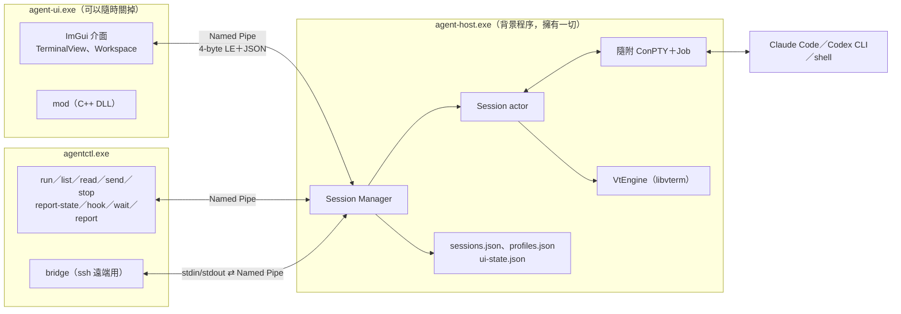
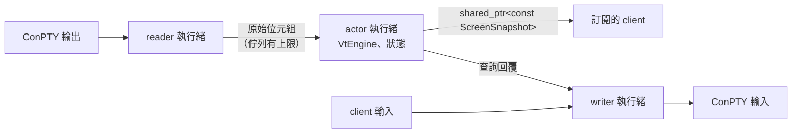
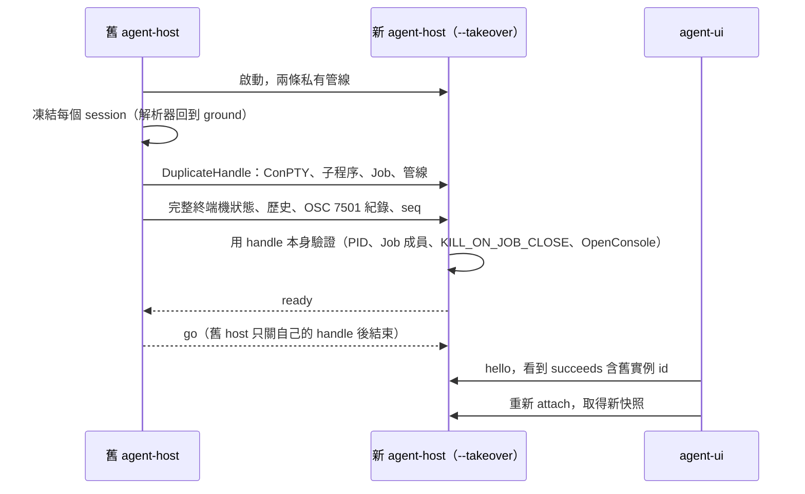

# AgentDesk 設計概念

適用版本：AgentDesk 0.2.0｜日期：2026-11-19

這份文件寫給第一次接觸 AgentDesk 程式碼的人，說明幾個主要設計決定背後的理由：為什麼拆成三個程序、為什麼狀態只信結構化回報、為什麼要隨附 ConPTY、為什麼介面照 herdr 做。規格與驗收數字以 `docs/design/AgentDesk_Design.md`（下稱設計文件）為準，這裡引用章節與 ADR，不重抄規格。日常操作見 `docs/user-guide.md`，使用案例見 `docs/design/use-cases.md`。

## 1. 要解決的問題

同時在好幾個終端機裡跑 coding agent，很快就會分不清哪個在等你回答、哪個已經做完、哪個程序早就結束了。一般的終端機程式還有另一個問題：視窗就是程序的主人，一不小心關掉，跑了半小時的 Agent 也跟著結束（設計文件 1.1）。

AgentDesk 要做到三件事：

- 在可分割的面板裡同時跑多個 Agent CLI，每個都有自己的輸入、畫面與尺寸。
- 關掉視窗，工作照樣在背景跑；重開時接回原本的畫面。
- 告訴你哪個 Agent 需要你。沒有可信的資料時就說不知道，不用猜的。

AgentDesk 管理的是實際的 CLI 工作階段。它不代理模型 API，不碰 Agent 的登入或訂閱，也不替 Agent 回答權限確認。

## 2. 三個程序



| 程序 | 角色 |
|---|---|
| `agent-ui.exe` | 畫面、輸入、IME、選取、側欄與所有介面。只拿快照和增量來畫 |
| `agent-host.exe` | 每位使用者每個登入工作階段一個。擁有 ConPTY、子程序、Job、VT 引擎、歷史與狀態 |
| `agentctl.exe` | 命令列 client，給腳本、hook、Agent 自己，以及 ssh 遠端的 `bridge` 使用 |

UI 和 CLI 都只是 host 的 client，連線先用 `hello` 協商協定版本 1（設計文件 3.7）。三者之間只有 Named Pipe，沒有 HTTP 服務，也沒有資料庫（第 0 節、ADR-04）。

### 為什麼 host 擁有一切

如果 UI 持有 ConPTY，關掉視窗就會關掉 Agent。所以從 ADR-01、ADR-02 開始，所有執行狀態都放在 host：ConPTY 的 handle、子程序、Job Object、VT 解析器、歷史、Agent 狀態。UI 不持有 HPCON 或程序 handle（2.2 第 3 點）。

這帶來幾個直接的好處：

- UI 不在的時候，host 照樣讀輸出、解析 VT、回覆終端機查詢（例如 DA1、OSC 7501 查詢）。沒有 UI，Agent 也不會因為等不到回覆而卡住（2.3）。
- UI 當掉或被關掉，不影響任何工作。UI 重開時只要重新 attach。
- `agentctl` 看到的狀態和 UI 一模一樣，因為兩者問的是同一個 host。

代價是 IPC 與同步要自己設計（ADR-01、ADR-02 的代價欄），畫面要經由管線傳給 UI。改功能前，先判斷它屬於 host 還是 UI；兩者之間的接縫是 `ui::TerminalSource`。

host 不是 Windows Service，也不以系統帳號執行。它只保證同一次登入工作階段內，UI 關掉後工作繼續跑；登出、重新開機或 host 異常結束後無法續接（2.2、ADR-07）。新 host 啟動時把上次遺留的 Running 紀錄標成 Lost，絕不憑舊 PID 接管程序，因為 PID 會被重用（2.2 第 6 點）。

## 3. 執行緒模型與背壓

每個 session 有三條執行緒（`libs/host/src/session.cpp`）：

- **reader**（在 `PtyProcess` 內）：從 ConPTY 讀位元組，原封不動丟進 actor 的佇列。
- **actor**：唯一能碰 VtEngine 的地方。解析輸出、產生查詢回覆、更新狀態、發布不可變的畫面快照。
- **writer**：把輸入寫進 PTY。



只讓一條執行緒寫 VT 狀態，就不需要在解析器周圍加鎖，也不會出現「解析到一半被別人讀」的問題。讀取端拿到的永遠是一份完整、不會再變的快照。

輸出太多怎麼辦？設計文件 3.3 有兩條規則，針對兩種不同的東西：

- **VT 位元組一個都不能丟。** 少了一個位元組，後面的畫面就全錯了。所以 session 的原始輸出佇列超過 8 MiB 時，reader 暫停讀取 PTY，子程序的寫入隨之阻塞（背壓，OQ-06）。關閉 session 前要先解除背壓，不然 join reader 時會死結。
- **送給 UI 的畫面更新可以丟。** 每個 UI client 的送出佇列超過 4 MiB 時，丟掉還沒送出的增量並標記 `needs_snapshot`，之後補一份最新的完整快照。慢的 client 只會讓自己的畫面跳一下，不會拖慢 host 或其他 client。

`CLAUDE.md` 把這條界線列為不可違反的不變式：host 必須完整依序解析所有 VT bytes；只有送給 UI 的畫面更新可以合併或丟棄。

## 4. 兩種狀態，以及為什麼只信結構化回報

AgentDesk 把「程序活著沒」和「Agent 在做什麼」分成兩個欄位（設計文件 3.6、ADR-06）：

| 欄位 | 值 | 來源 |
|---|---|---|
| process_state | Starting、Running、Stopping、Exited、Failed、Lost | host 自己觀察程序 |
| agent_state | Unknown、Idle、Working、Blocked、Done、Error | 只來自 Agent 的結構化回報 |

這兩件事真的不一樣。程序 Running 不代表 Agent 在工作；輸出沉默不代表做完了；Agent 回報 Done，程序也可能還沒結束。把它們混成一個欄位，介面就可能在 Agent 等你按確認的時候顯示「完成」。

agent_state 的來源依可信度只有兩種（3.6）：

1. **OSC 7501**：Claude Code 2.1.295 起原生支援的終端機狀態協定。Claude Code 先送查詢，host 必須回覆，而且回覆要排在 DA1 回覆之前。
2. **`agentctl report-state`／`agentctl hook`**：給不支援 OSC 7501 的 Agent，例如 Codex CLI 的 hook。

兩者都沒有時就是 Unknown。ADR-09 決定不從畫面文字推斷狀態。herdr 對這兩個 Agent 都用畫面規則推斷；我們不這麼做。畫面推斷可能把還沒做完的工作誤判成 Done，自動化要是依這個判斷送輸入，還可能在權限確認畫面誤送出去（ADR-09 的理由欄）。代價是結構化來源沒涵蓋的轉換（主要是 Codex hook 的缺口）只能顯示最後的狀態加經過時間。

狀態紀錄的生命週期也有規則（3.6）：每個 (session, source) 依 seq 去重，舊事件不會蓋掉新事件；程序結束時丟掉 working 與 blocked，保留 done 與 error；shell 重新顯示提示（OSC 133 A）表示 Agent 已經結束，丟掉全部紀錄。host 啟動 PowerShell、CMD、WSL 時會加上送出 OSC 133 A 的提示鉤子（`libs/host/src/session_manager.cpp`），CMD 保留使用者原本的 PROMPT。紀錄被丟掉時 agent_state 回到 Unknown，原值存在 `last_agent_state`，不會被猜成 Idle 或 Done。

「Done」在介面上的意思是「你沒看的時候完成了」，看過之後在這個 UI 變回 Idle。這個已讀狀態屬於 UI，不回寫 host。

## 5. 畫面：不可變快照與即時模式 UI

UI 用 Dear ImGui，每一幀從頭畫一次（即時模式）。它沒有自己的終端機狀態，只有從 host 收到的快照：

- actor 在畫面變動後發布 `shared_ptr<const ScreenSnapshot>`。快照一旦發布就不再改變，UI 執行緒隨時可以讀，不用和 host 協調鎖。
- 走 IPC 時，host 送一份完整快照，之後送只含變動列的增量。每個增量帶 `generation`、`base_seq` 與 `seq`；UI 發現 generation 不同或 seq 不連續，就丟掉增量、要求新的快照（3.7）。
- `TerminalView` 只負責把字元格畫出來：格寬取字型真實的 advance，每格各自定位，寬字元放大填滿兩格；框線、方塊與點字字元用圖形照像素邊界畫（設計文件 v2.9 版本紀錄）。

attach 的順序是避免漏畫面的關鍵：

```mermaid
sequenceDiagram
    participant UI as agent-ui
    participant Host as agent-host
    participant Actor as session actor
    UI->>Host: hello（v=1）
    Host-->>UI: host_instance_id、succeeds
    UI->>Host: session.attach（want_control）
    Host->>Actor: 在 actor 內取 seq=S 的快照並註冊訂閱
    Actor-->>Host: 快照（seq=S）
    Host-->>UI: attach 回應（is_controller、snapshot_meta）
    Host-->>UI: screen.snapshot（分段，完整收到才切換）
    loop 之後的輸出
        Actor-->>Host: 變動
        Host-->>UI: screen.delta（base_seq、seq > S）
    end
    Note over UI,Host: seq 不連續或 generation 改變時，UI 要求新快照
```

快照和訂閱在同一把鎖裡完成，所以快照之後的每個變動都一定會以增量送到，不會掉在兩者之間（3.7、3.7.1）。

一個 session 同時只有一個輸入控制者，只有它能決定 ConPTY 尺寸；其他 UI 是唯讀，要明確按「Take control」才能接手。這樣兩個視窗不會搶著把終端機改成不同大小（3.7 結尾）。

## 6. 為什麼隨附 ConPTY，為什麼改 libvterm

### 隨附 ConPTY（ADR-08）

M0 實測發現，Windows 內建的 ConPTY 會把程式回給終端機的部分序列吞掉，其中包括 OSC 7501 的查詢回覆。Claude Code 收不到回覆，就判定終端機不支援，從此不送任何狀態。所以 AgentDesk 跟 herdr-core 一樣，隨附固定版本、驗過 SHA-256 的 Microsoft.Windows.Console.ConPTY，從執行檔旁的 `conpty\` 載入（3.1、3.2）。執行檔旁沒有 `conpty\conpty.dll` 時退回系統內建版本，這時狀態回報不可用，也不能換版交接；檔案存在卻載入失敗時，host 不啟動。

代價是多兩個二進位檔要追版本與授權。好處除了狀態回報，還有一項：隨附版本匯出 `ConptyPackPseudoConsole`，這是 agent-host 換版時能把終端機交給新程序的前提（ADR-19）。

### libvterm 加了一段存取程式（ADR-19）

VT 引擎用 libvterm 0.3.3（ADR-05、OQ-03），原始碼收錄在 `third_party/libvterm`。它有幾個已知限制，例如 UTF-8 序列被切在兩次寫入之間會產生 U+FFFD，`VtEngine::feed` 會先暫存尾端不完整的序列（只延後、不丟）來繞過（3.4）。

agent-host 換版時，舊 host 要把每個終端機的完整狀態（兩個畫面緩衝區、筆、模式、捲動區、tab、字元集、DECSC 存的游標）交給新 host。libvterm 沒有公開這些欄位，所以我們在收錄的原始碼裡加了一段 AgentDesk 自己的存取程式（`agentdesk_handover.c`、`vterm_agentdesk.h`），其餘部分沒動，細節記在 `third_party/libvterm/README.agentdesk.md`。交接只在解析器回到 ground 狀態時進行，沒讀完的位元組留在管線裡給新 host，所以「VT 位元組依序完整解析」的不變式在換版時也成立。



ready 之前任何一步失敗，都由舊 host 接回所有 session；新 host 驗證失敗只關自己的副本，絕不結束 Job。完整流程見設計文件 2.7。

## 7. 複刻 herdr-app，但程式裡不說 herdr

AgentDesk 的介面與行為依 herdr 桌面版（herdr-app）的原始碼複刻（ADR-15）。這是使用者的要求：「一定要完整複刻，有問題就去查 herdr 的 source code」。版面尺寸、互動、狀態與提醒規則、Files／Changes、picker、命令面板、設定、歡迎頁、worktree 對話框都照 herdr；逐項規格在 `docs/research/herdr-app/`，對照的原始碼位置記在 `sprint/current/status.md` 的「依據」欄。

我們用 C++／ImGui 重寫，不搬 herdr 的 JS 執行環境，也不追求協定相容。herdr 的模型（版面節點樹、分割樹、注意力規則）轉寫成 C++，放在 `libs/ui`。遇到不清楚的行為時，答案是去查 herdr 的原始碼，不是自己發明。

程式裡不出現 herdr 的名稱（ADR-21）：執行檔、畫面與跟著發布的檔案只寫 AgentDesk，win98 版面叫 AgentDesk 98，圖示換成 AgentDesk 的標誌。出處仍然要留下，這是 Apache-2.0 第 4 條的要求：

- 發布包的 THIRD_PARTY_NOTICES 列出 herdr-app 並附授權（`third_party/herdr/LICENSE`）。
- 轉寫的程式碼在原始碼註解裡註明出處（例如 `// herdr window.rs 2262-2283`）。
- 版本庫保留 `third_party/herdr/`。

文件可以提到 herdr，但要寫明是觀察結果並附出處。

## 8. 擴充點

### 版面引擎

herdr 的版面模型已經搬進 `libs/ui`（`layout.hpp`）：節點樹（block、row、column、stack、floating）照 herdr 的 JSON 鍵與預設值讀寫，大小計算、分隔線拖曳都照 herdr，使用者的調整另存到 `layouts\.state\<名稱>.json`（設計文件 2.4）。內建三個版面：workspace、terminals、win98（ADR-18；win98 見 2.8）。使用者可以在 `%LOCALAPPDATA%\AgentDesk\layouts\` 放自己的版面檔，舊格式的檔案在讀取時轉換。

### 主題

我們自己的四個主題（Midnight、Ember、Moss、Paper），加上 herdr 的 graphite、ink、moss、paper 與 atom one dark；放進 `themes\` 的主題檔也會列出。每個版面各自記住一組深色與淺色主題。介面顏色依 herdr 的方式從主題推算。

### mod（2.5、ADR-17）

mod 是 C++ DLL，介面是純 C 的 `agentdesk/mod_api.h`，另有 header-only 的 `mod_sdk.hpp`。它原本用沙盒化的 Lua（ADR-14），後來使用者要求「所有的程式都想用 C++ 完成」，改成 DLL。

這個選擇的代價要講清楚：mod 沒有沙盒，以使用者權限執行；mod 卡在無窮迴圈時整個介面會停住。我們能做的是：只載入已啟用的 mod，`LoadLibraryExW` 只搜尋 DLL 所在資料夾與 System32；每次呼叫都包在 SEH 裡，當掉就停用並保留 DLL 不卸載；`exec` 不經 shell。`ModHost` 不碰 ImGui，mod 用資料描述面板，可以單元測試。

## 9. 安全原則

AgentDesk 跑的是會自己執行指令的 Agent，終端機輸出的內容不能信任。以下規則不因方便而放寬：

- **executable 與 argv 分開存。** 不把 prompt 拼進 PowerShell 或 cmd 的命令字串，quoting 經過測試（3.2）。`PtyProcess::spawn` 拒絕 `.cmd`／`.bat`。worktree 的 `git worktree add` 也不經 shell（3.7.2）。
- **輸出內容不能觸發命令或寫剪貼簿。** OSC 52 不註冊回呼（herdr 預設允許，我們不開放，QA-16）。連結要使用者按 Ctrl＋點擊才開，程式與指令檔只在檔案總管中標出，不執行（3.9）。
- **Named Pipe 只給自己用。** pipe 名稱含 SID 與登入工作階段；DACL 只含 SYSTEM 與目前使用者，拒絕遠端連線；host 與 client 互相比對 SID（3.7、3.7.1、QA-17）。這是本機同一使用者的控制通道，不是抵擋同帳號惡意程序的隔離邊界。
- **frame 有上限。** 每個 frame 上限 4 MiB，拒絕 0 長度、超長、無效 UTF-8／JSON 與未知版本（3.7）。OSC 7501 的回報也有長度與筆數上限，含控制字元的整筆丟棄（3.6）。
- **Job 是生命週期工具，不是沙箱。** 子程序以 CREATE_SUSPENDED 建立，指派到 KILL_ON_JOB_CLOSE 的 Job 後才 Resume，不允許 breakaway（3.2）。
- **不替使用者做決定。** `agentctl send` 預設不按 Enter；`agentctl hook` 不輸出任何東西，所以不會替使用者回答 Codex 的權限確認；送輸入的自動化應該依結構化狀態，不依畫面文字（3.8）。
- **log 不記內容。** 診斷只記 request／session ID、事件類型、錯誤碼、耗時與資源數，不記輸入文字或完整環境變數（3.9）。線上更新與使用統計沒有預設伺服器，要設定環境變數才會連線（ADR-18）。

## 10. AgentDesk 比 herdr 多做或刻意不同的地方

| 項目 | AgentDesk | 出處 |
|---|---|---|
| 選 shell 開新 space 或分頁 | 側欄「+」與分頁列「+」列出偵測到的 PowerShell 7、Windows PowerShell、Command Prompt、WSL 發行版。herdr 只開一種 shell，在 Windows 上就沒辦法同時用 cmd 與 PowerShell | ADR-20 |
| WSL 發行版當本機 shell | 自動加入 profile，用 OSC 7 追蹤 Linux 裡的 `cd` | ADR-16 |
| Agent 結束就清掉狀態 | shell 提示（OSC 133 A）出現時丟掉全部 OSC 7501 紀錄 | 3.6、QA-22 |
| 剪貼簿 | 程式不能透過 OSC 52 寫入剪貼簿；有選取時 Ctrl+C 複製 | 3.5、5.6「刻意保留的差異」 |
| 狀態來源 | 不做畫面推斷；Codex 用 `agentctl hook` | ADR-09、ADR-17 |
| mod | C++ DLL，不是 JS | ADR-17 |
| 意見回饋 | 沒有伺服器，草稿只能複製或存檔 | 5.6 |
| 介面文字 | 預設 15 px（herdr 為 13），可調整 | ADR-15 |

## 11. 取捨與不做的事

- 不跨重開機續跑。原程序無法恢復，metadata 只供顯示（ADR-07）。
- 不從畫面推斷 Agent 狀態。寧可顯示 Unknown（ADR-09）。
- 不做 Linux 版 agent-host。要重寫 ConPTY、Job、Named Pipe、背景啟動、程序樹等平台層，還要 Linux 工具鏈，換到的只有「Windows 端 host 結束後 WSL 裡的工作仍在」（ADR-16）。遠端機器目前也只支援 Windows。
- 不另外安裝工具。只用已安裝的 VS 2022 C++ 工具鏈，所以沒採用需要 Zig 的 libghostty-vt（ADR-11）。
- 不做手機 app、多人協作、HTTP backend、Docker、資料庫（第 0 節、1.3、ADR-13）。
- 不做 Windows Service。host 以一般使用者身分執行（2.2）。
- 沒有螢幕閱讀器支援，這是 Dear ImGui 的限制（5.4）。
- libvterm 的字寬限制照收：模糊寬度 1 欄、ZWJ emoji 不合併、OSC 7501 的「RIS 清除全部紀錄」無法實作（3.4）。
- 單獨更新 agent-host 只支援隨附 ConPTY，內建版本會拒絕更新（ADR-19）。

## 延伸閱讀

| 想知道 | 看哪裡 |
|---|---|
| 完整需求、協定、驗收矩陣 | `docs/design/AgentDesk_Design.md` |
| 使用案例 | `docs/design/use-cases.md` |
| 操作與快捷鍵 | `docs/user-guide.md` |
| herdr-app 的逐項移植規格 | `docs/research/herdr-app/`、`docs/research/herdr-app-review.md` |
| 每一項行為照 herdr 的哪一行 | `sprint/current/status.md` |
| M0 的實測結論 | `docs/poc/M0-report.md` |
| 治理與流程決策 | `.decisions/ADR_NNN` |
