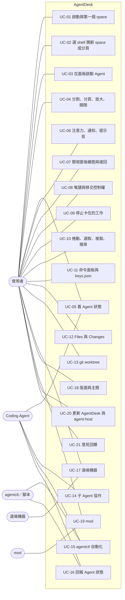

# AgentDesk 使用案例

適用版本：AgentDesk 0.2.0｜日期：2026-11-19

這份文件把 AgentDesk 現有的行為整理成使用案例，給要改功能、寫測試或做驗收的人對照。需求以 `docs/design/AgentDesk_Design.md`（下稱設計文件）為準；這裡只寫程式已經做到的事，每個案例最後列出對應的使用者故事（US）、驗收項目（QA）、章節或 ADR。操作細節與快捷鍵的完整清單在 `docs/user-guide.md`。

介面與行為依 herdr-app 的原始碼複刻（ADR-15），程式畫面上只寫 AgentDesk（ADR-21）。下文提到 herdr 時，指的是複刻的依據。

## 參與者

| 參與者 | 說明 |
|---|---|
| 使用者（開發者） | 在 Windows 11 x64 上操作 `agent-ui.exe` 的人，自己安裝並登入 Agent CLI |
| Coding Agent | 跑在面板裡的 CLI，首發是 Claude Code 與 Codex CLI。Claude Code 以 OSC 7501 回報狀態；Codex CLI 透過 hook 呼叫 `agentctl hook`／`report-state` |
| shell | PowerShell 7、Windows PowerShell、Command Prompt、WSL 發行版；新 space、新分頁、分割都先開 shell |
| agentctl 與腳本 | `agentctl.exe` 與呼叫它的腳本、hook，或在終端機裡執行它的 Agent（子 Agent） |
| 遠端機器 | 另一台裝了 AgentDesk 的 Windows 電腦，透過 `ssh <目標> agentctl bridge` 連到它的 agent-host |
| mod | 使用者啟用的 C++ DLL（ADR-17），可以對 Agent 狀態做出反應、加命令與面板 |
| agent-host | 背景程序，擁有所有終端機與程序。它不是外部參與者，但很多案例的後置條件落在它身上 |

## 總覽

## 使用案例

### UC-01 啟動 AgentDesk 與第一個 space

- **參與者**：使用者
- **前置條件**：已解壓發布包，`conpty\conpty.dll` 與 `conpty\x64\OpenConsole.exe` 在執行檔旁。
- **主要流程**：
  1. 使用者執行 `agent-ui.exe`。
  2. UI 連接目前使用者的 agent-host；不存在時以一般使用者身分在背景啟動它，並讓它脫離啟動者所在的 Job（設計文件 2.2）。
  3. UI 以 `hello` 協商協定版本 1（3.7）。
  4. 第一次啟動時開啟歡迎頁：依 Windows 的文字大小設定縮放，可選大小與主題、加入遠端機器、選擇要顯示的面板。
  5. 使用者完成歡迎頁。目前沒有任何 space 時，AgentDesk 開一個新 space，裡面是預設 shell。
  6. 之後再啟動時，UI 從 host 保存的 `ui-state.json` 還原 space、分頁與分割，並 attach 到仍在執行的終端機。
- **替代與例外流程**：
  - 2a. host 無法脫離啟動者的 Job（例如從 IDE 啟動）：留在原 Job，UI 提示 host 會隨啟動者結束（US-03b）。
  - 2b. 執行檔旁沒有 `conpty\conpty.dll`：退回系統內建版本，Claude Code 的狀態回報不可用，agent-host 也不能換版交接；檔案存在卻載入失敗時，host 啟動失敗（3.2、ADR-08）。
  - 4a. 使用者跳過歡迎頁，之後可從命令面板的「Welcome」再開。
  - 6a. 上次的終端機已結束或 Lost：不開成面板；分頁、space 空了就關閉（2.2 第 7 項）。
- **後置條件**：視窗顯示至少一個 space；host 在背景執行。
- **追溯**：US-03（US-03b、QA-20）；設計文件 2.2、3.2、3.7、5.6（歡迎頁、首次啟動縮放）；ADR-01、ADR-04、ADR-08。

### UC-02 選擇 shell 開新 space 或新分頁

- **參與者**：使用者
- **前置條件**：host 已在程式啟動時偵測到這台電腦的 shell（PowerShell 7、Windows PowerShell、Command Prompt、各個 WSL 發行版；略過 docker-desktop 開頭的發行版）。
- **主要流程**：
  1. 使用者按側欄 Spaces 旁的「+」。
  2. AgentDesk 列出偵測到的 shell，預設 shell 排在第一個，旁邊標出快捷鍵。
  3. 使用者選一個 shell。
  4. AgentDesk 在目前面板 shell 所在的資料夾開一個新 space，用選的 shell 開第一個終端機。
- **替代與例外流程**：
  - 1a. 在分頁列按「+」：選單的 Terminal 底下列出預設以外的 shell，選了就開成目前 space 的新分頁。
  - 1b. 按 Ctrl+Shift+N（新 space）或 Ctrl+Shift+T（新分頁）：直接用預設 shell，不出選單。
  - 2a. 沒有偵測到 shell：選單顯示「No shell found」。
  - 3a. 選 WSL 發行版：以 `wsl.exe -d <名稱>` 啟動，`D:\src` 會是 `/mnt/d/src`；bash 每次顯示提示前用 OSC 7 回報所在資料夾（ADR-16）。
  - 預設 shell 可在「設定 > Look」更改。
- **後置條件**：新的 space（或分頁）出現並取得焦點，shell 可以輸入。space 名稱跟著 shell 所在的 repo 變動。
- **追溯**：US-01、US-02；ADR-16、ADR-20；設計文件 3.7.1（profile.list）。

### UC-03 在面板啟動 Agent

- **參與者**：使用者、Coding Agent
- **前置條件**：使用者已安裝並登入 Claude Code 或 Codex CLI。
- **主要流程**：
  1. 使用者在面板的 shell 裡 `cd` 到專案資料夾。
  2. 面板標題、space 名稱與 git 分支跟著 shell 所在的資料夾更新（PowerShell 提示字元 hook、讀 PEB、OSC 7）。
  3. 使用者輸入 `claude` 或 `codex`。
  4. host 從 Job 裡找出目前在跑的程式，面板與分頁換上該程式的圖示與名稱（程式表 `programs\programs.json`）。
  5. Claude Code 送出 OSC 7501 查詢；host 在 DA1 回覆之前回覆，之後 Claude Code 開始回報狀態（3.6）。
- **替代與例外流程**：
  - 1a. 不經 shell，直接用分頁列「+」選單的「Start an agent」（可按 1～9）或命令面板的「Start a program…」，以 profile 啟動已安裝的 Agent。
  - 1b. 用 `agentctl run --profile ... --cwd ...` 從命令列啟動（UC-15）。
  - 4a. 程式啟動後 2 秒內以非 0 結束碼結束（127 不限時間）：右下角顯示「Terminal failed to start」，附結束碼與最後幾行輸出。
  - 4b. profile 的 executable 或 cwd 不存在：建立失敗並回報原因，沒有殘留程序（US-01b）。
- **後置條件**：Agent 在 host 的 ConPTY 裡執行，工作目錄等於指定的資料夾，面板可以輸入。
- **追溯**：US-01（QA-01、QA-02）、US-04（QA-21）；設計文件 3.2、3.6、3.7.2（`session.list` 的 `program`）、3.7.3（`program_argv`、`agent_app`）、5.6（資料夾追蹤）。

### UC-04 分割、分頁、放大與關閉面板

- **參與者**：使用者
- **前置條件**：至少有一個 space 與一個面板。
- **主要流程**：
  1. 使用者按 Ctrl+Shift+O（往右）或 Ctrl+Shift+E（往下），或面板標題列的分割按鈕。
  2. AgentDesk 在目前面板所在的資料夾開一個 shell，放進分割樹的新節點。
  3. 使用者拖曳分隔線調整大小，用 Alt+H/J/K/L 或 Alt+方向鍵移動焦點，用 Alt+Shift+H/J/K/L 交換位置。
  4. 使用者按 Ctrl+Shift+Z 放大目前面板，再按一次還原。
  5. 使用者按面板的 × 或 Ctrl+Shift+X 關閉面板，面板裡的程式隨之結束。
- **替代與例外流程**：
  - 3a. 拖曳標題列中間的把手，放到另一個面板的邊緣（移到那一側）或中間（互換）。
  - 5a. 關閉最後一個面板時一併關閉分頁；按分頁的 × 或 Ctrl+Shift+W 關閉整個分頁，不詢問。
  - 5b. 關閉 space 的最後一個分頁，或在 space 右鍵選單選 Close：先問「Close space?」，再結束 space 裡所有程式。
  - 5c. 子 Agent 的面板可用右鍵「Send back to …」收起，子 Agent 繼續跑。
  - 分頁可以雙擊改名、拖曳排序、用滾輪切換；命令面板的「Settle tab」把分頁收起來，程式照常執行，需要你時自動回到分頁列。
- **後置條件**：分割樹、分頁與 space 的結構寫回 host（`ui.state.set`），其他視窗會收到更新。
- **追溯**：US-02（QA-03、QA-04）；設計文件 3.7.2（`ui.state.get`／`ui.state.set`）、4.1、5.5、5.6；ADR-15。

### UC-05 在側欄查看 Agent 狀態

- **參與者**：使用者、Coding Agent
- **前置條件**：Agent 有可信的狀態來源（Claude Code 2.1.295 以上的 OSC 7501，或 Codex 的 hook）。
- **主要流程**：
  1. Agent 回報狀態（idle、working、blocked、done、error）。
  2. host 依 (session, source) 的 seq 去重，更新 agent_state，記錄來源與時間（3.6）。
  3. 側欄 Agents 清單依「Needs you／Done／Working／Idle」分段，同段內最近變動的在前；每列有程式圖示、space 與工作名稱、距離上次變動多久、狀態標記。
  4. 分頁與 space 顯示其中最緊急的狀態；狀態列顯示 Agent 數量與需要你的數量。
  5. Agent 結束、shell 重新顯示提示時，shell 送出 OSC 133 A，host 丟掉這個終端機全部的 OSC 7501 紀錄，Agent 從清單、分頁與 space 的狀態點、狀態列的計數中消失。
- **替代與例外流程**：
  - 1a. 沒有任何可信來源：維持 Unknown，輸出沉默再久也不會變成 Done（US-04b）。AgentDesk 不從畫面文字推斷狀態（ADR-09）。
  - 2a. 舊的 seq、錯誤的 session、環境變數不齊的回報：不改變狀態（QA-19）。
  - 3a. 使用者用排序鈕改成依 space 分組；滑鼠移上去可以釘選；子 Agent 以樹狀線列在父 Agent 下面。
  - 5a. 程序自己結束：working 與 blocked 被丟掉，done 與 error 保留（QA-22）。紀錄被丟掉時 agent_state 變成 Unknown，原值存在 `last_agent_state`（QA-08）。
- **後置條件**：側欄顯示的狀態只來自結構化回報。Done 的意思是「沒在看的時候完成」，看過之後在這個 UI 變回 Idle，不回寫 host。
- **追溯**：US-04（QA-07、QA-08、QA-19、QA-21、QA-22）；設計文件 3.6；ADR-06、ADR-09；5.6（Agents）。

### UC-06 注意力、通知與提示音

- **參與者**：使用者、Coding Agent
- **前置條件**：「設定 > Alerts」的提示音開啟（預設開啟）。
- **主要流程**：
  1. 某個 Agent 進入 Blocked（需要你），或在你沒看的時候完成。Error 視同需要你。
  2. AgentDesk 播放提示音（需要你與完成各一段，隨附兩段提示音）。
  3. 你沒在看那個 Agent（視窗沒有焦點，或它不在目前分頁的可見面板裡）時，右下角出現通知，內文是「<space> / <分頁>」。
  4. 使用者點通知，跳到那個 Agent 的面板。
- **替代與例外流程**：
  - 1a. 該 Agent 所在的分頁已收起（Settle tab）：分頁自動回到分頁列。
  - 2a. 使用者關閉提示音，或在 `ui.json` 的 `sound_done`／`sound_blocked` 指定自己的 MP3。
  - 3a. 你正在看那個 Agent：只播提示音，不跳通知。
  - 以 `--exit-after-ms` 等自動化參數執行時不發出提醒。
- **後置條件**：使用者知道哪個 Agent 需要處理；看過之後 Done 變回 Idle。
- **追溯**：US-04；設計文件 5.5（注意力、通知）、5.6（提醒規則：needs you 一定響、沒在看才跳通知、error 視同 needs you）；ADR-15。

### UC-07 關閉視窗後讓工作繼續，再接回

- **參與者**：使用者
- **前置條件**：有 Agent 正在執行。
- **主要流程**：
  1. 使用者按視窗右上角的 X。第一次會顯示一次說明。
  2. UI 對每個終端機 detach（`session.detach`），釋放輸入控制權，然後結束；程序與畫面都留在 host。
  3. host 在沒有 UI 的情況下繼續讀取輸出、解析 VT、回覆終端機查詢、收狀態回報。
  4. 使用者再次執行 `agent-ui.exe`。
  5. UI 重新 attach：host 在 session actor 內取 seq=S 的快照並註冊訂閱，送出快照，之後只送 seq>S 的增量（3.7）。
  6. 畫面回到關閉前的版面，計數、PID 與 session 都沒變，可以直接輸入。
- **替代與例外流程**：
  - 3a. 登出、重新開機或 host 異常結束：原本的工作無法續接。新 host 啟動時把舊的 Running 紀錄標成 Lost，絕不憑舊 PID 接管程序，也不重跑任何 prompt（2.2、QA-10）。UI 移除 Lost 的面板（2.2 第 7 項）。
  - 3b. agent-host 換版（UC-20）：新 host 接手終端機；`hello` 的 `succeeds` 帶有舊 host 的實例 id，UI 因此不把 session 標成 Lost，重新 attach 取得新快照（2.7、ADR-19）。
  - 5a. 增量的 generation 不同或 base_seq 不連續：UI 丟掉增量，要求新快照（QA-06）。
  - 5b. UI 送出佇列太滿：host 丟掉未送出的畫面增量並標記 `needs_snapshot`，之後補送最新快照（3.3、QA-18）。
  - 使用者要結束所有工作：命令面板「Exit and stop all sessions」列出仍在執行的工作，確認後全部停止並結束 host。
- **後置條件**：工作沒有因為視窗關閉而中斷；重開後畫面與關閉前一致。
- **追溯**：US-03（QA-05、QA-06、QA-10、QA-18、QA-20）；設計文件 2.2、2.7、3.3、3.7；ADR-01、ADR-02、ADR-07、ADR-19。

### UC-08 第二個視窗唯讀與移交控制權

- **參與者**：使用者
- **前置條件**：同一個終端機已有一個 UI 持有輸入控制權。
- **主要流程**：
  1. 另一個 UI attach 到同一個終端機。
  2. 它的面板顯示 Read-only，不能輸入，也不能改變 ConPTY 尺寸。
  3. 使用者按「Take control」。
  4. host 把控制權移交給這個 UI（`take_control`），原本的 UI 變成唯讀。
- **替代與例外流程**：
  - 4a. 持有者斷線：控制權自動釋放。
  - `agentctl send` 在有其他 client 持有控制權時回 `NOT_CONTROLLER`（退出碼 5）；沒人控制時可以送。
- **後置條件**：同一個終端機同時只有一個輸入控制者，尺寸只由它決定。
- **追溯**：US-02b（QA-14）；設計文件 3.7、3.7.1（attach 的 `want_control`、`take_control`）。

### UC-09 停止卡住的工作

- **參與者**：使用者
- **前置條件**：某個終端機的程式沒有反應。
- **主要流程**：
  1. 使用者在命令面板選「Stop the focused session」。
  2. host 寫入 Ctrl+C（0x03）作為中斷。
  3. 5 秒後程式仍未結束，介面出現「Force stop」。
  4. 使用者按 Force stop，host 以 TerminateJobObject 結束整個受管理的程序樹。
- **替代與例外流程**：
  - 2a. 程式收到中斷就結束：不需要 force。
  - 終端機沒有選取時按 Ctrl+C 也會送中斷；有選取時是複製。
- **後置條件**：Job 內沒有殘留程序；process_state 為 Exited 並記錄結束碼。
- **追溯**：US-05（QA-09）；設計文件 3.2（停止流程）、3.6。

### UC-10 捲動、選取、複製與搜尋

- **參與者**：使用者
- **前置條件**：終端機有輸出。
- **主要流程**：
  1. 使用者轉動滑鼠滾輪捲進歷史（最多 5000 行），或拖曳右側捲軸。
  2. 使用者拖曳選取，或雙擊選字、三擊選整行；放開就複製（可在設定關閉）。
  3. 使用者按 Ctrl+Shift+F，在畫面與歷史中搜尋，Enter 往前、Shift+Enter 往後。
  4. 使用者開始打字，畫面回到即時位置。
- **替代與例外流程**：
  - 1a. 歷史超過每個工作 10,000 行或 16 MiB：捨棄最舊的部分，介面顯示保留範圍（QA-12）。
  - 2a. 程式開了滑鼠回報（vim、less、htop）：點擊、拖曳、滾輪交給程式；按住 Shift 照常選取。
  - 2b. Ctrl＋點擊網址、檔案路徑或程式標記的連結才開啟；程式與指令檔只在檔案總管中標出，不執行。
  - 貼上多行文字前先顯示預覽；含 NUL 或超過 1 MiB 的內容會被拒絕。
- **後置條件**：剪貼簿的內容欄位正確、不含控制碼。
- **追溯**：US-06（QA-11、QA-12）；設計文件 3.4、3.5、5.5（搜尋、雙擊、三擊、右鍵選單）。

### UC-11 命令面板與 keys.json

- **參與者**：使用者
- **前置條件**：無。
- **主要流程**：
  1. 使用者按 Ctrl+Shift+P 開啟命令面板。
  2. 使用者輸入關鍵字，模糊搜尋命令，最近用過的排在最前面。
  3. 使用者選一個命令並執行。
  4. 使用者在「設定 > Look」按「Edit keys.json」，修改按鍵綁定後存檔。
  5. AgentDesk 立刻套用新的按鍵，不必重新啟動。
- **替代與例外流程**：
  - 1a. Ctrl+Shift+/ 顯示可篩選的快捷鍵清單；Ctrl+Shift+K 搜尋 space、分頁或 Agent。
  - 4a. 綁定可以放在 `global`、`terminal` 或 `layout:<版面名稱>` 區段；動作可以是命令、`send:<文字>` 或 `terminal`（把這個鍵交給程式）；值為空字串表示取消綁定。
  - 5a. 檔案有錯（無法讀的按鍵、未知的區段或命令）：整個檔案不套用，按鍵維持預設，原因寫在 `keys.error` 並顯示在設定頁。
- **後置條件**：AgentDesk 使用的按鍵不會送進終端機；其餘按鍵照常交給程式。
- **追溯**：設計文件 3.5（UI 快捷鍵不得吞掉終端機必要按鍵）、5.5（命令面板、`keys.json`）、5.6（keys.json 的 layout／mod 區段與錯誤檢查）；ADR-15。

### UC-12 Files 與 Changes 面板

- **參與者**：使用者
- **前置條件**：目前面板的 shell 在某個資料夾裡；Changes 需要該資料夾是 git repo。
- **主要流程**：
  1. 使用者按分頁列右側的 Files 或 Changes。
  2. Files 顯示目前面板 shell 所在資料夾的檔案樹，檔名旁有 git 狀態字母；點檔案可唯讀預覽。
  3. Changes 列出所有未提交的檔案與 +／− 行數；點檔案看差異。
  4. 使用者在 Changes 下方輸入訊息並 commit（先執行 `git add -A`）。
- **替代與例外流程**：
  - 2a. 遠端機器的 space：檔案與 git 經由那台機器的 agent-host（`fs.list`、`fs.read`、`git.run`）取得，沒有資料夾監看，每 10 秒更新（ADR-15）。
  - 2b. WSL 裡的 repo：用 Windows 的 git 並加上 `-c safe.directory=*`；走網路檔案系統，大 repo 較慢（ADR-16）。
- **後置條件**：面板開關狀態依 space 記住；commit 寫進該 repo。
- **追溯**：設計文件 2.6、3.7.3（`fs.list`、`fs.read`、`git.run`）、5.6（Files、Changes 面板）；ADR-15、ADR-16。

### UC-13 使用 git worktree

- **參與者**：使用者
- **前置條件**：目前 space 在一個 git repo 裡。
- **主要流程**：
  1. 使用者在分頁列「+」選單或 space 右鍵選單選「New worktree」。
  2. 使用者輸入分支名稱。
  3. host 不經 shell 執行 `git worktree add`，位置預設是 `%USERPROFILE%\.agentdesk\worktrees\<repo>\<分支>`。
  4. AgentDesk 把 checkout 開成新的 space，開一個 shell。側欄以 `├─`／`└─` 把它掛在主 repo 的 space 下面。
- **替代與例外流程**：
  - 2a. 分支已存在：直接 checkout；新分支從目前位置建立。
  - 1a. 「Open worktree」列出 repo 的所有 checkout，選一個開成 space。
  - 1b. 「Remove worktree」關閉該 space 並刪除 checkout 資料夾，分支保留；有未提交的變更或沒推送的 commit 時先警告。
  - 3a. 遠端機器的 space：checkout 建在那台電腦上。
  - worktree 資料夾可在「設定 > Look」更改。
- **後置條件**：多個 Agent 可以在不同 checkout 裡改檔，彼此不碰同一批檔案。
- **追溯**：設計文件 1.4（需要隔離時由使用者選擇不同 git worktree）、3.7.2（`worktree.add`）、5.6（worktree 對話框）、7.2（多 Agent 同時改檔）。

### UC-14 子 Agent 協作

- **參與者**：Coding Agent（父）、Coding Agent（子）、使用者
- **前置條件**：父 Agent 跑在 AgentDesk 的終端機裡，環境變數 `AGENTDESK_SESSION_ID`、`AGENTDESK_CTL`、`AGENTDESK_PIPE` 都在。
- **主要流程**：
  1. 父 Agent 讀 `agentctl --skill` 的說明。
  2. 父 Agent 執行 `agentctl run --profile ... --name reviewer --cwd ... --task "..."`；新 session 的 parent 自動設成目前的 session。
  3. 子 Agent 就緒（回報 Idle；沒有狀態來源時等 8 秒）後，host 把 `--task` 的文字送進它的輸入。
  4. 父 Agent 用 `agentctl wait reviewer --until idle` 等待，再用 `agentctl read` 讀輸出。
  5. 子 Agent 執行 `agentctl report "..."`，文字送進父 Agent 的輸入，前面加上 `[from <名稱> <id>]`。
  6. 使用者在側欄看到子 Agent 以樹狀線列在父 Agent 下面，點它可以浮動預覽（peek）。
- **替代與例外流程**：
  - 2a. 用 `--no-parent` 或 `--parent ID` 改變父子關係；用 `--label k=v` 或 `agentctl label` 加標籤。
  - 4a. `wait` 逾時：退出碼 7。
  - 5a. 父 Agent 正在工作或等待使用者：回報先排隊，等它閒下來才送。
  - 6a. 使用者在 peek 按「↗ keep」，把子 Agent 開成面板；子 Agent 面板右鍵「Send back to …」收回去。
- **後置條件**：子 Agent 不自動開成面板。這些指令只是通道，不保證任務一定完成。
- **追溯**：US-07；設計文件 3.8（v2.1 子 Agent 協作）、3.7.2（`session.create` 的 `parent`／`task`、`session.wait`、`session.report`、`session.label`）、4.1、5.5；ADR-13。

### UC-15 用 agentctl 自動化

- **參與者**：agentctl 與腳本
- **前置條件**：`agentctl.exe` 與 agent-host 在同一個資料夾。
- **主要流程**：
  1. 腳本執行 `agentctl run --profile codex-native --name review --cwd C:\work\demo`；host 不存在時 agentctl 會啟動它。
  2. 腳本以 `agentctl list --json` 取得 session 清單。stdout 只有 JSON，診斷在 stderr。
  3. 腳本以 `agentctl read review --lines 100` 讀輸出。
  4. 腳本以 `agentctl send review --text "..."` 送文字；要按 Enter 時另加 `--enter`。
  5. 腳本以 `agentctl stop review --interrupt`（或 `--force`）停止工作。
- **替代與例外流程**：
  - 1a. 名稱對到多個 session：回 `AMBIGUOUS`，退出碼 4；穩定的自動化應該用 session UUID。
  - 1b. 加 `--no-start`：不自動啟動 host；連不到時退出碼 3。
  - 4a. 另一個 client 持有控制權：`NOT_CONTROLLER`，退出碼 5。
  - 逾時（預設 `--timeout-ms` 5000）：退出碼 7。逾時不代表沒執行，要用 `list` 確認；`session.create` 依 request id 在 10 分鐘內去重。
  - `agentctl shutdown --stop-sessions` 停止所有工作並結束 host；有工作在跑又沒加 `--stop-sessions` 時回 `ACTIVE_SESSIONS`。`report-state`、`report`、`shutdown`、`hook` 都不會自動啟動 host。
- **後置條件**：退出碼符合 3.8：0 成功、2 參數錯誤、3 host 無法連線、4 session 不存在或歧義、5 操作遭拒、6 啟動失敗、7 逾時。
- **追溯**：US-07（QA-13）；設計文件 3.7、3.7.1、3.8。

### UC-16 回報 Agent 狀態（hook 與 report-state）

- **參與者**：Coding Agent、agentctl
- **前置條件**：Agent 跑在 AgentDesk 的終端機裡，host 已幫它設好環境變數 `AGENTDESK_SESSION_ID`、`AGENTDESK_CTL`、`AGENTDESK_PIPE`。Codex CLI 的 hook 已依發布包裡的 `agent-hooks.md` 安裝。
- **主要流程**：
  1. Codex 觸發 hook 事件，hook 執行 `agentctl hook`。
  2. `agentctl hook` 從 stdin 讀事件：`UserPromptSubmit`、`PostToolUse` 對應 working，`PermissionRequest` 對應 blocked（kind 為 permission），`Stop`、`Interrupt` 對應 idle；其他事件不處理。
  3. agentctl 以 `state.report` 送給 host（source 為 `agentdesk-hook`，seq 為毫秒時間戳）。它不自動啟動 host，不輸出任何東西，退出碼一律 0，也不替使用者回答權限確認。
  4. host 依 (session, source) 的 seq 去重後更新 agent_state（UC-05）。
- **替代與例外流程**：
  - 1a. 其他整合方直接呼叫 `agentctl report-state <session> --source S --state STATE --seq N [--kind K] [--message M]`；seq 建議用毫秒時間戳，`agentdesk:` 前綴保留給內建 adapter。
  - 3a. 不在 AgentDesk 的終端機裡（沒有 `AGENTDESK_SESSION_ID` 或 `AGENTDESK_PIPE`）：`agentctl hook` 直接結束。seq 太舊或 session 不符：不改變狀態，也不阻塞呼叫端超過逾時（QA-19）。
  - Claude Code 2.1.295 以上直接用 OSC 7501，不需要 hook。
- **後置條件**：Agent 狀態只來自結構化回報，來源與時間都有記錄。
- **追溯**：US-04（QA-19）；設計文件 3.6（環境變數＋CLI 回報 adapter、各 Agent 的預定來源）、3.8；ADR-09、ADR-17（Codex 狀態 hook 改為 `agentctl hook`）。

### UC-17 連到遠端機器

- **參與者**：使用者、遠端機器
- **前置條件**：遠端是 Windows 並安裝了 AgentDesk，`agentctl` 在 PATH 上（或填完整路徑），已設定好 ssh 金鑰登入。
- **主要流程**：
  1. 使用者按側欄左下的「Add machine」。
  2. AgentDesk 列出 `~/.ssh/config` 裡的主機；使用者選一台，或直接輸入 `user@host`。
  3. AgentDesk 執行 `ssh <目標> agentctl bridge`；遠端的 agentctl 把 stdin/stdout 轉接到那台電腦的 agent-host。
  4. 側欄出現該機器的標頭，下面是它的 space 與 Agent。
  5. 使用者在那台機器上開 space、啟動 Agent、看 Files／Changes，就像在本機一樣。
- **替代與例外流程**：
  - 3a. 需要密碼或確認主機金鑰：AgentDesk 不在背景跳出密碼輸入，設定頁顯示 ssh 的訊息，請使用者先在自己的終端機執行一次 `ssh <目標>`。
  - 3b. 連線失敗：該列顯示「Add」按鈕可以直接再試。
  - 4a. 機器斷線：它的面板保留（程式仍在那台電腦上執行），側欄改顯示「New space there」。
  - WSL 不能當遠端機器（ADR-16）。
- **後置條件**：遠端的工作在遠端執行，本機休眠時照樣繼續。
- **追溯**：設計文件 2.6、3.8（`agentctl bridge`）、5.5（遠端機器：實際 ssh 連線待人工驗收）、5.6（Add machine）；ADR-13、ADR-15、ADR-16。

### UC-18 切換版面與主題

- **參與者**：使用者
- **前置條件**：無。
- **主要流程**：
  1. 使用者按 Ctrl+Shift+L、用命令面板，或開「設定 > Look」。
  2. 使用者選版面：workspace（設定裡顯示為 AgentDesk）、terminals，或 AgentDesk 98（`win98`）。
  3. 版面引擎依版面樹排出側欄、分頁列、面板、右側面板與狀態列。
  4. 使用者選主題卡片；每個版面各自記住一組深色與淺色主題。
- **替代與例外流程**：
  - 2a. AgentDesk 98：Windows 98 的外觀，有工作列、開始選單、桌面圖示、踩地雷、接龍與小幫手；按鍵在 keys.json 的 `layout:win98` 區段。AgentDesk 在最前面時，Ctrl+Esc、Ctrl+Shift+Esc 由它接手開開始選單與工作管理員，其他時候仍交給 Windows。
  - 2b. 自訂版面放在 `%LOCALAPPDATA%\AgentDesk\layouts\<名稱>.json`；命令面板的「Duplicate layout」複製目前版面，「Reset layout」還原隨附的版面，改過的檔案改名保留。舊格式的版面檔在讀取時轉換，檔案本身不改寫。
  - 4a. 主題有我們的 Midnight、Ember、Moss、Paper，加上 herdr 的 graphite、ink、moss、paper、atom one dark；放進 `%LOCALAPPDATA%\AgentDesk\themes\` 的主題檔也會列出。
  - 介面縮放、介面文字大小（預設 15 px）、終端機字型、行高與字寬也在「設定 > Look」。
- **後置條件**：設定立即生效並存進 `ui.json`，沒有儲存鈕。
- **追溯**：設計文件 2.4、2.8、5.6（Terminals 版面、AgentDesk 98、Look 的版面卡片）；ADR-15、ADR-18、ADR-21。

### UC-19 使用與撰寫 mod

- **參與者**：使用者、mod
- **前置條件**：mod 放在 `%LOCALAPPDATA%\AgentDesk\mods\<名稱>\mod.dll`。第一次啟動會放入三個範例（`tab-timer`、`ntfy-notify`、`agent-summary`），預設不啟用。
- **主要流程**：
  1. 使用者在「設定 > Mods」啟用 mod。
  2. AgentDesk 用 `LoadLibraryExW` 載入 DLL，只搜尋 DLL 所在資料夾與 System32。
  3. mod 收到事件（`agent_state`、`session_added`、`session_exited`、每秒一次的 `tick`）。
  4. mod 透過 host 介面執行命令、送文字、發通知、不經 shell 啟動程式、加命令面板項目，或在側欄、Details 加面板，在分頁與 Agent 列加文字。
- **替代與例外流程**：
  - 4a. mod 當掉（例如記憶體存取錯誤）：被停用，錯誤顯示在設定頁，AgentDesk 照常執行。C++ 例外由 SDK 攔下並以通知回報。
  - 4b. mod 卡在無窮迴圈：整個介面會停住（ADR-17 的代價）。
  - 1a. 舊版的 Lua mod（`main.lua`）不再支援，設定頁顯示錯誤；三個範例自動換成 C++ 版本，保留原本的 `settings.json`。
  - 命令面板的「Duplicate mod」把 mod 資料夾複製成 `<名稱>-copy`，預設不啟用。
  - 自己寫 mod：發布包的 `sdk\include` 有 `mod_api.h` 與 `mod_sdk.hpp`，`sdk\examples` 有三個範例的原始碼。
- **後置條件**：mod 以使用者權限執行，沒有沙盒；只應啟用信任的 mod。
- **追溯**：設計文件 2.5、5.6（複製 mod）；ADR-17（取代 ADR-14）。

### UC-20 更新 AgentDesk 與 agent-host

- **參與者**：使用者、agentctl
- **前置條件**：設定了環境變數 `AGENTDESK_RELEASES_URL`（AgentDesk 沒有預設的更新伺服器，ADR-18）。
- **主要流程**：
  1. AgentDesk 啟動 10 秒後檢查新版，之後每小時一次；使用者也可以在「設定 > Updates」按「Check now」。
  2. 有新版時右下角提示；使用者按「Restart to update」換版，或等下次結束時換。
  3. app 更新後第一次啟動，AgentDesk 把終端機交給 zip 帶來的 agent-host（`agentctl update --exe`），並自動顯示一次「What's new」。
  4. agent-host 單獨更新時（Settings › Updates 的 agent-host 列或 `agentctl update`），agentctl 下載新的 `agent-host.exe`、檢查 sha256，換上新檔後以 `host.update` 請執行中的 host 交接。
  5. 舊 host 以 `--takeover` 啟動新 host，凍結每個 session（解析器回到 ground 才停），把 ConPTY、子程序與 Job 的 handle 複製過去並送出完整終端機狀態；新 host 逐一核對 handle 後回報 ready，舊 host 才放手。
  6. UI 重新連上，看到 `succeeds` 帶著舊的實例 id，重新 attach；終端機裡的程式沒有中斷。
- **替代與例外流程**：
  - 4a. 沒有新版也沒有錯誤：顯示「agent-host is up to date」。
  - 5a. 新 host 在 ready 前出錯或逾時：舊 host 結束新程序，恢復所有 session；設定頁顯示「The update failed: …」與「Try again」。新 host 驗證失敗只關自己的副本，不結束 Job。
  - 5b. 使用系統內建 ConPTY：沒有 `ConptyPackPseudoConsole`，更新回報錯誤，終端機不受影響。
  - 5c. 交接期間會改變狀態的請求回 `OVERLOADED`（可重試）；當時的連線（含 `agentctl wait`）會中斷。
- **後置條件**：agent-host 換成新版，session 的畫面、歷史、OSC 7501 紀錄與 seq 都搬到新 host。
- **追溯**：設計文件 2.7、3.4（libvterm 的換版存取）、3.7.3（`host.update`、`succeeds`）、5.6（Updates）；ADR-18、ADR-19（OQ-09）。

### UC-21 送出意見回饋

- **參與者**：使用者
- **前置條件**：無。
- **主要流程**：
  1. 使用者按設定視窗左下的「Send feedback」，設定視窗關閉，開出回饋草稿視窗。
  2. 使用者填寫「What happened? What did you expect?」。
  3. 草稿最後自動附上 AgentDesk 與 Windows 的版本；預覽框顯示實際會複製或存下的內容。
  4. 使用者按「Copy」複製，或按「Save to file」存到 `%LOCALAPPDATA%\AgentDesk\feedback\`。
  5. 使用者用自己習慣的方式寄出。
- **替代與例外流程**：
  - 介面崩潰時，呼叫堆疊寫在 `ui-crash.txt`，回報問題時可一併附上。
- **後置條件**：AgentDesk 沒有伺服器，草稿不會自己送出。
- **追溯**：設計文件 5.6（What's new、Send feedback：複製或存檔，不自動送出）；ADR-18。

## 對照表

| 使用者故事 | 使用案例 |
|---|---|
| US-01 在指定專案啟動 Agent | UC-02、UC-03 |
| US-02 同時執行兩個 Agent | UC-04、UC-08 |
| US-03 暫時關閉視窗 | UC-01、UC-07、UC-20 |
| US-04 知道哪個 Agent 等待輸入 | UC-05、UC-06、UC-16 |
| US-05 停止卡住的工作 | UC-09 |
| US-06 查看先前內容 | UC-10 |
| US-07 Agent 或腳本管理另一項工作 | UC-14、UC-15 |

UC-11～UC-13、UC-17～UC-19、UC-21 來自 herdr 功能對齊與移植（設計文件 5.5、5.6，ADR-13、ADR-15），沒有對應的 US。
